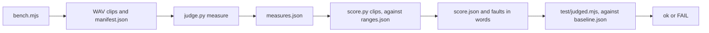

# ears: the sound judge

The engine's sound is judged here with nobody listening. Fixed benchmark clips are rendered from the synthesiser, measured, and scored against the range that well-made reference audio of the same kind lies in. Each fault comes out in words an ear would use ("thin: no low end", "hissy: reads as white noise"). `test/judged.mjs` turns that into a check that fails when the sound gets worse.

How the sound engine works, and the judge's place in it: [guide/sound.md](../../guide/sound.md). How each measure was proven and what none of them can see: the [sound-judge skill](../../.agents/skills/sound-judge/SKILL.md).



## Setup

The judge is Python 3.12 managed by [uv](https://docs.astral.sh/uv/). `pyproject.toml` lists numpy, scipy, soundfile, librosa, pyloudnorm and matplotlib; `uv.lock` pins them. The rendering side needs the engine's Node packages (`npm ci` in `engine/`).

```sh
uv sync
```

This makes `.venv/` here (ignored by git). Without uv the check fails; it never passes silently.

## Run it

The check, from `engine/`:

```sh
cd ..
node test/judged.mjs                      # render, measure, score, compare with baseline.json
node test/judged.mjs --keep /tmp/judged   # keep the clips and score.json there
node test/judged.mjs --accept             # take the new scores as the baseline, on purpose
```

The same steps by hand, from this folder, to see every fault and compare two versions:

```sh
node bench.mjs --out /tmp/before
uv run python judge.py measure /tmp/before
uv run python score.py clips /tmp/before --json /tmp/before/score.json
# change the engine, then render, measure and score /tmp/after the same way
uv run python compare.py /tmp/before /tmp/after
uv run python look.py /tmp/before/hit-wood.wav /tmp/after/hit-wood.wav --out /tmp/hit-wood.png
```

| Command | Flags | Does |
| --- | --- | --- |
| `node bench.mjs --out DIR` | `--only a,b` renders clips whose names start with those; `--held 1` renders the same clips from other seeds | renders every benchmark clip to WAV through `page/sound/dsp.ts` in Node, at 48 kHz, and writes `manifest.json` (names, kinds, event times). A mix is also written as `.world.wav` and `.music.wav` |
| `judge.py measure DIR` | `--kind K` for a folder without a manifest; `--out FILE` (default: measures.json in the folder) | measures every clip in parallel processes |
| `score.py clips DIR` | `--json FILE` keeps the scores; `--faults N` faults printed per clip (default 3); `--musiceval` uses the private calibration below | scores each clip and prints the table, its faults and the mean |
| `score.py ranges REFS` | | rebuilds `ranges.json` from a measured reference folder |
| `compare.py BEFORE AFTER` | | each clip's score before and after and what is out; `!!` marks a clip that got worse |
| `look.py A.wav B.wav ... --out PNG` | `--seconds S`, `--start S`, `--names "a,b"` | waveform, spectrogram on a log pitch axis and loudness over time, side by side |

Never tune on `--held 1` clips: they are there to show that a change did not just fit the benchmark's seeds.

## What the files are

| File | What it is |
| --- | --- |
| `bench.mjs` | the benchmark: which clips, how each is played (as `page/sound/sound.ts` places sounds and the conductor plays music), and their fixed seeds |
| `measures.py` | the measures. Level is read on the clip as it is; timbre and music on the clip brought to -23 LUFS |
| `judge.py` | runs `measures.py` over a folder |
| `score.py` | which measures apply to which kind of clip (`APPLIES`), the hard faults (`HARD`), the words for each fault, and the score: 100 less the mean cost of the measures that apply, less 25 per hard fault. A measure outside its range costs how far out it is in range widths, up to one |
| `ranges.json` | for each group of reference audio (`impact`, `step`, `break`, `blast`, `oneshot`, `bed`, `music`, `mix`, `instrument`, `tone`), how many references it has (`n`) and, for each measure, `[low, high, median]`: the 5th and 95th percentile when there are eight or more references, the extremes otherwise |
| `baseline.json` | each benchmark clip's accepted `score`, the measures that were `out` of range, and its `hard` faults. Written only by `judged.mjs --accept` |
| `damage.json` | the damage study: good clips broken one way at a time, and which measures moved. Written by `validate.py damage` |
| `damage.py` | the ways to break a clip, each brought back to its first loudness |
| `validate.py` | proves measures before they are trusted: `damage REFS`, `people FOLDER`, `bury REFS` |
| `keep.py`, `people.py`, `pairs.py` | the private calibration: which measures to keep, a fit to human ratings of music, and blind before-and-after pairs |
| `compare.py`, `look.py` | before against after, as numbers and as pictures |

Hard faults in the public score are clipping (`clip_ppm`), a lopsided wave (`dc`) and a world event buried under the music (`heard_median`). Held tones (`tone`) are judged on hard faults only, and mixes on loudness, hard faults and whether events are heard, because no references of those kinds were gathered.

## How the check decides

`../test/judged.mjs` runs `bench.mjs`, `judge.py measure` and `score.py clips --faults 0` in a temporary folder, then fails if:

- a benchmark clip in the baseline was not rendered;
- any clip has a hard fault;
- a measure that was inside its range at the last accept is now outside it;
- a clip scores more than 1.5 under its accepted score;
- the mean score falls by more than half a point.

It runs in `npm run check` in `engine/` (`test/all.mjs`). The render is deterministic, so a new fault is the change's own. When a change moves the sound on purpose, run it with `--accept` and say in the pull request what moved.

## What stays outside the repository

The reference recordings and anything rated by people stay on the maintainer's machine. Only the derived ranges and the damage study are committed, so the check needs no reference audio.

- `~/.village/engine/ears/refs/`: the references, in folders named `music`, `sfx`, `beds` and `instruments` (the folder sets each file's kind), with `SOURCES.tsv` giving each file's source and licence. Rebuild the ranges with `uv run python judge.py measure ~/.village/engine/ears/refs` and then `uv run python score.py ranges ~/.village/engine/ears/refs`.
- `~/.village/engine/ears/musiceval/`: the private calibration that `score.py clips --musiceval` reads (its own ranges, the kept measures and the fit to human ratings). `keep.py` and `people.py fit` write there.
