# engine/workshop

When a model writes a rule, it also says what it could not do with what the engine offers. The workshop turns one of those gaps into a development session that builds the missing [engine plugin](../../guide/engine-plugins.md#a-plugin) and opens a pull request. It runs on the helper, and only the owner of the machine the helper runs on can use it, from inside the game.

```mermaid
flowchart LR
  Rule["make/rules.mjs<br/>a rule and what it could not do"] --> Gaps["~/.village/engine/cannot.jsonl<br/>and the server's GET /gaps"]
  Gaps --> Card["page/workshop.ts<br/>a card per gap"]
  Card -- "POST /workshop/brief" --> Brief["the brief, shown whole"]
  Brief -- "POST /workshop/send" --> T3["t3 thread start<br/>a session in its own worktree"]
  T3 --> PR["a pull request"]
  PR -- "merged, then plug.mjs" --> Game["the game picks up the plugin"]
  Game -- "if the owner said yes" --> Again["the rules that wanted it, asked again"]
```



## Files

| File | What it does |
| --- | --- |
| `route.mjs` | The helper's `/workshop/` routes, the fixed brief (`briefFor`), starting the session through T3 Code, and following it to a merge |
| `../page/workshop.ts` | The chip and the cards in the game |
| `../make/rules.mjs` | Writes each rule's gaps to `cannot.jsonl` and to the server (`POST /world/gap`) |

## Routes

All three answer only through the helper's own door on this machine: its own host name, the world's own page and the helper's secret. Through the tailnet door they refuse everyone, the helper's own person included.

| Route | What it does |
| --- | --- |
| `GET /workshop/gaps` | The gaps, newest first. The same line from several asks is one gap, with a count and who asked. |
| `POST /workshop/brief {gap}` | The brief a session would be given, to be read. Nothing starts. |
| `POST /workshop/send {brief, again}` | Starts the session with exactly that brief, by the token the brief came with. `again: true` is the owner's yes to asking the rules that wanted it again once the plugin is in. A gap is sent once. |

## What keeps it safe

- **Two steps.** "Send to the workshop" only shows the brief. "Start the session" sends that very brief.
- **Fixed words.** The brief's instructions are `briefFor`'s own, the same every time. What a player typed and what a model said are four quoted lines under a line that says they are data, cleaned of control characters and of the quote's own marks.
- **Nothing anyone wrote reaches the command.** The title and the branch (`feature/264-plugin-<gap id>`) come from the gap's id. The command is `t3 thread start --json --title ... --worktree origin/main --branch ... <project> -`, with the brief on its input.
- **Nothing loads until merged.** A session works in a worktree of its own and opens a pull request. No game loads its code until that pull request is merged to main and the game is told to look (`node plug.mjs`). Merging stays a person's act.

## Run it

Run commands from `engine/`:

```sh
node serve.mjs --port 5801 --world ~/.village/engine/workshop/try.log
node helper.mjs --world http://127.0.0.1:5801 --workshop-provider claudeAgent --workshop-model claude-opus-5-5
```

Open the address the helper prints. The "Workshop" chip in the game counts what is waiting.

| Helper flag | What it sets |
| --- | --- |
| `--workshop-project` | The T3 Code project a session starts in. Default: the checkout this repository's worktrees hang from. |
| `--t3` | T3 Code's command. Default: `~/.t3/bin/t3`. |
| `--workshop-provider`, `--workshop-model` | Which provider and model a session runs on. Needed when the project in T3 Code has no default. |
| `--workshop-checkout` | The checkout the game's server runs from. When a session's pull request is merged, that checkout's plugins are brought to main first, as `node plug.mjs --at` does. |

## Where a sent gap is

The helper follows each sent gap every 30 s and writes every step to `~/.village/engine/workshop/sent.jsonl`, so a helper started again carries on.

| State | Meaning |
| --- | --- |
| `started` | A session is building it |
| `open` | Its pull request is open (found with `gh pr list --head <branch>`) |
| `closed` | Its pull request was closed without a merge |
| `merged` | Merged; the game is told to look at its plugins |
| `in` | The plugin loaded in the game |
| `asked` | The rules that wanted it (up to three) were asked again in the asker's own words |

## Check it

```sh
node test/workshop.mjs    # who may, the two steps, the quoted brief, the card in a real page; T3 Code is stood in for
```

No session is started by the check.
