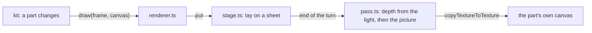
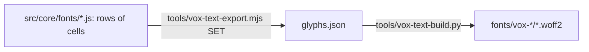

The [kit](/kit) describes every control as a model of small cubes. `engine/blocks` is the renderer that turns those cubes into pictures: a small WebGPU program, separate from the world renderer, that draws each control into its own canvas when it changes and does nothing at rest. The Vox fonts are the kit's lettering drawn from the same cell grids, so a word on a key is cut from the same cells as the key.

## The renderer at a glance



| File | What it is |
| --- | --- |
| [`pass.ts`](https://github.com/voxelwright/voxelwright/blob/main/engine/blocks/pass.ts) | The block pass. Draws laid parts in two render passes: every part's depth as the light sees it, then every part's picture. Used by both the page stage and the world. |
| [`stage.ts`](https://github.com/voxelwright/voxelwright/blob/main/engine/blocks/stage.ts) | The page stage. One GPU device and the block pass, and nothing of the world: no sky, no ground, no frame loop. |
| [`renderer.ts`](https://github.com/voxelwright/voxelwright/blob/main/engine/blocks/renderer.ts) | The kit's renderer on the page stage: `renderer()` resolves to an object with `draw(frame, canvas)` and `ownsCanvas: true`, or to `null` where there is no WebGPU or no adapter. |
| [`world.ts`](https://github.com/voxelwright/voxelwright/blob/main/engine/blocks/world.ts) | `stand(stage, kit, where)` stands a panel of kit parts inside a 3D world, drawn with the world's camera, depth and sun. |
| [`serve.mjs`](https://github.com/voxelwright/voxelwright/blob/main/engine/blocks/serve.mjs) | A local server for the kit's showcase on this renderer and for the renderer's own check page. |

## How a part reaches the screen

1. The kit builds a part's model and calls `draw(frame, canvas)` once whenever that part changes. The `Frame` holds the cubes as flat arrays plus the light, the projection and the picture's size (see the table below).
2. `stage.put` lays the part on a sheet, a texture of at most 1024 pixels each way unless one part is larger, and queues a flush for the end of the current turn. Parts put in the same turn share sheets. A part put twice in one turn is drawn once, as it was last put.
3. The flush runs the block pass on the sheet, then copies each part's area into its own canvas with `copyTextureToTexture`. No pixel comes back to the page's thread.
4. Each part's canvas keeps its picture until it is drawn again, so at rest nothing runs.

The block pass makes five pipelines and uses them in two render passes:

| Pass | Pipeline | What it does |
| --- | --- | --- |
| Depth from the light | `shadowPipe` | Every laid part's cubes into one 2048 by 2048 depth map, each part in its own region. |
| The picture | `pagePipe` (page only) | Writes the page plane into depth alone, so what sits below the page is hidden except through a well. |
| | `groundPipe` | The part's shadow on the transparent page. |
| | `facePipe` | The cubes: tones per face, ambient occlusion in the corners, a bevel band and seam on each edge, shadows read from the depth map. |
| | `haloPipe` | Halos round cubes that glow, when the light's glow is above zero (always at night, and by day in the lit look). |

In a page the picture is drawn at four samples a pixel and resolved, with a cabinet projection: a cube's front face lands on whole pixels and height shows as a shift right and down. Nothing goes through a tone curve, so a material's front face comes out as the colour it was given. In the world (`world: true`) the picture is one sample a pixel, tested against the world's depth, and its colours are written at 0.8 so that white stays under the glow of the world's last pass.

| `Frame` field | Per cube | Meaning |
| --- | --- | --- |
| `pos` | 8 floats | Centre, size and rotation (a quaternion). |
| `col` | 4 floats | Colour and glow. A negative glow means no seams. |
| `ao` | 2 words | Corner occlusion, two bits a corner. With `surfaceBytes: true`, bits 16 to 23 of the second word scale chamfer and seam, and bits 24 to 31 scale specular. |
| `normals` | 4 bytes, optional | A surface normal and blend weight. |
| `groundSoft` | per part, optional | Ground-shadow filter radius in voxels, clamped to 0 to 2. |

The kit's lit look sets `groundSoft` and per-material finishes (`finishes` in `engine/kit/src/looks/lit.js`), and the kit's stage turns `finishes` into `surfaceBytes: true` on every frame it hands over.

## Losing the device

A lost GPU device takes every picture with it. The stage drops what was waiting, tries to open a new device up to three times (waiting one, then two seconds), and then calls `onrestore`. The kit answers by drawing every part again. If no device can be opened it calls `onfail`, and the kit gives every part back to plain CSS and dispatches `vx-plain` on the document.

<Note>
A part is never shown live without something that can draw it. When a page hands the kit `use(renderer())` and it resolves to `null`, the page stays plain CSS and no canvas is added. On the kit's default path the order is: the WebGPU renderer, then the kit's WebGL2 stand-in when that resolves to `null` or the browser has no WebGPU, then plain CSS when there is no WebGL2 either.
</Note>

## Who uses it

| Caller | How |
| --- | --- |
| The kit's default | `engine/kit/src/engine.js` re-exports `renderer`. `adopt()` asks for it on first use when `navigator.gpu` exists. If it resolves to `null` the kit's own WebGL2 renderer (`engine/kit/src/core/gl.js`) stands in. A root with `data-vx-plain` asks for nothing. |
| Engine pages | Pages under `engine/page` import the kit's `engine/kit/src/index.js` and call `adopt`, so they take the default path. |
| The site | `site/static/site.js` calls `use(renderer())` itself, or `use(null)` for a plain page, so a browser without WebGPU gets the plain page and never the WebGL2 stand-in. `site/generator/kit.mjs` bundles `blocks/renderer` beside the kit. |
| Built folders | `npm run player` (in `engine/`) writes the renderer as plain modules, and `engine/sf/build.mjs` requires them for the San Francisco release. `copyModules` in `engine/kit/browser.mjs` writes the same files for any static host. |
| The landing world | `engine/landing/landing.ts` imports `world.ts` and stands a panel when the address has `?kit=`. |

## Why one canvas per part

The renderer says `ownsCanvas: true`, and the kit then hands it each part's canvas instead of a 2D context. Each canvas gets its own `GPUCanvasContext` on one shared device. The two other routes do worse:

- Drawing into one hidden canvas and copying with `drawImage` makes the page's thread wait for the GPU on every part in Safari, and with a source rectangle it copies the wrong pixels.
- One canvas under the whole window redraws everything on every change and cannot put cubes between two layers of HTML, such as a dialog over a card.

The measurements and other WebGPU traps are in the `raw-webgpu` skill, under "Many small transparent pictures in a page" ([SKILL.md](https://github.com/voxelwright/voxelwright/blob/main/.agents/skills/raw-webgpu/SKILL.md)).

## What it costs

| Resource | Size |
| --- | --- |
| Code | `renderer.ts`, `stage.ts`, `pass.ts` and `probe/gpu.ts`: about 53 KB with types stripped, about 15 KB brotli. `world.ts` adds about 7 KB (2.3 KB brotli). |
| Depth map | One 2048 by 2048 `depth32float` texture, 16 MB, made on first draw. |
| Cubes | 60 bytes a cube of room, 16,384 cubes to start. A single larger part, or `reserve` in the world, grows it to the next power of two. |
| Pictures | Sheets and four-sample scratch textures, each kept for the last four sizes asked for. |
| A lot | 64 parts per draw (the uniform slots). In a page the stage flushes and starts a new lot; in the world the rest of a panel is left out with a warning. |
| At rest | Four seconds after the last draw the stage lets go of its sheets, scratch textures and the depth map. |

The renderer's check, `engine/test/blocks.mjs`, reports the memory it sees: on the last run, about 69 MB held while drawing and 0.9 MB after the rest.

## In the world

`stand(on, kit, where)` reads the kit's stylesheet and modules from `kit` (same origin only), lays the panel's HTML out in a hidden element, and hands the kit a renderer that keeps each part's frame instead of drawing it. Each world frame, one of the stage's `passes` lays every kept part with a matrix built from the panel's position and the camera, and draws them into the world's colour and depth. The kit's light is turned to the world's sun and mixed between day and night by the hour.

What it does not do yet: HTML words (a button's label) are not drawn, only voxel lettering and icons; nothing on the panel can be pressed; the world's shadows do not fall on the panel and it casts none; every cube is sent to the GPU again every frame.

## Check it

```sh
cd engine
node test/blocks.mjs
```

It drives `proof/check.html` in Chrome with real WebGPU and checks face colours, edge lighting under rotation, seams, finish bytes, ground softness, that parts drawn together match parts drawn alone, the page hiding what is under it, release at rest, and device loss. The engine's `npm run check` runs it as `blocks`.

To see the kit's showcase drawn by this renderer:

```sh
cd engine
node blocks/serve.mjs      # http://127.0.0.1:5990/kit/showcase/
```

The [folder README](https://github.com/voxelwright/voxelwright/blob/main/engine/blocks/README.md) has the server's flags.

## The Vox fonts

Type in the kit has three roles: lettering built from voxels (signs and headings), legends on keys (a Vox web font laid on the key's face), and reading text in IBM Plex Sans and IBM Plex Mono. Every Vox face is a glyph set in `engine/kit/src/core/fonts/`, written as rows of `#` and `.` cells. The kit draws lettering in voxels from those sets directly. The same sets are exported as web fonts, so plain headings and the words on keys use the identical shapes.

| Face | Glyph set | Cells | Used for |
| --- | --- | --- | --- |
| Vox Block | `block.js` | Capitals 11 cells tall, two-cell stroke | Signs and voxel headings. Inlined in the stylesheet so a heading has the same box with and without voxels. |
| Vox Sign | `sign.js` (registered as "Vox Sign 2") | Capitals 7 cells tall | The fallback when a column is too narrow for Vox Block. Inlined like Vox Block. |
| Vox Text | `sentence.js` (the Vox Sentence set) | Capitals 7, x-height 5, lowercase | Legends on keys (`--vx-key-font`), weights 400 and 700. |
| Vox Zakon | `zakon.js` | Capitals 11 cells tall | A second display face, drawn after Zakon in the same grid. |
| Vox Zakon Text | `zakon-text.js` (`zakontext`, `zakontextbold`) | Capitals 7, x-height 5 | Key legends in the San Francisco realm, which sets `--vx-key-font` to it in `engine/page/typeface.ts`. The bold is drawn, not smeared. |

`zakon-text.js` also holds `zakoncaps`, a compact capitals set the realm draws in voxels; it has no web font. Latin and Ukrainian are drawn in every set; letters shared with Latin are aliases, not copies.

The other folders in `engine/kit/fonts/` are typefaces from the type study (`engine/kit/showcase/type.html`). The kit's stylesheet does not load them.

### How a font is built



`vox-text-export.mjs` writes a set's metrics, glyph rows and kerning pairs as JSON. `vox-text-build.py` turns every cell into a square of outline at 100 units, on a 1000-unit em, so the font is ten cells to the em: one cell is 2 px at 20 px. It needs Python with `fonttools` and `brotli`.

```sh
cd engine/kit
node tools/vox-text-export.mjs sentence > glyphs.json
python tools/vox-text-build.py glyphs.json fonts/vox-text "Vox Text" vox-text --bold
```

| Flag | Effect |
| --- | --- |
| none | Writes the 400 weight only (`STEM-400-normal.woff2`). |
| `--bold` | Also writes a 700 made by smearing every cell one to the right, with hand-drawn exceptions for glyphs whose strokes would close. |
| `--as-bold` | The set is already a bold: writes it as the 700 alone. |

Each font folder's README has the exact commands for its files. Vox Block and Vox Sign are also inlined in `engine/kit/css/_kit.css` as data URIs; `engine/kit/tools/type-inline.py` writes those.

### Licence

The Vox fonts are under the SIL Open Font License 1.1, with the copy in each folder's `OFL.txt`. The reserved font names are "Vox", "Vox Block", "Vox Sign", "Vox Sign 2", "Vox Sentence", "Vox Text", "Vox Zakon", "Vox Zakon Text", "Vox Zakon Text Caps" and "Vox Zakon Text Bold". A modified version must be renamed. The kit's code is Apache-2.0 (`engine/kit/LICENSE`), and the keyboard recordings are MIT (`engine/kit/src/core/audio/LICENSE`). `engine/kit/NOTICE` lists all three.
