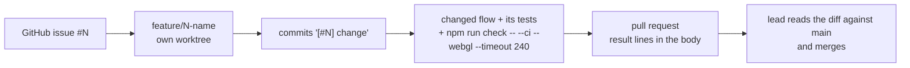

AI agents write most of this repository. One lead agent decides what to build, splits the work, starts a builder agent for each unit and merges the results. The owner sets direction and judges the results by looking and listening. The rules are in [AGENTS.md](https://github.com/voxelwright/voxelwright/blob/main/AGENTS.md). Where this page disagrees with it, AGENTS.md wins.

## Concepts

- **Lead.** The agent that routes work. It follows the playbook in `.agents/skills/lead-orchestration/SKILL.md`: take stock, split work by file, write a brief, land, look closely at the output.
- **Builder.** An agent given one unit of work, in its own git worktree and its own feature branch, with a stop condition and a time box.
- **Brief.** The builder's only context: repository, branch, current state with numbers, numbered tasks, the commands that prove the work, files that are off limits and a reply format.
- **Skill.** A versioned `SKILL.md` under `.agents/skills/<name>/` that holds what was learned about one technology or practice, from primary sources and short experiments. A new dependency needs one (`.agents/skills/technology-grounding`). An agent loads the skill for the area it changes before changing it.
- **Dispatch log.** The local file `.agents/dispatch-log.jsonl`, one JSON line per agent started, with its role, issue, task, provider and model. `.claude/hooks/dispatch-log.mjs` appends a row for each T3 delegation. It is the first dataset for routing work to models.
- **Gate.** What must pass before a change lands: the changed flow run by hand, its own tests, and `npm run check -- --ci --webgl --timeout 240` on the branch merged with main.

## A change, from issue to main



1. Work is tracked in a GitHub issue. The branch is `feature/<issue>-<name>`. Commit subjects are `[#<issue>] <change>`.
2. Run the flow you changed, then its own tests. Each part has its own: `npm run check` in `engine/` (core tests, types and page checks in Chrome), `npm test` in `site/`, the Python tests in `engine/bay`. [CONTRIBUTING.md](https://github.com/voxelwright/voxelwright/blob/main/CONTRIBUTING.md) lists the command for every part.
3. Merge current main into the branch and run the root gate from the repository root: `npm run check -- --ci --webgl --timeout 240`. Put its result line in the pull request.
4. GitHub runs the check workflow on pull requests and pushes to main. Include the local Mac result in the pull request.
5. Reviews are a tool, not a gate. Run `.agents/skills/adversarial-review` when you expect it to find something: a change you cannot fully test, a format others will build on, anything that touches real people's data.

A mocked provider or a saved model reply proves the pipeline, never a model integration. Say which one you ran.

## The root check runner

`scripts/check.mjs` runs the checks listed in `scripts/checks.mjs` with free ports and one shared dev server, at most four at a time. `--ci` skips checks marked local-only, and `--webgl` runs Chrome with software WebGL2. Logs are written to `.check/<name>.log`. [Repository checks](/checks) lists every check and [Check runner](/check-cli) its options; both pages are generated from those files. The list covers the documentation and the paused Village folders (`home/`, `host/`, `street/`). It runs none of the engine's, kit's, master's, site's or deploy's own tests.

## The documentation gate

Every guide page, README and skill is bound in `guide/bindings.json` to the source surfaces that would make it false. `node scripts/docs.mjs` (the `docs` check) hashes each surface and compares it with the page's stamp in `guide/stamps.json`. A changed surface turns the page red until someone reads the change and re-verifies the page in the same pull request. The gate also checks that every path, link, command and flag a page mentions exists. The `docs-coverage` check fails a branch that changes a component's source without touching any of its pages, unless a `Docs-unchanged:` line says why. The `docs-site` check builds `guide/` with the Mintlify CLI. See [Keeping a page current](/documentation).

The gate proves agreement with the bound surface. It does not prove that a sentence explains the code well. For behaviour a reader relies on, a page can carry a runnable example, as [Drawing from a page plugin](/render-passes) does.

## The first hour

For a person:

1. Run `./world` from the repository root ([Walk San Francisco](/quickstart)).
2. Read the [project map](/project), then the page for the part you will change: [the engine](/engine), [worlds as cells](/cells), [the city pipeline](/city-pipeline), [making](/making) or [the kit](/kit).
3. Read that part's README for commands, and its skill under `.agents/skills` for what was learned the hard way.

For an agent, before changing code:

1. Read [AGENTS.md](https://github.com/voxelwright/voxelwright/blob/main/AGENTS.md). Read [DESIGN.md](https://github.com/voxelwright/voxelwright/blob/main/DESIGN.md) before UI work.
2. Read the guide page for the part and its bound sources. The bindings in `guide/bindings.json` show which files the page's claims rest on.
3. Load the skill for the technology you touch, and check its facts against the code. A skill records what was true when it was verified.
4. Make the change with its docs in the same pull request. Run `node scripts/docs.mjs`. If a page you did not expect turns red, the change made a claim false: fix the page or the change.

## Machine hygiene

Builders leave a git worktree each. `scripts/hygiene.sh` removes the finished ones on the maintainer's Mac and warns when the disk runs low.

```sh
scripts/hygiene.sh --dry-run     # print what would be removed, change nothing
scripts/hygiene.sh --install     # copy to ~/.village/bin and run it hourly with launchd (village.hygiene)
scripts/hygiene.sh               # remove finished worktrees, prune, check the disk
```

It looks in `~/.t3/worktrees/Village` for worktrees of the checkout at `~/Developer/Village`. Set `VILLAGE_WORKTREES` and `VILLAGE_REPO` to point it elsewhere. A worktree is removed only when all of these hold:

- It has no modified files, and no untracked files apart from `node_modules`, `dist`, `target`, `.venv` and `__pycache__`.
- Its HEAD is merged into origin/main, or its branch is gone on the remote, or it is on a pushed branch and nothing in it changed for 3 days.
- Nothing in it changed in the last 2 hours.
- It is not under `feature-450-*`, not locked, and no running process has a file or working directory inside it.

A HEAD that no branch contains is kept as `refs/backup/wt-<name>` first. Below 60 GiB free it posts a notification. Each removal and disk alarm is logged to `~/.village/hygiene.log`. Rerun `--install` after changing the script.

## Check a change to this process

```sh
node scripts/docs.mjs                       # every page against its sources
node scripts/docs.mjs mentions              # paths, links and commands only
node scripts/doc-coverage.mjs               # every changed component has a reviewed page
npm run check -- --list                     # every check and whether CI runs it
```
