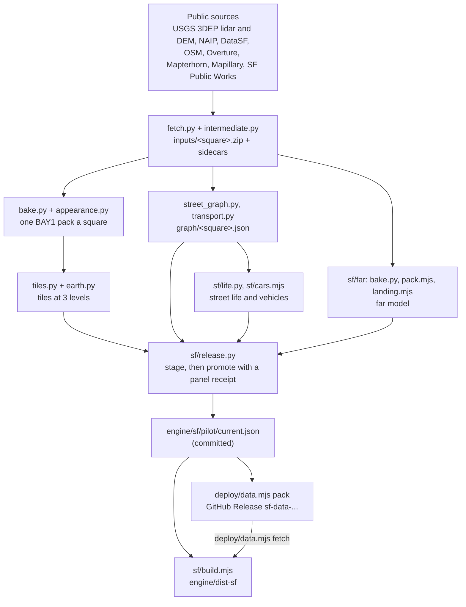

San Francisco in the engine is baked from public data. Python scripts in `engine/bay` fetch the sources for each 1 km square, bake each square into a pack, and cut the packs into tiles. `engine/sf/release.py` stages the tiles, street graphs, street life, vehicles and far model as one content-addressed release. `engine/sf/build.mjs` turns the pinned release into a static realm that any file host can serve. The files each stage writes are specified in [the San Francisco release](/sf-release).

Raw and baked data live under `~/.village/engine`, never in git. Git holds the code, the square inventory ([sf-squares.json](https://github.com/voxelwright/voxelwright/blob/main/engine/bay/sf-squares.json)), the pin (`engine/sf/pilot/current.json`), a copy of each pinned manifest and `deploy/data.json`.

## Squares

`sf-squares.json` lists every 1 km square that touches DataSF's shoreline polygons: 155 squares with lidar (`lidar`) and 11 made from planet data (`planet`), offshore islands among them. A square is named by the kilometres of its south-west corner in UTM zone 10N, for example `551.7_4183.5`. `coverage.py` regenerates the list from DataSF and the USGS lidar project, and records a hash of each response.

The release pinned now names all 155 lidar squares. Around the county, the run cuts planet tiles from Overture and Mapterhorn out to 500 m, 4 km and 16 km at the three levels (`RADIUS` in `coverage.py`). The inventory's `landmarkExtras` lists the additional tiles needed to walk up to landmarks outside those bounds, including the Marin approach to the Golden Gate Bridge. The six-square pilot omits the surrounding planet tiles.

## Stages



| Stage | Reads | Writes |
| --- | --- | --- |
| `engine/bay/fetch.py SQUARE` | EPT lidar, the 1 m DEM, NAIP imagery and DataSF layers (`EPT`, `DEM`, `NAIP`, `SF`, `LAYERS` at its top) | Raw downloads under `~/.village/engine/bay/raw/<square>/` |
| `engine/bay/intermediate.py` | The raw downloads | `inputs/<square>.zip`: quarter-metre lidar grids, the 1 m ground, imagery and the DataSF layers in EPSG:26910 |
| `engine/bay/street_sources.py`, `street_detail_sources.py` | OSM, DataSF, San Francisco Public Works, Mapillary | Gzip JSON sidecars beside each ZIP: OSM geometry and business categories, extra outlines and parcel facts, stop signs, street fixtures |
| `engine/bay/bake.py` and `appearance.py` | One square's archive (restored to `raw/<square>/`) and sidecars | One `BAY1` pack for the square, with wall colours, facade cues, despiked roofs and sidewalk canopy/trunk cleanup (`clean_canopy_grid`, also enforced at L0 load in `engine/core/src/bay.rs`), off-road-snapped street fixtures (`street_furniture.py`), and its names file |
| `engine/bay/street_graph.py` | One square's street sidecar | `graph/<square>.json`, the routable [street graph](https://github.com/voxelwright/voxelwright/blob/main/engine/sf/streets.md) |
| `engine/bay/transport.py ROOT OUT` | The graphs, a city-wide OSM tag extract, DataSF stop signs and signals | The graphs with road levels and traffic controls added |
| `engine/bay/tiles.py` | Packs. `earth.py` makes tiles from Overture and Mapterhorn where no square reaches. | Tiles at level 0 (250 m), level 1 (1 km) and level 2 (4 km), each a `BAY1` pack, and `index.json` |
| `engine/sf/life.py` | Street graphs and land use | `<square>.json` for walking, driving, parking, rails and signal heads, `transit.json`, and `index.json` |
| `engine/sf/cars.mjs OUT` | The kept-car shelf and the hand-built fleet (`engine/sf/fleet.mjs`, including the sculpted Waymo Ojai robotaxis from `engine/page/ojai-sculpt.ts` & `engine/page/robotaxi-services.ts`, and the GT coupe from `engine/page/car-sculpt.ts`) | The vehicle library: each car's finest look cleaned (`engine/sf/sculpt-cars.mjs`: specks off, pinholes and edge leaks sealed, nubs smoothed), coarser looks that keep their shells, repaint variants and `index.json`. `engine/sf/car-shots.mjs` draws each car close up for before-and-after checks. |
| `engine/sf/far/grow.sh` | The square archives | The far model's faces, packed into far tiles and their listing ([far README](https://github.com/voxelwright/voxelwright/blob/main/engine/sf/far/README.md)) |
| `engine/sf/release.py ROOT OUT` | `full_run.py`'s verified output, and optionally the far model, street life, cars and an accepted paint batch | A staged release under `OUT/releases/<sha256>/`. With `--panel RECEIPT` it also moves `OUT/current.json`. |
| `engine/sf/build.mjs` | The release pinned in `engine/sf/pilot/current.json`, the city's street graphs, neighborhood storefronts & plazas (`engine/sf/places.mjs` over `engine/sf/places-raw.json.br`, `engine/sf/brands.json`, `engine/sf/plazas.json`), map places (`engine/sf/map.mjs`, including every registered robotaxi station and featured plazas/parody anchors), and a kept car | `engine/dist-sf`: the page's modules with types stripped, the realm's record from `engine/sf/realm.json`, the release, the road marks, neighborhood places (`<out>/bay/places.json`), 3D map (`<out>/bay/map.bin`), and a Brotli copy beside every file |
| `deploy/data.mjs pack` | The pinned release and the other build inputs under `~/.village/engine` | A bundle uploaded as GitHub Release `sf-data-<16 hex>`, and `deploy/data.json` |
| `deploy/data.mjs fetch` | `deploy/data.json` and the bundle | The same files restored under `$HOME/.village/engine`, each checked by length and SHA-256 |

`engine/bay/full_run.py` runs fetch, the inputs, bake, appearance, street graphs and tiles as checkpointed tasks. Each finished task records SHA-256 checksums in `state.json`, and a restart checks them again. A changed recipe needs a new output directory. `engine/bay/run-city.sh start` runs the whole city as a detached job on the bake machine and stages its release when the tiles are done. [engine/bay/README.md](https://github.com/voxelwright/voxelwright/blob/main/engine/bay/README.md) is the operator's guide.

## Street life and street paint

Two things in the realm come from the street graphs rather than the tiles:

- **Street life.** `life.py` cuts each graph down to what people walk and cars drive, with how busy each pavement is from nearby land use, parked-car places and signal heads. `cars.mjs` writes the kept vehicles. Both go into the release as its `life` and `cars` sections, and `page/street.ts` reads them.
- **Street paint.** Lane lines, centre lines, crossings and rails are drawn by the march as lines over the asphalt (`page/marks.ts`), not as cells. `build.mjs` writes them to `<out>/bay/marks.bin` in its output folder, from the city's graphs with `sf/marks.mjs`, plus two committed files the graphs do not hold: `sf/street-tags.json` (rails by gauge, the grid's ways, tunnels and bridges, from `sf/street-tags.py`) and `sf/crossing-colours.json` (yellow and rainbow crossings, from `sf/crossing-colours.mjs`). The build fails without the graphs.

`build.mjs` also writes `<out>/bay/places.json` from `sf/places-raw.json.br` (extracted by `engine/bay/places_sources.py` from Overture Maps Places, OpenStreetMap plazas/benches/POIs including street-level urgent care clinics, DataSF Recreation & Parks `gtr9-ntp6`, and local building footprints) combined with two user-editable config files: `engine/sf/brands.json` (GTA-style parody names, sign palettes, and per-place overrides for trademarked big chains) and `engine/sf/plazas.json` (town-square and civic plaza archetypes and hero profiles such as Noe Valley Town Square). Editing either config and running `node engine/sf/build.mjs` or deploying automatically regenerates all storefront signs, plaza architecture, gathering crowds, and map POIs in `<out>/bay/map.bin`.

`build.mjs` also writes `<out>/bay/map.bin` for the minimap and GPS from the release's tiles, the graphs, and the compiled neighborhood POIs (`sf/map.mjs`).

## Pins and what is committed

Two small files tie a checkout to its data:

- `engine/sf/pilot/current.json` names the release this checkout's realm uses: `{version, release, manifest}`. Moving it is the change that ships new city data.
- `deploy/data.json` names the bundle that holds that release for machines without `~/.village`: `{pin, digest, tag}`. `fetch` refuses a record whose `pin` is not the release in `current.json`, and a bundle whose index does not hash to `digest`.

`./world` (the [quickstart](/quickstart)) runs `engine/core/build.mjs`, `deploy/data.mjs fetch` and `engine/sf/build.mjs` in that order, with `HOME` set to `.voxelwright` in the checkout so the realm uses only its pinned inputs. Then it serves `engine/dist-sf` on port 5760.

To build a staged candidate before it is pinned, run `node engine/sf/build.mjs --staged STAGE`, where `STAGE` is the folder holding its `current.json`. To bundle it without uploading, run `node deploy/data.mjs pack-local PIN DIRECTORY`.

A bake machine that already has the pinned bundle can restore its street graphs, vehicles and other shared inputs with `node deploy/data.mjs fetch /path/to/data.tar`. An explicit archive is verified even when a previous restore is available.

## Promotion

A release with new tiles must pass a visual panel before its pointer moves. `release.py` stages a candidate and prints its digest. A person or agent scores the 16 fixed cameras in `engine/bay/neighbourhoods.json` against reference photographs, at street level and at 100 m. `--panel RECEIPT` moves the pointer only when no score falls below the previous pin or the floors in `engine/bay/panel-floors.json` (`check` in `engine/bay/panel_gate.py`). A restock that changes only street life, vehicles or the far model keeps the tiles, so it needs no panel. [Cut a new release](/sf-release#cut-a-new-release) lists the steps.

## Licences

Every layer keeps its own terms, listed in [DATA-LICENSES.md](https://github.com/voxelwright/voxelwright/blob/main/DATA-LICENSES.md). Rules for all of it are in the `bay-sources` skill (`.agents/skills/bay-sources/SKILL.md`):

- Requests carry a generic client name and no personal detail.
- A source that needs a key is not used until the owner provides one. Keys live under `~/.village/engine/bay/keys/`, never in git or a log.
- Layers derived from Mapillary (CC BY-SA) stay separable and keep their image credits.

The shipped city includes public street lamp positions and trolley wire paths from San Francisco Public Works, whose layer records state no licence. The owner chose to include them. `--no-public-works-fixtures` bakes lamps and wires from OSM alone; start a fresh output directory when switching. Adding a source means adding its row to `DATA-LICENSES.md` and to the skill, with how its terms were checked.

## Landmarks, ordinary houses and multi-city fidelity

For a new city, start with parcel and terrain coverage. Use measurements to decide where the general building rules need a local correction.

1. **Map tags and terrain.** `earth.py` reads façade and roof colours, materials and roof shapes where Overture or OpenStreetMap supplies them. These tags can describe a hipped or domed roof, glazing or a living roof. `street_sources.py` and `street_detail_sources.py` retain mapped water and garden boundaries. `street_detail.py` uses the shoreline to place water on the terrain, including basins above sea level.
2. **Ordinary houses.** `core/src/bay.rs` carries windows around faceted bays and recessed porches and recognises bays already traced in a footprint. `street_detail.py` and `page/march.ts` use the available material evidence for surfaces such as painted stucco. Footprints and lidar establish positions and heights. Exact window layout, wall colour and door position need a photograph matched to the parcel. For a measured wall colour or finish, check the proposed field on a separate street photograph. Supply the reviewed fields and their solved camera positions with `release.py --facades FILE`. The [release procedure](/sf-release#bay1-a-tile) describes how the fields reach a near tile.
3. **Landmarks.** Register the footprint, source and parts in `sf/heroes.json`. The rules in `core/src/heroes.rs` draw features such as arches, ribbed domes, pagoda eaves and arched footbridges. Give each part only the area it occupies. Fort Point sits beneath the Golden Gate Bridge’s south arch. The Japanese Tea Garden leaves its mapped Gift Shop and Temple Gate to the ordinary building layer. The Dry Landscape Garden’s gravel bed and two interior features follow the park’s site plan, fitted to six mapped landmarks. Their relief and materials are estimated from the operator’s photograph. The Botanical Garden leaves its County Fair Building and ticket kiosk there too. Near and distant ground share the mapped shorelines. Use `sf/landmark-tiles.mjs` to include the terrain at both ends of a bridge.

Test a general house rule on streets outside the block used to develop it. Include low porches, party walls or gaps, and a flat roof. Compare the compiled heights at the same survey returns before and after, then check the street pictures and tile loading cost. On 36th Avenue a proposed citywide fit smoothed two pitched roofs but raised porch columns by more than four metres on another block. `node engine/sf/check-roof-fronts.mjs /path/to/tiles/0` reads the two corrected fronts and the independent Sunset and Mission controls from the release. The Mission flat-roof camera looks down on five of those survey points. The street camera looks across the façade below them.

The near-tile cutter uses measured cross sections for two pitched fronts on 36th Avenue. It matches a directed edge in each DataSF footprint and writes the contour into the half-metre height grid. The source records in `engine/bay/sf-roof-fronts.json` identify the corresponding OSM buildings and lidar square. [Northern footprint](https://www.openstreetmap.org/way/285266662) · [Southern footprint](https://www.openstreetmap.org/way/285266687)

## Place and check a landmark

Start with the footprint, ground datum and an identifiable feature in a survey or photograph. Register what was measured and what was drawn by eye in `sf/heroes.json`. Read a footprint with the aerial beside it. At the California Academy of Sciences the rectangular canopy measures about 161 by 102 metres. A 5.5-metre-wide walkway extends another 30 metres. Treating its bounding box as the roof used to cover part of the garden.

Check each part that gives a building its silhouette. The Conservatory’s two-tier Palm House rises about 18 metres above its terrace and the long galleries rise about 5 metres. The transverse galleries project toward the visitor at both ends. Its mapped flower borders follow the slope. The main walk rises 2.8 metres on eighteen stone treads. Its step count comes from OSM way 867911035 and the local lidar gives the two landing elevations. Four palms flank the walk at OSM nodes 10725865300–10725865303. The lidar fixes their heights and the park photograph shows the arch of their fronds. The near renderer replaces tall canopy returns around those trunks. The distant packer replaces the corresponding crown and bark faces. The seasonal border uses low foliage at the edges and isolated touches of flower colour on taller spikes toward the middle. [Gardens of Golden Gate Park exterior photograph](https://gggp.org/wp-content/uploads/2023/11/hero-cof.jpg)

At a bridge approach, pick the rendered surface over the gully and compare its elevation with the terrain tile. The Golden Gate’s northern trestle follows the midpoint of the two mapped US 101 carriageways. They bend toward the ocean 1,220 metres from midspan and meet the terrain at 1,413 metres, where the tile gives the road elevation as 73 metres. Check both the ground below the deck and the road surface at the landing.

For a broad roof, sample the original lidar in the landmark's own coordinate frame. This reproduces the Academy's five-metre grid. Each value is the median return over a two-metre patch, in decimetres above its datum. The aerial shows the large field of circular skylights over one dome and the smaller cluster over the other. [Architect's aerial photograph](https://www.fondazionerenzopiano.org/en/project/california-academy-of-sciences/image-717.pdf)

```sh
~/.village/engine/bay/venv/bin/python engine/bay/roof_samples.py \
  ~/.village/engine/bay/sf-450-city/inputs/546.7_4179.5.zip \
  'California Academy of Sciences' --u -65 65 --w -55 25 --spacing 5
```

Choose a separate grid between the samples used to build the roof. Compare the survey with the upward faces drawn by the compiled core. Run the same command with the previous core to check that it catches the original defect. Select a solid roof patch for each distinctive part, such as a low gallery or an observation deck. A missing face fails the check. The tolerance is in metres and should reflect the survey quality and cell size.

```sh
~/.village/engine/bay/venv/bin/python engine/bay/roof_samples.py \
  ~/.village/engine/bay/sf-450-city/inputs/546.7_4179.5.zip \
  'California Academy of Sciences' --u -62.5 62.5 --w -52.5 22.5 --spacing 5 \
  --compare-core engine/page/core.wasm --max-p90 1
```

Save a few independently sampled points for each roof section in `sf/landmark-roof-surveys.json`. Each row gives coordinates along and across the building’s local axis and the measured height above its registry foot, all in metres. Use the centre of the emitted cell and record the source square and tolerance. The engine’s `landmark-audit` check compares those points with the compiled surfaces on every full engine check. At City Hall this checks the wing ridges and the lower roof inside a light court. The dome, open lantern and finial also need an elevation or a street photograph because a top-down measurement cannot show the openings.

Keep a fixed review camera for each registered landmark in `sf/landmark-views.json`. For a photographic comparison, match the eye height and lens as well as the viewing direction. An optional sixth camera value gives the vertical field of view in degrees. The Conservatory’s central walk uses a standing eye and a 31.7-degree vertical lens. The end cupolas, entrance gable and stair corners in the park photograph constrain its framing. Use separate output directories for the pinned build and the candidate. The same command can draw the neighbourhood panel using its saved poses. It reads the actual release and renderer from the loaded page, waits for the near cells and distant mesh, and records both digests beside each PNG. The capture checks the vertical angle used to project the image against the registered lens.

```sh
node engine/sf/landmark-shots.mjs --dist "$BASELINE" --out "$SHOTS/before"
node engine/sf/landmark-shots.mjs --dist "$CANDIDATE" --out "$SHOTS/after"
node engine/sf/landmark-shots.mjs --dist "$CANDIDATE" --out "$SHOTS/panel" \
  --poses ~/.village/engine/bay/450-panel/fixed-poses.json --hour 15
```

Check the upper floors of towers separately. The de Young's main galleries were within a metre of the lidar at half of the sampled locations, while the observation deck missed much of its footprint. The mapped floors shear between two parallel ends. The lidar fixes the top deck as a long parallelogram. [Architect’s drawings and photographs](https://www.herzogdemeuron.com/projects/173-de-young-museum/)

When a landmark appears to have another building in front of it, pick the visible wall in the running renderer and compare it with the mapped parcel boundary. At the Ferry Building the entrance fell 2.7 m outside the old landmark rule. The survey outline now includes the three entrance arches. From the plaza a tree obscures part of one wing, so a second camera checks the full arcade. [Ferry Building frontage photograph](https://www.ferrybuildingmarketplace.com/wp-content/uploads/fb-about-main.jpg)

Check individual outlines within an architectural row. At 722 Steiner the survey distinguishes a two-metre square bay and a taller angled bay on either side of a recessed entrance. Copying the façade from the six neighbouring houses put one face 1.3 metres into the street. [Corner footprint](https://www.openstreetmap.org/way/261412887)

For one place add `--place 'Golden Gate Bridge'`. A private server reached over a local tunnel can be captured with `--server http://127.0.0.1:PORT`. Compare the full-size frames alongside a reference with a known pose. Record which features the reference actually shows. For a rule shared by ordinary houses, repeat the comparison on a separate residential block and in a second neighbourhood. Include stoops, light wells, flat roofs and corners. Compare the heights of the same changed columns with the original survey, including places where a build emits no roof. On two Sunset blocks, smoothing a roof on one street put full-height posts over measured stoops on another.

For towers, check both edges of the silhouette against photographs from different bearings. Salesforce Tower’s survey returns include gaps between the crown’s screens. Compare its outer width separately from the area of its solid faces. The Ina Coolbrith Park and Potrero Hill photographs both resolve the upper taper.

The Palace of Fine Arts follows eight mapped piers and two separate colonnades. Lidar sets the rotunda dome at 49 m above its base, the colonnade beams at 17.7 m, and ten planter boxes at 21.7 m. The ordinary building footprints sit 1.2 m west and 0.6 m north of their OSM counterparts. The Palace clears both sets of walls and accounts for metre-wide distant cells at the archways. From the lagoon, the exhibition hall is visible through the lower openings, with sky above its roof. The lagoon, islands and neighbouring plinths keep their surveyed outlines. The paired russet shafts on the rotunda’s buff concrete piers follow the National Register description. Shaft dimensions, column spacing and arch rise are estimates. From the east bank, the arch frames sky between two solid piers. Run `python3 engine/sf/check_palace.py <gallery-folder>` on the full-size daylight frame to check that sightline. [National Park Service lagoon photograph](https://www.nps.gov/places/000/palace-of-fine-arts.htm) · [National Register nomination, section 7](https://npgallery.nps.gov/pdfhost/docs/NRHP/Text/04000659.pdf)

For the Conservatory of Flowers, compare the south-facing glasshouse at the same hour as the reference. The fine model shows individual glazing bars. At distance, their real spacing and thinness resolve as a pale roof. Plants grow only inside the surveyed flower beds. Their species and colours are illustrative.

Six still ponds in Golden Gate Park use a common elevation per body, measured from the low cluster of lidar returns inside the shore. The near ground resolves decimetres and the distant ground resolves metres. The level is carried across survey-square boundaries. Streams retain their slope. In the Moon Viewing pool, only 88 returns support the estimate. The retained levels are within 0.1 m of the USGS DEM at the comparison points, which uses the same underlying survey.

The visitor map calls the lake northwest of the Great Meadow Waterfowl Pond. OpenStreetMap calls it McBean Wildfowl Pond and records its shoreline and island as relation 2792384. A closed-way-only importer missed the lake. Keep outer rings and island holes together, test a point on each, and retain the mapped outline for older survey archives. The retained shorelines in `bay/sf-garden-water.json` cover three survey squares, including the Palace of Fine Arts lagoon. That lagoon sits near sea level. Its traced outer shore identifies the ground that survives open-sea filtering in the distant view, and its two inner rings keep the islands dry. More recent observations of the same feature take precedence. Both the near ground and the distant terrain rasterize these rings at their own sample positions. [Garden visitor map](https://gggp.org/wp-content/uploads/2023/10/Map-SFBG-General-Visitor-Map-May-2022.pdf) · [OSM relation](https://www.openstreetmap.org/relation/2792384)

## Check a change

```sh
~/.village/engine/bay/venv/bin/python -m unittest discover -s engine/bay -p 'test_*.py'
node engine/sf/landmark-audit.mjs --manifest "$RELEASE/manifest.json"
~/.village/engine/bay/venv/bin/python engine/sf/check_water.py "$RELEASE/manifest.json"
node engine/sf/landmark-shots.mjs --dist "$DIST" --out "$GALLERY" --hour 14
~/.village/engine/bay/venv/bin/python engine/sf/check_gallery.py "$GALLERY" "$RELEASE/manifest.json" "$DIST/page/core.wasm"
cd engine && npm run sf      # the realm's checks in Chrome
```

The runtime check captures the presented canvas beneath the live HUD. It checks the saved pixels for missing terrain and sky, which headless Vulkan can leave transparent in a browser screenshot.

The gallery check reads each registered image, checks the actual eye and direction against its camera, and verifies its release and core against the supplied build. The Academy roof and garden pond surveys look straight down. An idle movement update previously tilted all three by four degrees. It also checks the Ferry Building entrance, the Pyramid finish and the Palace arch directly in the images. Compare the full-size views with the reference photographs for the remaining visual details.

`node engine/test/street.mjs` checks the street paint and cars, and `node engine/test/sf-life.mjs` checks street life.

A change to `bake.py` or `tiles.py` changes tile bytes, so it needs a new release and a new panel pass before the pin moves. A change to how `bay.rs` reads a pack must keep reading the pinned release's tiles, or move the pin in the same change.
