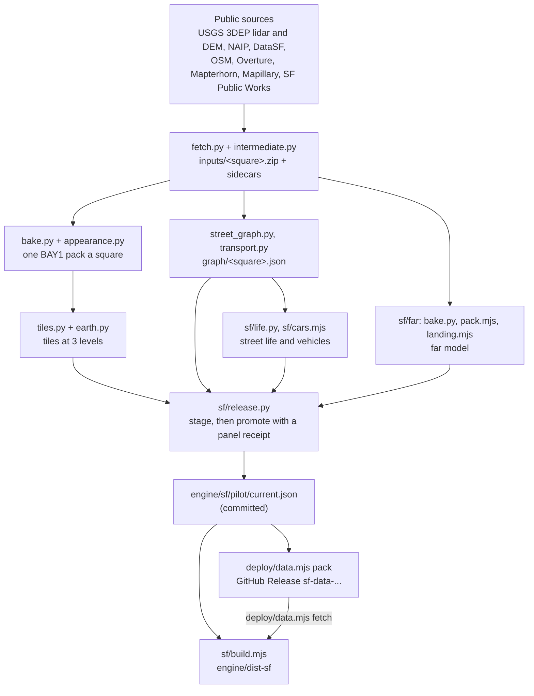

San Francisco in the engine is baked from public data. Python scripts in `engine/bay` fetch the sources for each 1 km square, bake each square into a pack, and cut the packs into tiles. `engine/sf/release.py` stages the tiles, street graphs, street life, vehicles and far model as one content-addressed release. `engine/sf/build.mjs` turns the pinned release into a static realm that any file host can serve. The files each stage writes are specified in [the San Francisco release](/sf-release).

Raw and baked data live under `~/.village/engine`, never in git. Git holds the code, the square inventory ([sf-squares.json](https://github.com/voxelwright/voxelwright/blob/main/engine/bay/sf-squares.json)), the pin (`engine/sf/pilot/current.json`), a copy of each pinned manifest and `deploy/data.json`.

## Squares

`sf-squares.json` lists every 1 km square that touches DataSF's shoreline polygons: 155 squares with lidar (`lidar`) and 11 made from planet data (`planet`), offshore islands among them. A square is named by the kilometres of its south-west corner in UTM zone 10N, for example `551.7_4183.5`. `coverage.py` regenerates the list from DataSF and the USGS lidar project, and records a hash of each response.

The release pinned now names all 155 lidar squares. Around the county, the run cuts planet tiles from Overture and Mapterhorn out to 500 m, 4 km and 16 km at the three levels (`RADIUS` in `coverage.py`). The inventory's `landmarkExtras` lists the additional tiles needed to walk up to landmarks outside those bounds, including the Marin approach to the Golden Gate Bridge. The six-square pilot omits the surrounding planet tiles.

## Stages



| Stage | Reads | Writes |
| --- | --- | --- |
| `engine/bay/fetch.py SQUARE` | EPT lidar, the 1 m DEM, NAIP imagery and DataSF layers (`EPT`, `DEM`, `NAIP`, `SF`, `LAYERS` at its top) | Raw downloads under `~/.village/engine/bay/raw/<square>/` |
| `engine/bay/intermediate.py` | The raw downloads | `inputs/<square>.zip`: quarter-metre lidar grids, the 1 m ground, imagery and the DataSF layers in EPSG:26910 |
| `engine/bay/street_sources.py`, `street_detail_sources.py` | OSM, DataSF, San Francisco Public Works, Mapillary | Gzip JSON sidecars beside each ZIP: OSM geometry and business categories, extra outlines and parcel facts, stop signs, street fixtures |
| `engine/bay/bake.py` and `appearance.py` | One square's archive (restored to `raw/<square>/`) and sidecars | One `BAY1` pack for the square, with wall colours and facade cues, and its names file |
| `engine/bay/street_graph.py` | One square's street sidecar | `graph/<square>.json`, the routable [street graph](https://github.com/voxelwright/voxelwright/blob/main/engine/sf/streets.md) |
| `engine/bay/transport.py ROOT OUT` | The graphs, a city-wide OSM tag extract, DataSF stop signs and signals | The graphs with road levels and traffic controls added |
| `engine/bay/tiles.py` | Packs. `earth.py` makes tiles from Overture and Mapterhorn where no square reaches. | Tiles at level 0 (250 m), level 1 (1 km) and level 2 (4 km), each a `BAY1` pack, and `index.json` |
| `engine/sf/life.py` | Street graphs and land use | `<square>.json` for walking, driving, parking, rails and signal heads, `transit.json`, and `index.json` |
| `engine/sf/cars.mjs OUT` | The kept-car shelf and the hand-built fleet (`engine/sf/fleet.mjs`, including the sculpted Waymo Ojai robotaxis from `engine/page/ojai-sculpt.ts` & `engine/page/robotaxi-services.ts`, and the GT coupe from `engine/page/car-sculpt.ts`) | The vehicle library: each car's finest look cleaned (`engine/sf/sculpt-cars.mjs`: specks off, pinholes and edge leaks sealed, nubs smoothed), coarser looks that keep their shells, repaint variants and `index.json`. `engine/sf/car-shots.mjs` draws each car close up for before-and-after checks. |
| `engine/sf/far/grow.sh` | The square archives | The far model's faces, packed into far tiles and their listing ([far README](https://github.com/voxelwright/voxelwright/blob/main/engine/sf/far/README.md)) |
| `engine/sf/release.py ROOT OUT` | `full_run.py`'s verified output, and optionally the far model, street life, cars and an accepted paint batch | A staged release under `OUT/releases/<sha256>/`. With `--panel RECEIPT` it also moves `OUT/current.json`. |
| `engine/sf/build.mjs` | The release pinned in `engine/sf/pilot/current.json`, the city's street graphs, map places (`engine/sf/map.mjs`, including every registered robotaxi station from `engine/page/robotaxi-services.ts`), and a kept car | `engine/dist-sf`: the page's modules with types stripped, the realm's record from `engine/sf/realm.json`, the release, the road marks and map, and a Brotli copy beside every file |
| `deploy/data.mjs pack` | The pinned release and the other build inputs under `~/.village/engine` | A bundle uploaded as GitHub Release `sf-data-<16 hex>`, and `deploy/data.json` |
| `deploy/data.mjs fetch` | `deploy/data.json` and the bundle | The same files restored under `$HOME/.village/engine`, each checked by length and SHA-256 |

`engine/bay/full_run.py` runs fetch, the inputs, bake, appearance, street graphs and tiles as checkpointed tasks. Each finished task records SHA-256 checksums in `state.json`, and a restart checks them again. A changed recipe needs a new output directory. `engine/bay/run-city.sh start` runs the whole city as a detached job on the bake machine and stages its release when the tiles are done. [engine/bay/README.md](https://github.com/voxelwright/voxelwright/blob/main/engine/bay/README.md) is the operator's guide.

## Street life and street paint

Two things in the realm come from the street graphs rather than the tiles:

- **Street life.** `life.py` cuts each graph down to what people walk and cars drive, with how busy each pavement is from nearby land use, parked-car places and signal heads. `cars.mjs` writes the kept vehicles. Both go into the release as its `life` and `cars` sections, and `page/street.ts` reads them.
- **Street paint.** Lane lines, centre lines, crossings and rails are drawn by the march as lines over the asphalt (`page/marks.ts`), not as cells. `build.mjs` writes them to `<out>/bay/marks.bin` in its output folder, from the city's graphs with `sf/marks.mjs`, plus two committed files the graphs do not hold: `sf/street-tags.json` (rails by gauge, the grid's ways, tunnels and bridges, from `sf/street-tags.py`) and `sf/crossing-colours.json` (yellow and rainbow crossings, from `sf/crossing-colours.mjs`). The build fails without the graphs.

`build.mjs` also writes `<out>/bay/map.bin` for the minimap and GPS from the release's tiles and the graphs (`sf/map.mjs`).

## Pins and what is committed

Two small files tie a checkout to its data:

- `engine/sf/pilot/current.json` names the release this checkout's realm uses: `{version, release, manifest}`. Moving it is the change that ships new city data.
- `deploy/data.json` names the bundle that holds that release for machines without `~/.village`: `{pin, digest, tag}`. `fetch` refuses a record whose `pin` is not the release in `current.json`, and a bundle whose index does not hash to `digest`.

`./world` (the [quickstart](/quickstart)) runs `engine/core/build.mjs`, `deploy/data.mjs fetch` and `engine/sf/build.mjs` in that order, with `HOME` set to `.voxelwright` in the checkout so the realm uses only its pinned inputs. Then it serves `engine/dist-sf` on port 5760.

To build a staged candidate before it is pinned, run `node engine/sf/build.mjs --staged STAGE`, where `STAGE` is the folder holding its `current.json`. To bundle it without uploading, run `node deploy/data.mjs pack-local PIN DIRECTORY`.

A bake machine that already has the pinned bundle can restore its street graphs, vehicles and other shared inputs with `node deploy/data.mjs fetch /path/to/data.tar`. This checks the archive against the same digest as a network fetch.

## Promotion

A release with new tiles must pass a visual panel before its pointer moves. `release.py` stages a candidate and prints its digest. A person or agent scores the 16 fixed cameras in `engine/bay/neighbourhoods.json` against reference photographs, at street level and at 100 m. `--panel RECEIPT` moves the pointer only when no score falls below the previous pin or the floors in `engine/bay/panel-floors.json` (`check` in `engine/bay/panel_gate.py`). A restock that changes only street life, vehicles or the far model keeps the tiles, so it needs no panel. [Cut a new release](/sf-release#cut-a-new-release) lists the steps.

## Licences

Every layer keeps its own terms, listed in [DATA-LICENSES.md](https://github.com/voxelwright/voxelwright/blob/main/DATA-LICENSES.md). Rules for all of it are in the `bay-sources` skill (`.agents/skills/bay-sources/SKILL.md`):

- Requests carry a generic client name and no personal detail.
- A source that needs a key is not used until the owner provides one. Keys live under `~/.village/engine/bay/keys/`, never in git or a log.
- Layers derived from Mapillary (CC BY-SA) stay separable and keep their image credits.

The shipped city includes public street lamp positions and trolley wire paths from San Francisco Public Works, whose layer records state no licence. The owner chose to include them. `--no-public-works-fixtures` bakes lamps and wires from OSM alone; start a fresh output directory when switching. Adding a source means adding its row to `DATA-LICENSES.md` and to the skill, with how its terms were checked.

## Landmarks, ordinary houses and multi-city fidelity

Every city follows three tiers so ordinary streets, parks and iconic landmarks all read accurately without hand-authoring every house:

1. **Semantic ingest (`earth.py`, `street_sources.py`, `street_detail_sources.py`, `street_detail.py`).** Overture Maps and OpenStreetMap already carry building materials, colours, roof shapes, inland water bodies and garden polygons. `earth.py` preserves `facade_material`, `facade_color`, `roof_shape`, `roof_material` and `roof_color` (sculpting gabled, hipped, pyramidal and domed roofs rather than flattening them, and rendering living green roofs and glazed conservatories in their true materials). `street_sources.py` and `street_detail_sources.py` retain those tags plus inland water and garden polygons alongside road geometry in the same OSM pass, and `street_detail.py` stamps inland ponds and lagoons as `WATER` so elevated park basins ripple and reflect in `core/src/bay.rs` rather than turning into concrete yards.
2. **Ordinary-house facade rules (`core/src/bay.rs`, `street_detail.py`, `page/march.ts`).** Surveyed bay windows and recessed porches inherit street-facing windows across faceted chains, narrow angled bay panes centre a single sash window rather than falling blank, footprints that already trace bays skip duplicate synthetic bay extrusion, and stepped lower porches or pitched gables never protrude floating parapet cornice slabs or get sliced flat. Painted plaster walls render as smooth stucco with subtle course tooling rather than heavy horizontal clapboard ribs across every neighbourhood.
3. **Parametric landmarks and landscape heroes (`core/src/heroes.rs`, `sf/heroes.json`, `sf/landmark-tiles.mjs`).** Iconic bridges, civic buildings, museums, conservatories, stepped historic rows and botanical or tea gardens are built from reusable architectural and landscape primitives (arches, ribbed domes, pagoda eaves, pitched gables, hipped crowns, arched footbridges, stone lanterns, specimen trees, ponds and floral parterres). `bay.rs` supports overlapping heroes (such as Fort Point beneath the Golden Gate Bridge's south arch) and terrain-hugging ground-surface overrides (such as the Palace of Fine Arts lagoon, Japanese Tea Garden pond and Conservatory Valley parterres). The two Golden Gate Park gardens are sited from OpenStreetMap ways named beside each constant in `heroes.rs`: a garden draws only inside its mapped fence, leaves mapped buildings it does not draw (the Tea Garden's Gift Shop and Temple Gate, the Botanical Garden's County Fair Building and ticket kiosk) to the map, and its native tests check each part at its mapped place. The Botanical Garden's mapped ponds south of the meadow are ground water only, with no ownership, so the trees and paths round them stay the map's; ground overrides are near-view only, as the far model bakes a rule's cells and not its surface. `sf/landmark-tiles.mjs` covers both ends of suspension bridges (including Marin Headlands and Yerba Buena Island) so the approach roads have ground underfoot.

## Place and check a landmark

Start with the footprint, ground datum and an identifiable feature in a survey or photograph. Register what was measured and what was drawn by eye in `sf/heroes.json`. Read a footprint with the aerial beside it. At the California Academy of Sciences the rectangular canopy measures about 161 by 102 metres. A 5.5-metre-wide walkway extends another 30 metres. Treating its bounding box as the roof used to cover part of the garden.

For a broad roof, sample the original lidar in the landmark's own coordinate frame. This reproduces the Academy's five-metre grid. Each value is the median return over a two-metre patch, in decimetres above its datum. The aerial shows the large field of circular skylights over one dome and the smaller cluster over the other. [Architect's aerial photograph](https://www.fondazionerenzopiano.org/en/project/california-academy-of-sciences/image-717.pdf)

```sh
~/.village/engine/bay/venv/bin/python engine/bay/roof_samples.py \
  ~/.village/engine/bay/sf-450-city/inputs/546.7_4179.5.zip \
  'California Academy of Sciences' --u -65 65 --w -55 25 --spacing 5
```

Keep a fixed review camera for each registered landmark in `sf/landmark-views.json`. Use separate output directories for the pinned build and the candidate. The same command can draw the neighbourhood panel using its saved poses. It reads the actual release and renderer from the loaded page, waits for the near cells and distant mesh, and records both digests beside each PNG.

```sh
node engine/sf/landmark-shots.mjs --dist "$BASELINE" --out "$SHOTS/before"
node engine/sf/landmark-shots.mjs --dist "$CANDIDATE" --out "$SHOTS/after"
node engine/sf/landmark-shots.mjs --dist "$CANDIDATE" --out "$SHOTS/panel" \
  --poses ~/.village/engine/bay/450-panel/fixed-poses.json --hour 15
```

For one place add `--place 'Golden Gate Bridge'`. A private server reached over a local tunnel can be captured with `--server http://127.0.0.1:PORT`. Compare the full-size frames alongside a reference with a known pose. Record which features the reference actually shows. For ordinary houses, check adjacent frontages as well. A repair can smooth one roof while adding steps to the next.

## Check a change

```sh
~/.village/engine/bay/venv/bin/python -m unittest discover -s engine/bay -p 'test_*.py'
node engine/sf/landmark-audit.mjs --manifest "$RELEASE/manifest.json"
cd engine && npm run sf      # the realm's checks in Chrome
```

`node engine/test/street.mjs` checks the street paint and cars, and `node engine/test/sf-life.mjs` checks street life.

A change to `bake.py` or `tiles.py` changes tile bytes, so it needs a new release and a new panel pass before the pin moves. A change to how `bay.rs` reads a pack must keep reading the pinned release's tiles, or move the pin in the same change.
