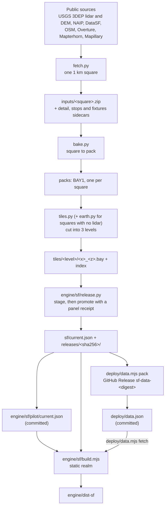

San Francisco in the engine is baked from public data. Python scripts in `engine/bay` fetch the sources for each 1 km square, bake each square into a pack, and cut the packs into tiles. `engine/sf/release.py` pins the tiles as a content-addressed release. `engine/sf/build.mjs` turns the pinned release into a static realm that any file host can serve. The formats each stage writes are in [worlds as cells](/cells).

Raw and baked data live under `~/.village/engine/bay`, never in git. Git holds the code, the square inventory (`engine/bay/sf-squares.json`), the pin (`engine/sf/pilot/current.json`) and the manifest of each release that has been pinned (`engine/sf/pilot/releases/<sha256>/manifest.json`). The tiles themselves are never in git.

## Stages



| Stage | Reads | Writes |
| --- | --- | --- |
| `engine/bay/coverage.py` | DataSF shoreline, the USGS lidar project hierarchy | `engine/bay/sf-squares.json`: every 1 km square that touches the city, with source hashes |
| `engine/bay/fetch.py SQUARE` | EPT lidar, the 1 m DEM, NAIP imagery and DataSF layers (`EPT`, `DEM`, `NAIP`, `SF`, `LAYERS` at its top) | The retained observations for one square, `inputs/<square>.zip`: quarter-metre lidar grids, ground, imagery, map layers |
| `engine/bay/street_sources.py`, `street_detail_sources.py` | OSM, DataSF, San Francisco Public Works and Mapillary | Gzip JSON sidecars beside each ZIP: OSM geometry and businesses, street detail, stop signs, fixtures |
| `engine/bay/bake.py` | One square's ZIP and sidecars | One `BAY1` pack for the square |
| Appearance and paint (`appearance.py`, `frontage.py`, `paint_*.py`) | Packs, NAIP, Mapillary panoramas | Colours and facade cues written into packs and level-0 tiles |
| `engine/bay/tiles.py` | Packs. `earth.py` makes tiles from Overture and Mapterhorn where no square reaches. | Tiles at level 0 (250 m), level 1 (1 km) and level 2 (4 km), each a `BAY1` pack, and `index.json` |
| `engine/sf/release.py ROOT OUT` | `full_run.py`'s verified output, and optionally the far model, street life and cars | A staged release in `OUT`. With `--panel RECEIPT` it also moves `OUT/current.json`. |
| `engine/sf/cars.mjs OUT` | The kept cars' records and the hand-built fleet (`engine/sf/fleet.mjs`, the GT coupe from `engine/page/car-sculpt.ts`) | The vehicle library: each car's finest look cleaned (`engine/sf/sculpt-cars.mjs`: specks off, pinholes and edge leaks sealed, nubs smoothed), coarser looks that keep their shells, repaint variants. `release.py --restock --cars OUT` stages it into a new release; `engine/sf/car-shots.mjs` draws each car close up for before-and-after checks |
| `engine/sf/build.mjs` | The release pinned in `engine/sf/pilot/current.json`, street graphs, a kept car | `engine/dist-sf`: the page's modules with types stripped, the realm's record from `engine/sf/realm.json`, the release, and a Brotli copy beside every file |
| `deploy/data.mjs pack` | The pinned release and the other build inputs under `~/.village/engine` | A `data.tar` uploaded as GitHub Release `sf-data-<digest>`, and `deploy/data.json` |
| `deploy/data.mjs fetch` | `deploy/data.json` and the release asset | The same files restored under `~/.village/engine`, each checked by length and SHA-256 |

`engine/bay/full_run.py` runs fetch, bake, appearance and tiles as checkpointed tasks. Each finished task records SHA-256 checksums in `state.json`, and a restart checks them again. `engine/bay/run-city.sh start` runs it as a detached job on the bake machine. A changed recipe needs a new output directory.

## Pins and what is committed

Two small files tie a checkout to its data:

- `engine/sf/pilot/current.json` names the release this checkout's realm uses: `{manifest, release, version}`. Moving it is the change that ships new city data.
- `deploy/data.json` names the bundle that holds that release for machines without `~/.village`: `{pin, digest, tag}`. `fetch` refuses to run when `pin` is not the release in `current.json`, and refuses a bundle whose index does not hash to `digest`. It checks each file's length and SHA-256 after decompressing it and before writing it.

`./world` (the [quickstart](/quickstart)) runs `engine/core/build.mjs`, `deploy/data.mjs fetch` and `engine/sf/build.mjs` in that order, then serves `engine/dist-sf`.

## Promotion

`release.py` stages a candidate and prints its digest. A person or agent scores fixed cameras from `engine/bay/neighbourhoods.json` against reference photographs, at street level and at 100 m. The receipt names the candidate, the previous pin, the tested core's hash and a score pair for each of the sixteen places. `--panel RECEIPT` moves the pointer only if no score falls below the previous pin or the committed floors in `engine/bay/panel-floors.json`; `release.py` checks this with `check` from `engine/bay/panel_gate.py`. The full contract is in [engine/sf/release.md](https://github.com/voxelwright/voxelwright/blob/main/engine/sf/release.md).

## Licences

Every layer keeps its own terms, listed in [DATA-LICENSES.md](https://github.com/voxelwright/voxelwright/blob/main/DATA-LICENSES.md). Rules that hold for all of it are in the `bay-sources` skill (`.agents/skills/bay-sources/SKILL.md`):

- Requests carry a generic client name and no personal detail.
- A source that needs a key is not used until the owner provides one. Keys live under `~/.village/engine/bay/keys/`, never in git or a log.
- Layers derived from Mapillary (CC BY-SA) stay separable and keep their image credits.

The shipped city includes public street lamp positions and trolley wire paths from San Francisco Public Works. The layer records state no licence. The maintainer chose to include them on November 25, 2026 after no terms were found. Use `--no-public-works-fixtures` for an OSM-only lamp and wire bake. Start a fresh output directory when switching recipes.

Build a staged candidate with `node engine/sf/build.mjs --staged STAGE` to populate the quality-11 cache. Run `node deploy/data.mjs pack-local PIN DIRECTORY` to write the archive under its tag in DIRECTORY and the matching bundle record alongside that tag. The digest identifies the decompressed-file index. SHA-256 of the tar itself identifies that exact archive.

Adding a source means adding its row to `DATA-LICENSES.md` and to the skill, with how its terms were checked.

## Check a change

```sh
~/.village/engine/bay/venv/bin/python -m unittest discover -s engine/bay -p 'test_*.py'
cd engine && npm run sf      # the realm's checks in Chrome
```

A change to `bake.py` or `tiles.py` changes tile bytes, so it needs a new release and a new panel pass before the pin moves. A change to how `bay.rs` reads a pack must keep reading the pinned release's tiles, or move the pin in the same change.
