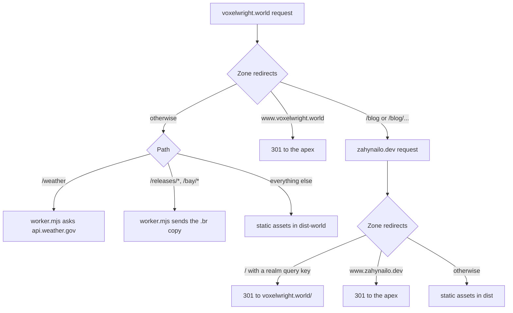

Two Cloudflare Workers serve everything public. **`voxelwright`** serves the San Francisco realm at voxelwright.world. **`zahynailo`** serves the owner's front page and blog at zahynailo.dev. Both are built from one checkout by [deploy/](https://github.com/voxelwright/voxelwright/tree/main/deploy), and every push to main that touches `engine/`, `site/` or `deploy/` (other than documentation Markdown) ships both.

| Worker | Domains | Assets folder | Worker code |
| --- | --- | --- | --- |
| `voxelwright` | voxelwright.world, www.voxelwright.world | `deploy/dist-world` | `worker.mjs` (entry point `world-worker.mjs`) for `/releases/*`, `/bay/*` and `/weather` only |
| `zahynailo` | zahynailo.dev, www.zahynailo.dev | `deploy/dist` | none: static assets only |

One [cloudflare.config.ts](https://github.com/voxelwright/voxelwright/blob/main/deploy/cloudflare.config.ts) describes both. `cf deploy --mode world` picks `voxelwright`, and plain `cf deploy` picks `zahynailo`. [wrangler.config.ts](https://github.com/voxelwright/voxelwright/blob/main/deploy/wrangler.config.ts) points each mode at its folder. Neither Worker has a `workers.dev` address (`workersDev: false`), so nothing reaches them without the zones' redirects in front.

## How a request is answered



Cloudflare runs a zone's Single Redirect rules before either Worker. Then each Worker answers from its static assets, except for the three path patterns that `runWorkerFirst` hands to `worker.mjs`. Every one of those calls counts against the Workers Free plan's 100,000 requests a day. With `negotiateMarkdown: false` (the default in `site/site.config.mjs`), the `zahynailo` Worker runs no code, so it never counts; setting `negotiateMarkdown: true` wires `site/src/worker.mjs` in for page routes.

## Assembly

[assemble.mjs](https://github.com/voxelwright/voxelwright/blob/main/deploy/assemble.mjs) turns one realm build and one site build into the two folders. It refuses to run unless `engine/dist-sf/sf/index.html`, `site/dist/index.html` and `site/dist/blog/index.html` exist.

- **`deploy/dist`** is `site/dist` as it is: the front page at `/`, the blog under `/blog/`, `/robots.txt`, `/404.html` and the site's `_headers`. See [the site](/site).
- **`deploy/dist-world`** is `engine/dist-sf` with its `sf/` folder lifted to the root, beside the engine's own folders. Assembly then:
  - adds the early-alpha notice (`alpha.js`) to every HTML page through [notice.mjs](https://github.com/voxelwright/voxelwright/blob/main/deploy/notice.mjs);
  - gives `index.html` the title `Voxelwright — San Francisco`, a description, the site's favicon (`/favicon.svg`, from the site build), its canonical and Open Graph and X tags, and points its `/blog/` links at zahynailo.dev;
  - publishes the world's own share card, `deploy/og-world.png` (1200 × 630, the voxel skyline under the Voxelwright plate), at `/og.png`;
  - adds the PWA manifest (`/manifest.webmanifest`, `display: "fullscreen"` with `standalone` fallback, `focus-existing` launch handler, and Explore / Night Drive / Golden Hour shortcuts), Voxelmorphism PNG icons under `/icons/` (`192`, `512`, `maskable` and `apple-touch-icon`), iOS/mobile web-app meta tags and a build-stamped `/sw.js` service worker (precaching the engine shell, caching visited `/releases/*` tiles in a bounded LRU bucket with a 12 s fetch timeout and single-pass buffering that prunes superseded releases when `/current.json` advances, serving `/bay/*` stale-while-revalidate and keeping `/weather` cached for offline fallback);
  - writes `/robots.txt`, a dark `/404.html` in the realm's `#10141a`, and `_headers` (below);
  - keeps `.br` copies only under `releases/` and `bay/`, where the Worker sends them;
  - drops the plain copy of a `.bay`, `.far`, `.bin` or `.pack` file under those folders when its `.br` copy exists;
  - leaves out the release's street graphs (`releases/<pin>/graph/`), which no page code reads.

The early-alpha notice says the realm is in active development. It never shows over the realm's failure screen: when the page sets `data-failed` on `<html>`, the notice is not added, or leaves.

### Headers on voxelwright.world

| Path | Headers |
| --- | --- |
| `/*` | `X-Content-Type-Options: nosniff`, `Referrer-Policy: strict-origin-when-cross-origin`, `Strict-Transport-Security: max-age=31536000; includeSubDomains`, `Permissions-Policy: camera=(), microphone=(), geolocation=()` and the CSP |
| `/current.json` | `Cache-Control: no-cache`, so a new pin shows at once |
| `/sw.js` | `Cache-Control: no-cache`, so service worker shell updates take effect promptly |
| `/manifest.webmanifest` | `Content-Type: application/manifest+json; charset=utf-8` and `Cache-Control: public, max-age=3600` |
| `/icons/*` | `public, max-age=604800, stale-while-revalidate=2592000` |
| `/loading-*.webp` | `public, max-age=31536000, immutable`: the loader's pictures are named by their content |
| `/assets/*` | `public, max-age=31536000, immutable`: content-hashed ES module bundles, shared chunks, workers and `core-<hash>.wasm` |
| `/kit/voxelmorphism-*.css` | `public, max-age=31536000, immutable`: content-hashed Voxelmorphism stylesheet |
| `/kit/fonts/*` | `public, max-age=604800, stale-while-revalidate=2592000` |

[worker.mjs](https://github.com/voxelwright/voxelwright/blob/main/deploy/worker.mjs) holds the security headers once (`securityHeaders`, `worldCsp`). Assembly writes them into `_headers` and the Worker sets them on every answer it makes. The CSP allows scripts from the realm itself, WebAssembly (`'wasm-unsafe-eval'`) and YouTube's player (the car radio). It allows no inline script except the page's own: assembly hashes each inline `<script>` of the published pages, after every rewrite, and lists each `'sha256-…'` in `script-src`. Styles may be inline. Images, media and workers may come from `blob:`; frames from YouTube; connections from the realm, the AI providers, any `https:` and `wss:` (a player's own provider and the lobbies). It forbids plugins and `<base>`, and only the realm and zahynailo.dev may frame it. A page that gains an inline script gets its hash at the next assembly; a script added to the page at run time is refused.

Assembly fails when two sources would write the same path, when a folder holds more than 20,000 files, or when one file is over 25 MiB. Those are the Workers Free plan's limits for one version.

## Binary tiles and Brotli

The realm build writes a quality-11 Brotli copy (`<file>.br`) beside each release file. The Worker sends that copy byte for byte, so what crosses the wire is what the realm's checks measured. Static assets alone can't do this: an asset given `Content-Encoding: br` in `_headers` gets compressed a second time, and the edge sends `.bay`, `.far`, `.bin` and `.pack` files uncompressed.

For a `GET` or `HEAD` under `/releases/` or `/bay/`, [worker.mjs](https://github.com/voxelwright/voxelwright/blob/main/deploy/worker.mjs) does this:

| Request | Answer |
| --- | --- |
| Accepts `br` (`takesBrotli` in [encoding.mjs](https://github.com/voxelwright/voxelwright/blob/main/deploy/encoding.mjs): `br` with no `q`, or `q` above 0) and `<path>.br` exists | The `.br` bytes with `Content-Encoding: br`, `Vary: Accept-Encoding` and a type from the extension, sent with `encodeBody: "manual"` |
| No `.br` copy, or a client without `br`, and the plain file exists | The plain file |
| No `br`, and only `<path>.br` exists (a Brotli-only binary) | `406` with `Vary: Accept-Encoding` |
| Anything under `/releases/` that is sent | `Cache-Control: public, max-age=31536000, immutable`, because a release is named by its hash |
| Anything under `/bay/` that is sent (`200` or `304`) | `Cache-Control: public, max-age=86400, stale-while-revalidate=604800`: the bay's files change only when the realm is rebuilt |

Every answer, the `404`, `406` and the weather's included, carries the security headers above. The `.br` address is built by copying the request's URL and setting its path, so a path that starts with `//` never reaches another host.

Every WebGPU browser sends `Accept-Encoding: br`, so dropping the plain binaries costs real visitors nothing.

## The weather endpoint

`GET /weather` (or `HEAD`; any other method gets `405` with `Allow: GET, HEAD`) answers San Francisco's weather now for the realm's "SF now" sky. The Worker reads the last eight observations from the National Weather Service's SFO station (`api.weather.gov/stations/KSFO`), takes the newest one that reports cloud layers, and answers:

```json
{ "observed": { "time": "<ISO time>", "present": ["<raw weather>"], "clouds": ["<layer amount>"], "ceiling": null, "visibility": null } }
```

`clouds` lists each layer's amount (`FEW`, `BKN`, `OVC` and so on). `ceiling` is the lowest base among the broken, overcast and obscured layers, and `visibility` the station's figure, each as the service gives it, or `null`. The Worker names itself to the service as `voxelwright.world (https://voxelwright.world)`. The upstream answer is cached ten minutes at the edge, and a failed one a minute, so an outage still costs one call a minute; the response is kept five minutes in the browser. If the service fails, the Worker answers `502` with `{ "error": ... }` and `no-store`, and the sky keeps its own weather.

## The data bundle

The release, the street graphs and the kept car live in `~/.village`, not in git. [data.mjs](https://github.com/voxelwright/voxelwright/blob/main/deploy/data.mjs) carries them to CI and to a fresh clone running `./world` as one GitHub Release asset, and [data.json](https://github.com/voxelwright/voxelwright/blob/main/deploy/data.json) names which one. The archive holds every file as Brotli beside an `index.json` that lists each file's `path`, `bytes` and `sha256`.

| Command | Where | What it does |
| --- | --- | --- |
| `node deploy/data.mjs pack` | The machine with `~/.village`, after the pin moves | Bundles the pinned release (its quality-11 copies from the realm build's cache), the street graphs and the kept car as Brotli in one `data.tar`. Uploads it as release `sf-data-<first 16 hex of the index digest>` unless that release exists, and writes `deploy/data.json` (`pin`, `digest`, `tag`). |
| `node deploy/data.mjs pack-local PIN DIRECTORY` | Anywhere with the staged release | Writes the archive and `data.json` into `DIRECTORY` instead of uploading. |
| `node deploy/data.mjs fetch` | CI and local builds | Restores the pinned bundle to `~/.village/engine`, checking the index digest and each file’s length and SHA-256. A matching stamp, manifest digest and file sizes let later builds reuse the restore. Pass `--force` to download and verify again. |
| `node deploy/data.mjs fetch /path/to/data.tar` | Bake machine | Restores a local copy of the bundle with the same pin, index and file checks. |

`fetch` downloads from GitHub, or from `VOXELWRIGHT_DATA_URL` when it is set (HTTPS, or HTTP on a loopback address: `127.0.0.1`, `localhost` or `[::1]`). A mirror serves `<tag>/data.tar` under that address, the layout `pack-local` writes. If the pin and `data.json` disagree, CI fails before it builds the realm, so nothing deploys. Commit `data.json` with the pin.

`./world` runs `fetch` with `HOME` set to `.voxelwright` in the checkout (`scripts/world.mjs`), so a local realm uses only its pinned inputs, even on the machine that packed them.

## Ship

From a clean checkout with the pinned data present:

```sh
npm --prefix deploy run ship
```

[ship.mjs](https://github.com/voxelwright/voxelwright/blob/main/deploy/ship.mjs) runs these steps in order:

<Steps>
  <Step title="Check">
    Refuses a dirty working tree (unless `--allow-dirty`). Fails fast if `npx cf accounts list` fails, which means the local `cf` CLI is not signed in.
  </Step>
  <Step title="Build">
    `npm --prefix engine run core`, `node engine/sf/build.mjs`, `npm --prefix site run build` and `node deploy/assemble.mjs`. It uses `VOXELWRIGHT_EGG_MEDIA`, or `~/.village/engine/sf/eggs/media` when that folder exists, unless `--public` is passed.
  </Step>
  <Step title="Deploy">
    `npx cf deploy --mode world --message <HEAD sha>` for voxelwright.world, then `npx cf deploy --message <HEAD sha>` for zahynailo.dev.
  </Step>
  <Step title="Check what is live">
    For voxelwright.world: `/current.json` names the pinned release, `/bay/map.bin` answers, `/weather` answers, then `engine/test/sf-live.mjs` runs. For zahynailo.dev: `/` and `/blog/` answer `200`.
  </Step>
</Steps>

| Flag | Effect |
| --- | --- |
| `--world-only`, `--site-only` | Deploy one Worker. |
| `--public` | Build with procedural eggs only. |
| `--skip-build` | Deploy whatever the last assembly left in the two folders. |
| `--skip-live` | Skip the live checks. |
| `--allow-dirty` | Ship uncommitted changes. The message still names `HEAD`. |
| `--dry-run` | Print the plan and stop, before the sign-in check. |

`ship` does not install packages, run tests, fetch the data bundle or roll back. Its live check fails when `/weather` fails, so an outage at the weather service fails a good deploy.

<Warning>
Shipping changes both public sites at once, and so does merging. The `deploy` workflow runs on every push to main whose changes touch `engine/**`, `site/**`, `deploy/**` or the workflow itself. Markdown files are left out, except blog posts under `site/posts/`, so a docs-only merge does not redeploy.

The workflow has no approval step of its own. It deploys both Workers in the `production` environment, and only that environment's protection rules, kept in GitHub's settings, can hold it back.

The redirect rules are set by hand on the zones through the Rulesets API. No deploy touches them.

Changing the workflow, the environment or the redirects changes what the public internet sees, so it is the owner's decision.
</Warning>

## In CI

[deploy.yml](https://github.com/voxelwright/voxelwright/blob/main/.github/workflows/deploy.yml) runs on main in the `production` environment, which holds `CLOUDFLARE_API_TOKEN` and `CLOUDFLARE_ACCOUNT_ID`. It fetches the private egg media when the `EGG_OVERLAY_TAG` variable names a release. It installs, tests and builds the site, fetches the data bundle, builds the core and the realm, then installs and tests `deploy/` and assembles both folders before either Worker moves. The workflow's token is read-only, except in the separate `release` job that runs `release.mjs` after both Workers pass.

[publish.sh](https://github.com/voxelwright/voxelwright/blob/main/deploy/publish.sh) then deploys `voxelwright`, then `zahynailo`, and checks each one:

1. `wrangler deployments status` shows the new commit on 100% of traffic.
2. Pages answer `200`: `/`, `/current.json` and the pinned manifest for voxelwright.world, and `/`, `/blog/` and `/blog/feed.xml` for zahynailo.dev.
3. For voxelwright.world, the manifest arrives with `Content-Encoding: br` and the same length as its `.br` file in `dist-world`.

If a check fails after the upload, the script runs `wrangler rollback` for that Worker and stops. Each outcome, and the traffic status after an error, goes to the Actions summary. A failure on `zahynailo` leaves `voxelwright` on its new version. `publish.sh` reads `GITHUB_SHA` and `GITHUB_STEP_SUMMARY` and uses GNU `stat`, so it runs only in Actions.

## Releases

Once `publish.sh` succeeds for both Workers, the workflow runs [release.mjs](https://github.com/voxelwright/voxelwright/blob/main/deploy/release.mjs) to record the deploy as a GitHub Release. A failed or rolled-back deploy never publishes a release.

- **Tagging.** Deploy releases use `vYYYY.MM.DD.N` in UTC (for example `v2026.11.26.1`, incrementing `N` for multiple deploys in one day) and set `make_latest: "true"`. This keeps live deploy releases clearly separated from `sf-data-*` data bundles and `eggs-overlay-*` media overlays.
- **Change range.** Each release covers every first-parent change on `main` since the previous deploy release tag. If a docs-only PR landed between deploys, or an earlier deploy failed before a fix merged, all newly live changes appear in the next release's notes.
- **Release notes.** Changes are grouped by area (`San Francisco Realm & Engine`, `Site & Blog`, `Deploy`, `Master Server`, `Documentation`, `Other`). When a pull request includes a `## Release notes` section (prompted by [the PR template](https://github.com/voxelwright/voxelwright/blob/main/.github/pull_request_template.md)), that prose is used verbatim; otherwise `release.mjs` distills the PR's summary and change bullets while stripping check logs, bot footers and local paths. Each release ends with live URLs, commit link, pinned SF city release and data bundle tag, changed areas, workflow run link and a full compare link.
- **Idempotency.** Re-running the workflow on a commit that already has a deploy release logs the existing release and exits cleanly without creating a duplicate.

Preview release notes locally before merging with `npm --prefix deploy run release -- --dry-run`.

## Roll back by hand

Select the Worker by name. Add a version ID after `rollback` to pick one.

```sh
cd deploy
npx wrangler deployments list --name voxelwright
npx wrangler rollback --name voxelwright -m "reason"
```

Rolling the code back to an older commit also needs that commit's data bundle, so never delete old `sf-data-*` releases.

## Redirects

Four rules are kept as JSON in `deploy/` and were installed with the `cf` CLI. The commands are in [deploy/README.md](https://github.com/voxelwright/voxelwright/blob/main/deploy/README.md#redirects).

| Rule file | Zone | Sends |
| --- | --- | --- |
| `world-blog-rule.json` | voxelwright.world | `/blog` and everything under it, on either host, to the same path on zahynailo.dev |
| `world-www-rule.json` | voxelwright.world | www.voxelwright.world to the apex |
| `zahynailo-realm-rule-a.json`, `zahynailo-realm-rule-b.json` | zahynailo.dev | `/` with any of the realm's old query keys to `https://voxelwright.world/` |

All four are `301` and keep the query string. The realm keys are split over two rules because the pinned `cf` CLI dies without a message when one `--body` carries the whole list. zahynailo.dev also has a www-to-apex rule that is not kept in the repository.

## Related

- [deploy/README.md](https://github.com/voxelwright/voxelwright/blob/main/deploy/README.md): commands for the egg media, the data bundle, redirects and checking what is live.
- [The site](/site): what `site/dist` holds.
- [The San Francisco release](/sf-release): what the pin names.
