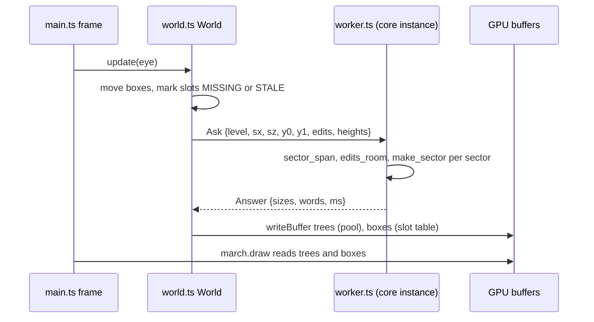

`engine/page` is the browser side of [the engine](/engine). It keeps the sectors around the eye on the GPU, draws them by marching a ray per pixel in WGSL, and draws everything else over that picture. It uses raw WebGPU with no framework or bundler: `engine/serve.mjs` serves the TypeScript files with Node's type stripping. Start it with `npm run serve` (in `engine/`) and open `/city`.

## Concepts

- **Box** (`Level` in `engine/page/world.ts`). For each level, a fixed grid of sector slots centred on the eye. Level 0 holds 10 cm cells; each further box has cells twice as large and reaches twice as far. A sector's slot is its position wrapped around the box, so moving the eye fills slots at the edges and moves nothing else.
- **Slot state.** `MISSING`, `QUEUED`, `FLYING`, `READY`, `STALE`, `STALE_FLYING`. A slot whose sector was edited is `STALE`: it keeps showing the old tree until the new one arrives.
- **Pool** (`Pool` in `world.ts`). One GPU storage buffer of words, labelled `trees`, that holds every sector's tree. First fit, in runs of 64 words. A second buffer, `boxes`, holds each box's slot table, masks and column heights.
- **Ask and Answer** (`engine/page/worker.ts`). The message to a sector worker and its reply. Shown below.
- **Marcher** (`engine/page/march.ts`, `engine/page/march-trace.ts`, `engine/page/march-shade.ts`). Split into decoupled GPU passes to keep Metal compilation fast and avoid uber-shader register pressure:
  1. **Pass 0 — 1/4-res conservative beam pre-pass (`march-trace.ts`, `cs_beam`)**: `@compute @workgroup_size(8, 8)` at `ceil(w/4) × ceil(h/4)` into a persistent grow-only `r32float` `beamDepth` texture. Marches a conservative cone ray (stopping at hierarchy nodes once beam spacing reaches their tier, inflating tight AABBs, and pulling back at least 2 cells) so empty sky and air are skipped without clipping thin wires, poles, or roof edges; skipped for `PLAIN`, `PICK`, `HEAT`, `COUNT`, and `UNDER` (and `?beam=0`).
  2. **Pass 1 — Compute visibility pass (`march-trace.ts`, `cs_vis`)**: `@compute @workgroup_size(8, 8)` reading the 2×2 minimum of `beamDepth` as `t0`, applying Halton(2, 3) sub-pixel ray jitter when TAA is active, and executing pure octree traversal plus optional glass-pane discovery (`paneEnd`) with zero lighting registers, writing persistent grow-only `vis0` (`rgba32uint`: hit cell + packed kind/level/face/flags) and `vis1` (`rgba32float`: primary hit `t`, glass pane distance/metadata, step count).
  3. **Pass 1.5 — Depth/normal pre-pass, half-res compute GTAO, Voxel GI + SVGF, and ReSTIR-DI (`march-trace.ts`, `gtao.ts`, `gi-world.ts`, `gi.ts`, `restir.ts`)**: When shadows are on (and `?gtao=0` is not set), a lightweight pre-pass writes `to.depth` (`depth24plus`) and world normals (with zero-tree-walk 1-cell ground slope-riser smoothing) into `aux.visNormal`, then dispatches half-res screen-space compute GTAO (`createGtao`, ~0.1–0.3 ms) directly between Pass 1 and Pass 2. On the **High** preset (or `?gi=1` / `?restir=1`; off on Low/Medium and bypassed on `PICK`/`COUNT`/`HEAT`/`PLAIN`/`SPACE`), a shared half-res G-Buffer pre-pass (`march-half-gbuf`) populates persistent grow-only half-res depth, normal+linearZ, motion-vector, and roughness/metal/wetness targets for two live moonshot lighting passes:
     - **Voxel-Native 3D Clipmap Radiance Cache GI + SVGF** (`gi-world.ts` `createWorldVoxelizer` + `gi.ts` `createVoxelGI`, `?gi=0` disables, `engine.gi` telemetry: `active`, `ms`, `cascadeMs`, `traceMs`, `svgfMs`, `resets`): voxelizes the active 64-tree world (`Globals`, `pool`, `top`, `looks`, `sunMap`, lit windows, and active flames) into three toroidal `64×32×64` cascades (`[8, 32, 128]` cells = 0.8 m / 3.2 m / 12.8 m) with steady-state Z-slice amortization (`amortizeStride = 8`) and immediate full refresh after blasts/edits/resets, then runs 1-spp cosine-weighted hemisphere tracing + temporal and 3-pass edge-stopping à-trous SVGF denoising with automatic history resets on `> 5 m` teleports, camera cuts, hour/realm jumps, and resizes.
     - **ReSTIR-DI Stochastic Local-Light Shadow Resampling** (`restir.ts` `createRestirDI`, `?restir=0` disables, `engine.restir` telemetry: `active`, `lights`, `ms`, `resets`): runs whenever active local lights > 0 (cleanly skipped at `0.00 ms` with zero local lights in clear daytime), plugging Voxelwright's real 64-tree DDA raymarcher (`restirOcclusionWgsl` in `march-trace.ts`, bound at `@group(1)`) into 16-candidate RIS + temporal and Pairwise-MIS spatial resampling in scene-calibrated mode (`evalMode: 'scene'`, albedo-demodulated diffuse + specular luma) so streetlamps and headlights never bleed through solid building walls.
  4. **Pass 2 — Deferred shading pass (`march-shade.ts`, `fs`)**: Fullscreen pass (strictly 4 bind groups `@group(0)..@group(3)`) reading `vis0`/`vis1`, `gtaoTex` (`override USE_GTAO`), half-res denoised `giTex` (`override USE_GI`), and half-res `restirTex` (`override USE_RESTIR`) via 4-tap depth+normal bilateral upsampling (`sampleHalfBilateral`) to evaluate material paint, slope and diagonal-wall normals, GTAO or legacy openness, sun shadows combined with 2-cascade dynamic-object directional shadows (`@group(3)`, `dynamic-shadows.ts`, `sunVis = min(staticSunVis, dynShadowVis)`), energy-conserving GGX Metallic/Roughness PBR (`LIGHT` `shadePbrAo`/`shadePbr`/`shade`, replacing flat `ROOM_LIGHT` interior fill with true voxel-native multi-bounce GI when `USE_GI` is active), night lighting with shadowed ReSTIR-DI or 512-light 3D frustum-clustered local lights (`@group(2)`, `lights-cluster.ts` via `override USE_CLUSTER_LIGHTS`, or legacy 48-light uniform path on `?cluster_lights=0`) with optional `LOCAL_OCCLUDE`, reflections (`MIRRORS`), physically based Hillaire Sky-View & Aerial Perspective LUTs (`@group(3)`, `sky-lut.ts`, or legacy analytic sky on `?sky_lut=0`), and optional `shader-f16` color/BRDF intermediates when `gpu.canF16` is enabled. Writes linear HDR `gpu.sceneFormat` (`rg11b10ufloat` or `rgba16float`), `depth24plus` via `@builtin(frag_depth)`, jitter-compensated analytic screen-space `rg16float` motion vectors (`prevUV - jitUV`, exposed as `march.velocityView`), `rgba16float` world normals (`march.visNormalView`), and `rgba16float` glass `panes` MRT (plus `march.vis0View` / `march.vis1View`). Backing targets grow-only (`Offscreen.resize`) with per-pass viewports and UV scaling so dynamic resolution (`steer`) never reallocates GPU textures; `PICK` and `COUNT` readbacks target `rgba8unorm`.
- **Atmosphere, Volumetric Clouds, Froxel Fog & Dynamic Shadows** (`engine/page/sky-lut.ts`, `engine/page/volumetric-clouds.ts`, `engine/page/froxel-fog.ts`, `engine/page/dynamic-shadows.ts`). Wired live into `main.ts` with zero per-frame reallocations, GPU timestamp telemetry (`engine.skyLut`, `engine.volClouds`, `engine.froxelFog`, `engine.dynShadows`, `engine.clusterLights`), and diagnostic `?flag=0` fallback switches:
  - **Physically based Sky LUTs** (`sky-lut.ts`, default ON, `?sky_lut=0` falls back to legacy analytic sky): 3-tier dirty-tracked Hillaire (EGSR 2020) Transmittance, Multi-Scattering, Sky-View, Aerial Perspective 3D, and L2 SH irradiance LUTs driven by the unclamped physical solar direction (`rawSun`), blending smoothly back to the calibrated navy legacy night sky as `dayFade -> 0` for Bay Bridge and horizon water continuity, with altitude-attenuated, glare-compressed aerial perspective.
  - **Volumetric 3D Clouds** (`volumetric-clouds.ts`, default ON on Medium/High, `?vol_clouds=0` falls back to the legacy cloud plane): Quarter-res 4×4 Bayer temporally amortized Schneider/Nubis cumulus & stratus layer with high-frequency detail erosion, adapting coverage, density, cloud type, and backlit sunset lighting to weather and hour (fading off cleanly at night when `dayFade < 0.12`), composited via `compositeSky()` strictly onto open sky pixels (`marched == 1.0 && farDepth == 0.0 && panes.a == 0.0`) after `farModel.draw` with a horizon elevation fade, zero ghosting, and softened reflected clouds on glass. Each frame a compute pass also marks, for every 8×8 block of weather-map texels, which of 32 altitude bands can hold cloud. The trace uses those words to start near the first occupied band along a ray and to stop after the last.
  - **3D Froxel Volumetric Fog** (`froxel-fog.ts`, default ON on Medium/High during fog, rain, or overcast weather, skipped on clear skies; `?froxel_fog=0` falls back to legacy `fog.ts`): Temporally reprojected `160×90×64` volumetric scattering volume integrating cool coastal mist, attenuated sun shafts, and up to 64 nearest prioritized local lights (`localLights.feedFroxel`) with a pushed near onset (~19 m in fog) so foreground masonry stays crisp while distant skyscrapers dissolve into mist, composited onto linear HDR after overlays and smoke and before TAA & bloom (respecting marched depth, `farModel.depth`, and open-sky `skyWeight`). Before the composite, a compute pass writes a discontinuity bitmask, one bit per froxel column and depth slice. It marks a whole column where scene depth varies by more than 10% across the column's footprint and, when local lights are in the volume, single slices where scattered light jumps between neighbouring columns. Marked pixels replace the plain filtered sample with four taps weighted by depth and light, so fog does not bleed across edges.
  - **Dynamic-Object Directional Shadows** (`dynamic-shadows.ts`, default ON on Medium/High when sun is above the horizon, `?dyn_shadows=0` disables): 2-cascade texel-snapped `depth32float` shadow maps (`1024×1024×2`, 48 m / 160 m) fed each frame by active cars/pieces (`pieces.castShadows` exact merged faces in Cascade 0 + OBB fallback) and pedestrians (`people.castShadows`, suppressing the legacy pedestrian ground-oval decal while active), sampled in `march-shade.ts` via Safari-safe 4-tap rotated `textureSampleCompareLevel` PCF.
- **TAA / TSR-lite upscaling** (`engine/page/taa.ts`). Runs after all scene, overlay, volumetric fog, and plugin passes when active (default ON; `?taa=0` or `engine.off.add('taa')` disables it, and `PICK`/`COUNT`/`HEAT`/`PLAIN`/`SPACE` bypass it automatically). First `march.patchVelocity` flags dynamic foreground overlays (moving cars, wheels, pedestrians, flying tow banner, water, debris) that wrote nearer `to.depth` and computes exact 3D reprojection velocity for static `farModel` towers so moving objects stay sharp without temporal smearing. Then `createTaa` resolves the active `to.size` sub-rect into persistent native-resolution linear HDR `rgba16float` output using 3×3 closest-depth velocity dilation, Catmull-Rom bicubic history, YCoCg variance clipping in Karis space, and anti-ringing RCAS sharpening (`?taa_sharp=`, default `0.25`), with zero reallocations across scale changes and automatic history resets on `> 5 m` teleports, angle/FOV cuts, realm/portal switches, and hour jumps (`engine.taa`, `engine.gtao`, `engine.sunCompute`).
- **Post-processing & AgX tonemapping** (`engine/page/glow.ts`). All scene passes (and `taa.ts`) output linear HDR radiance directly with no per-shader tonemapping or alpha-channel bloom smuggling. `glow.ts` accepts any `GlowSource` (`Offscreen` or TAA's native-res `rgba16float` output) with `WeakMap`-cached bind groups, extracts true HDR luminance above threshold using Karis-averaged (`1 / (1 + luma)`) 4-tap downsampling into persistent quarter/sixteenth `rgba16float` targets (using `shader-f16` when `gpu.canF16` is enabled), adds linear bloom before Troy Sobotka's AgX tonemapper (`?tonemap=aces` available as a diagnostic switch), then applies lens vignette, hour grade, realm tint, and rain streaks onto the `gpu.format` swapchain.
- **Local lights & 512-Light 3D Clustering** (`engine/page/lights.ts`, `engine/page/lights-cluster.ts`). A zero-GC dual-backend unified GPU local-light sink shared by `march.ts`, `pieces.ts`, `people.ts`, `wheels.ts`, and `froxel-fog.ts`. Vehicle beams (low/high headlights, tail/brake/reverse/hazard, turbo boost), real San Francisco `SFST` street lamps (`bay.ts`), automatic `LAMP` (`material 15`) piece emitters (spinning robotaxi LiDAR domes, traffic signals, charging depot canopies, conjured props), flickering fire/blast light (`puffs.ts`), open portals (`portal.ts`), and placed `LAMP` world edits (`main.ts`) populate both the 8×8 XZ uniform buffer (Low `12`, Medium `28`, High `48` for overlay passes and `?cluster_lights=0` fallback) and the 512-light GPU compute `16×9×24` 3D view-frustum clustered shading backend (`initClustered()` / `dispatchCluster()`, default ON, `engine.clusterLights`) evaluated in `march-shade.ts` with identical PR #192/#208 HDR GGX falloff and optional 2-tap octree occlusion (`LOCAL_OCCLUDE`).
- **View** (`View` in `march.ts`). The eye in finest cells and the camera axes. Every pass gets the same view.
- **Sun maps** (`engine/page/sun.ts`, `engine/page/sun-compute.ts`). One `r32float` shadow map layer per box (`STORAGE_BINDING | RENDER_ATTACHMENT`). Dirty tiles scheduled by `sun.plan()` are updated in a single compute dispatch (`createComputeSunUpdater`, `dispatchWorkgroups(8, 8, tiles.length)`, `?sun_compute=0` falls back to legacy per-tile `fs_sun` render passes) with GPU timestamp queries preserving `sunRoom.tileMs` steering. A place whose tile is not yet drawn is answered from the next coarser box's map, and by tracing a ray toward the sun only where no box has one. See [the sun's share of a frame](#the-suns-share-of-a-frame).
- **Far model** (`engine/page/far.ts`). In San Francisco, the city past the cells' reach is drawn as baked faces. The march leaves those pixels to it (`farCover`) once verified faces are loaded, and `World` skips redundant coarse tiles over surveyed `far.ground` (`farCovered`) while streaming fallback cells on demand via `onFallback` → `refreshFar` if a far tile fails or overflows edits.

## How sectors reach the GPU



A worker keeps nothing between asks. Each ask carries every edit that reaches its column, so any worker can answer any ask, and a worker that fails is replaced and its asks sent again (`hire` in `world.ts`). An answer to an older ask for the same slot is dropped.

{/* schema engine/page/worker.ts Ask,Answer */}
```ts
export interface Ask {
    id: number;
    level: number;
    sx: number;
    sz: number;
    y0: number;
    y1: number;
    edits: Int32Array;
    heights: Int32Array;
    fine?: number;
    bricks?: boolean;
}

export interface Answer {
    id: number;
    level: number;
    sx: number;
    sz: number;
    y0: number;
    sizes: Uint32Array<ArrayBuffer>;
    words: Uint32Array<ArrayBuffer>;
    ms: number;
    refused: number;
    lacking?: boolean;
    failed?: string;
}
```

In `sizes`, each sector from `y0` up has 0 for air, 1 for a single kind (the one word is that kind) or the number of words in its tree. `words` holds the trees one after another. `edits` uses the core's [edit format](/engine-core#the-edit-format). `lacking` means a San Francisco tile did not arrive (or timed out), so the column was made as water and will be asked for again. `failed` reports a worker error (such as a WASM trap or OOM), prompting `World` to replace the worker and requeue its columns.

## Files to know

| File | Owns |
| --- | --- |
| `main.ts`, `steer.ts` | Start-up (parallel GPU/WASM init, early sector-worker feeding, `sound()` deferred until after the first picture, and kept-car spawn deferred until after `seen.near`), the frame loop (including the merged `overlay-tbdr` render pass over `(to.color, to.depth)` that prepares `under`, `tracks`, `wheels`, `pieces`, `signs`, `people`, and `crumbs` — including `crumbs-compute` — before recording all active overlays into one `GPURenderPassEncoder`, reported via `engine.overlayPasses`, to avoid redundant Apple Silicon / iOS TBDR tile load/store flushes), persistent grow-only Linear HDR scene targets (`gpu.sceneFormat`), tools, dynamic render-scale steering (`steerScale`, which subtracts fixed-resolution `taa`, `dynShadows`, and `volClouds` GPU pass costs from the march budget and measures real main-thread `workCpuMs` separately from `getCurrentTexture()` / `queue.submit()` swapchain `presentWaitMs` so GPU backpressure on phones never locks scale at 1.0, while still avoiding slashing scale on genuinely CPU-bound frames and using deadband + escalating cooldowns on unclocked touch devices), and the `engine` object on `globalThis` that checks and plugins use. |
| `glow.ts`, `taa.ts` | Linear HDR temporal upscaling and post-processing: `taa.ts` resolves Halton(2, 3)-jittered dynamic-resolution scenes into native-res `rgba16float` linear HDR with 3×3 YCoCg variance clipping and anti-ringing RCAS sharpening (`?taa=0`, `?taa_sharp=`); `glow.ts` takes any `GlowSource` (`Offscreen` or TAA output) for Karis-averaged luminance bloom into persistent quarter/sixteenth `rgba16float` targets (`shader-f16` when supported), AgX tonemapping (`?tonemap=aces` diagnostic override), speed/drift lens blur, vignette, hour grade, realm tint, and rain streaks. |
| `world.ts` | Boxes, slots, the pool, asks to workers. |
| `worker.ts` | One core instance that makes sectors. |
| `march.ts`, `march-trace.ts`, `march-shade.ts`, `gtao.ts`, `sun-compute.ts` | Deferred visibility-buffer ray marcher: 1/4-res conservative cone beam pre-pass (`cs_beam`), full-res compute visibility pass (`cs_vis` -> `vis0`/`vis1`), Pass 1.5 depth/normal pre-pass + half-res screen-space compute GTAO (`gtao.ts`, `?gtao=0` fallback) + shared half-res G-Buffer (`march-half-gbuf`) + 64-tree voxel shadow hook (`restirOcclusionWgsl`), single-dispatch compute sun-map tile updater (`sun-compute.ts`, `?sun_compute=0` fallback to `fs_sun`), deferred GGX Metallic/Roughness PBR shading pass (`fs`, optional `shader-f16`, strictly 4 bind groups `@group(0)..@group(3)`) sampling GI + ReSTIR-DI (`@group(1)` via 4-tap depth+normal bilateral upsampling), clustered lights (`@group(2)`), dynamic shadows + Sky LUTs (`@group(3)`), and writing linear HDR color, depth, jitter-compensated analytic `rg16float` motion vectors (`velocityView`), `rgba16float` world normals (`visNormalView`), and glass `panes`, plus post-overlay `patchVelocity` for dynamic overlays and far towers. Specialised by WGSL `override` constants (`MIRRORS`, `FOGGY`, `NIGHT`, `FAR_MODEL`, `UNDERWATER`, `LOCAL_OCCLUDE`, `USE_GTAO`, `USE_CLUSTER_LIGHTS`, `USE_GI`, `USE_RESTIR`, `AUTOTILE`); `engine.march.reshade` swaps its shaders while the page runs. |
| `gi.ts`, `gi-world.ts`, `restir.ts` | Live Wave 3D-2 High-preset moonshot lighting passes (`?gi=0`/`?gi=1`, `?restir=0`/`?restir=1`; `engine.gi`, `engine.restir`; zero per-frame GPU reallocations): `gi-world.ts` voxelizes the live 64-tree world (`pool`/`top`/`looks`/`sunMap`/flames) into three toroidal `64×32×64` cascades with Z-slice amortization and instant blast/edit refresh for `gi.ts`'s multi-bounce clipmap radiance cache + 1-spp trace + temporal/à-trous SVGF denoiser (replacing flat `ROOM_LIGHT` interior fill); `restir.ts` runs stochastic 16-candidate RIS + temporal/Pairwise-MIS spatial resampling over up to 512 clustered local lights using `march-trace.ts`'s real 64-tree voxel occlusion hook (`evalMode: 'scene'`), skipped at 0.00 ms when 0 local lights are active. |
| `lights.ts`, `lights-cluster.ts` | Zero-GC dual-backend unified GPU local-light sink (`engine.localLights`, `engine.clusterLights`): vehicles, automatic `LAMP` piece emitters (spinning robotaxi LiDAR domes, traffic signals, depot canopies, conjured props, with gentle pools for small decorative Edison bulbs in `pieces.ts`), fire/blasts, portals, placed `LAMP` world edits, and SF street lamps binned into an 8×8 XZ uniform tile mask (Low `12`, Medium `28`, High `48` for overlays & `?cluster_lights=0` fallback) and a priority-selected 512-light GPU compute `16×9×24` 3D frustum-clustered shading pass (`lights-cluster.ts`, default ON, selecting the top 512 lights from a 2,048-candidate pool via `partitionTopK` so nearby lights never pop out behind dense street lamps) plus `feedFroxel()` for volumetric light scattering. |
| `sky-lut.ts`, `volumetric-clouds.ts`, `froxel-fog.ts`, `dynamic-shadows.ts` | Live Wave 3D-1 atmosphere, cloud, fog, and dynamic-shadow passes wired into `main.ts` (`?sky_lut=0`, `?vol_clouds=0`, `?froxel_fog=0`, `?dyn_shadows=0` fallback switches; `engine.skyLut`, `engine.volClouds`, `engine.froxelFog`, `engine.dynShadows`): Hillaire physical Sky-View & Aerial Perspective LUTs, quarter-res 4×4 Bayer temporally amortized volumetric 3D clouds composited strictly behind geometry (`compositeSky`), `160×90×64` temporally reprojected 3D froxel volumetric fog with sun shafts & 64 local lights composited before TAA/bloom, and 2-cascade texel-snapped `depth32float` dynamic-object directional shadows fed by `pieces.castShadows` and `people.castShadows`. |
| `sun.ts`, `far.ts`, `far-unpack.ts`, `eggs-sky.ts`, `eggs-pictures.ts`, `water.ts`, `people.ts`, `pieces.ts`, `crumbs.ts`, `puffs.ts`, `smoke-grid.ts`, `tracks.ts` | The other passes of a frame. `far.ts` unpacks tile headers and grouped faces off-thread in `far-unpack.ts` and packs all section uniforms into a single shared dynamic-offset uniform buffer. `eggs-sky.ts` draws an instanced drone swarm and atmospheric fog halo strictly over open sky pixels (`marched == 1.0 && faced == 0.0`) inside `march.screen.rect` for video Easter eggs, with staggered takeoff and a ~1 s quaternion-spring camera chase (disabled for The Matrix); while the drone swarm is active, `boards.ts` lifts the tow-banner airplane so it flies above the drones. `eggs-pictures.ts` paints the shared `256×144` window screen and fills the unused lower/outer windows outside `rect` (especially the lower ~40% on portrait phones) with a switchable `WindowEffect` (`ambilight` default soft wet-glass skylight spill, `equalizer` live Web Audio `AnalyserNode` skyline spectrum bars, or `off`). `pieces.ts` draws a body's glass after its solid faces, tinting what is behind it; with mirrors off it still tints but mirrors nothing, so a car is seen out of from its seat on every preset (#74). `crumbs.ts` integrates up to 8,192 debris crumbs and velocity-stretched sparks (`spark()`) in a WebGPU `@compute @workgroup_size(64)` pass over a unified `STORAGE \| VERTEX` buffer with optional screen-space depth-buffer bounce (`setDepthSource`) and heightfield fallback (clean CPU fallback when compute is unavailable). `smoke-grid.ts` runs a coarse `32×32×32` (0.8 m / 8-cell) local Eulerian smoke-advection volume (`SmokeGrid`) with thermal buoyancy, incompressible ceiling/wall deflection and window venting; `puffs.ts` hooks into it via `setSolidSampler` / `refreshSmokeSolids` and adds `emitMoltenSparks` for incandescent cuts and parry clashes (#166). `SmokeGrid` also keeps a two-level occupancy bitmask (64 bricks of 8³ smoke cells, each with 64 bits for 2³ blocks). `rayInterval` walks it to bound where a ray can meet visible smoke, and `exportBitmask` copies it in upload order. No render pass reads either yet. |
| `deform.ts` | Vehicle damage: dents, scuffs, cracked glass and engine damage recorded from crashes, packed for `pieces.ts` (see [vehicle damage](#vehicle-damage)). |
| `fine.ts`, `fine-core.ts`, `runs.ts`, `streetfaces.ts` | Faces and RLE codecs for things in cells finer than the world's (vehicles' looks). `fine-core.ts` bridges fine meshing (`faces`, `facesWithSmooth`), RLE decode/encode, coarsening, and procedural vehicle sculptors to the Rust/WebAssembly core (with TypeScript fallbacks when the wasm instance is not yet loaded). `facesWithSmooth` gives each outside face smooth words at its four corners: a normal fitted to the shape round the corner and how open it is (#38). Street cars, `setDown`, and summoned-car coupe sculpting/meshing bake off-thread in the `streetfaces.ts` worker. |
| `edits.ts` | Building edits as the core reads them. |
| `build-tools.ts` | The [building kernel](#the-building-kernel): shape stamps, the rake, undo and placement snap. Nothing in the page calls it yet. |
| `mover.ts`, `link.ts` | What moves loose bodies: a local worker (bounded by device-tier `world_memory_budget` sent from `main.ts`), or the shared world's stream. Besides blasts, edits and steps, the worker takes the Cleave (`cleave`, answered as a blast with `cleft`), what it holds up (`hang`, moved on by real time inside the step it comes with), poses put back after a rewind (`pose`), the sea and rain bodies meet (`env`), weapons' work (`combat`: carves, shots, shockwaves and beams, answered as a blast), joints the page names by its own handle (`joint`, `winch`) and ragdolls (`ragdoll`, answered with its id alone; `ragdollHit`). Settled debris pieces (`lying` in `main.ts`) destroy their GPU buffers once edited sectors (`world.stats.stale === 0`) finish rebuilding (with a frame cap) without waiting on distant streaming sectors (`wanted`). |
| `cleave.ts`, `rewind.ts`, `glow.ts` (`PostFx`) | Small Magic's spells (#226): the Cleave's gesture, seam and instant (tool 6, reach `CLEAVE_REACH` in `main.ts`, 45 m), time stopped and wound back (T), and what both, and a blast's frame of ink and ring, do to the whole picture in the last pass. `main.ts` composes their pace with `tempo.rate` once a frame (`stepSpells`). |
| `grass.ts`, `avbd-rubble.ts`, `billows.ts` | Grass and wildflowers over grass cells round the eye, flattened and burnt by blasts and cuts; GPU rubble boxes thrown by blasts of 1 m or more and by cuts (needs compute); a blast's rolling billows and close fire's tongues, drawn from `puffs.ts` (`engine.billows`). `?grass=0`, `?avbd=0`, `?billows=0`. |
| `combat-tools.ts`, `sports-court.ts`, `ragdoll-live.ts`, `ragdoll-bridge.ts` | The weapons (#166) after the first seven tools: lightsaber (the melee arena in the page's own core), rifle, rocket, laser, grapple and tennis (the sports world in the page's own core), met through the page's callbacks (a voxel ray walk, the mover's `combat` and `joint` asks). People a blast, shot, beam, blade or cut reaches go limp: `ragdoll-live.ts` spawns their ragdoll in the mover, reads its `POSE` records, and `people.ts` draws them as it lies until they stand. `?ragdolls=0` leaves that out. |
| `living.ts`, `person.ts`, `people.ts`, `residents.ts` | Living things, a person's own body, figures and the town's residents ([living things and people](/living)). |
| `street.ts`, `robotaxi-services.ts`, `ojai-sculpt.ts`, `robotaxi.ts`, `robotaxi-maker.ts` | San Francisco pedestrians, multi-level traffic and charging depots. Traffic and parking resolve elevated decks per OSM layer via `bay_bridge_y`, separate obstacles vertically across stacked freeway/street levels, close unexcavated tunnels, and filter steep cross-slope highway embankments. Road openings verify full-length and lane-width building clearance, turning traffic guards against swept-corner OBB overlaps across adjacent lanes, simultaneously awake crash-woken cars are capped so pileups do not stall physics, on-foot parked-car waking uses its own bounded pool separate from distant crashed/thrown vehicles (evicting farther unmoved parked cars along dense blocks and offering a direct `E` entry fallback while waking), traffic recovers from blocked lanes and perpendicular deadlocks, and street navigation strictly budgets at most 1 nav tile rebake/frame (skipped on slow frames) while filtering high-altitude blasts out of panic flow-field builds with a frame+time cooldown. Each robotaxi operator supplies a name, a livery, traffic shares and a station location. Operators share the Ojai model and the driving and crowd behavior; `robotaxi-maker.ts` loads the Rust/WebAssembly core and sculpts + coarsens + encodes the 3-LOD robotaxi models in a Web Worker after the first picture so boot never blocks the main thread. |
| `input.ts` | Keys, pointer, touch and gamepad for play. Modes form a stack; a lane pushes its own mode and pops it. `stickSide` says which half of the picture a touch is the move stick in (`'left'`, `'right'`, or `null` for none); while a car is driven by touch, `drive-touch.ts` sets it and gives it back as `'left'` when you get off. |
| `hud.ts` | The DOM over the picture: the ask bar, cues, notices, panels. |
| `radio-ui.ts`, `sound/radio.ts`, `sound/radio-providers.ts` | Procedural offline FM car radio (`N` cycles), zero-login YouTube / YouTube Music streaming (official IFrame Player API with `>=200×200` visible mini-player and saved playlists; Spotify PKCE and Apple MusicKit JS v3 kept behind `ENABLED_STREAMING_PROVIDERS`), curated SF driving playlists, Waymo-style media picker (`R` while driving or Settings `Radio…`), horn/collision ducking, and Doppler pass-by whooshes. |
| `ask.ts`, `making.ts`, `kept.ts`, `maker.ts`, `models.ts` | The ask bar's wishes: the helper, the ghost of what is kept, and making in the page with a visitor's own AI ([making](/making)). |
| `drive-cam.ts`, `drive-touch.ts`, `cockpit.ts`, `wheels.ts`, `summon.ts`, `gamepad.ts`, `stunts.ts`, `entry.ts`, `explore.ts` | Driving cameras, the touch driving schemes and their Controls sheet, the first-person cockpit, drawn car wheels, summoning a car (with background `prewarm()`), the gamepad, stunts, the 1-click EXPLORE 3D map picker + background resource preloading + Optical Dive world entry and map fast travel (`entry.ts`), and the legacy EXPLORE board controller (`explore.ts`) ([gameplay](/gameplay)). |
| `car-sculpt.ts` | The GT coupe (`sculptCoupe`: `car`, `KEPT.car`, the `G` summon and the SF library coupe) and racing kart (`sculptKart`: `KEPT.kart`) sculpted from continuous shapes, plus `coarser` and the edge-leak sealer that keep vehicle shells closed across levels. |
| `minimap.ts`, `map-search.ts`, `map-gpu.ts`, `gps.ts` | The 3D minimap, the full-screen 2D/3D map (including pre-entry starting-location picker mode), Apple Maps-style quick POI search with category pills, location-ranked autocomplete, recents, "Search here" re-anchoring and screen-space pin clustering (`map-search.ts`), GPS routes, and 0-frame-lag Map-to-Reality dive rendering ([gameplay](/gameplay)). Building geometry is packed into compact 20-byte vertices with chunk-local `uint16` indices (and compact low-rise box simplification on phones and tablets), and full-screen map MSAA/depth/swapchain targets are released when the map closes or a dive ends. |
| `realms.ts`, `portal.ts`, `wheel.ts` | Stepping between realms without a reload ([realms](/engine-plugins#realms)). |
| `door.ts`, `lobbies.ts` | Joining a lobby on someone else's machine ([multiplayer](/multiplayer)). |
| `plugins.ts` | Loading plugin page sides and the pass registry ([page plugin types](/plugin-types)). |
| `recorder.ts`, `feedback.ts` | 30 s black-box gameplay flight recorder, passive anomaly watchers (stuck player, vehicle overlap, falls, stalls, GPU/worker faults), synchronous WebGPU canvas capture, and the F8 / `/bug` feedback dialog (`engine.recorder`, `engine.feedback`). |
| `studio/*` | Lazy-loaded local-dev T3 Code Studio IDE (`F2`), `F9`/`F10` bug-to-thread capture, Game-Use control runtime, and `StudioExtension` registry ([Studio & Game-Use IDE](/studio)). Excluded from static public builds. |
| `pwa.ts` | Progressive Web App runtime (`engine.pwa`): manifest-gated `/sw.js` registration, `navigator.storage.persist()` when installed, dynamic sky `<meta name="theme-color">` sync, Screen Wake Lock while playing, Car Radio `navigator.mediaSession` bridge, and the Settings `Install app` prompt (`beforeinstallprompt` and iOS Safari guidance), and `--app-h`: an installed iOS app is laid out a status bar short of the screen, so the canvas and HUD layer are sized to the measured screen height instead of `100dvh`. |
| `bay.ts` | Loading the core (`open`), San Francisco tiles from a release, O(9) tile-bucketed `SFST` street-lamp extraction (`streetLamps`), worker handshake deduplication for `heroes.json`, `marks-squares.bin`, `kerbs.bin` and `bridges.bin` (read from embedded `LOCAL.bay` or fetched once on the main thread and passed to workers), packed street names, and cell-to-WGS84/tile helpers (`latLon`, `tileOf`) ([worlds as cells](/cells)). |
| `pack.ts` | `VXPK` binary pack reader and LRU cache for bundled release files (landing cut, 2 km far band-0 squares, cars, 4 km street life and names), with transparent fallback to individual release objects and `?packs=0` opt-out. |

## The building kernel

`engine/page/build-tools.ts` (#226) is the arithmetic of building by hand. It reads the world only through a `sample(x, y, z)` that the caller gives it and answers with rows of cells as `edits.ts` has them. The page does not call it yet, so a player has none of it.

- **Shape stamps** (`stampRuns`, `stampEdit`). Wall, slab, stairs, arch, roof, pillar, window cut and door cut, each turned by yaw, pitch and roll, added in a material or carved out. In an arch, window cut or door cut, carving empties the opening and adding builds what surrounds it.
- **Rake** (`rakeRuns`). Levels the ground in a round brush to a flat or sloping plane, filling below and cutting above by at most `maxDeltaY` cells a column. It ignores water. It leaves a column alone when no ground lies within that reach under the plane, or when the column is still solid that far above it. It refuses a plane steeper than about 72°.
- **Undo** (`EditUndoStack`). Undo, redo and rewind to a mark, keeping at most 64 steps and 4,000,000 stored numbers by default. Cells finer than 10 cm come back as their plain kind.
- **Snap** (`snapPlacement`). `global` puts the shape on a grid with quarter turns, `local` sets it flush with the face aimed at, and `free` takes the nearest cell and angle steps. `into` sinks a carving shape into the face.

The wand has a matching preview that nothing sets yet: while `buildPreview` holds a box, a held wand outlines and lights it, gold to add and crimson to carve. `node test/build-tools.mjs` (in `engine/`) checks the kernel.

## Trims from a cell's neighbours

The march colours a face of a cell by the cells round it (#226: `autotile` in the `AUTOTILE` block of `march.ts`, called from `march-shade.ts` `litPrimary` after the material's paint). Only the colour changes: stored cells, geometry and collision stay as they were. Open here means air or glass, and terrain means earth, grass or sand.

| Trim | Faces | Where | What it draws |
| --- | --- | --- | --- |
| Coping or sill | Walls of concrete, brick, plaster and wood | Open above, or another material above that is not terrain | A stone cap with a lit top edge and a shadow line along its foot |
| Lintel | The same | Open below, no coping, and nothing solid one cell down in front | A stone course with a drip line along its foot |
| Plinth | The same | Something solid one cell down in front (not concrete over asphalt, which is a kerb) | A darker stone course with a lit chamfer and a joint along its top |
| Arris | The same | Glass beside, or air beside with nothing solid behind that air | A lit chamfer and a groove, so window jambs and outside corners are edged and a post one cell wide is fluted |
| Seam on a wall | Walls of asphalt, concrete, brick, plaster and wood | Terrain one cell down in front, or beside | Moss from grass, dirt from earth or sand, feathered by noise |
| Seam on a top | Tops of asphalt, concrete, brick and plaster | Terrain beside | The same stain, creeping over the edge |

Wood takes the light and shadow of a trim but no stone. A pixel asks only about the neighbours nearest to it, at most five `kindAt` lookups on a wall and two on a top.

The trims go by how many pixels of the render size a cell covers. At 2.5 or fewer there are none and no lookup is made, and they reach full strength at 6.5. The shadow lines, grooves and joints begin above 6 pixels and are full at 12. Band edges are smoothed over about a pixel.

Trims are drawn only on cells of the finest box (10 cm), seen directly or through glass, and not in reflections. Faces smoothed into ground slopes or diagonal walls, rubble, cells that hold finer cells and the outermost cells of that box take none, because past the box's edge every cell reads as air.

`?autotile=0` turns the trims off through the `AUTOTILE` pipeline override, to compare the two at one camera. `node test/autotile.mjs` (in `engine/`) builds a scene cell by cell and checks the picture near, at 10 m and far, with the trims and without.

## The sun's share of a frame

A tile of a sun map is 4,096 rays that each go through everything up-sun of them. Whenever the eye moves, tiles scroll in at the maps' edges and every box that moved wants its tiles drawn again. What a tile takes of the GPU depends on the place and the hour: 0.4 ms in San Francisco at midday, 3.5 ms there with the sun low, 2.5 to 3 ms in the town. In the town, on a GPU that other work was drawing on, eight tiles in a frame made about one frame in twelve late at any speed from 60 km/h, with the page's own thread at 2 ms a frame. With the tiles held to a share, none came late in the same session (#73). On a quiet GPU neither did, and in San Francisco at midday the share changed nothing that was measured.

- While the eye moves faster than a metre a second, tiles get a twelfth of the frame's time on the GPU (`sunMost` in `main.ts`). By default `tend` in `march.ts` batches all scheduled tiles for the frame into a single compute dispatch (`sun-compute.ts`, `dispatchWorkgroups(8, 8, tiles.length)`) writing directly into the `r32float` `STORAGE_BINDING` sun-map array (`?sun_compute=0` falls back to per-tile `fs_sun` render passes). Timestamp queries round the pass measure what a tile takes (`sunRoom.tileMs`, exposed alongside `engine.sunCompute`) and count the share in tiles; a tile that costs more than the share is drawn every few frames.
- An eye that stands still gets eight tiles a frame, as before. Nothing passes there for a late frame to show in, and the first picture's shadows are traced ray by ray until its tiles are drawn.
- A tile's rays never enter a finer box, so a map is drawn as soon as its own box and every coarser one is whole but for a layer of sectors at each side (`wholeFrom` in `world.ts`). Going fast, the finest boxes are always being made; the coarser maps no longer wait for them. Sun rays pass through glass at L0–L1 and fine overhead wires (`FINE | STEEL`) across L0–L2 so aerial cables continue cleanly past L0 without casting coarse shadows.
- `engine.sunRoom` reports the measured tile time and the last frame's count. `?suntiles=8` (or setting `engine.sunRoom.fixed`) draws a fixed number a frame, to measure what the share is worth.

## Where a moving thing is drawn

The mover (`engine/page/mover.ts`) is asked once a frame to move bodies on by the time the last frame took, and its answer is what the next frame draws. A body is therefore drawn where it was a frame ago. With every frame on time nobody can tell. A frame that comes late shows the body at half speed and then double speed, and an answer that arrives after the next frame has begun shows it standing still for a frame and then jumping: 0.9 m at 200 km/h, and the eye that rides a car jumps with it. In San Francisco the mover's steps are slower than in the town, so driving fast there showed the car standing or jumping in 2 to 5% of frames (#73).

`drawAhead` in `main.ts` draws each body the last step moved on from where that step left it, the way it went in that step, to the time of the frame being drawn. It goes on a tenth of a second at most, and not for a body that was set down somewhere else. A body the last step did not move lies where the mover said. `?ahead=0` or `engine.ahead = false` draws bodies as the mover last said them, for measuring: the `--ahead` mode of the [drive-smooth check](#check-a-change) drives the same car both ways in one session.

## Vehicle damage

Every drivable car and kart wears a 2.5 cm fine look (`car()`, `KEPT.car`, `KEPT.kart`, and street cars), so every car dents where it is struck (#37, #61). The core reports each crash as a `STRUCK` record with a place, a closing speed, a push, and flags (including figure bits 8 and 16 when a person's body is involved), but no direction; street-car impacts also dent both vehicles immediately through `living.hit`, and blows on a car before its fine look arrives are queued and replayed as soon as the look loads. `living.ts` ignores person-figure bumps so walking or running into a car never dents bodywork or throws crash sparks and debris, and keeps the hardest vehicle/world blow each vehicle took in one answer. For a blow at 1.8 m/s or more, it gives each part of the look a dent at that place, pushed in from the side of the part's box nearest the hit. `deform.ts` holds up to six dents a part. Each dent has a centre, a radius, a direction and a depth, all in the part's own cells. Nearby blows deepen an existing dent, and blows near the driver's eye and seats are kept out of it: no dent, however it is moved, reaches that room. The same record holds how scuffed the paint is, how damaged the engine is, and how cracked each of the four window zones (front, rear, left, right) is.

`pieces.ts` bends the vertices of a struck piece as it draws them.

- A struck piece splits only merged rows whose bounding box overlaps an active dent sphere or torn opening into 1-cell unit faces; undamaged regions stay merged. Every corner in the bent zone lies on the cell lattice, so faces that meet still meet once bent. High-resolution interior cabin parts (`per > 4`) are not deformed, and `pieces.ts` frustum- and backface-culls pieces so off-screen and back-facing quads pay nothing. A piece never struck draws its merged faces, and the shader returns before any dent work.
- Paint and lamps keep the unbent position, so a bent panel keeps its own paint.
- The hit pushes the panel inward. Two flanks meet at an oblique crease. The upper sheet tucks into a diagonal joint, pinching the struck side of the grille. A low lip turns back toward the windshield behind the tuck. A broadside hit presses in the door between the creases. The painted shoulder folds above the contact. A hard strike against a wheel opening renders a smooth, anti-aliased torn sheet-metal split and bare-steel lip along the buckled arch shoulder without carving a stepped voxel staircase (#92). The body and wheel mounts share the same depth allowance and deformation. The clear coat dulls on the flanks. A small patch of primer and a few bare chips show along the fold. A directly struck lamp goes dark.
- Each window keeps its own crack origin in `Piece.cracks[0..3]`. Fine radial cracks and short connecting fractures wrap around the glass from that point. From the seat the cracks scatter less light near the forward sightline.
- Drawn 3D wheels (`wheels.ts`) evaluate the same dent field on the CPU (`deformPointCpu` in `deform.ts`) across the hub and surrounding wheel arch so a crushed corner shifts and tilts its wheel inward with the bent fender. `carveWheelWells` preserves painted fender skin and lines recessed wheel-well walls in dark matte liner so bent arches show no bright inner wall or dark stair-step seam.

Crashes at 2.8 m/s or more throw sparks, road dust and flakes of paint and trim. A newly cracked window also sheds glass. Broken wood and foliage from the surroundings scatter as small matte splinters. Pale steam, then grey smoke and finally flame escape at the grille or lamp opening nearest the struck corner. The broken housing loses its lens, including the amber tip. Its back and side walls remain visible. The flame starts in the empty space behind the torn lip and follows it as the car moves. The escaping vapour and smoke emerge directly from the upper flame tongue with an outward nose bias so the plume rises clear of the hood from every heading without a gap (#92). Reduced motion suppresses the debris and thins the smoke. Press `F` while driving (touch **Repair**, gamepad D-pad right) or call `living.repair(thing)` to restore the body, wheels, windows and engine. Removing the car clears its damage. `node engine/test/dents.mjs` checks the struck corner against the repaired view, the driver’s sightline, horizontal streaks on glass after a side hit, the flame’s rendered position as the car turns, smoke hood clearance and flame continuity, smooth side wheel-arch impacts, wheel alignment, per-window cracks and repair.

## What the page refuses

A link, a page that frames the realm and someone else's server can all send the page something. The page guards each of these inputs, and `engine/test/client-security.mjs` checks every guard (#81).

- **Records from a server.** `told.ts` reads the core's records, from this page's worker or from a shared world's stream. A record that runs past the words that came, or is shorter than its kind's fixed part, or is not whole rows of a list kind (8 words a move, 12 a living thing), stops the reading. The page keeps what was read before it. The check also reads every record of a real crash in the core.
- **Messages from a host page.** `host.ts` hears and tells only a host on this site's origin, `https://zahynailo.dev`, or, when the realm is served from `127.0.0.1` or `localhost`, a page on this machine. It posts to that origin, never to `'*'`. The host's origin is this page's own when the parent is on the same origin. Otherwise it comes from `location.ancestorOrigins`, then `document.referrer`. Where neither says, what the realm would tell is held until a trusted host first speaks.
- **A sign's picture.** `screens.ts` `picture` shows this site's own pictures, any `https:` address and raster pictures drawn in the page (`data:image/png`, `jpeg`, `gif` or `webp`, base64). It refuses `javascript:`, `blob:`, `http:` from elsewhere and SVG.
- **The far model's paths.** `?far=` and `?farlanding=` must be paths on this site (`far.ts` `samePath`), with no scheme, `//`, `..` or backslash, even percent-encoded. Otherwise the page draws the realm's own far model and says so on the console. The release's own manifest and the realm's `far` folder are used as they are. `?far=` with no value still turns the far model off.
- **Numbers in the address.** The measuring knobs go through `march.ts` `bounded`, which keeps each in range and ignores `NaN`, `Infinity` and words: `workers` 1 to 8, `pool` 16 to 2048 MiB (and no more than the device allows), `levels` 1 to the march's most, `grid` three whole sizes of 2 to 32 sectors, `suntiles` 0 to 64, `fine` 0 to 2, `scale` 0.25 to 1.5, `tries` 1 to 64, `panes` 1 to 8, `through` 0.1 to 64, `farfaces` 100,000 to 20,000,000, `farreach` 0 to 20,000 m, `farthest` 100 to 50,000 m, `farnear` 0 to 5,000 m and `fardetail` 0.05 to 16.
- **A worker's address.** `bay.ts` passes on `?ll=` only as two finite numbers on Earth, encoded. Anything else is left out.

## Device classes and what each holds

`bay.ts` `tierOf` sorts the device into a phone (a touch screen under 600 points on its short side), a tablet (a touch screen under 900 points, or a touch device that reports 4 GB of memory or less) or a desktop. `BUDGETS` says what each class holds. A tablet draws as a desktop does (`DEVICE` is `'desktop'`) and holds less.

| | Phone | Tablet | Desktop |
| --- | --- | --- | --- |
| Pool of cells on the GPU | 80 MiB | 192 MiB | 256 MiB |
| Makers of sectors (workers) | 2 | up to 3 | up to 6 |
| Tile bytes the page keeps for its workers | 24 MiB | 48 MiB | 96 MiB |
| Far model faces (20 bytes each) | 3,000,000 (about 60 MiB) | 6,000,000 | 12,000,000 |

The canvas draws at most two device pixels to a CSS pixel. A band of the far model that is let go destroys its face buffer and recycles its sections' uniform slots in the shared dynamic-offset buffer; when over budget, the far model drops stale bands first and then trims out-of-view and furthest finer bands so phones and tablets stay within their tier limits. Out-of-view far tiles past 3 km wait to fetch band 0 until the eye turns toward them, and connections advertising `navigator.connection.saveData` or `slow-2g` / `2g` / `3g` default to a 6 km far radius instead of 16 km (`?farthest=` overrides). The 40° chase-camera FOV floor applies only while driving adds a dynamic FOV offset, so the landing view keeps its 25.05° lens and matches the exact landing cut without fetching extra band files.

Street life asks the network for nothing until it first wakes, which is when the visitor leaves the first view. It then fetches the life files' listing, the transit routes, the kept vehicles' listing and each kept vehicle. A visitor who leaves from the landing costs none of these requests. Squares of street life come nearest first, three at a time. A square stays held once it has come: street life does not yet let squares go, because its walks, roads and parked cars refer to one another across squares. The street names under the picture (`whereabouts`) keep the 32 nearest squares and never let go of one the eye is near.

## When it cannot open, or the GPU is lost

When the realm cannot open, `loading.fail()` dims the first view and sets `data-failed="1"` on the `<html>` element, so that no site notice is shown over the reason. `main.ts` `failCard` shows a card in the middle of the page:

- **Without WebGPU** the card says WebGPU is needed. On a touch device, or in an app's own browser such as X's, it says to open the link in Safari or Chrome. Elsewhere it names a recent Chrome, Edge or Safari. **Copy link** copies the page's address and says **Copied** only if the copy worked. The card links to zahynailo.dev and to the project on GitHub.
- **After any other failure** the card has a **Reload** key.

If the GPU device is lost (`probe/gpu.ts` `onLost`: a reset, a phone short of memory, a long while in the background), the frame loop stops. A realm shows a card with a key to reload it, such as **Reload San Francisco**, and tells its host `error` with `fatal: true`. The engine's own pages say so in the status line.

## Invariants

- Keys, pointer and touch for play go through `input.ts`: a lane pushes a mode on its stack and pops it, rather than reading keys itself. Some DOM panels, such as the EXPLORE board (`explore.ts`), world entry (`entry.ts`), and the AI dialog (`connect.ts`), still listen for their own events.
- A pass records into the encoder it is given and reads the target's depth to sit behind nearer things.
- A page in a shared world applies changes only as the world's stream orders them.

## Check a change

```sh
cd engine
npm run typecheck
node test/all.mjs --changed       # the page checks that cover what you changed
node test/bench.mjs               # frame cost before and after
node test/drive-smooth.mjs        # going fast against standing: late frames, the page's thread, the sun's tiles
```

`test/drive-smooth.mjs` carries the eye along a straight street at 180 km/h with the picture's size pinned and compares it with the same page standing still. `--curve` runs 0, 60, 120 and 180 km/h in one session, `--car` drives the summoned coupe, `--ahead` drives it with and without `drawAhead` in turn, `--busy` has a second page draw beside it, `--profile` adds Chrome's samples of the page's thread, and `--sf <folder>` serves this checkout's page over a San Francisco folder that `engine/sf/build.mjs` wrote, without copying its tiles.

Add `?pool=`, `?grid=` or `?levels=` to `/city` to try other sizes for the pool, the boxes and the number of levels.
