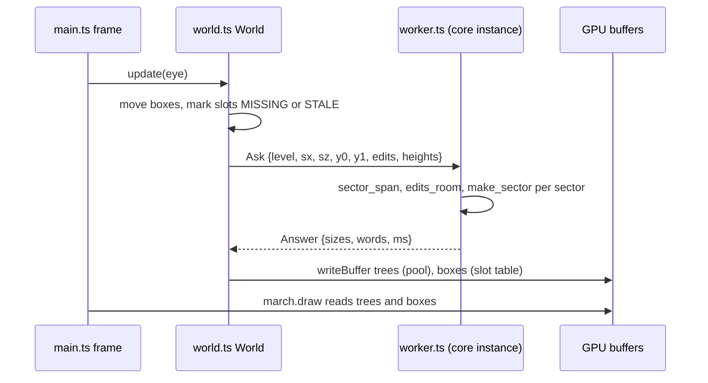

`engine/page` is the browser side of [the engine](/engine). It keeps the sectors around the eye on the GPU, draws them by marching a ray per pixel in WGSL, and draws everything else over that picture. It uses raw WebGPU with no framework or bundler: `engine/serve.mjs` serves the TypeScript files with Node's type stripping. Start it with `npm run serve` (in `engine/`) and open `/city`.

## Concepts

- **Box** (`Level` in `engine/page/world.ts`). For each level, a fixed grid of sector slots centred on the eye. Level 0 holds 10 cm cells; each further box has cells twice as large and reaches twice as far. A sector's slot is its position wrapped around the box, so moving the eye fills slots at the edges and moves nothing else.
- **Slot state.** `MISSING`, `QUEUED`, `FLYING`, `READY`, `STALE`, `STALE_FLYING`. A slot whose sector was edited is `STALE`: it keeps showing the old tree until the new one arrives.
- **Pool** (`Pool` in `world.ts`). One GPU storage buffer of words, labelled `trees`, that holds every sector's tree. First fit, in runs of 64 words. A second buffer, `boxes`, holds each box's slot table, masks and column heights.
- **Ask and Answer** (`engine/page/worker.ts`). The message to a sector worker and its reply. Shown below.
- **Marcher** (`engine/page/march.ts`). Draws the world into a target with a colour and a depth texture. Flags such as `SHADOWS`, `MIRRORS` and `PICK` change what one draw does.
- **View** (`View` in `march.ts`). The eye in finest cells and the camera axes. Every pass gets the same view.
- **Sun maps** (`engine/page/sun.ts`). One shadow map per box, drawn a few tiles a frame. A place whose tile is not yet drawn is answered from the next coarser box's map, and by tracing a ray toward the sun only where no box has one. See [the sun's share of a frame](#the-suns-share-of-a-frame).
- **Far model** (`engine/page/far.ts`). In San Francisco, the city past the cells' reach is drawn as baked faces. The march leaves those pixels to it (`farCover`) once verified faces are loaded, and `World` skips redundant coarse tiles over surveyed `far.ground` (`farCovered`) while streaming fallback cells on demand via `onFallback` → `refreshFar` if a far tile fails or overflows edits.

## How sectors reach the GPU



A worker keeps nothing between asks. Each ask carries every edit that reaches its column, so any worker can answer any ask, and a worker that fails is replaced and its asks sent again (`hire` in `world.ts`). An answer to an older ask for the same slot is dropped.

{/* schema engine/page/worker.ts Ask,Answer */}
```ts
export interface Ask {
    id: number;
    level: number;
    sx: number;
    sz: number;
    y0: number;
    y1: number;
    edits: Int32Array;
    heights: Int32Array;
    fine?: number;
    bricks?: boolean;
}

export interface Answer {
    id: number;
    level: number;
    sx: number;
    sz: number;
    y0: number;
    sizes: Uint32Array<ArrayBuffer>;
    words: Uint32Array<ArrayBuffer>;
    ms: number;
    refused: number;
    lacking?: boolean;
}
```

In `sizes`, each sector from `y0` up has 0 for air, 1 for a single kind (the one word is that kind) or the number of words in its tree. `words` holds the trees one after another. `edits` uses the core's [edit format](/engine-core#the-edit-format). `lacking` means a San Francisco tile did not arrive, so the column was made as water and will be asked for again.

## Files to know

| File | Owns |
| --- | --- |
| `main.ts` | Start-up, the frame loop, tools, the `engine` object on `globalThis` that checks and plugins use. |
| `world.ts` | Boxes, slots, the pool, asks to workers. |
| `worker.ts` | One core instance that makes sectors. |
| `march.ts` | The ray marcher's WGSL and pipelines. `engine.march.reshade` swaps its shader while the page runs. |
| `sun.ts`, `far.ts`, `water.ts`, `people.ts`, `pieces.ts`, `crumbs.ts`, `puffs.ts`, `tracks.ts` | The other passes of a frame. `pieces.ts` draws a body's glass after its solid faces, tinting what is behind it; with mirrors off it still tints but mirrors nothing, so a car is seen out of from its seat on every preset (#74). |
| `deform.ts` | Vehicle damage: dents, scuffs, cracked glass and engine damage recorded from crashes, packed for `pieces.ts` (see [vehicle damage](#vehicle-damage)). |
| `fine.ts`, `streetfaces.ts` | Faces of things in cells finer than the world's (vehicles' looks). `facesWithSmooth` also gives each outside face smooth words at its four corners: a normal fitted to the shape round the corner and how open it is (#38). The street's cars get theirs in the `streetfaces.ts` worker. |
| `edits.ts` | Building edits as the core reads them. |
| `mover.ts`, `link.ts` | What moves loose bodies: a local worker, or the shared world's stream. |
| `living.ts`, `person.ts`, `people.ts`, `residents.ts` | Living things, a person's own body, figures and the town's residents ([living things and people](/living)). |
| `street.ts`, `robotaxi-services.ts`, `ojai-sculpt.ts`, `robotaxi.ts` | San Francisco pedestrians, traffic and charging depots. Each robotaxi operator supplies a name, a livery, traffic shares and a station location. Operators share the Ojai model and the driving and crowd behavior. |
| `input.ts` | Keys, pointer, touch and gamepad for play. Modes form a stack; a lane pushes its own mode and pops it. |
| `hud.ts` | The DOM over the picture: the ask bar, cues, notices, panels. |
| `radio-ui.ts`, `sound/radio.ts`, `sound/radio-providers.ts` | Procedural offline FM car radio (`N` cycles), zero-login YouTube / YouTube Music streaming (official IFrame Player API with `>=200×200` visible mini-player and saved playlists; Spotify PKCE and Apple MusicKit JS v3 kept behind `ENABLED_STREAMING_PROVIDERS`), curated SF driving playlists, Waymo-style media picker (`R` while driving or Settings `Radio…`), horn/collision ducking, and Doppler pass-by whooshes. |
| `ask.ts`, `making.ts`, `kept.ts`, `maker.ts`, `models.ts` | The ask bar's wishes: the helper, the ghost of what is kept, and making in the page with a visitor's own AI ([making](/making)). |
| `drive-cam.ts`, `cockpit.ts`, `wheels.ts`, `summon.ts`, `gamepad.ts`, `stunts.ts`, `entry.ts`, `explore.ts` | Driving cameras, the first-person cockpit, drawn car wheels, summoning a car, the gamepad, stunts, the 3D Map-to-Reality Optical Dive world entry and map fast travel (`entry.ts`), and the EXPLORE board ([gameplay](/gameplay)). |
| `car-sculpt.ts` | The GT coupe (`sculptCoupe`: `car`, `KEPT.car`, the `G` summon and the SF library coupe) and racing kart (`sculptKart`: `KEPT.kart`) sculpted from continuous shapes, plus `coarser` and the edge-leak sealer that keep vehicle shells closed across levels. |
| `minimap.ts`, `map-gpu.ts`, `gps.ts` | The 3D minimap, the full-screen 2D/3D map, GPS routes, and 0-frame-lag Map-to-Reality dive rendering ([gameplay](/gameplay)). |
| `realms.ts`, `portal.ts`, `wheel.ts` | Stepping between realms without a reload ([realms](/engine-plugins#realms)). |
| `door.ts`, `lobbies.ts` | Joining a lobby on someone else's machine ([multiplayer](/multiplayer)). |
| `plugins.ts` | Loading plugin page sides and the pass registry ([page plugin types](/plugin-types)). |
| `recorder.ts`, `feedback.ts` | 30 s black-box gameplay flight recorder, passive anomaly watchers (stuck player, vehicle overlap, falls, stalls, GPU/worker faults), synchronous WebGPU canvas capture, and the F8 / `/bug` feedback dialog (`engine.recorder`, `engine.feedback`). |
| `bay.ts` | Loading the core (`open`), San Francisco tiles from a release, and cell-to-WGS84/tile helpers (`latLon`, `tileOf`) ([worlds as cells](/cells)). |

## The sun's share of a frame

A tile of a sun map is 4,096 rays that each go through everything up-sun of them. Whenever the eye moves, tiles scroll in at the maps' edges and every box that moved wants its tiles drawn again. What a tile takes of the GPU depends on the place and the hour: 0.4 ms in San Francisco at midday, 3.5 ms there with the sun low, 2.5 to 3 ms in the town. In the town, on a GPU that other work was drawing on, eight tiles in a frame made about one frame in twelve late at any speed from 60 km/h, with the page's own thread at 2 ms a frame. With the tiles held to a share, none came late in the same session (#73). On a quiet GPU neither did, and in San Francisco at midday the share changed nothing that was measured.

- While the eye moves faster than a metre a second, tiles get a twelfth of the frame's time on the GPU (`sunMost` in `main.ts`). The page measures what a tile takes with timestamp queries round the tile passes (`tend` in `march.ts`) and counts the share in tiles. A tile that costs more than the share is drawn every few frames.
- An eye that stands still gets eight tiles a frame, as before. Nothing passes there for a late frame to show in, and the first picture's shadows are traced ray by ray until its tiles are drawn.
- A tile's rays never enter a finer box, so a map is drawn as soon as its own box and every coarser one is whole but for a layer of sectors at each side (`wholeFrom` in `world.ts`). Going fast, the finest boxes are always being made; the coarser maps no longer wait for them.
- `engine.sunRoom` reports the measured tile time and the last frame's count. `?suntiles=8` (or setting `engine.sunRoom.fixed`) draws a fixed number a frame, to measure what the share is worth.

## Where a moving thing is drawn

The mover (`engine/page/mover.ts`) is asked once a frame to move bodies on by the time the last frame took, and its answer is what the next frame draws. A body is therefore drawn where it was a frame ago. With every frame on time nobody can tell. A frame that comes late shows the body at half speed and then double speed, and an answer that arrives after the next frame has begun shows it standing still for a frame and then jumping: 0.9 m at 200 km/h, and the eye that rides a car jumps with it. In San Francisco the mover's steps are slower than in the town, so driving fast there showed the car standing or jumping in 2 to 5% of frames (#73).

`drawAhead` in `main.ts` draws each body the last step moved on from where that step left it, the way it went in that step, to the time of the frame being drawn. It goes on a tenth of a second at most, and not for a body that was set down somewhere else. A body the last step did not move lies where the mover said. `?ahead=0` or `engine.ahead = false` draws bodies as the mover last said them, for measuring: the `--ahead` mode of the [drive-smooth check](#check-a-change) drives the same car both ways in one session.

## Vehicle damage

Every drivable car and kart wears a 2.5 cm fine look (`car()`, `KEPT.car`, `KEPT.kart`, and street cars), so every car dents where it is struck (#37, #61). The core reports each crash as a `STRUCK` record with a place, a closing speed and a push, but no direction; street-car impacts also dent both vehicles immediately through `living.hit`, and blows on a car before its fine look arrives are queued and replayed as soon as the look loads. `living.ts` keeps the hardest blow each vehicle took in one answer. For a blow at 1.8 m/s or more, it gives each part of the look a dent at that place, pushed in from the side of the part's box nearest the hit. `deform.ts` holds up to six dents a part. Each dent has a centre, a radius, a direction and a depth, all in the part's own cells. Nearby blows deepen an existing dent, and blows near the driver's eye and seats are kept out of it: no dent, however it is moved, reaches that room. The same record holds how scuffed the paint is, how damaged the engine is, and how cracked each of the four window zones (front, rear, left, right) is.

`pieces.ts` bends the vertices of a struck piece as it draws them.

- A struck piece draws from a copy of its faces cut into rows one cell long. Every corner then lies on the cell lattice, so faces that meet still meet once bent. Merged rows bent only at their ends opened gaps beside their neighbours. A piece never struck draws its merged faces, and the shader returns before any dent work.
- Paint and lamps keep the unbent position, so a bent panel keeps its own paint.
- The hit pushes the panel inward. Two flanks meet at an oblique crease. The upper sheet tucks into a diagonal joint, pinching the struck side of the grille. A low lip turns back toward the windshield behind the tuck. A broadside hit presses in the door between the creases. The painted shoulder folds above the contact. A hard strike against a wheel opening can split the painted lip and expose the inner metal. The body and wheel mounts share the same depth allowance and deformation. The clear coat dulls on the flanks. A small patch of primer and a few bare chips show along the fold. A directly struck lamp goes dark.
- Each window keeps its own crack origin in `Piece.cracks[0..3]`. Fine radial cracks and short connecting fractures wrap around the glass from that point. From the seat the cracks scatter less light near the forward sightline.
- Drawn 3D wheels (`wheels.ts`) evaluate the same dent field on the CPU (`deformPointCpu` in `deform.ts`) across the hub and surrounding wheel arch so a crushed corner shifts and tilts its wheel inward with the bent fender. `carveWheelWells` preserves painted fender skin and lines recessed wheel-well walls in dark matte liner so bent arches show no bright inner wall or dark stair-step seam.

Crashes at 2.8 m/s or more throw sparks, road dust and flakes of paint and trim. A newly cracked window also sheds glass. Broken wood and foliage from the surroundings scatter as small matte splinters. Pale steam, then grey smoke and finally flame escape at the grille or lamp opening nearest the struck corner. The broken housing loses its lens, including the amber tip. Its back and side walls remain visible. The flame starts in the empty space behind the torn lip and follows it as the car moves. The escaping vapour becomes visible as it rises clear of the body. Reduced motion suppresses the debris and thins the smoke. Press `F` while driving (touch **Repair**, gamepad D-pad right) or call `living.repair(thing)` to restore the body, wheels, windows and engine. Removing the car clears its damage. `node engine/test/dents.mjs` checks the struck corner against the repaired view, the driver’s sightline, horizontal streaks on glass after a side hit, the flame’s rendered position as the car turns, wheel alignment, per-window cracks and repair.

## Invariants

- Keys, pointer and touch for play go through `input.ts`: a lane pushes a mode on its stack and pops it, rather than reading keys itself. Some DOM panels, such as the EXPLORE board (`explore.ts`), world entry (`entry.ts`), and the AI dialog (`connect.ts`), still listen for their own events.
- A pass records into the encoder it is given and reads the target's depth to sit behind nearer things.
- A page in a shared world applies changes only as the world's stream orders them.

## Check a change

```sh
cd engine
npm run typecheck
node test/all.mjs --changed       # the page checks that cover what you changed
node test/bench.mjs               # frame cost before and after
node test/drive-smooth.mjs        # going fast against standing: late frames, the page's thread, the sun's tiles
```

`test/drive-smooth.mjs` carries the eye along a straight street at 180 km/h with the picture's size pinned and compares it with the same page standing still. `--curve` runs 0, 60, 120 and 180 km/h in one session, `--car` drives the summoned coupe, `--ahead` drives it with and without `drawAhead` in turn, `--busy` has a second page draw beside it, `--profile` adds Chrome's samples of the page's thread, and `--sf <folder>` serves this checkout's page over a San Francisco folder that `engine/sf/build.mjs` wrote, without copying its tiles.

Add `?pool=`, `?grid=` or `?levels=` to `/city` to try other sizes for the pool, the boxes and the number of levels.
