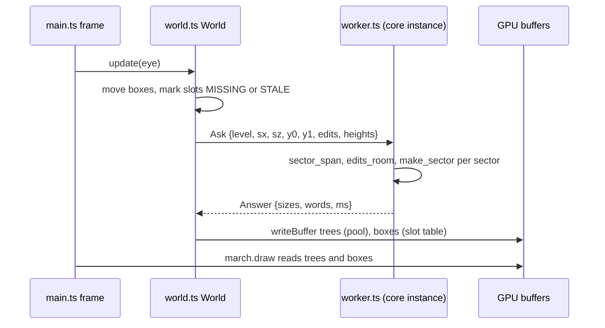

# The page

`engine/page` is the browser side of [the engine](engine.md). It keeps the sectors around the eye on the GPU, draws them by marching a ray per pixel in WGSL, and draws everything else over that picture. It uses raw WebGPU with no framework or bundler: `engine/serve.mjs` serves the TypeScript files with Node's type stripping. Start it with `npm run serve` (in `engine/`) and open `/city`.

## Concepts

- **Box** (`Level` in `engine/page/world.ts`). For each level, a fixed grid of sector slots centred on the eye. Level 0 holds 10 cm cells; each further box has cells twice as large and reaches twice as far. A sector's slot is its position wrapped around the box, so moving the eye fills slots at the edges and moves nothing else.
- **Slot state.** `MISSING`, `QUEUED`, `FLYING`, `READY`, `STALE`, `STALE_FLYING`. A slot whose sector was edited is `STALE`: it keeps showing the old tree until the new one arrives.
- **Pool** (`Pool` in `world.ts`). One GPU storage buffer of words, labelled `trees`, that holds every sector's tree. First fit, in runs of 64 words. A second buffer, `boxes`, holds each box's slot table, masks and column heights.
- **Ask and Answer** (`engine/page/worker.ts`). The message to a sector worker and its reply. Shown below.
- **Marcher** (`engine/page/march.ts`). Draws the world into a target with a colour and a depth texture. Flags such as `SHADOWS`, `MIRRORS` and `PICK` change what one draw does.
- **View** (`View` in `march.ts`). The eye in finest cells and the camera axes. Every pass gets the same view.
- **Sun maps** (`engine/page/sun.ts`). One shadow map per box, drawn a few tiles a frame. A tile not yet drawn falls back to tracing a ray toward the sun.
- **Far model** (`engine/page/far.ts`). In San Francisco, the city past the cells' reach is drawn as baked faces. The march leaves those pixels to it (`farCover`).

## How sectors reach the GPU



A worker keeps nothing between asks. Each ask carries every edit that reaches its column, so any worker can answer any ask, and a worker that fails is replaced and its asks sent again (`hire` in `world.ts`). An answer to an older ask for the same slot is dropped.

<!-- schema engine/page/worker.ts Ask,Answer -->
```ts
export interface Ask {
    id: number;
    level: number;
    sx: number;
    sz: number;
    y0: number;
    y1: number;
    edits: Int32Array;
    heights: Int32Array;
    fine?: number;
    bricks?: boolean;
}

export interface Answer {
    id: number;
    level: number;
    sx: number;
    sz: number;
    y0: number;
    sizes: Uint32Array<ArrayBuffer>;
    words: Uint32Array<ArrayBuffer>;
    ms: number;
    refused: number;
    lacking?: boolean;
}
```

In `sizes`, each sector from `y0` up has 0 for air, 1 for a single kind (the one word is that kind) or the number of words in its tree. `words` holds the trees one after another. `edits` uses the core's [edit format](engine-core.md#the-edit-format). `lacking` means a San Francisco tile did not arrive, so the column was made as water and will be asked for again.

## Files to know

| File | Owns |
| --- | --- |
| `main.ts` | Start-up, the frame loop, tools, the `engine` object on `globalThis` that checks and plugins use. |
| `world.ts` | Boxes, slots, the pool, asks to workers. |
| `worker.ts` | One core instance that makes sectors. |
| `march.ts` | The ray marcher's WGSL and pipelines. `engine.march.reshade` swaps its shader while the page runs. |
| `sun.ts`, `far.ts`, `water.ts`, `people.ts`, `pieces.ts`, `crumbs.ts`, `puffs.ts`, `tracks.ts` | The other passes of a frame. |
| `edits.ts` | Building edits as the core reads them. |
| `mover.ts`, `link.ts` | What moves loose bodies: a local worker, or the shared world's stream. |
| `living.ts`, `drive-cam.ts` | Driven vehicles, telemetry, and the five-mode cinematic driving camera suite (`C` cycles, `X` looks back, `V` toggles the driver seat). |
| `input.ts` | Keys, pointer, touch and gamepad for play. Modes form a stack; a lane pushes its own mode and pops it. |
| `gamepad.ts` | Standard W3C Gamepad API input (analog triggers, steering curves, right-stick orbit, dual-motor haptic rumble) and touch steering curve. Zero polling overhead until `gamepadconnected`. |
| `hud.ts` | The DOM over the picture: the ask bar, cues, notices, panels. |
| `stunts.ts` | Driving stunt and combo tracker (`engine.stunts`): drifts, hill jumps, 180/360 spins, traffic near-misses (`voxelwright:nearmiss`), speed runs, x1–x5 combos, banking chime, and `[data-panel="stunts"]`. |
| `plugins.ts` | Loading plugin page sides and the pass registry ([page plugin types](plugin-types.md)). |
| `bay.ts` | Loading the core (`open`) and San Francisco tiles from a release ([worlds as cells](cells.md)). |

## Invariants

- Keys, pointer and touch for play go through `input.ts`: a lane pushes a mode on its stack and pops it, rather than reading keys itself. Some DOM panels, such as the EXPLORE board (`explore.ts`) and the AI dialog (`connect.ts`), still listen for their own events.
- A pass records into the encoder it is given and reads the target's depth to sit behind nearer things.
- A page in a shared world applies changes only as the world's stream orders them.

## Check a change

```sh
cd engine
npm run typecheck
node test/all.mjs --changed       # the page checks that cover what you changed
node test/bench.mjs               # frame cost before and after
```

Add `?pool=`, `?grid=` or `?levels=` to `/city` to try other sizes for the pool, the boxes and the number of levels.

<!-- docs-verified 7395eccfb62b043807f729073dfc0b4483063163 {"engine/page/worker.ts":"e99afb289778a685cc5c0fc996cc3c2e","engine/page/world.ts":"9ddf726d184807da7cbb5267b9f8fb4b","engine/page/march.ts":"2dd1ea66bf0292768b2f55c8749524ee","engine/page/main.ts":"4db19705b2d4d1cd08864bb529d3159c","engine/package.json":"83c296e8585f38f1346548d6aed7e5bb","engine/page/input.ts":"87ea91747fb483c7955adaed7cde6121","engine/page/plugins.ts":"bccd33977348a0dc89afed82531a0a2f","engine/page/explore.ts":"0125e7ca46dc9c20396443fc70f93c22"} -->
