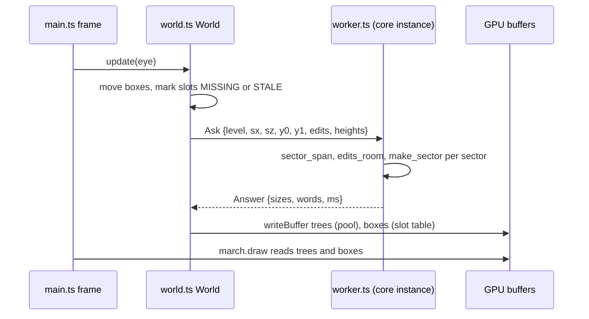

`engine/page` is the browser side of [the engine](/engine). It keeps the sectors around the eye on the GPU, draws them by marching a ray per pixel in WGSL, and draws everything else over that picture. It uses raw WebGPU with no framework or bundler: `engine/serve.mjs` serves the TypeScript files with Node's type stripping. Start it with `npm run serve` (in `engine/`) and open `/city`.

## Concepts

- **Box** (`Level` in `engine/page/world.ts`). For each level, a fixed grid of sector slots centred on the eye. Level 0 holds 10 cm cells; each further box has cells twice as large and reaches twice as far. A sector's slot is its position wrapped around the box, so moving the eye fills slots at the edges and moves nothing else.
- **Slot state.** `MISSING`, `QUEUED`, `FLYING`, `READY`, `STALE`, `STALE_FLYING`. A slot whose sector was edited is `STALE`: it keeps showing the old tree until the new one arrives.
- **Pool** (`Pool` in `world.ts`). One GPU storage buffer of words, labelled `trees`, that holds every sector's tree. First fit, in runs of 64 words. A second buffer, `boxes`, holds each box's slot table, masks and column heights.
- **Ask and Answer** (`engine/page/worker.ts`). The message to a sector worker and its reply. Shown below.
- **Marcher** (`engine/page/march.ts`). Draws the world into a target with a colour and a depth texture. Flags such as `SHADOWS`, `MIRRORS` and `PICK` change what one draw does.
- **View** (`View` in `march.ts`). The eye in finest cells and the camera axes. Every pass gets the same view.
- **Sun maps** (`engine/page/sun.ts`). One shadow map per box, drawn a few tiles a frame. A tile not yet drawn falls back to tracing a ray toward the sun.
- **Far model** (`engine/page/far.ts`). In San Francisco, the city past the cells' reach is drawn as baked faces. The march leaves those pixels to it (`farCover`).

## How sectors reach the GPU



A worker keeps nothing between asks. Each ask carries every edit that reaches its column, so any worker can answer any ask, and a worker that fails is replaced and its asks sent again (`hire` in `world.ts`). An answer to an older ask for the same slot is dropped.

{/* schema engine/page/worker.ts Ask,Answer */}
```ts
export interface Ask {
    id: number;
    level: number;
    sx: number;
    sz: number;
    y0: number;
    y1: number;
    edits: Int32Array;
    heights: Int32Array;
    fine?: number;
    bricks?: boolean;
}

export interface Answer {
    id: number;
    level: number;
    sx: number;
    sz: number;
    y0: number;
    sizes: Uint32Array<ArrayBuffer>;
    words: Uint32Array<ArrayBuffer>;
    ms: number;
    refused: number;
    lacking?: boolean;
}
```

In `sizes`, each sector from `y0` up has 0 for air, 1 for a single kind (the one word is that kind) or the number of words in its tree. `words` holds the trees one after another. `edits` uses the core's [edit format](/engine-core#the-edit-format). `lacking` means a San Francisco tile did not arrive, so the column was made as water and will be asked for again.

## Files to know

| File | Owns |
| --- | --- |
| `main.ts` | Start-up, the frame loop, tools, the `engine` object on `globalThis` that checks and plugins use. |
| `world.ts` | Boxes, slots, the pool, asks to workers. |
| `worker.ts` | One core instance that makes sectors. |
| `march.ts` | The ray marcher's WGSL and pipelines. `engine.march.reshade` swaps its shader while the page runs. |
| `sun.ts`, `far.ts`, `water.ts`, `people.ts`, `pieces.ts`, `crumbs.ts`, `puffs.ts`, `tracks.ts` | The other passes of a frame. |
| `deform.ts` | Vehicle damage: dents, scuffs, cracked glass and engine damage recorded from crashes, packed for `pieces.ts` (see [vehicle damage](#vehicle-damage)). |
| `fine.ts`, `streetfaces.ts` | Faces of things in cells finer than the world's (vehicles' looks). `facesWithSmooth` also gives each outside face smooth words at its four corners: a normal fitted to the shape round the corner and how open it is (#38). The street's cars get theirs in the `streetfaces.ts` worker. |
| `edits.ts` | Building edits as the core reads them. |
| `mover.ts`, `link.ts` | What moves loose bodies: a local worker, or the shared world's stream. |
| `living.ts`, `person.ts`, `people.ts`, `residents.ts` | Living things, a person's own body, figures and the town's residents ([living things and people](/living)). |
| `street.ts`, `robotaxi-services.ts`, `ojai-sculpt.ts`, `robotaxi.ts` | San Francisco street life (parked and moving traffic, pedestrians, cable cars) and service-agnostic autonomous robotaxis (declarative multi-service registry in `robotaxi-services.ts` with PayMo as the primary fleet, sculpted Waymo Ojai monobox EVs in `ojai-sculpt.ts`, spinning roof LiDAR, 4-way amber hazards, intersection/narrow-street freezes with bystander filming/yelling and blocked-car honking, and per-service charging stations). |
| `input.ts` | Keys, pointer, touch and gamepad for play. Modes form a stack; a lane pushes its own mode and pops it. |
| `hud.ts` | The DOM over the picture: the ask bar, cues, notices, panels. |
| `ask.ts`, `making.ts`, `kept.ts`, `maker.ts`, `models.ts` | The ask bar's wishes: the helper, the ghost of what is kept, and making in the page with a visitor's own AI ([making](/making)). |
| `drive-cam.ts`, `cockpit.ts`, `wheels.ts`, `summon.ts`, `gamepad.ts`, `stunts.ts`, `entry.ts`, `explore.ts` | Driving cameras, the first-person cockpit, drawn car wheels, summoning a car, the gamepad, stunts, the 3D Map-to-Reality Optical Dive world entry and map fast travel (`entry.ts`), and the EXPLORE board ([gameplay](/gameplay)). |
| `car-sculpt.ts` | The GT coupe (`sculptCoupe`: `car`, `KEPT.car`, the `G` summon and the SF library coupe) and racing kart (`sculptKart`: `KEPT.kart`) sculpted from continuous shapes, plus `coarser` and the edge-leak sealer that keep vehicle shells closed across levels. |
| `minimap.ts`, `map-gpu.ts`, `gps.ts` | The 3D minimap, the full-screen 2D/3D map, GPS routes, and 0-frame-lag Map-to-Reality dive rendering ([gameplay](/gameplay)). |
| `realms.ts`, `portal.ts`, `wheel.ts` | Stepping between realms without a reload ([realms](/engine-plugins#realms)). |
| `door.ts`, `lobbies.ts` | Joining a lobby on someone else's machine ([multiplayer](/multiplayer)). |
| `plugins.ts` | Loading plugin page sides and the pass registry ([page plugin types](/plugin-types)). |
| `bay.ts` | Loading the core (`open`) and San Francisco tiles from a release ([worlds as cells](/cells)). |

## Vehicle damage

Every drivable car and kart wears a 2.5 cm fine look (`car()`, `KEPT.car`, `KEPT.kart`, and street cars), so every car dents where it is struck (#37, #61). The core reports each crash as a `STRUCK` record with a place, a closing speed and a push, but no direction; street-car impacts also dent both vehicles immediately through `living.hit`, and blows on a car before its fine look arrives are queued and replayed as soon as the look loads. `living.ts` keeps the hardest blow each vehicle took in one answer. For a blow at 1.8 m/s or more, it gives each part of the look a dent at that place, pushed in from the side of the part's box nearest the hit. `deform.ts` holds up to six dents a part. Each dent has a centre, a radius, a direction and a depth, all in the part's own cells. Nearby blows deepen an existing dent, and blows near the driver's eye and seats are kept out of it: no dent, however it is moved, reaches that room. The same record holds how scuffed the paint is, how damaged the engine is, and how cracked each of the four window zones (front, rear, left, right) is.

`pieces.ts` draws a struck piece bent, in its vertex shader, with no new meshing:

- A struck piece draws from a copy of its faces cut into rows one cell long. Every corner then lies on the cell lattice, so faces that meet still meet once bent. Merged rows bent only at their ends opened gaps beside their neighbours. A piece never struck draws its merged faces, and the shader returns before any dent work.
- Paint and lamps keep the unbent position, so a bent panel keeps its own paint.
- In a dent, the outside paint is scraped to primer and bare steel and loses some of its clear coat. Inside the cabin, nothing is scraped. A blow that cracks a window marks the glass cell nearest it for that window zone (`Piece.cracks[0..3]`), leaving earlier origins on other windows untouched. Each cracked window breaks into a mosaic with a web of cracks spreading from its own struck cell, wider for a harder blow, and the view still shows through.
- Drawn 3D wheels (`wheels.ts`) evaluate the same dent field on the CPU (`deformPointCpu` in `deform.ts`) across the hub and surrounding wheel arch so a crushed corner shifts and tilts its wheel inward with the bent fender. `carveWheelWells` preserves painted fender skin and lines recessed wheel-well walls in dark matte liner so bent arches show no bright inner wall or dark stair-step seam.

Crashes at 2.8 m/s or more throw sparks, dust, chips of the struck paint and, when a window cracked, glass. A damaged engine steams, then smokes and finally burns (`puffs.ts` `engine`). Where `prefers-reduced-motion` is set, the debris is left out and the smoke is lighter. Pressing `F` while driving (touch **Repair**, gamepad D-pad right) or calling `living.repair(thing)` restores the look, cracks, wheels and engine to as made. Dents go with the look when the thing breaks, is taken away, or the world is forgotten, so a new car never inherits them. `node engine/test/dents.mjs` crashes the car into a block and checks the dent, bent wheel offset and tilt, per-window crack origins, the driver's clear room, the picture of the struck corner against the same view repaired, and `F` repair from the drive card.

## Invariants

- Keys, pointer and touch for play go through `input.ts`: a lane pushes a mode on its stack and pops it, rather than reading keys itself. Some DOM panels, such as the EXPLORE board (`explore.ts`), world entry (`entry.ts`), and the AI dialog (`connect.ts`), still listen for their own events.
- A pass records into the encoder it is given and reads the target's depth to sit behind nearer things.
- A page in a shared world applies changes only as the world's stream orders them.

## Check a change

```sh
cd engine
npm run typecheck
node test/all.mjs --changed       # the page checks that cover what you changed
node test/bench.mjs               # frame cost before and after
```

Add `?pool=`, `?grid=` or `?levels=` to `/city` to try other sizes for the pool, the boxes and the number of levels.
