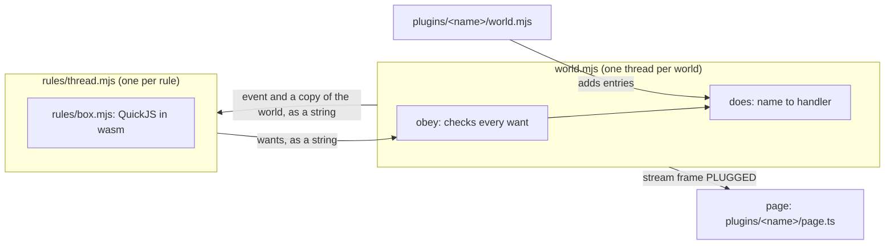

A shared world (see [the engine](/engine)) changes while it runs, in two ways. A **rule** is a script anyone or their model wrote. It runs in a sandbox and can only ask the world for things. A **plugin** is trusted engine code from the checkout's `engine/plugins` folder. It adds something new that rules can hear or do, and it can draw on the page. Neither needs a restart or a page reload. A world with its own record is a **realm**: one server keeps many, each with its own rules, and a static page runs one alone.

## Concepts

- **Rule.** Source text of at most `SOURCE_MOST` characters, kept with the world under an id. It listens with `on(name, fn)`. The handler receives a copy of the world and returns what it wants done.
- **Want.** One thing a rule asks for, such as `world.actor(id, {...})`. Wants are data. The world process checks every field (`obey` in `engine/world.mjs`, then the handler for that want) and refuses what is wrong. The rule hears `refused`.
- **Actor.** A body the world moves for a rule. Everyone sees it. See [living things and people](/living).
- **Guide.** The text served at `GET /world/`. It lists every event a rule hears and every want it may make, with limits. It is `GUIDE` in `engine/serve.mjs` plus the `guide.txt` of each plugin that loaded. Models that write rules are shown this text, so it is the rule API.
- **Plugin.** A folder `engine/plugins/<name>/` with up to four files, below.
- **Realm.** A world with its own record. One server keeps many, each with its own file, rules and people, and one of them is home. A static page runs a realm of its own with no server ([below](#realms)).

## Where code runs



The world process never runs a line of a rule. It posts an event to the rule's thread and keeps its own clock. The answer comes back later as a message.

## Rules

Put a rule into a running world with one ask, then read how it is doing:

```sh
cd engine
node serve.mjs --port 5741 --world ~/.village/engine/world/try.log   # then open /city?shared=1
curl -s -X POST http://127.0.0.1:5741/world/ask -d '{"by": "me", "rule": {"id": "greeter", "name": "A greeter", "source": "on(\"said\", (world, e) => world.actor(\"guide\", {name: \"Odile\", at: [700, 4009], say: \"Hello, \" + e.name}))"}}'
curl -s http://127.0.0.1:5741/world/rules   # running, calls, ms, what it got wrong
curl -s http://127.0.0.1:5741/world/         # the guide: everything a rule hears and may do
```

- **Changed while it runs.** Put again under the same id, a rule keeps its actors where they stand and what it kept in `world.keep`.
- **Kept with the world.** The asks that put a rule in and took it out are in the world's file. A world started again has its rules, each with its actors and what it kept (`<world file>.people.json`). Their `start` is told `why: "restart"`.
- **What a person types is something heard.** `e.text` and names reach a rule as text to match or to pass on, never as code.

The full list of events and wants is the guide itself. [engine/test/whole.mjs](https://github.com/voxelwright/voxelwright/blob/main/engine/test/whole.mjs) keeps most of them in `HEARS` and `DOES`, and fails a merge that takes one of those away. The table groups them.

| Area | A rule hears | A rule may ask | Lives in |
| --- | --- | --- | --- |
| Talk and time | `start`, `said`, `spoke`, `tick`, `near` | `actor`, `mark`, `gone` | `world.mjs`, `plugins/gone` |
| Minds | `thought`, `read` | `think`, `read` | `engine/mind` ([living](/living)) |
| Bodies | `struck`, `landed`, `ride`, `crossed`, `arrived`, `broke` | `person`, `clock`, `throw`, `push`, `down`, `drive`, `seat`, `thing`, `line` | `engine/rules` |
| Hands | `act`, `pick`, `held`, `put`, `thrown` | `offer`, `show`, `give`, `take` | `rules/hands.mjs`, `rules/holding.mjs` |
| The world | `built`, `ground`, `seen` | `blast`, `ignite`, `build`, `ground`, `look`, `matter`, `paint` | `rules/blows.mjs`, plugins |
| Sound | | `sound`, `music` | `plugins/sound`, `plugins/music` |
| Other rules and models | `asked`, `answered` | `ask`, `answer`, `make`, `write` | `plugins/ask`, `plugins/make`, `plugins/write` |
| Anything refused | `refused` | | `obey` in `world.mjs` |

`world.people`, `world.near`, `world.residents`, `world.things` and `world.keep` are read from the copy each call gets.

### The rule sandbox

The limits are constants in `engine/rules/run.mjs` and `engine/rules/box.mjs`:

| Limit | Value | Where |
| --- | --- | --- |
| Rules per world | `RULES_MOST` = 16 | `run.mjs` |
| Rule source | `SOURCE_MOST` = 65,536 characters | `run.mjs` |
| Starting | `START_MOST` = 30 s to start and run its own text | `run.mjs` |
| Memory | a WebAssembly memory with a maximum of `PAGES_MOST` = 512 pages (32 MB) | `box.mjs` |
| Work per call | about 10 ms of interpreter steps (`ASKS` interrupt checks), then the call is interrupted | `box.mjs` |
| Wall clock per call | `CALL_MOST` = 1000 ms, then the rule's thread is ended | `run.mjs` |
| Answer size | `ANSWER_MOST` = 256 KB | `box.mjs` |
| Kept memory (`world.keep`) | `KEEP_MOST` = 64 KB of JSON | `run.mjs` |
| Failures | `STRIKES` = 5; a good call takes `MENDS` = 0.25 off. At the limit the rule is stopped. | `run.mjs` |
| Actors per rule | `ACTORS_MOST` = 64 | `world.mjs` |
| Wants per answer | `WANTS_MOST` = 64 | `world.mjs` |

Nothing is bound into the interpreter: it has no timers, network, files or imports. One string goes in and one comes out. The memory limit is the WebAssembly maximum, not QuickJS's own setting, which a rule can outgrow. Interrupts count steps rather than time, so a busy machine does not stop a rule a quiet one would let run. The wall clock ends what the count does not see, such as a regex that backtracks. A stopped rule stays in the world's file and `GET /world/rules` says why. Putting it again starts it afresh.

### A model writes a rule

`engine/make/rules.mjs` has the asker's own Claude Code write a rule from words, on their own machine:

```sh
cd engine
node make/rules.mjs "a busker who plays when someone stops to listen" --world http://127.0.0.1:5741 --at 700,155,4060
```

1. The model is given the guide, fetched from the server each time, so it writes against what this build can really do.
2. It answers with the rule and with a list of what it could not do with what the engine offers. That list goes to `~/.village/engine/cannot.jsonl` and to the server (`POST /world/gap`). It is the input of [the workshop](https://github.com/voxelwright/voxelwright/tree/main/engine/workshop).
3. The rule is tried in a world of its own, with someone standing beside it who talks and walks. One that does not start, goes wrong or is slow is sent back with why, up to three times. After that the best one that ran is put in, marked rough.

`--change id` changes a rule that is there. The ask bar reaches the same writer through the helper's `/rule`, `/imagine` and `/realm`. A realm may also keep a rule under the id `director` (`engine/make/director.mjs`), which watches how people play and stirs things up. The world lets it run only while the realm's record says `director: true` and someone's model answers for the world.

## Realms

One server keeps many worlds. Each realm is the same planet by the same rule, with its own file of what was done there, its own rules and people, a place where one arrives and a look of its own. Home is the world of `--world`, which `/world/…` and `?shared=1` mean.

```sh
cd engine
node serve.mjs --port 5770 --world ~/.village/engine/realms/try/home.log --idle 300
curl -s -X POST http://127.0.0.1:5770/realms -d '{"by": "me", "name": "A grey dawn", "arrive": {"at": [9000, 4070], "yaw": 1.57}, "look": {"hour": 6.2, "rain": 0.3}}'
curl -s http://127.0.0.1:5770/realms
```

Then `/city?realm=a-grey-dawn` is a page in that realm.

| Fact | Value |
| --- | --- |
| What a realm is | Its file of asks. The `realm` asks in it say its `name`, `about`, `arrive` (`{at, yaw, pitch}`, cells and radians) and `look` (`{hour, rain, grade, tint}`). |
| Where the files are | `--realms dir`, by default `<world file without .log>.realms` |
| Routes | `GET /realms`, `POST /realms`, `GET` and `DELETE /realm/<id>`, and `/realm/<id>/world/…` for everything `/world/…` is |
| A process each | Started when first asked anything. Stopped after `--idle` seconds (300) with nobody reading its stream and nothing moving. |
| Most realms | `REALMS_MOST` = 64 kept, `AWAKE_MOST` = 16 awake (an idle one gives way) |
| Taken out | `DELETE` moves the file aside, never destroys it. Home cannot be taken out. |
| Lost when it rests | Bodies in seats, actors and what rules kept, as on a restart |

A realm's `look.hour` is the hour for everyone in it: the town's residents are out by it in the world process and on every page. A page steps between realms without reloading (`engine/page/realms.ts`), through a portal (`engine/page/portal.ts`) or the realm wheel (`engine/page/wheel.ts`).

<Warning>
Nobody is asked who they are. Whoever can reach the server can make a realm and take one out. Every realm route refuses a request whose `Origin` is another site's, as `/world/…` does.
</Warning>

A static page also has a realm of its own, with no server: a `realm.json` that the build puts into the page (typed as `Local` and `Rules` in `engine/page/local.ts`). Its `rules` say whether a visitor may use models, make things or join lobbies. San Francisco's is [engine/sf/realm.json](https://github.com/voxelwright/voxelwright/blob/main/engine/sf/realm.json).

## A plugin

`engine/plugins.mjs` defines the form. `found` reads the folder and `plugger` loads it into a world process.

| File | Contract |
| --- | --- |
| `world.mjs` | `export default (world) => ({ does, dropped, state, close, recored })`. Each entry of `does` is `name(rule, want, now, wrong)`, and a rule calls it as `world.<name>({...})`. Treat every field of `want` as a stranger's. The return value is ignored. To refuse, call `wrong(why)`: the rule hears `refused` and `GET /world/rules` shows the reason. A throw is caught and reported the same way. `recored` is called after the core is swapped. One file: it may import engine modules, but no file from its own folder. |
| `page.ts` | Optional. `export default ({ engine, link }) => ({ state, once, close })`, typed as `PagePlugin` in [page plugin types](/plugin-types). To draw, add a pass to `engine.draws` and remove it in `close` ([drawing from a page plugin](/render-passes)). |
| `guide.txt` | The plugin's lines of the guide. No blank lines, no lines in capitals only, and no lines that start with `GET` or `POST`. At most `GUIDE_MOST` characters. |
| `check.mjs` | Its check against a real server, built on `engine/test/plugkit.mjs`. |

The `world` argument holds the doors a plugin may use: `builds`, `core()` (call it each time, because the core can be swapped), `folk`, `living`, `text`, `tell`, `release`, `look`, `stand`, `tall`, `happen`, `hear`, `pages.state`, `pages.once` and `was`. `pages.state(v)` reaches the page side's `state` on every page, including pages that join later. `pages.once(v)` reaches only pages there now. A plugin that needs another door adds it to `doors` in `engine/world.mjs`.

A folder name must match `NAME`: a lower-case letter or digit, then up to 23 more of those or dashes. Each entry of `does` must match `DOES`: a lower-case letter, then up to 23 letters or digits. A plugin may not take a name that the engine or another plugin already has. When a new version fails to load, the old one stays and `GET /plugins` says why.

`engine/plugins/gone` is the smallest complete example: a 13-line `world.mjs`, a one-line `guide.txt` and a check. `engine/plugins/look` is the example the workshop's sessions follow.

## Loading while the world runs

1. Change a folder under `engine/plugins`.
2. `node plug.mjs --port PORT` (in `engine/`) sends `POST /plugins/look`. The request carries nothing; the server reads its own folder again. With `--at <checkout>` it first brings that checkout to `origin/main`, or only its plugins folder when main changed more than plugins.
3. Each world process imports each changed `world.mjs` by the hash of its text, passes the old version's `state()` to the new one as `was`, and swaps the entries of `does`.
4. Pages get a `PLUGGED` frame on the stream and import `/plugins/<name>/page.ts?v=<hash>`.

No request, rule, model reply or typed text can become a plugin. Plugin code comes only from the checkout the server runs.

The core is swapped the same way: build it with `npm --prefix engine run core`, then `POST /core/look`. See [the core](/engine-core#check-a-change).

## Check a change

```sh
cd engine
node plugins/gone/check.mjs     # one plugin's check
node test/plugged.mjs           # every plugin's check; a world side with no check fails
node test/rules.mjs             # rules run, change while running, survive a restart, stay in their box
node test/rulewrite.mjs         # a rule written from words, with kept replies and no model
node test/realms.mjs            # realms start, rest, survive a restart and stay apart
node test/whole.mjs             # every event and want is still in the guide
```
