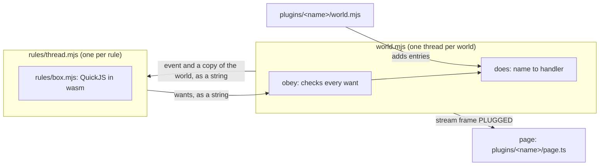

# Plugins and rules

A shared world (see [the engine](engine.md)) changes while it runs, in two ways. A **rule** is a script anyone or their model wrote. It runs in a sandbox and can only ask the world for things. A **plugin** is trusted engine code from the checkout's `engine/plugins` folder. It adds something new that rules can hear or do, and it can draw on the page. Neither needs a restart or a page reload.

## Concepts

- **Rule.** Source text of at most `SOURCE_MOST` characters, kept with the world under an id. It listens with `on(name, fn)`. The handler receives a copy of the world and returns what it wants done.
- **Want.** One thing a rule asks for, such as `world.actor(id, {...})`. Wants are data. The world process checks every field in `obey` (`engine/world.mjs`) and refuses what is wrong.
- **Actor.** A body the world moves for a rule. Everyone sees it.
- **Guide.** The text served at `GET /world/`. It lists every event a rule hears and every want it may make, with limits. It is `GUIDE` in `engine/serve.mjs` plus the `guide.txt` of each plugin that loaded. Models that write rules are shown this text, so it is the rule API.
- **Plugin.** A folder `engine/plugins/<name>/` with up to four files, below.
- **Realm.** Another world kept by the same server, with its own rules. Pages step between realms without reloading (`engine/page/realms.ts`).

## Where code runs



The world process never runs a line of a rule. It posts an event to the rule's thread and keeps its own clock. The answer comes back later as a message.

## The rule sandbox

The limits are constants in `engine/rules/run.mjs` and `engine/rules/box.mjs`:

| Limit | Value | Where |
| --- | --- | --- |
| Rules per world | `RULES_MOST` = 16 | `run.mjs` |
| Rule source | `SOURCE_MOST` = 65,536 characters | `run.mjs` |
| Memory | a WebAssembly memory with a maximum of `PAGES_MOST` = 512 pages (32 MB) | `box.mjs` |
| Work per call | about 10 ms of interpreter steps (`ASKS` interrupt checks), then the call is interrupted | `box.mjs` |
| Wall clock per call | `CALL_MOST` = 1000 ms, then the rule's thread is ended | `run.mjs` |
| Answer size | `ANSWER_MOST` = 256 KB | `box.mjs` |
| Kept memory (`world.keep`) | `KEEP_MOST` = 64 KB of JSON | `run.mjs` |
| Failures | `STRIKES` = 5; a good call takes `MENDS` = 0.25 off. At the limit the rule is stopped. | `run.mjs` |
| Actors per rule | `ACTORS_MOST` = 64 | `world.mjs` |

Nothing is bound into the interpreter: it has no timers, network, files or imports. One string goes in and one comes out. A stopped rule stays in the world's file and `GET /world/rules` says why. Putting it again starts it afresh.

## A plugin

`engine/plugins.mjs` defines the form. `found` reads the folder and `plugger` loads it into a world process.

| File | Contract |
| --- | --- |
| `world.mjs` | `export default (world) => ({ does, dropped, state, close, recored })`. Each entry of `does` is `name(rule, want, now, wrong)`, and a rule calls it as `world.<name>({...})`. Treat every field of `want` as a stranger's. The return value is ignored. To refuse, call `wrong(why)`: the rule hears `refused` and `GET /world/rules` shows the reason. A throw is caught and reported the same way. One file: it may import engine modules, but no file from its own folder. |
| `page.ts` | Optional. `export default ({ engine, link }) => ({ state, once, close })`, typed as `PagePlugin` in [page plugin types](plugin-types.md). To draw, add a pass to `engine.draws` and remove it in `close` ([drawing from a page plugin](render-passes.md)). |
| `guide.txt` | The plugin's lines of the guide. No blank lines, no lines in capitals only, and no lines that start with `GET` or `POST`. At most `GUIDE_MOST` characters. |
| `check.mjs` | Its check against a real server, built on `engine/test/plugkit.mjs`. |

The `world` argument holds the doors a plugin may use: `builds`, `core()` (call it each time, because the core can be swapped), `folk`, `living`, `text`, `tell`, `release`, `look`, `stand`, `tall`, `happen`, `hear`, `pages.state`, `pages.once` and `was`. `pages.state(v)` reaches the page side's `state` on every page, including pages that join later. `pages.once(v)` reaches only pages there now.

A folder name must match `NAME`: a lower-case letter or digit, then up to 23 more of those or dashes. Each entry of `does` must match `DOES`: a lower-case letter, then up to 23 letters or digits. A plugin may not take a name that the engine or another plugin already has. When a new version fails to load, the old one stays and `GET /plugins` says why.

`engine/plugins/gone` is the smallest complete example: a 13-line `world.mjs`, a one-line `guide.txt` and a check.

## Loading while the world runs

1. Change a folder under `engine/plugins`.
2. `node plug.mjs --port PORT` (in `engine/`) sends `POST /plugins/look`. The request carries nothing; the server reads its own folder again.
3. Each world process imports each changed `world.mjs` by the hash of its text, passes the old version's `state()` to the new one as `was`, and swaps the entries of `does`.
4. Pages get a `PLUGGED` frame on the stream and import `/plugins/<name>/page.ts?v=<hash>`.

No request, rule, model reply or typed text can become a plugin. Plugin code comes only from the checkout the server runs.

## Check a change

```sh
cd engine
node plugins/gone/check.mjs     # one plugin's check
node test/plugged.mjs           # every plugin's check; a world side with no check fails
node test/rules.mjs             # rules run, change while running, survive a restart, stay in their box
```

<!-- docs-verified cc92103ace26412f9a674455c432ef9c452fb3a3 {"engine/rules/run.mjs":"fc019064e956918701a48a39e88f4086","engine/rules/box.mjs":"44753d68692cadc5f6b1ed820024b197","engine/world.mjs":"dcd2961a04bbedb561c1035f1d9bd81f","engine/plugins.mjs":"243ba508a54cb0538d10b8917dc53da2","engine/page/plugins.ts":"553079615786f9ee2fe5b4bafafba46f","engine/page/frames.ts":"982add52463aa24c413035bc86d1cd99","engine/plugins/gone/world.mjs":"bc023bf1e7882cb0758007145bc694e2","engine/plug.mjs":"843b060dfc1e38c859ffc6ddebfcfdea"} -->
