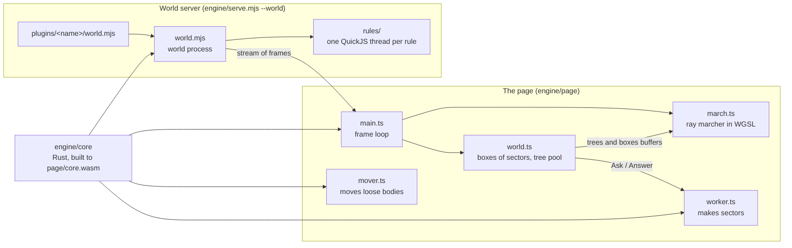

The engine in `engine/` stores a world as cells and draws it in the browser. Its core is Rust compiled to WebAssembly. The page that draws is TypeScript on raw WebGPU, with no framework. A world can also run in a world server (`serve.mjs --world`) that many pages share. People and models change a running world through rules and plugins. What a player does in it (controls, driving, the map, the sky) is on [gameplay](/gameplay).

## Concepts

- **Cell.** The world's unit of space: 10 cm a side in the finest copy of the world. A cell holds one **kind**, a 16-bit number. Kind 0 is air. See [the core](/engine-core).
- **Sector.** A cube of 64 × 64 × 64 cells, stored as a tree of 32-bit words. Sectors are what the core makes, what the page keeps on the GPU and what the ray marcher reads. See [worlds as cells](/cells).
- **Level.** A copy of the world whose cells are 2^level times larger. Level 0 holds the finest cells. The page keeps one box of sectors per level around the eye.
- **Edit.** Something done to the world, written as whole numbers: a ball of one kind, a blast, or rows of cells. Every core applies the same edits in the same order and gets the same cells.
- **Pass.** A drawing step in the frame. A plugin can add its own; see [page plugin types](/plugin-types).
- **Rule.** A script that a person or their model wrote, run in a sandbox beside a shared world. **Plugin.** Engine code from the checkout that gives rules something new to hear or do. See [plugins and rules](/engine-plugins).
- **Realm.** A world with its own record: its name, where people arrive, its sky and what a visitor may do. San Francisco is a static realm, a built folder whose record is `realm.json`, that the page runs alone. A server can also keep several realms, each with its own file and people. See [plugins, rules and realms](/engine-plugins).

## Parts



| Part | Path | What it owns |
| --- | --- | --- |
| Core | `engine/core/src` | Cells, sectors as trees, the generated town, edits, loose bodies, fire and water. One build serves every caller. |
| Page | `engine/page` | The frame loop, the boxes of sectors, the ray marcher and everything drawn over the world. |
| Sector makers | `engine/page/worker.ts` | A pool of workers. Each holds its own core instance and turns an ask for a column of sectors into trees. |
| Mover | `engine/page/mover.ts` | One worker with one core that moves what has come loose, when the page is not in a shared world. |
| World process | `engine/world.mjs` | A Node worker thread started by `engine/serve.mjs` with `--world`. It runs the core for everyone in a shared world and decides the order of every change. |
| Rules | `engine/rules` | Run each rule in a thread and a QuickJS interpreter of its own. |
| Plugins | `engine/plugins` | Folders of trusted engine code that a running world loads while it runs. |

The core in each place is the same `page/core.wasm`. The page instantiates it with no imports (`open` in `engine/page/bay.ts`), so every function the outside calls is a plain export.

## How a frame is made

`frame` in `engine/page/main.ts` runs once per animation frame. It skips the frame while the page is paused or the full-screen map covers the picture.

1. Move the eye and step what the page simulates itself: an active walkable store interior (`interiors.ts`), the car or body you control (or the free eye), stunts, the handheld smartphone OS and DoorSmash delivery loop (`phone.ts`, `delivery.ts`), the wand, sound and street life.
2. `world.update` decides which sectors each box needs around the eye (staying anchored to the street outside while indoors). It sends asks to the sector workers and uploads finished trees into the GPU pool.
3. One command encoder records the drawing, in this order: single-dispatch compute sun-map tiles (`march.tend`), 512-light GPU 3D frustum clustering (`localLights.dispatchCluster`, `?cluster_lights=0` falls back to 48-light uniform path), dirty-tracked physically based Sky & Aerial Perspective LUTs (`sky-lut.ts`, `?sky_lut=0`), quarter-res temporally amortized volumetric 3D cloud trace/reproject (`volumetric-clouds.ts`, `?vol_clouds=0`), 2-cascade dynamic-object directional shadow maps for cars, pieces, and people (`dynamic-shadows.ts`, `?dyn_shadows=0`), `march.draw` (beam pre-pass, visibility pass, half-res compute GTAO, and deferred PBR shading sampling clustered lights, dynamic shadows, and Sky LUTs), a portal's window into another world, the far model of distant tiles, sky-only volumetric 3D cloud compositing (`volClouds.compositeSky`), sky eggs, legacy sea fog (when `?froxel_fog=0` or Low preset), water, the merged `overlay-tbdr` pass (shade under things, skidmarks and light on the road, vehicle wheels, falling pieces, storefront, plaza and interior signs, people, crumbs), smoke, 3D froxel volumetric fog (`froxel-fog.ts`, `?froxel_fog=0`), every plugin pass (`pluginDraws.draw`), the wand's marker, then `march.patchVelocity` and native-resolution linear HDR TAA/TSR-lite upscaling (`taa.ts`).
4. A final pass (`glow.ts`) extracts bloom from the resolved linear HDR target, applies AgX tonemapping and grading onto the canvas, and `device.queue.submit` sends it.

Falling pieces include vehicles and other things built in finer cells. A curved panel in 2.5 cm cells is a staircase, and lit by each face's square normal it showed every step as bands, like a 3D print. Those things carry four extra words per face, one for each corner (`Born.smooth`, from `fine.ts` `facesWithSmooth`): a normal fitted to the shape round the corner, and how open the corner is to light. Faces that meet at a corner share it, and a face blends its corners across itself, so a curve has no steps in its light. Narrow seams such as door gaps are filled for the normals, so panels either side read as one surface, but still darken. The outside air is found by a flood fill, so a car's cabin counts as solid and its panels' normals point outward. Faces in the cabin keep their square normals, so the inside stays sharp from the driver's seat. `pieces.ts` lights a face by its smooth normals, darkens its hollows, and gives polished paint a clear coat and smooth glass true reflections of the sky, horizon and street. Bodies the core makes have no smooth words and draw as before. Turn smooth words off from the console with `engine.falling.smooth = false` to compare.

Above a fixed height the planet view replaces the march. To measure what one drawing step costs, turn it off from the browser console, for example `engine.off.add('people')`. The names are `water`, `under` (shade under things, skidmarks and light on the road), `wheels` (driven cars' wheels, which also stops stepping them), `pieces`, `signs`, `people`, `crumbs`, `puffs`, `flames`, `lights`, `clusterLights`, `dynShadows`, `skyLut`, `volClouds`, `froxelFog`, `taa` and `spoil`.

## Glass

A released city's first frames can show opaque glass while the GPU compiles the reflection pipeline. Once it is ready, the march looks through glass. A look that meets a pane goes on and shows what is behind it, tinted by the glass and by how much glass it crosses. A pane also keeps a little mirror, most of it at a glancing angle.

- Only the first pane is looked through (`PANES` in `engine/page/march.ts`). The pane behind it, a pane too far off for its cells to be two pixels wide (`THROUGH`), and glass in the coarser boxes show what is likely there instead: a dim room, or from inside, the day. The look fades into that over a band, so a wall of windows has no seam.
- At night a window with someone home (`litWindow`) shows a lit blind instead of the room.
- The march writes how far off the first pane is and what it lets through (`march.panes`). The wand's ring, people and loose bodies read it, so they are tinted behind glass. Crumbs, smoke and water are drawn over it untinted.
- Mirrors off (Shift+M, or `?mirrors=0`) is a pipeline of its own with no glass in it: a pane is a pale face again.

`node test/glass.mjs` (in `engine/`) checks a lamp seen through glass from outside and inside, and hidden with mirrors off.

## A shared world

`node serve.mjs --world FILE` (in `engine/`) keeps one world in a file and runs `world.mjs` behind the server. Pages open it with `/city?shared=1`. The page then uses `engine/page/link.ts` in place of the mover. The world process applies each ask, then sends the result down `GET /world/stream` as binary frames. Each frame has a 12-byte header (kind, number, length). The kinds are the constants in `engine/page/frames.ts`. A page applies only what the stream says, in the stream's order.

### Anchor zones

A world server can heal what people do to a world, except inside zones that someone keeps. It is off unless the server starts with `--anchor-regen-ttl`:

```sh
cd engine
node serve.mjs --world /tmp/world.log --anchor-regen-ttl 600
```

| Flag | Default | What it sets |
| --- | --- | --- |
| `--anchor-regen-ttl` | none: nothing heals | Seconds a changed cell outside every zone is left alone before it is healed. A number over 0. |
| `--anchor-regen-cells` | 256 | The most cells one step, once a second, puts back in each world |
| `--anchor-compact-interval` | 60 | The fewest seconds between compactions of a world's file |

A zone is a sphere of 10 cm cells with an id, a name, an owner, a `center` and a `radius`. `engine/anchor-zones.mjs` holds the rules, `engine/world.mjs` applies them and `engine/serve.mjs` keeps what they remember.

- A cell changed inside a zone stays. A cell changed outside every zone is remembered with what it was before its first change. Each later change restarts its wait.
- Healing puts back the lowest cells first, as an ordinary edit by `the world` that every page receives. No cell becomes solid where someone stands or a living thing is. It waits.
- Some changes always stay: cells that a made thing is put into, taken from or held out of, what rules build, cells finer than 10 cm, and an edit too large to heal (more than one blast of radius 40, or rows over `CELLS_MOST` cells).
- Adding a zone keeps what is waiting inside it as it is now. Taking a zone out does not heal what already stood there: only later changes do.
- After heals, the server compacts the world's file: rows that a later heal made worthless are cut. Zones and pending cells are kept beside it in `<world file>.anchors.json`.
- A server started without `--anchor-regen-ttl` keeps the zones in that file and forgets the pending cells. If the file cannot be read, nothing heals in that world.
- A world keeps at most 64 zones of radius 1 to 2000 cells, and remembers at most 500,000 cells to heal. Changes past that stay.
- `--release` and `--anchor-regen-ttl` cannot be combined yet, and the [dedicated server](/hosting) does not take the anchor flags.

| Request | Answer |
| --- | --- |
| `GET /world/anchors` | `{enabled, anchors, ephemeralCells, healedTotal, untrackedCells, policy}`. With healing off: `enabled: false`, no zones and zero counts. |
| `POST /world/anchors` with `{by, id, name, center: [x, y, z], radius}` | 201 `{anchor, promoted}`. A zone with the same id is replaced. `promoted` counts the waiting cells it now keeps. |
| `DELETE /world/anchors/<id>` | `{removed: true}`, or 404 for an unknown id |

An `id` is up to 40 lower-case letters, digits and dashes, and `center` and `radius` are whole cells. A bad zone gets 400. A 65th zone, or a change with healing off, gets 409. Another realm answers the same under `/realm/<id>/world/anchors`. The door does not pass these routes, so a lobby's visitors cannot reach them.

`node test/anchor-zones.mjs` (in `engine/`) checks the rules alone and then a real server.

## Check a change

```sh
cd engine
npm ci
npm run core        # build the core to page/core.wasm
npm run check                 # cargo test, tsc, then page checks in Chrome
node test/all.mjs --changed   # only the checks that cover your branch's changes
```

`node test/bench.mjs` (in `engine/`) measures frame cost. Run it before and after a change to the march or the frame.
