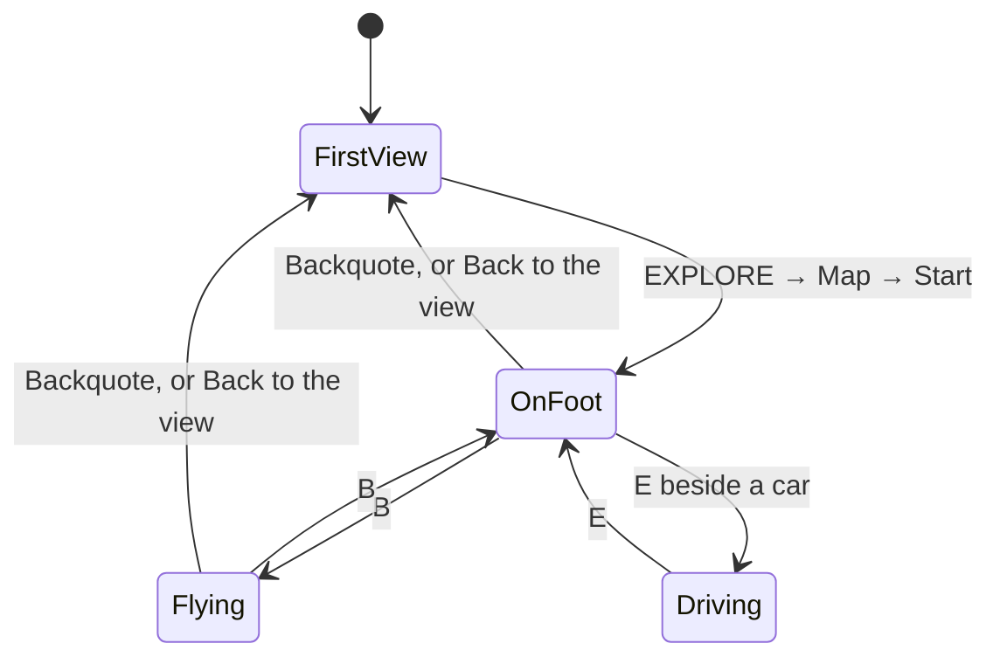

The San Francisco realm is the engine's own page (`engine/page/main.ts`) run with the realm's record, `engine/sf/realm.json`. A visitor to San Francisco arrives at a still picture of the skyline, clicks the EXPLORE board to open the interactive 3D map with a scenic default spot pre-selected (North Beach, Columbus Ave framing the Transamerica Pyramid), picks any place on the map or confirms Start to dive straight into sunlit 10 cm streets, then walks, flies and drives through the city. Every control, every address option and the code behind each are below.



## Controls

The letter keys the page owns are listed in `engine/page/keys.ts`, and `node test/keys.mjs` (in `engine/`) fails on a key the page listens for that is not listed there. A dash means the action has no control on that device.

| What | Keyboard and mouse | Touch | Gamepad |
| --- | --- | --- | --- |
| **On foot** | | | |
| Move | W A S D | Drag on the left half of the screen | Left stick |
| Look | Mouse, after a click locks the pointer | Drag on the right half | Right stick |
| Run | Hold Shift (walking is a third of running pace) | - | Hold LB or L3 |
| Jump, or open the canopy in the air | Space | Jump key (Chute in the air) | A / Cross |
| Switch between walking and flying | B | Fly / Walk key | D-pad down |
| Camera behind you or in your head | V | - | R3 or D-pad up |
| Get in a car, use an egg's thing | E, beside it | Tap its cue | Y / Triangle |
| Summon a sports coupe | G (not in a shared world) | - | - |
| **Flying** | | | |
| Move along the view | W A S D | Left half | Left stick |
| Up and down | Space, and C or Left Ctrl | Up and Down keys | A / Cross, and B / Circle or LT |
| Faster | Hold Shift (5 times); the wheel sets the speed | - | Hold LB or L3 |
| **Tools** | | | |
| Open the tool wheel | E: tap to keep it open, or hold, point and let go to pick | Tool key | - |
| Pick a tool | 1 to 7, or a wedge of the wheel | A wedge of the wheel | - |
| Use the tool | Click | Use key | RT, X / Square or RB |
| Set what is ahead alight | F | - | - |
| Take the wand | Q | Wand on the wheel | - |
| **Driving** | | | |
| Throttle, brake and reverse | W, S | Gas & Brake pedals (bottom-right), or left half forward/back one-handed | RT, LT (analog) |
| Steer | A, D | Left half (side to side; pure steering while pedals are held) | Left stick |
| Drift (handbrake) | Hold Space | Hold Drift (above Gas) | A / Cross (analog) |
| Boost | Hold Shift | Hold Boost (above Brake) | B / Circle |
| Burnout, then launch | Hold W and Space at a standstill, then let go of Space | Hold Gas and Drift at a standstill, then let go of Drift | RT and A, then let go of A |
| Next camera (the seat among them) | C | Cam (top-right utility rail) | RB or D-pad down |
| Look back | Hold X | - | Hold LB |
| Headlights | L | - | - |
| Horn | Hold H | Hold Horn (top-right utility rail) | L3 |
| Next FM station | N | Choose a station in Radio | - |
| Open the radio picker | R | Radio (top-right rail), or tap the station name while it shows | - |
| Repair car | F | Repair (appears in top-right rail when damaged) | D-pad right |
| Straight into the seat, and back | V | Seat (hover things); while driving, Cam goes round to the seat | R3 or D-pad up |
| Get out | E | Exit (top-right utility rail) | Y / Triangle |
| **Map** | | | |
| Open and close | M (once in the city), Esc closes | Tap the minimap | View / Share |
| Quick POI search | `/` focuses search, Enter commits, Esc clears | Tap search bar or category pill | - |
| Route to a place | Click it, a pin, a search result or a chip | Tap it | - |
| Clear the route | Backspace, Delete or a right-click | - | - |
| Zoom | Wheel, = and - | Pinch | - |
| Pan | Drag, W A S D or the arrows | Drag | - |
| Turn and tilt | Right-drag or Shift-drag | - | - |
| 2D or 3D | 2, 3 | 2D / 3D button | - |
| **Anywhere** | | | |
| Make something from words ([making](/making)) | Enter opens the ask bar (where the realm does not make things, Enter opens the eggs' line) | Ask bar | - |
| Type an egg's phrase | / (and Enter in the first view) | - | - |
| End an egg | Esc | Tap the banner (first view) | - |
| Open the billboard ahead | O | Tap the board | - |
| Back to the first view | Backquote (under Esc) | Back to the view, in settings | - |
| Hour back or forward 30 minutes | [ and ] | Hour fader, in settings | - |
| Rain on or off | R | Rain, in settings | - |
| Reset the world | Backspace | Reset world, in settings | - |
| Report an issue (canvas + last 30 s trace) | F8, `/bug <note>` on the ask bar, or Report in settings | Report, in settings | - |
| Mirrors, shadows, traced shadows, heat view | Shift+M, L, K, H (on foot) | - | - |
| In a [shared world](/multiplayer): pick up, throw, portal, realm wheel | G, T, P, Tab | - | - |

While you drive, the car's mode is solid. Keys the page hears before any mode still work (Enter, `/`, O, M and Shift+M among them), but the hour, rain, reset, K, G and Backquote wait until you are out; F repairs the car you are driving instead of lighting a fire.

Riding something other than a car (a flying or hovering thing, or one that jumps) uses the schemes in `SCHEMES` in `engine/page/living.ts`: W and S, A and D, then Space and C to rise and sink, Q to roll over (hover) or Space to jump (ride). The wand ignores Q while `mounted` is live (`engine/page/wand.ts`), so on a hover vehicle Q rolls it over (and the touch key **Roll over** works too). The ray marcher draws mirrors, shadows and glass; [the engine](/engine#glass) explains how.

## The first view and EXPLORE

The realm opens on a still picture from Ina Coolbrith Park (`engine/page/first.ts`). No key moves the eye and no click takes the pointer. Only the settings gear (time, weather, graphics and Credits), the lockers count and the signs answer. Enter, NumpadEnter and `/` open the eggs' line. `?first=0` skips the first view. The realm hides the line of numbers (frame time, memory, position) unless the address has `?debug=1`.

The EXPLORE board on the roof of 555 California St is the way in (`engine/page/entry.ts`). `engine.explore.state` moves through `idle`, `picking`, `going`, `in` and `leaving`:

1. **Click, tap, or press Enter on EXPLORE**: immediately opens the full-screen 3D WebGPU map of San Francisco (`engine/page/minimap.ts`) with an iconic default scenic spot selected (**North Beach**, Columbus Ave facing the Transamerica Pyramid). As soon as the map opens, location-independent resources (MAP1, citywide far model, road marks, off-thread vehicle smooth faces via `streetLife.prewarm()`, and the sculpted sports coupe via `carSummon.prewarm()`) and the selected spot's tiles, 10 cm voxel sectors and street graph begin preloading in the background. Click any landmark chip or point on the map to pick a different starting spot (which updates background preloading), or press Esc / Back to return cleanly to the park first view.
2. **Confirm Start** (click **Start** or press Enter): runs the 3D Map-to-Reality Optical Dive straight from the current map camera with zero jump, locking the live voxel and far-model camera pixel-for-pixel behind it, optically dissolving the stylized map into 10 cm streets, and swinging behind your body on foot. Any key or tap after 420 ms skips to the end once tiles arrive. With `prefers-reduced-motion` the picture cross-fades straight onto the street.
3. **Back to the view** (Backquote, or the button at the foot of the settings panel) arcs smoothly back to the park. You get off any vehicle first. The world is not reloaded: what you broke stays broken.

A realm with no EXPLORE board (`?boards=0`) enters on any key or click on the picture.

## On foot and flying

Your body (`engine/page/person.ts`) runs at 4.5 m/s with Shift and walks at a third of that. It jumps 0.74 m (`AS_IT_IS`). Space in the air opens a canopy when there are 3 m clear below. It sinks at 4 m/s, steers at 7.5 m/s with the walking keys, and folds when your feet touch something (`CANOPY`).

B leaves the body and flies the eye free (`walk` in `engine/page/main.ts`). It starts at 12 m/s. The mouse wheel multiplies the speed by 1.25 or 0.8, between 1 and 400 m/s, and Shift multiplies it by 5. Above 400 m the eye also speeds up with height, so space is reachable.

## Driving

### Getting in

Stand within 4.5 m of a parked car (or 3.5 m of a charging depot robotaxi) and the cue says `E  drive the` or `E  Take the` and its paint-aware name (for example `white saloon` or `yellow taxi`). Press E or tap the cue. The three nearest parked cars within 12 m of your feet are woken so they can be entered, at most four at a time (`engine/page/street.ts`). Each drawn parked car is settled onto its four-wheel spring equilibrium stance (matching the physics solver's pitch, roll and suspension sag, and re-settled once its finest terrain tile arrives) and placed directly without an upward hop, while animated wheels reset their suspension state on teleport from the spawn sky (`engine/page/wheels.ts`), so waking causes no visible jump. A stopped live traffic car within 2.8 m on the same level shows `F  Take the` on the desktop play HUD so nearby traffic never steals E from the radial tool wheel (tap the cue on touch, or E in classic mode). Getting off sets you down beside the car. If the car breaks, you are put down where it broke.

**Summoning a car.** On foot, G delivers a sports coupe (`engine/page/summon.ts`) to clear asphalt within 60 m, about 5.5 m away when it can. The spot must be at street level (not under a roof), more than 5.5 m from any other living thing, clear above, and on a grade under about 18%. The coupe parks beside the road and faces along it. Only one summoned car stands at a time: G again replaces it unless you are in it, and Reset world removes it. G does nothing in the first view or in a shared world, where it picks things up. `engine.summonCar()` does the same from the console.

### How a car drives

The physics runs in the core (`engine/core/src/bodies/living.rs`), as it does for every [living thing](/living). The page sends three numbers: go (throttle or brake), turn, and rise (the handbrake). For a car it also sends whether boost is held and how hard it rains (`living_drive_aux` in the [core](/engine-core)). It resends them when they change and every 0.25 s while held. A car told nothing for 1 s (`QUIET`) goes to sleep.

Each car has a **motor**: `grip`, `power`, `top` speed, `steer` angle and `tough`ness, with its wheels as feet that steer or drive (`Motor` in `engine/page/living.ts`). The street cars carry their motors in the kept car library. `?living=car` (and `?living=finecar`) puts the hand-written sculpted test car in front of you (4.2 m long, top speed 20 m/s, with a cabin in 2.5 cm cells).

- **Throttle** is strongest from a standstill and fades toward `top`. Reverse tops out at about a third of it.
- **Brake**: pressing against the direction of travel brakes every wheel. Off the throttle the car coasts, and stops dead below 0.6 m/s.
- **Handbrake (Space)** cuts rear grip so the tail slides. With throttle it powers a drift. Without, it locks the rear wheels.
- **Hills** pull the car back, weight shifts in braking and turning, and a car thrown off a crest keeps its flight while its tumbling is damped.
- **The ground** sets the grip. Dry paving, and anything more than 1 m above the ground (a bridge, a roof), grips fully. Rain takes paving down to 0.78. Grass, earth, sand and leaves grip at 0.64 and water at 0.55, and both drag the car. Less grip lets a slide run wider.
- **Archetypes.** The core also reads each motor's top speed and wheelbase. A fast, short car turns in sharper and slides more under power. A long, slow one (wheels more than 3.8 m apart) rolls less in corners and coasts further.
- A car breaks when its speed changes in one step by more than its `tough`ness, or a blast reaches it.

The HUD shows km/h, a gear (R, N, 1 to 6), a 12-bar rev meter, a DRIFT tag and a thin boost bar. The six-speed gearbox only drives the rev meter, the sound, exhaust pops and gamepad rumble. The core never reads the gear.

The street's kept cars get their motors from `HANDLING` in `engine/sf/fleet.mjs`, which `engine/sf/cars.mjs` applies when it writes the car library. A top speed in cells a second times 0.36 is km/h.

| Class | Cars | Top speed | Power | Grip | Steer | Tough |
| --- | --- | --- | --- | --- | --- | --- |
| `coupe` | sports coupe | 590 (212 km/h) | 142 | 1.24 | 0.62 | 220 |
| `saloon` | grey saloon | 475 (171 km/h) | 112 | 1.38 | 0.58 | 210 |
| `hatch` | blue saloon, taxi | 445 (160 km/h) | 100 | 1.42 | 0.60 | 200 |
| `suv` | grey SUV | 420 (151 km/h) | 96 | 1.48 | 0.54 | 280 |
| `robotaxi` | PayMo (Waymo Ojai) | 440 (158 km/h) | 108 | 1.52 | 0.58 | 270 |
| `van` | delivery van | 345 (124 km/h) | 84 | 1.32 | 0.48 | 360 |
| `truck` | box truck | 295 (106 km/h) | 76 | 1.28 | 0.42 | 500 |

`HANDLING` also has a `bus` row, which nothing uses: buses and trolleybuses are driven by the street, not by a motor.

### Boost and launch

Hold Shift (Boost on touch, B on a pad) with the throttle on for nitrous: 40% more thrust and 24% more top speed while it lasts. A full reserve burns in about 2.8 s and needs 8% to start again. It refills while you drift, when you land after a quarter second in the air, faster while you cruise cleanly above 45% of top speed, and slowly whenever you roll. The boost bar shows the reserve. Boosting fires multi-stage blue-white and amber-tipped plasma jets from the rear tailpipes, lights the road behind in cyan, widens the lens by 5.5 degrees (not with reduced motion), and adds a turbo whine to the engine. Upshifts, launches, high-RPM throttle lift-offs and aggressive drift entries fire fiery orange-gold exhaust backfire flames with a brief warm asphalt light flash from dual rear diffuser tips on sports coupes or the lower-right tailpipe on sedans and SUVs.

A **burnout** builds a launch. Below 6.5 km/h with the throttle and the handbrake both over half, the front brakes hold the car while the rear wheels spin and smoke. The charge fills in 1.15 s and the boost bar turns orange to show it. Let go of the handbrake with the throttle still on and the car launches with up to 45% more thrust, fading over 0.8 s.

In a shared world, both boost (on and off) and rain wetness are forwarded to the world process (`POST /world/drive` → `living_drive_aux`), matching local driving.

### Cameras

`engine/page/drive-cam.ts` has six views, `DRIVE_CAM_MODES`: Close (the default), Far, Hood, Bumper, Seat and Cinema. C (the touch Cam key, a pad's RB) goes round them all and a toast names the new one. Getting out leaves the seat for the view before it; the other views survive getting out and back in.

- **Close chase**: rides low just above the roofline and tight behind the rear bumper with a nearly level sightline over the roof down the street, pulling back smoothly under hard acceleration and boost, leaning in on braking, and swinging toward the outside rear-quarter with a lateral shoulder offset during hard drifts so the car's flank, tire smoke and the turn ahead stay framed. Portrait phone viewports scale back and elevate cleanly to clear the bottom-right touch keypad.
- **Look back** (hold X or LB) turns the view 180 degrees and eases back on release.
- **Air cam**: after 0.35 s airborne at speed, the close, far and cinema views pull wider.
- **Cinema** cuts between low rear-quarter hero, fender, flyby and helicopter shots every 4.5 s, and cuts away early when a shot is blocked.
- **Speed and drift lens**: the field of view widens with speed, while `engine/page/glow.ts` adds peripheral radial speed streaks from ~35 km/h (strongest along rushing roadside asphalt and side buildings) plus tangential rotational motion blur during hard drifts that streaks city buildings and streetlights while keeping the lower-center car silhouette and vanishing point sharp.
- **Seat** puts the eye in the driver's seat ([from the seat](#from-the-seat)). V goes straight into it from any view and back to that view; C goes on from it to Cinema.

Reduced motion makes camera changes instant, turns off the speed/drift lens streaks and holds each cinema shot 6.5 s.

### From the seat

Every car is seen out of from its seat. Its glass is seen through on every graphics preset: with mirrors off (Low and Medium) a car's glass is tinted and mirrors nothing, where it used to be an opaque face that turned a car's every window black from inside. Where a car's recorded eye has its own seat back, roof or dash within a head's room (35 cm) ahead of it, `living.ts` `clearEye` moves it, once, as its look is worn, to the nearest place that sees out: the street's blue saloon's eye sat 3 cm over its own seat's back and goes 20 cm forward. `node engine/test/seat-view.mjs` checks the camera's round and every car (the hand-written one, the street's kept cars and the realm's parked saloon as this checkout makes them), mirrors on and off.

In the seat, `engine/page/cockpit.ts` moves your head with the car. Springs push it back on a launch, forward under braking, against the turn in a corner and down over a bump, with a jolt for a hit, a landing or a gear change and a buzz that grows with speed and rough ground. Reduced motion holds the head still.

In a car it also draws on the glass, and only when there is something to draw:

- **Rain** above 0.1 beads on the windshield. Drops run down at low speed and blow up and out at speed. Two wipers sweep together, from a 1.15 s sweep with a 1.85 s pause in light rain to a 0.73 s sweep with no pause in the heaviest. With reduced motion the wipers stay parked.
- **At night** a dark brow and a faint blue dash light frame the view.

Inside, the picture's rain effect is at 45% and the outside sounds dull ([sound](/sound#in-a-car)).

### Radio

N cycles the car radio through Radio Off, Bay Drive FM, Twin Peaks Chill and Fillmore Funk. Tap the station name during its 2.5-second display, tap Radio in the driving controls or settings, or press R to open the picker. Choose FM, a curated YouTube stream or a saved playlist. A person starts on Bay Drive FM. A browser driven by a check (`navigator.webdriver`) starts with it off, and `?radio=` picks the station. The page remembers the station when you get out and back in. Each station is composed as it plays; [sound](/sound#in-a-car) explains how, and the pass-by whooshes heard at speed.

### Wheels

Every living car with two or more wheels gets drawn wheels (`engine/page/wheels.ts`, the `wheels` pass of the [frame](/engine#how-a-frame-is-made), at most 64 wheels). The wheels baked into a car's fine look are carved out (`carveWheelWells`, preserving painted fenders and lining recessed wheel wells dark) so the drawn ones can move. Front wheels steer with your input and counter-steer into a slide. Each wheel rides its own suspension over kerbs and shifts and tilts inward with a crushed corner (`deformPointCpu` in `engine/page/deform.ts`). Driven wheels spin in a burnout, rear wheels lock under the handbrake, and brake discs glow orange-red after hard braking and cool as you drive on. Reduced motion softens the steering and the spin.

### Lamps, skidmarks and light on the road

Only lamp cells (material 15) on the car you ride light up (`engine/page/pieces.ts`), and they go dark when you get out.

| Lamp | Lights when |
| --- | --- |
| Brake | You brake, pull the handbrake, or hold S almost stopped |
| Reverse | The gear is R |
| Headlights | They start on auto (on after dusk). L then cycles low, high and off (from auto after dusk it goes straight to high). |

`engine/page/tracks.ts` draws onto the ground after the world's cells. Rear wheels that slide lay **skidmarks**, dark on asphalt and brown off-road. It keeps the last 1024 segments (`MAX_SEGS`), each fading out by 18 s (`LIFE`). It also draws up to 24 **light pools** a frame (`MAX_SPILLS`): vivid crimson taillight/brake road glow, brief fiery orange exhaust pop flashes, cyan nitrous splash, white reverse light, and two-stage near/far warm night headlight cones.

### Traffic

Traffic cars are drawn and steered by the page, not simulated as bodies (`engine/page/street.ts`). They drive within 260 m of the eye at speeds set by the street's size, follow the car ahead, slow for turns and obey signals (`CYCLE`, `GREEN`, `AMBER`), stop signs and turn order. How many there are follows the hour (`TRAFFIC`). They stop for a few seconds after a blast nearby.

No vehicle is set down on another. A car, a bus or a streetcar is placed only where its outline is clear of every vehicle that drives or lives there (`taken`). Opposing traffic lanes beside parallel streetcar tracks are offset right in `engine/sf/life.py` (`clear_opposing_streetcar_rails`, with a runtime `railShiftOf` fallback in `engine/page/street.ts`) so oncoming vehicles pass at least 2.8 m clear of streetcar rails. Cable car lines share a cycle-aligned 120 s departure period (`CABLE_EVERY`) with phases coordinated across all lines (`coordinateCablePhases`) so routes sharing tracks or crossings stay clear of one another through every light cycle, and `cableCars` skips any car whose box would overlap another. A streetcar's path is its rails, which turn across the traffic's lanes. So it looks for whatever drives or lives along its rails, as its 14 m body will stand there every 2.4 m for 40 m (`railGap`), whichever way that vehicle heads, and stops short of it. A car takes another car coming the other way to keep to its own lane. A streetcar, cable car or bus is in a car's way by where its sides are (`inPath`), whichever way it heads and wherever its middle is.

They react to you:

- **Crashes.** Hit a car and it wakes as a real drivable body with its interior, is knocked ahead by the impact, and both vehicles dent immediately, at most 6 at a time (`MAX_CRASH_LIVING`). Pedestrians nearby are startled and traffic close by stops briefly. Cable cars, trams and buses bounce you off and dent your car. Each hit fires a `voxelwright:crash` event that plays debris and glass ([sound](/sound)).
- **Pileups.** Waking a car takes a few frames, and at 150 km/h a car covers 0.7 m a frame. So above 65 km/h the street looks for the touch as far ahead as the quickest of the last four wakings took (`wakeLag`, 20 to 150 ms), and the car wakes as it is reached. Under 22 km/h it looks one frame ahead, so a car you nudge does not jump before you touch it. If the striker is in its place by then, the solver puts the woken car clear ahead of it and shoves on the row it lands in ([the core](/engine-core)). A car thrown by a crash or a blast wakes the drawn cars it reaches in its turn at 22 km/h or more (`ROLLS`) and loses to each what it gives. Slower, the drawn car stops it and stays asleep. When six already live, one that has come to rest is sent away to make room, the furthest and oldest first. The blow lifts the struck car 7 cm at most, never a car's height.
- **Horn.** Holding H makes pedestrians within 14 m flinch or step aside, nudges slow traffic ahead to move on, and makes one nearby car honk back.
- **Near misses.** Passing within 2 m of a car above 65 km/h fires `voxelwright:nearmiss`, once per car every 3 s.
- **PayMo robotaxis.** Open the map, select **PayMo Station** and choose **Visit** to reach the six charging bays on Stockton Street between Beach and North Point. More PayMos drive nearby as cars leave and return to the depot. Look for the short nose, white roof and wide sensor bar above the Ojai’s windshield. A PayMo occasionally stalls at an intersection or on a narrow street. Its amber hazards flash, drivers behind it honk, and pedestrians stop at the curb to yell or hold up phones to film. When the car clears, they resume their walk. Press **E** beside a stopped car to drive it.
- **Neighborhood storefronts, town squares and gathering crowds.** Commercial corridors and neighborhood squares across San Francisco stream from `/bay/places.json` (`engine/page/neighborhood.ts`, `?neighborhood=0` to disable). Storefronts wear fascia signboards, projecting blade signs (including backlit medical-cross urgent care signs) and category-matched sidewalk life (café patio umbrellas, flower stands, bookstore racks, produce crates, A-frame menu boards). Big trademarked chains use configurable GTA-style parody names and sign themes from `engine/sf/brands.json` (for example, Whole Moods Market, Bullseye Mart, Starbuxx, Wallgreens, Carbonic Health, GoWell Urgent Care). Community squares and civic plazas (`engine/sf/plazas.json`, such as Noe Valley Town Square, Patricia's Green, Jane Warner Plaza and Washington Square) feature timber pergola pavilions, overhead string lights, plaza entrance archways, benches at real OSM coordinates, Little Free Libraries, daytime farmers-market stalls, and seated/chatting crowds that follow the hour and weather.

### Stunts

`engine/page/stunts.ts` scores driving. Five kinds: **drift**, **air**, **spin**, **near miss** and **speed**.

| Stunt | Scores when |
| --- | --- |
| Drift | Sliding with two wheels down at 22 km/h or more. Points grow with speed and slip angle: Drift, Great Drift (450), Ultimate Drift (1200). |
| Air | 0.35 s with no wheels down, landed upright after 4 m or 0.45 s. Great Air at 10 m, Big Air at 20 m. |
| Spin | Turning fast while sliding: a J-turn past 150 degrees, a spin past 320. |
| Near miss | Traffic's near-miss event, worth more the faster and closer. |
| Speed | Above 130 km/h for 2.5 s, repeating every 3 s until you drop below 118. |

Stunts in a row make a **combo**. A stunt of a different kind from the last raises the multiplier by one, up to 5 (`MAX_MULTIPLIER`). The combo banks when 2.8 s pass with no new stunt (`GRACE_SECONDS`, paused while drifting or airborne) or when you get out. A hard impact (over 4.5 m/s), a crash event or landing on your roof busts it and loses the points. Records (best combo, longest drift, biggest jump, total banked) are kept in the browser under `voxelwright.stunts.v1`.

## The HUD

`engine/page/hud.ts` is the one layer of HTML over the picture: the status line, the ask bar, the last few lines people said, cues, the controls card and notices. `engine/page/play-hud.ts` lays out the play controls on top of it, in one of three styles chosen by `?hud=`:

- `wheel` (the default): E opens a pie of tools over the middle of the picture (`engine/page/radial.ts`). A quick tap leaves it open for a click, arrows, the wheel or a number key. Holding E, pointing and letting go picks the wedge pointed at. Esc closes it unchanged.
- `context` and `quiet`: E and Shift+E step through the tools, and the mouse wheel cycles them on foot.
- `classic`: the realm's controls without the wheel, for comparing the two.

**Cues** appear beside your body when there is something to learn: "Open the parachute" while falling, "Take to the air" on the ground, and "Back on your feet" after flying. The street's name shows for 4.5 s when it changes.

**Touch.** The left half of the screen is a move stick and the right half turns the head. Keys at the right edge (a column when the phone is upright, two by two when it is on its side) hold Up (Jump or Chute on foot), Down, Use, Fly / Walk and the tool key, which opens the pie. The keys dim after 3 s untouched. While driving a car, the foot keys step aside for a two-zone icon-only layout: four pointer-captured driving controls sit under the right thumb (tall Gas pedal, Brake/Reverse pedal, Drift and Boost — dedicating the left stick to smooth horizontal steering while pedals are pressed), while quiet 44 px utility icons (Horn, Radio, Cam and Exit, plus Repair only when the car is damaged) sit along the top-right rail beside Settings (Cam goes round the views, the seat among them; there is no separate Seat key while driving).

The **ask bar** (Make) is a slim key in the corner until it is opened. Open, it has a × key before the line; Esc, or a press anywhere on the picture, also puts it away, and the keys of play come straight back. The gameplay HUD has no Back key of its own: Back to the view is in the settings panel, and Backquote on a keyboard.

The **settings panel** is in sections: Time & weather (Light, Dark, SF now, the hour fader, the weather), Graphics (Low, Medium, High, Window glow when egg media is installed — **Ambient** default, **EQ**, or **Off** — Dynamic resolution and Target FPS or the resolution fader), and the keys that act: Credits (shown in both the first view and play, with Mapillary attribution inside the Credits card) plus, in play, Back to the view, Say…, Your AI… and Reset world. On a desk in play the two sections stand side by side with the keys along the foot; on an upright phone they are one column. The first view's gear, its panel and its lockers key use the same slim look as the HUD in play.

## The minimap, the map and GPS

The **minimap** (`engine/page/minimap.ts`) is a small 3D map drawn by the engine's own WebGPU device (`engine/page/map-gpu.ts`): extruded buildings, roads by class and a pink route ribbon. It sits bottom left on a desk and at the top on a phone and turns with your heading (your car's when driving). On foot it shows about 132 m. Flying widens it with speed. Driving, it zooms out to 1.85 times that by 180 km/h and centres up to 52 m ahead of the car, and your marker glows cyan above 45 km/h and pink in a drift (a still ring with reduced motion). `engine.map.stats` reports its `span`, `zoom` and `lookAhead`. It is hidden in the first view. Clicking it opens the full map.

The **full-screen map** opens with M. Click a place, a landmark pin or a chip along the bottom to route there. A frosted-glass **quick search** bar (`/` on desktop, or tap the search bar) searches all San Francisco points of interest (`engine/page/map-search.ts` over `places.json` and `map.bin`): businesses, coffee shops, restaurants, fast food, barbershops, hospitals, urgent care clinics, parks, plazas, landmarks, neighborhoods and streets. Tap a category suggestion pill or type a category (such as `barbershop`) to plot all matching pins on the map with numbered clusters and a distance-ranked list (with **Nearest** / **In View** filters and a **Search here** pill after panning), or type a specific place (such as `hi way burger`) for location-ranked suggestions with street addresses. A card shows the distance and rough drive and walk times. **Visit** fast-travels via the same 3D Map-to-Reality Optical Dive straight from the current map camera onto a verified clear street beside the destination (pressing M mid-dive cancels the dive and re-opens the map). The world stops drawing while the map covers it.

**GPS** (`engine/page/gps.ts`) runs A* over the road graph. Both ends snap to a road within 700 m. Freeways and arterials cost less than side streets, and driving against a one-way costs more. When you stray more than 48 m from the route it routes again. Within 16 m of the destination it says you have arrived and clears the route. Distances are in feet and miles.

The road graph, places and landmarks come from `map.bin` (format `MAP1`), which `engine/sf/map.mjs` builds from the release during `node sf/build.mjs` (in `engine/`). The page fetches it once you are in the city, and `parseMap` in `engine/page/nav-data.ts` reads it. Away from the Bay, `buildTownMap` makes a map of the generated town instead.

## Gamepad

`engine/page/gamepad.ts` reads any pad with the W3C standard mapping, so Xbox and DualSense pads work alike. It does not tell them apart. Nothing is polled until a pad connects.

| Button | On foot | Driving |
| --- | --- | --- |
| Left stick | Move | Steer (curved) |
| Right stick | Look | Look |
| RT, LT | Use the tool, fly down (LT) | Throttle, brake and reverse |
| A / Cross | Jump, canopy, fly up | Handbrake (analog) |
| B / Circle | Fly down | Boost |
| X / Square | Use the tool | Q, which the wand takes first (see above) |
| Y / Triangle | E | E (get out) |
| LB | Run | Look back |
| RB | Use the tool | Next camera |
| L3 | Run | Horn |
| R3, D-pad up | V | V |
| D-pad down | Walk or fly (B) | Next camera |
| View / Share | Map | Map |

The left stick has a radial dead zone of 0.12 (`STICK_DEADZONE`), the triggers 0.04 (`TRIGGER_DEADZONE`). Steering follows a cubic curve for precision near the centre, and the triggers a gentle square curve. **Rumble** runs on pads that support dual-rumble: a continuous hum from revs, tyre slip and rough ground, and pulses for crashes, hard landings and gear shifts. Reduced motion turns it off.

## Sky, sun and weather

The settings gear ("Weather, time of day and graphics", `engine/page/realm-ui.ts`) holds the sky. Three modes (`engine/page/modes.ts`):

- **Light** and **Dark** set a clear sky at 17:15 and 21:30.
- **SF now** follows San Francisco's clock, sun and moon (`sfHour` and `heavens` in `engine/page/almanac.ts`), stepped every 60 s. At night the moon lights the city when it is up.

SF now also asks `/weather` every 10 minutes. On the public site a Worker answers it from the National Weather Service's latest SFO report (`deploy/worker.mjs`), and `weatherOf` turns the report into one of **clear**, **overcast**, **fog** or **rain**. A report older than 3 h is ignored. `./world` and the page server have no `/weather`, so there the sky keeps the weather it has.

`engine/page/weather.ts` eases between weathers: rain over 5 s, cloud over 6 s, fog over 12 s. Fog rolls in from the west as a bank whose top is 140 m up. Rain, fog and cloud turn more windows and lamps on.

The panel also has an hour fader, weather buttons, graphics presets (Low, Medium, High), a dynamic resolution switch with a target frame rate, Reset world, and a Report… key beside Credits that opens the F8 feedback dialog. Moving the fader, choosing a weather or pressing [ or ] takes the sky out of its mode. The choice is kept in the browser. `?hour=` or `?rain=` pins the sky instead.

## Signs and the banner plane

The site's navigation stands in the city as things you would see from the park (`engine/sf/boards.json`, read by `engine/page/boards.ts`):

- **Lettering boards** (BLOG, EXPLORE) are cells of the world: panels and posts with lamp letters that strike and warm up one by one at dusk (`engine/page/letterlight.ts`). Every tool breaks them and reset lays them again. Beyond 400 m they are drawn as a picture of their own face so they stay readable.
- **Logos** are company signs on tower roofs (`engine/page/logos.ts`), lit at night. They are not cells, so nothing breaks them.
- **Digital** boards are LED billboards that show words, an image or a video (`engine/page/screens.ts`). `boards.json` lists none.
- **The banner** is cloth towed by a small plane flying a long round over the bay.

Click or tap a board and the eye flies to it, then opens its link. A link to another site shows a card asking to open it in a new tab (`engine/page/leaving.ts`). O opens the board ahead. Every board is also a link in the page for keyboards and screen readers.

What a sign shows is set through `realm.signs` (`engine/page/signs.ts`): `realm.signs.set(id, content)` takes `{ text }`, `{ image }`, `{ video }`, or `null` for its own. Lettering takes text only. When the realm runs in a frame, `engine/page/host.ts` lists the messages it sends the host page (`ready`, `error`, `navigate`, `engaged`, `back`) and the ones it takes (`fly`, `open`, `signs.set`, `explore`). It hears and tells only a host on a trusted origin, and a sign's `{ image }` must be this site's, `https:` or a raster picture drawn in the page ([what the page refuses](/engine-page#what-the-page-refuses)).

The words are set in the kit's faces (`engine/page/typeface.ts`): `?face=zakon` (the default) or `?face=block`, each with a display and a compact set.

## The eggs

Eggs are surprises started by a phrase on the eggs' line (`/`), by a thing in the city, or from the first view. The phrases are `PHRASES` in `engine/page/eggs-said.ts`, and include "wake up neo" (the Matrix's code rain on every window), "do a barrel roll", "shoot the moon", "iddqd" (the city cannot be broken) and "help". The line suggests phrases as you type. The Konami code gives +30 lives. Esc ends any egg.

- **Things in the city** (`SPOTS` in `engine/page/eggs-things.ts`): a jukebox, a toy plane and a coin viewer on the EXPLORE roof, a fruit cart on the plaza below, an arcade cabinet on the BLOG roof, and a ringing payphone, a golden shield and an old TV in the park. Walk up and press E, or tap the cue.
- **The first view** (`engine/page/eggs-first.ts`): between showings of the site's name, the banner shows a line for an egg. Tap it to start that egg.
- **Window lockers** (`engine/page/eggs-lockers.ts`, `engine/sf/lockers.json`): in the first view some of the city's windows each hold an egg. A new one flickers like a television, an opened one glows green, a locked one is dim red. What you have opened is kept in the browser under `village.sf.lockers`.
- **Sky-gap drone swarm, fog halo & lower-window effects** (`engine/page/eggs-sky.ts`, `engine/page/eggs-pictures.ts`): video eggs play uncropped across both the city's lit windows and any open sky gaps (such as the upper half of a portrait phone or spaces between towers). An instanced GPU drone swarm lifts off in staggered curved waves from behind the skyline with an atmospheric fog halo, and smoothly re-forms over ~1 s when the camera turns or rotates; each egg opts in via `sky` (The Matrix stays windows-only). While the drone swarm is active, the tow-banner airplane climbs to fly above the drones, descending back to its normal round once the drones finish landing. Unused windows below and beside the video band — especially the lower ~40% of portrait phone viewports — show a **Window glow** effect chosen in Settings (persisted under `village.windowEffect` and switchable live via `engine.windowEffect`): **Ambient** (default Ambilight skylight spill and wet-glass reflection that fades into the city's natural warm night lamps), **EQ** (a live audio-reactive skyline spectrum equalizer with peak-hold floor caps), or **Off** (dim framing).

The public build has the procedural eggs only, including a silent code rain. The Rickroll, Bad Apple!!, the memes and the things that play them (jukebox, fruit cart, TV) appear only in a build with the private media. See [Private egg media](https://github.com/voxelwright/voxelwright/blob/main/deploy/README.md#private-egg-media).

## The wand

Q, or the Wand on the tool wheel, takes the wand (`engine/page/wand.ts`). It aims at the middle of the picture in one of three ways, picked with 1, 2 or 3:

- **Point**: a ring on whatever is there. The wheel picks the spell a click casts.
- **Area**: a box on the ground, 40 cm to 25.6 m a side. The wheel sizes it, with Shift for height only and Alt for depth only.
- **Thing**: the cells of one thing, lit and outlined. X cycles Whole, Part (touching cells of one kind) and Side (faces looking the same way).

A click casts the spell in hand, Fireball at first. Typing a spell's words on the ask bar with the wand in hand casts it at once, with no model (`engine/page/spells.ts`): Fireball and Great fireball, a colour ("make it pink"), a material ("turn it to steel"), shiny, and twice, three times or half the size. A change of more than 3,276 rows of cells (`ROWS_MOST`) is sent as several edits. `engine.spell(words)` casts from the console.

## Query parameters

Add these to the page's address. "Realm" means the San Francisco realm, as `./world` serves it. "Server" means `/city` from the engine's page server, `engine/serve.mjs`. A number outside its range is kept to the nearest end of it, and one that is not a number is ignored ([what the page refuses](/engine-page#what-the-page-refuses)).

| Parameter | Where | Does |
| --- | --- | --- |
| `at=x,y,z` | Both | Start the eye there, in metres, instead of the arrival |
| `look=yaw,pitch` | Both | Start looking that way, in degrees |
| `fov`, `roll` | Both | Lens width and roll, in degrees |
| `ll=lat,lon` | Both | Start at that place on Earth in a Bay world (not in a shared world). Two finite numbers, or it is ignored |
| `first=0` | Realm | Skip the first view |
| `walk=1` | Both | Start on foot |
| `living=car`, `living=finecar` | Both | A test car in the street ahead |
| `hour=0..24`, `rain=0..1` | Both | Pin the hour and the rain |
| `haze`, `clouds` | Realm | Scale the realm's haze and clouds |
| `hud=wheel`, `context`, `quiet`, `classic` | Realm | The style of play controls |
| `debug=1` | Realm | Show the line of numbers |
| `studio=1`, `studio=0` | Server | Load (`1`) or suppress (`0`, under `serve.mjs --studio`) the native in-game T3 Studio IDE and Game-Use runtime ([Studio & Game-Use IDE](/studio)); ignored on public static builds |
| `telemetry=1` | Realm | Enable posting `/api/feedback` and `/api/session` traces on a local realm build |
| `status=1` | Both | Show the status line on a phone |
| `boards=0`, `boards=edit` | Realm | No signs, or the sign editor |
| `face=zakon`, `face=block` | Realm | The typeface for signs and keys |
| `letters=display`, `letters=compact` | Realm | Force a lettering size |
| `arms=0` | Realm | No lamps on arms over the letters |
| `kit=plain` | Both | Panels in plain HTML, without the kit's voxel styling |
| `street=0` | Realm | No street life (traffic, parked cars, pedestrians) |
| `people=0` | Both | No people |
| `heroes=0` | Both | No landmarks by rule, on a Bay world |
| `sound=0`, `music=1` | Both | No sound; turn the place's music on |
| `radio=0`, `radio=1`, `radio=baydrive`, `twinpeaks`, `fillmore` | Both | The car radio's first station: off, Bay Drive FM, or the one named |
| `fire=0` | Both | Blasts do not set things alight |
| `making=1` | Realm | Making, where the realm has it as a preview |
| `shared=1`, `realm=id`, `name=` | Server | Join the server's shared world or a realm, under a name |
| `voices=babble`, `voices=speech` | Server | Hear what others say in a shared world |
| `release=digest` | Server | Join only a world on that city release |
| `bay=1`, `bay=earth`, `bay=a,b` | Server | Stream the Bay's tiles, the same from planet data alone (no lidar), or only the named squares |
| `lobbies=1`, `master=`, `lobby=` | Both | Find and join lobbies through a master server |
| `fly=1`, `breaks=0`, `seconds=` | Server | The measuring flight (the default at `/`) and its settings |
| `shadows=0`, `mirrors=0`, `maps=0`, `heat=1`, `flat=1` | Both | Drawing switches, as the keys give |
| `scale`, `detail`, `rest=0`, `suntiles`, `ahead=0` | Both | Fixed resolution scale (0.25 to 1.5), march detail, no resting at 30 fps when still, a fixed number of sun-map tiles a frame ([the sun's share](/engine-page#the-suns-share-of-a-frame)), bodies drawn as the mover last said them ([where a moving thing is drawn](/engine-page#where-a-moving-thing-is-drawn)) |
| `bricks`, `finesun`, `fine`, `levels`, `pool`, `grid`, `workers` | Both | World size and finer cells, for measuring (`fine` 0 to 2, `workers` 1 to 8, `pool` 16 to 2048 MiB) |
| `panes`, `through`, `tries`, `fog`, `walk=loop` | Both | Glass, finer-cell and sea-fog settings, and a march variant, for measuring |
| `far`, `farreach`, `farnear`, `fardetail`, `farfaces`, `farlight`, `farcutfit`, `farthest`, `farlanding`, `farpacks`, `packs=0` | Both | The far model's source, packs and limits, for measuring. `far`, `farlanding` and `farpacks` must be paths on this site; `farfaces` is 100,000 to 20,000,000; `farthest` defaults to 16,000 m (6,000 m on `saveData` / `2g` / `3g`); `packs=0` disables reading `VXPK` release packs |
| `portalworkers`, `portalkeeps` | Server | Workers and keep time for a portal's world |

## Where it lives and how it is checked

Run one from `engine/` with `node test/<name>.mjs`.

| Part | Source | Check |
| --- | --- | --- |
| Keys and modes | `engine/page/input.ts`, `engine/page/keys.ts` | `engine/test/keys.mjs`, `engine/test/keys-stay.mjs` |
| First view, EXPLORE & Map Dive | `engine/page/first.ts`, `engine/page/entry.ts`, `engine/page/explore.ts` | `engine/test/sf-entry.mjs`, `engine/test/sf-explore.mjs` |
| Body, canopy | `engine/page/person.ts` | `engine/test/person.mjs` |
| Driving, boost, grip | `engine/page/living.ts`, `engine/core/src/bodies/living.rs` | `engine/test/living.mjs`, `engine/test/fine-living.mjs`, the core's `cargo test` |
| Car classes | `engine/sf/fleet.mjs`, `engine/sf/cars.mjs` | - |
| Seat, wheels, summoning | `engine/page/cockpit.ts`, `engine/page/wheels.ts`, `engine/page/summon.ts` | `engine/test/seat-view.mjs` (the seat) |
| Radio, pass-by whooshes | `engine/page/sound/radio.ts` | `engine/test/radio.mjs` |
| Stunts | `engine/page/stunts.ts` | `engine/test/stunts.mjs` |
| Traffic & robotaxis | `engine/page/street.ts`, `engine/page/robotaxi-services.ts`, `engine/page/ojai-sculpt.ts`, `engine/page/robotaxi.ts` | `engine/test/street.mjs`, `engine/test/crash-stack.mjs`, `engine/test/sf-robotaxi.mjs` |
| HUD | `engine/page/hud.ts`, `engine/page/play-hud.ts`, `engine/page/radial.ts` | `engine/test/sf-hud.mjs` |
| Map and GPS | `engine/page/minimap.ts`, `engine/page/map-search.ts`, `engine/page/gps.ts` | `engine/test/sf-map.mjs`, `engine/test/map-search.mjs` |
| Gamepad | `engine/page/gamepad.ts` | `engine/test/gamepad.mjs` |
| Sky and weather | `engine/page/modes.ts`, `engine/page/almanac.ts`, `engine/page/weather.ts` | `engine/test/almanac.mjs`, `engine/test/sf-modes.mjs` |
| Signs | `engine/page/boards.ts`, `engine/page/signs.ts` | `engine/test/sf-boards.mjs`, `engine/test/sf-leaving.mjs`, `engine/test/sf-type.mjs` |
| Eggs, lockers | `engine/page/eggs.ts`, `engine/page/lockers.ts` | `engine/test/sf-eggs.mjs`, `engine/test/sf-lockers.mjs` |
| Wand, spells | `engine/page/wand.ts`, `engine/page/spells.ts` | `engine/test/wand.mjs`, `engine/test/spells.mjs` |
| Feedback, telemetry, replay & playtests | `engine/page/recorder.ts`, `engine/page/feedback.ts`, `engine/inbox.mjs`, `engine/scan.mjs`, `engine/replay.mjs`, `engine/playtest.mjs` | `engine/test/telemetry.mjs` |
| Native T3 Studio & Game-Use MCP | `engine/studio/*`, `engine/page/studio/*` | `engine/test/studio.mjs` |

One module owns every key, pointer and touch: `engine/page/input.ts`. It keeps a stack of **modes**. A key goes to the top mode first and on down until one takes it. A `solid` mode stops it there, which is how a car takes C, L, X, H and N from the page while it is driven. A `text` mode (the ask bar) swallows letters. The first view is a `still` mode that turns the page's keys and pointer lock off.

Camera modes other than the seat, skidmarks, lamps, traffic's reactions, the drawn wheels and summoning have no check of their own yet.

Signs and eggs have their own tools:

```sh
cd engine
node sf/boards.mjs edit      # serve the realm with the sign editor
node sf/boards.mjs check     # what is wrong with sf/boards.json, if anything
node sf/boards.mjs seat linkedin --roof --pixel 755,300   # stand a logo on the tower seen at that pixel of the first picture
node sf/add-egg.mjs <youtube link> --says "phrase one, phrase two" --title "Short Title" --id short-id
node sf/lockers.mjs          # give each new egg a window in the first view
```
