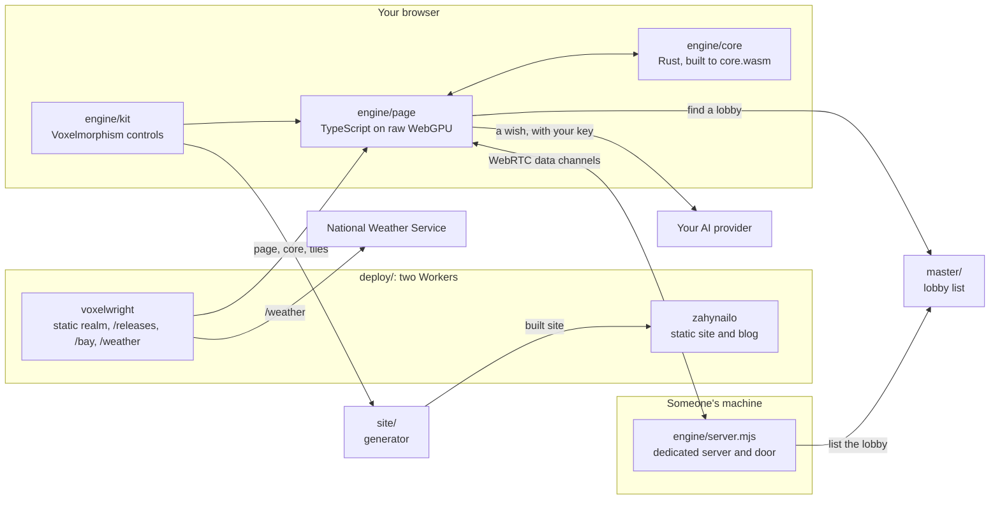

Voxelwright is a game and the stack that builds it: one systemic, multiplayer world that people make by talking, where their own agents live as characters. Today that world is San Francisco, 155 one-kilometre squares of public city data turned into 10 cm cells and drawn in the browser with raw WebGPU. It is live at [voxelwright.world](https://voxelwright.world), and `./world` runs the same city on your machine.

A **realm** is a world with its own record of its name, where people arrive, its sky and what a visitor may do: San Francisco is a static realm whose record is `realm.json`, and a server can keep several more ([plugins, rules and realms](/engine-plugins)).

## How the parts connect

The city a visitor plays is a folder of static files. The page loads the Rust core as WebAssembly and simulates the city on its own. Game servers come in only when people share a world.

- **The page and the core.** The page (`engine/page`) runs the frame loop, the ray marcher and everything drawn over the world. The core (`engine/core`) holds the cells. The same WebAssembly build runs in the page's workers and in a world server. See [the engine](/engine).
- **The realm.** `engine/sf/build.mjs` turns the pinned city release into a static folder. The `voxelwright` Worker serves it at voxelwright.world, sends the city's binary files as stored Brotli, and answers `/weather` for the live sky. See [deploy](/deploy) and [the San Francisco release](/sf-release).
- **A shared world.** `engine/serve.mjs --world FILE` keeps one world for many pages. `engine/server.mjs` adds a door, so strangers reach it over WebRTC. The master lists lobbies and passes one offer and one answer for each join. Game traffic never goes through it. See [playing together](/multiplayer) and [the master server](/master).
- **The kit and the site.** Voxelmorphism (`engine/kit`) draws the realm's controls and the site's. The site generator (`site/`) builds the owner's front page and blog, served by the `zahynailo` Worker. See [the kit](/kit) and [the site](/site).

## I want to…

| I want to… | Read |
| --- | --- |
| Walk the city on my machine | [Quickstart](/quickstart) |
| Know the controls: walking, flying, driving, the map | [Gameplay](/gameplay) |
| See every part and what each name means | [Project map](/project) |
| Understand how a frame is drawn | [The engine](/engine), [the page](/engine-page) |
| Learn how the world is stored | [Worlds as cells](/cells), [the core](/engine-core) |
| Rebuild San Francisco from public data | [The city pipeline](/city-pipeline), [the San Francisco release](/sf-release) |
| Make things by typing a wish | [Making](/making) |
| Add a rule, a plugin or a drawing pass | [Plugins, rules and realms](/engine-plugins), [drawing from a page plugin](/render-passes) |
| Host a server others can join | [Host a server](/hosting), [playing together](/multiplayer) |
| Change a control's look | [The kit](/kit), [blocks and the Vox fonts](/blocks-and-fonts) |
| Ship a change | [How the project is built](/building), [repository checks](/checks) |
| Keep a page true to the code | [Keeping a page current](/documentation) |

## What you can do today

- Walk, fly and drive through San Francisco, in a WebGPU browser on a desk or a phone.
- Watch the sky follow the city's real hour and weather.
- Make new things in the city by typing a wish, with your own Anthropic, OpenAI, Gemini or OpenRouter key. The page sends it straight to that provider.
- Run a dedicated server on your machine and let others join it through a master. On voxelwright.world the server list is a preview, shown with `?lobbies=1&master=<address>`.
- Change a shared world with rules and plugins while it runs.
