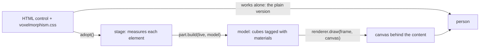

Voxelmorphism is the design language of every Voxelwright interface: each control is a small solid object built from voxels, such as a keycap on a ring of light, a knob in a bezelled slot or a lamp in a collar. The `voxelmorphism` package in `engine/kit` implements it. Plain HTML and CSS carry the interface and must work alone. Where a renderer is available, the kit draws each control as cubes behind its content.

The detailed rules live in [SPEC.md](https://github.com/voxelwright/voxelwright/blob/main/engine/kit/SPEC.md), the part-by-part design choices in [BUILDING.md](https://github.com/voxelwright/voxelwright/blob/main/engine/kit/BUILDING.md), and how renderer and fonts work in [Blocks and the Vox fonts](/blocks-and-fonts). Read [DESIGN.md](https://github.com/voxelwright/voxelwright/blob/main/DESIGN.md) before you build UI.

## The model in one picture



Three layers, each with one job:

| Layer | Owns | Where |
| --- | --- | --- |
| HTML | Names, roles, states, focus, keyboard. The control is real: `button`, `input`, `dialog`, `details`, a popover. | The page |
| CSS | The plain version: layout, sizes in voxels, flat faces, focus rings. It looks finished with no script. | `engine/kit/css/` |
| Voxels | The solid: depth, light, shadow, press, build and break. Drawn over the real control and never focusable. | `engine/kit/src/` |

A part becomes voxels when the stage marks it `data-vx-live`; its painted CSS faces then step aside. Take the voxels away and everything still works.

## The physical model

Every part answers the same physics, so the kit reads as one set of objects.

- **The voxel is the unit.** `--vx` is one voxel, 4 CSS pixels by default. Sizes are whole voxels. Set `--vx` on any element to scale what is inside it.
- **A fixed projection, not a camera.** Axes are x right, y down, z toward the viewer, with z = 0 the page. A voxel of height is drawn half a voxel right and down, so you see each solid's top and left side. The face that carries a label lands exactly on the element's box, so text stays sharp and the hit box never moves.
- **One light, real shadows.** Light comes from the top left and a little toward the viewer (`LIGHTS` in `engine/kit/src/core/materials.js`). Shadows are cast from a depth map, never painted.
- **Height says what you can do.** Proud means press me. A well means type here. Level means it holds content. Each look sets the heights (`BASE` in `engine/kit/src/core/look.js`, `defineLook('lit', …)` in `engine/kit/src/looks/lit.js`):

| Depth | Default look | Lit look |
| --- | --- | --- |
| A key stands (`rise`) | 4 | 6 |
| A press pushes it down (`travel`) | 3 | 4 |
| A card or panel (`slab`) | 2 | 5 |
| A menu, toast or popover (`float`) | 4 | 6 |
| A dialog (`dialog`) | 6 | 7 |
| A field's well (`well`) | 2 below | 4 below |
| A groove (`groove`) | 1 below | 1 below |

- **Materials have jobs.** A material is what a cube is made of and says what it is for: `enamel` for the one main action, `signal` and `light` for what is on, `chalk` for surfaces that carry content, `slate` for trays and tracks, `steel` for hardware and anything switched off, `brick` and `light-stop` for destructive or failed, `leaf` and `light-go` for done. Each has a day and a night colour (`MATERIALS`, `defineMaterial`). Dark mode is night, not an inversion: lights glow and throw halos.
- **Motion is springs.** Anything a hand touches moves on a spring and can be interrupted: `PRESS`, `RELEASE`, `SLIDE` and `CALM` in `engine/kit/src/core/motion.js`. The stylesheet carries the same springs as CSS `linear()` curves, so a plain key moves like a voxel one.
- **Things are built, and they break.** A new object assembles from bricks and a removed one crumbles. Nothing else animates for show, and nothing moves while someone reads.

The lit look (`data-vx-look="lit"` on a region) is the hardware look the kit's showcase and the site's pages use: thicker panels, keycaps on rings of light, lamps in steel collars. `theme('bay' | 'rose' | 'dusk')` changes its accent. `fitInstrument` picks an enclosure, cap set and profile; a page can instead name them in markup (`<html data-shell="walnut" data-caps="field">`).

## Tokens

Tokens are CSS custom properties on `:root` in `engine/kit/css/_kit.css`, redefined for `prefers-color-scheme: dark` and for `data-theme="dark"` or `"light"` on the root. The lit look overrides the colours inside `[data-vx-look="lit"]`.

| Group | Tokens |
| --- | --- |
| Size and type | `--vx`, `--vx-font`, `--vx-mono`, `--vx-serif`, `--vx-key-font`, `--vx-key-size` |
| Surfaces | `--vx-ground`, `--vx-ink`, `--vx-ink-quiet`, `--vx-shadow`, `--vx-focus`, `--vx-link` |
| Materials | `--vx-enamel`, `--vx-signal`, `--vx-chalk`, `--vx-slate`, `--vx-steel`, `--vx-walnut`, `--vx-leaf`, `--vx-brick`, some with `-top` and `-side` shades, and `--vx-on-*` text colours |
| Motion | `--vx-press-time`, `--vx-release-time`, `--vx-slide-time` and their `-ease` curves |
| State | `--vx-theme` (`day` or `night`) and `--vx-look`, which the script reads so CSS decides both |

`engine/kit/voxelmorphism.css` is generated by `engine/kit/tools/css.mjs` from `css/_kit.css` and the per-part sheets beside it. Edit those, never the generated file.

## The parts

`components` in `engine/kit/src/index.js` lists every registered part. Most draw voxels; the ones marked *behaviour* add keyboard and open-close wiring to plain markup and draw nothing themselves.

| Group | Parts |
| --- | --- |
| Keys and controls | button, lamp key, toggle (switch), slider, rotary, checkbox, radio, select, stepper (*behaviour*), toggle button, toggle group, code input (*behaviour*) |
| Surfaces and fittings | backplane, card, block, groove, recess, lamp, cursor (the voxel pointer), field (the well), validation (*behaviour*) |
| Reading | lettering (voxel headings that break and mend), list, list group, table, kbd, avatar, callout, prose quote, skeleton, spinner, meter, chart, trace |
| Overlays | menu, dialog, sheet, drawer, popover, hover card, tooltip, toast, context menu (*behaviour*), accordion (*behaviour*), collapsible (*behaviour*) |
| Navigation | tabs, navs, navbar (*behaviour*), sidebar, navigation menu and its float, menubar, command palette, combobox, pagination, scroll area, scroll spy (*behaviour*) |
| Heavy | calendar (*behaviour*), date picker (*behaviour*), carousel, data table (*behaviour*), resizable, theme picker |
| Conversation | bubble, message scroller (*behaviour*), attachment, questionnaire (*behaviour*) |

Some parts are CSS only, with a sheet in `engine/kit/css/` and no script: badge, breadcrumb, code block, figure, item, label, separator, empty state and others. The catalogue pages are under `engine/kit/showcase/parts/` (the core parts are shown on the main showcase instead), and a part's script opens with a comment describing it, usually with its markup.

## Using it on a page

```html
<link rel="stylesheet" href="kit/voxelmorphism.css">
<button class="vx-button">Plant a seed</button>
<script type="module">
  import { adopt, ready } from './kit/src/index.js';
  adopt();                      // every part under document; remembered until a renderer arrives
  const stage = await ready();  // the stage, or null if the page stays plain
</script>
```

- The stylesheet alone is the plain version. `adopt()` adds the voxels.
- `adopt(root)` turns every part under `root` into voxels. Call it again after adding markup. `release(root)` gives them back to plain CSS.
- By default the kit asks for the engine's WebGPU renderer on first `adopt()`. A GPU device takes a moment, so every page starts plain and nothing moves when the voxels arrive. Without WebGPU, the kit's own WebGL2 renderer draws instead. `data-vx-plain` on the root asks for no GPU at all.
- `use(renderer)` hands the kit another renderer before the first `adopt()`; `use(null)` keeps the page plain.
- Give the page `overflow-x: clip`. A part's canvas is larger than its box on each side (its `pad`, up to 16 voxels), to hold its shadow and pieces in flight.
- Values set from code (`input.checked = true`) are drawn at once with no sound. For any other change a part is drawn from (its text, its children), call `refresh(el)`.
- At rest nothing runs: no frame loop, no timers. A part is drawn again only when its state changes, and parts off screen wait until they come near.

| Export | What it does |
| --- | --- |
| `adopt(root?)`, `release(root?)` | Turn parts into voxels, or give them back to CSS |
| `use(renderer)`, `ready()`, `plain()`, `getStage()` | Choose the renderer, know when the page is live, ask whether it is plain |
| `live(el)`, `refresh(el)` | The live model behind an element; redraw it after an unheard change |
| `define(def)`, `components` | Register a part of your own; the registered list |
| `theme(t)`, `THEMES`, `fitInstrument(choice)` | The lit look's accent; the enclosure and caps |
| `toast(text, opts)`, `closeDialog(el, value)` | A toast that works plain too; close a dialog with its lowering motion |
| `sound(on)`, `cue(name, opts)` | Turn sound on from a user gesture; play a cue |
| `Model`, `Part`, `Spring`, `assemble`, `crumble`, `PRESS`, `RELEASE`, `SLIDE`, `CALM` | What parts are built and moved with |
| `MATERIALS`, `defineMaterial`, `LIGHTS`, `LOOKS`, `defineLook` | Materials, the light and looks |
| `ring`, `cap`, `bezel`, `hole`, `halo`, `byTheme`, `warmth`, `lightName`, `kindOf` | Helpers for building lit parts (`engine/kit/src/core/light.js`) |
| `FONTS`, `registerFont`, `makeFont`, `layoutText`, `measureText` | The voxel glyph sets |
| `plant`, `pot`, `STAGES`, `stageOf` | The plant generator |

## The accessibility floor

Every part must meet these, plain and live:

- A real HTML control underneath, so it works with a keyboard, a screen reader and no script. Names, roles, states and keys come from the HTML. The WAI-ARIA practices are the reference for keys and roles.
- Every state lives in the markup or the control (`aria-*`, `disabled`, `checked`), never only in script.
- The canvas is `aria-hidden`, takes no pointer events and is never focusable.
- Focus is visible: a 2 px `:focus-visible` outline, and a live key's ring frames its whole solid.
- Contrast: body text 7:1, quiet text and legends 4.5:1.
- Hit targets are at least 11 voxels (44 px) tall.
- With `prefers-reduced-motion`, nothing travels: builds and breaks become a short change of scale in place, and keyboard-driven changes never animate.
- At 390 px wide nothing is cut and nothing scrolls sideways. A long Ukrainian label must fit or wrap.
- Voxel lettering keeps its words in the DOM, selectable and findable like any heading.

## Building a part

A part is a definition object passed to `define`, or added to `components`. `engine/kit/src/components/kbd.js` is a short complete example; the checkbox (`checkbox.js`, `css/checkbox.css`, `showcase/parts/checkbox.html`) is the one to hold a new part beside.

```js
export const thing = {
  name: 'thing',
  selector: '.vx-thing',   // the element becomes voxels; its box is the model's box
  pad: 7,                  // voxels of canvas round the element, for height, shadow and halo
  build(live, m) {},       // make the model from the element as it is now
  pose(live) {},           // before each drawing: move parts from springs
  step(live, dt) {},       // each frame while moving; return true to keep going
  bind(live) {},           // once: listeners; return a function that removes them
  plain(el, on) {},        // the same behaviour with no voxels
};
```

Omit `build` for a part that only adds behaviour. Inside `build`, `m.part(name)` gives a `Part` with `box`, `slab`, `carve`, `plot` and `text`; take every depth from `live.look` (`rise`, `travel`, `well`, `slab`, `float`, `dialog`, `groove`), never a number; use only the kit's materials, so a theme can recolour them.

Before writing one, decide what real object it is. BUILDING.md has the five tools (key, surface, groove, well and float, plus "none") and a settled table of which tool each part uses. The short version:

1. Reach for "none" first. A part that is only words gets no voxels.
2. Only what can be pressed stands up. One main action per group.
3. Light means something: accent for acts or on, warm for structure, green for done, red for failed.
4. One mechanism everywhere: something pressed is the keycap (`cap()` on `ring()`), something that slides is a knob in a bezelled slot.
5. Write the plain HTML and CSS first, then the voxels.

A new part owns its script in `engine/kit/src/components/`, its sheet in `engine/kit/css/`, its page in `engine/kit/showcase/parts/`, and, if it has behaviour, a check in `engine/kit/tools/parts/`. Then:

```sh
cd engine/kit
node tools/css.mjs                       # rebuild voxelmorphism.css after a change in css/
PORT=5989 node tools/part.mjs thing      # shoot the part's page every way; read shots/parts/thing/sheet.png
PORT=5989 node tools/parts.mjs thing     # the harness and the part's own check
```

## The package and the site

`engine/kit/package.json` names the package `voxelmorphism` (Apache-2.0) and exports:

| Export | What it is |
| --- | --- |
| `.` | `browser/kit/src/index.js`, the browser modules |
| `./browser` | `browser.mjs`, whose `copyModules(out)` writes the kit, the engine renderer modules and the showcase desk into a folder, with types stripped from `.ts` files |
| `./voxelmorphism.css` | The plain stylesheet |
| `./fonts/*` | IBM Plex and the Vox faces, each with its `OFL.txt` |

`npm pack` in `engine/kit` runs `browser.mjs` (the `prepare` script) and packs the same modules as plain JavaScript.

The site depends on the kit as `"voxelmorphism": "file:../engine/kit"` in `site/package.json`. `buildKit` in `site/generator/kit.mjs` builds only what the site uses:

1. `copyModules` writes the kit into a temporary folder.
2. `PARTS` lists each part the site uses, keyed by its exported name, with its script in `src/components` and its sheet in `css/` (either may be `null`). The build rewrites the kit's `components` list to those names, drops the other component imports, and fails if a listed part is missing from the kit.
3. esbuild bundles and minifies the kit, the desk controls and the renderer into `vendor/village/` with shared chunks.
4. The stylesheet is rebuilt from `_kit.css` plus the sheets the chosen parts need and the always-needed `SHEETS`. Only the IBM Plex Latin, Vox Text and inlined font faces are kept, and each font file is copied with its licence.

`site/test/kit.test.mjs` fails when a page uses a `vx-` class that the tailored stylesheet does not style. The fix is to add the part to `PARTS`.

## Check a change

```sh
cd engine/kit
PORT=5989 node tools/serve.mjs          # the showcase at http://127.0.0.1:5989/kit/showcase/
PORT=5989 node tools/links.mjs          # every showcase page loads
PORT=5989 node tools/default.mjs        # which renderer draws in each case
```

[HILL.md](https://github.com/voxelwright/voxelwright/blob/main/engine/kit/HILL.md) lists the full set of gates and how a change to the look is judged. Run `npm test` in `site/` for the tailored build. For any visual change, follow the `ui-craft` skill's screenshot and review loop ([SKILL.md](https://github.com/voxelwright/voxelwright/blob/main/.agents/skills/ui-craft/SKILL.md)).
