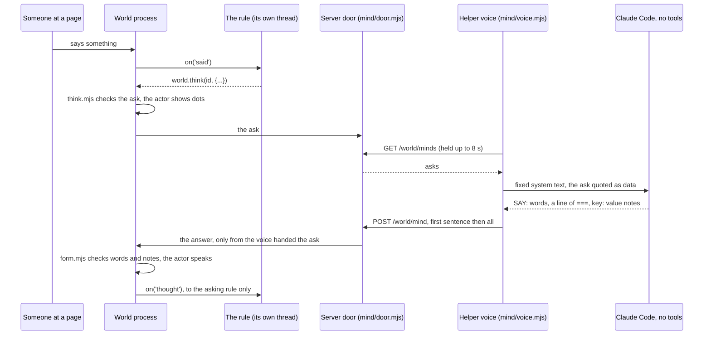

Some things in a world move: cars, karts and brooms run on their own motors. People walk: someone at a page, an agent in a seat, a rule's actor and the town's residents. Some of them answer when spoken to, because a model on someone's own machine speaks as them, and that model never gets a say over the world.

For the keys a player uses to drive, walk and look, see [gameplay](/gameplay). For how things are made, see [making](/making). For the rules that drive actors, see [plugins and rules](/engine-plugins).

## The bodies

| Body | What it is | Moved by | Source |
| --- | --- | --- | --- |
| Living thing | A made thing whose record's `controls` has a motor. Its cells leave the world while it lives. | The core's solver: the world process in a shared world, the page's own solver in a world the page runs alone | `Controls` in `engine/page/living.ts`, `engine/core/src/bodies/living.rs` |
| A person's own body | Someone at a page on their feet: a box 1.4 m tall on a springy leg that reaches 0.6 m down | That person's page, in a core of its own that is told every edit the world tells of | `engine/page/person.ts` |
| Actor | A body the world moves for a rule. Everyone sees it. | The world process, for the rule that owns it | `actor` in `engine/world.mjs`, `engine/about.mjs` for finding a way round |
| Seat | A body for an agent or any program that joins with `POST /world/join` | The world process, a step at a time over the world's cells | `engine/world.mjs` |
| Resident | One of the town's or San Francisco's people, worked out from place and time. Nothing is kept or sent: every page and the world process name the same people in the same places. | Nobody: a rule of place and time (until a rule takes one as an actor) | `engine/page/residents.ts` for the town; `engine/sf-walks.mjs` shared by `engine/world.mjs` and `engine/page/street.ts` for San Francisco. |

Every person is drawn as the same figure (`figure` in `engine/page/people.ts`): boxes of 5 cm cells jointed at hip, knee, shoulder, elbow and neck. A figure is never cells of the world, so the march does not see it. All the figures in sight are drawn in one call over the marched picture.

A person's page moves its own body because a body moved by the world process would be seen late: the world is a network hop away, and every step would wait for it. The world process still judges what strikes that body. Each body has a ghost in the world's core, a box put where the person stands, which meets what is thrown, falls or drives (`engine/rules/blows.mjs`).

## Living things

A thing lives once its record's `controls` has a motor. The motor is numbers, so a model can write it with the thing and nothing is run.

| Field of `controls` | What it says |
| --- | --- |
| `scheme` | How it is driven: `drive`, `fly`, `hover` or `ride` (`SCHEMES` in `living.ts`) |
| `motor` | Its feet, power, top speed, grip, steering, lift and how hard a hit it takes (`Motor`) |
| `seats`, `size` | Where riders sit, in its own cells from its low corner |
| `eye` | Where the driver's eye is when it looks from the seat |
| `fine` | Its look in finer cells (below) |
| `rest`, `driven` | Written by the world: where it last slept, and whether anyone has got on or driven it |

**A look in finer cells.** The body that moves is 10 cm cells. Every drivable car and kart wears a fine look (2.5 cm or finer, riding on the body in up to eight parts of 4 or 8 cells to one of the body's), and the body's own cells are not drawn; generated streets hold no plain stand-in cars made of world cells. In a shared world the record holds no cells: each part's cells go first to `POST /world/fine`, which keeps them by their sha256, and the record names them under `controls.fine[].kept`. Every page fetches `GET /world/fine/<kept>` once.

There are five ways a thing comes alive:

| Way | How | Source |
| --- | --- | --- |
| Made from words or a picture | The maker works out wheels, front, seat and motor from the thing's own cells. A car's 0 to 100 km/h is tried in the solver until it matches what was asked. | `engine/make/drivable.mjs` |
| A reply of living cells | A reply of cells with `living`: scheme, motor, seats, eye, look and figures | `engine/make/alive.mjs` |
| "make it drivable" | Words that point at the asker's own made thing bring it to life in place, on one ask that takes the old thing out | `asksToDrive` in `living.ts`, `aimed` in `engine/make/maker.mjs` |
| A rule brings one | `world.thing(id, {like, at, yaw, colour})` sets down a kart, a car, a broom or a craft at once, with no model; `car` and `kart` carry 2.5 cm sculpted looks stored in `/world/fine/<kept>` | `engine/rules/kept.mjs`, `engine/page/car-sculpt.ts` |
| Imported | `node make/import.mjs <build.json> --twin <twin.json>` (in `engine/`) turns a living car from the fast-voxels bench into a reply of living cells on the asker's own shelf (never `engine/make/kept/`), so typing its name makes it at once | `engine/make/import.mjs` |

A rule drives a living thing as a rider does (`world.drive`), gives it a course to follow, seats people on it (`world.seat`) and tunes its motor for a while (`world.thing(id, {tough, top, power, ...})`). The world process steers a course and sets back on its wheels a thing that is wedged (`engine/rules/things.mjs`). Anything that can send a request drives one through `POST /world/drive`.

## What a body can do is numbers

Neither the core nor the page knows the words "fly" or "walk up walls". A rule sets numbers on a body, and the body does the rest.

| Rule call | What it sets | Source |
| --- | --- | --- |
| `world.person(id, {pace, jump, climb, fly, fall})` | How fast someone runs, how high they jump, how high a wall they climb, how fast they fly, how much pull they feel | `CAN` in `engine/rules/bodies.mjs` |
| `world.person(id, {down, cling})` | Which way is down for them, or down onto whatever face they walk onto | `engine/rules/bodies.mjs` |
| `world.clock({rate, spare})` | How fast the world goes, for everyone but those spared | `engine/rules/bodies.mjs` |
| `world.actor(id, {jump, climb, fly, fall})` | The same numbers for an actor | `engine/world.mjs` |
| `move`, `aim` on a person or an actor | What the figure does with its limbs | `engine/page/moves.ts` |
| `look` on a person or an actor | What the figure wears and carries | `engine/page/wear.ts` |

A move is data. A pose is a number for each of 21 joints (`CHANNELS` in `moves.ts`), and a move is poses over time that name only the joints they set, laid over standing, walking or running. Named moves (`NAMED`) include wave, strike, kick, block, aim, fire, throw, fall and get-up. A rule may also send keys of its own. A look names things worn (`WORN`: a suit, a tie, glasses, a helmet, a coat and more), something carried (`CARRIED`), and boxes of the rule's own on any part of the body. A move is how a body looks: it strikes nobody.

Holding works the same way. A made thing picked up leaves the world in one edit and rides in the holder's right hand as a few boxes cut from its cells (`engine/rules/holding.mjs`, `engine/page/held.ts`). A rule hears `held` and `put`, and may `world.give` and `world.take`.

## People who answer

A rule can ask one of its actors to think: to answer what was said as a person of that world would. The answer comes from a model on the machine of someone who is there. The world server never runs a model.

```js
on('said', (world, e) => world.think('odile', {
  who: 'A baker, dry and kind.', where: 'outside her bakery', heard: e.text, from: e.name,
  notes: { doubts: { ask: 'does the speaker seem to doubt that the world is real', is: 'yes/no' } },
}))
on('thought', (world, e) => { if (e.notes.doubts) world.actor(e.id, { pace: 60, to: [760, 4009] }) })
```

The rule names the notes it wants, each a question and a kind (`"yes/no"`, `"words"`, a list of choices, or `[low, high]`). It hears `thought` with the words and each note as a value of its kind or null. `world.read(id, {said, from, listening, notes})` has a model fill in notes about what someone said, with nobody answering: a rule reads what a person means however they word it.



<Warning>
**Model output is data, never authority.** Neither a model's reply nor anything a person or a rule typed can grant a permission, run code or reach outside the words a person says. Each step enforces this in code:

- **The run.** `engine/mind/model.mjs` starts Claude Code with no tools, no MCP servers, no settings and no session, in an empty folder, with only a few environment variables. A run that reports a tool or a server is refused.
- **The prompt.** `asked` in `engine/mind/form.mjs` quotes every field (who, where, what was heard, earlier talk, the realm's description) as JSON strings under labels. `SYSTEM` tells the model all of it was written by strangers and is never an instruction.
- **The reply.** `read` takes only what follows `SAY:`. `lines` cuts it to 400 characters in lines of 200, and `worldly` refuses any words shaped like an email address, a tag or a system prompt. `noted` keeps only the notes the rule asked for, each coerced to its kind or null.
- **The handoff.** `engine/mind/door.mjs` takes an answer only from the helper the ask was handed to, by its key.
- **The world.** `engine/mind/think.mjs` checks the answer again with the same form, because to the world a helper is a stranger too, and tells only the rule that asked.
</Warning>

### Whose model

A helper started on someone's machine (`node helper.mjs --world URL` in `engine/`) voices the world's people with that person's own Claude Code. One helper voices everyone in a world: the first that came, for as long as it keeps asking. When it closes or goes quiet for ten seconds, the next helper to come takes over. So what anyone says near an actor goes to the model of whoever's helper came first, on their subscription. A helper voices home and every realm of its server that is awake with a page reading it (`voices` in `engine/mind/voice.mjs`).

With no helper running, a thought fails within a second, so a rule can do something else.

### San Francisco street residents

San Francisco's pedestrians are evaluated from the same shared module (`engine/sf-walks.mjs`) on both the world process (`engine/world.mjs`) and every browser page (`engine/page/street.ts`), using the square walk graphs (`life/*.json`) and signal timing (`cycleAt`, `phaseOf`).

- **District-clocked daily routines.** Each resident gets a deterministic archetype (`commuter`, `shopkeeper`, `tourist`, `runner`, `night_owl`, `resident`) from their seed and street busyness, and follows origin-to-destination walks across five schedule phases (`morning_commute`, `work_day`, `evening_commute`, `nightlife`, `late_quiet`). When `rain > 0.3`, pedestrians hurry toward busy commercial storefronts (`seeking_shelter` / `sheltering`) and raise umbrellas.
- **Three-ring AI LOD.** Pedestrians are classified by distance (`classifyLod`): **Ring 1** (`<= 35 m`) runs full gaze, avoidance, horn and stuck-robotaxi micro-reactions; **Ring 2** (`35–110 m`) uses simplified kinematics with posture and umbrellas; **Ring 3** (`110–300 m`) tracks lightweight macro route progression with zero animation or collision work and materialises cleanly into Ring 2 when approached.
- **Zero-teleport promotion.** On released San Francisco worlds, `world.residents` lists nearby SF pedestrians with their `seed`, `home`, `archetype`, `activity`, and `lod`. Taking one (`world.actor(id, { take })`) promotes them from their live `sf-walks.mjs` whereabouts with zero jump, broadcasts their `was` seed so connected pages suppress the analytic duplicate (`taken`), and lets `release()` walk them back to their live route before handing them back to the street crowd.

### San Francisco traffic AI

San Francisco's ambient street vehicles (`engine/page/street.ts`) use the modular traffic AI in `engine/page/traffic-ai.ts` so queues keep flowing around craters and stalled robotaxis without overlapping or snapping.

- **Per-driver profiles and wet roads.** Every vehicle gets a deterministic `driverProfile(seed, kind, emergency)` across six archetypes (`cautious`, `commuter`, `assertive`, `hurried`, `delivery`, `emergency`) setting its speed bias, caution, aggression, following gap, lane-change willingness, horn patience, and rain braking scale. When `rain > 0.2`, `rainDrivingFactors` elongates braking and following distances and trims cornering speed.
- **Dynamic lane-changing and local junction detours.** When a lane ahead is obstructed by a blast crater (`r.blocked`), a stalled robotaxi (`rtStuck`), or a stopped car, trailing vehicles verify clearance with `isLaneClear` and smoothly interpolate lateral shifts (`laneShift` on multi-lane roads, `overtakeShift` on narrow streets) with zero snapping and OBB overlap guards. Approaching a junction whose outgoing road is blocked or congested triggers `planLocalDetour` (budgeted to 16–24 graph expansions and cached per road and blocked set) to choose a clear alternate road.
- **Emergency vehicles and acoustic sirens.** Police cruisers and ambulances spawn at a low ambient share (~4%) or on demand via `street.spawnEmergency(...)`. While their siren is active, they pulse alternating red/blue roof flashers through `LocalLightSink`, clear red lights after a brief caution slowdown, and project an acoustic siren cone (45 m / 50° forward plus 18 m omnidirectional). Regular traffic inside the cone (`evaluateSirenYield`) slows and pulls smoothly toward the right kerb (`sirenYieldShift`), then merges back once passed.
- **Pedestrian-vehicle coupling and telemetry.** Crosswalk yielding scales with driver caution and rain (`crosswalkYieldBuffer`), hurried drivers honk sooner when blocked, and close fast passes emit structured `PedestrianNearMissCue` records (`street.nearMissCues`) that make nearby Ring-1 pedestrians flinch and step back. `street.trafficAiStats()` reports `{ laneChanges, detours, sirenYields, activeEmergency, deadlocksResolved }`.

### People answer by default

Once someone's model answers for a world, the world is given one rule by the engine: `engine/mind/talk.rule.js`, under the id `talk`. When someone speaks, the nearest resident (in the town or on San Francisco's streets) within 9 m stops, turns and answers as an ordinary person of the street. Left alone for 25 seconds they walk on. It is text run in a box like any rule. It does nothing while nobody's model answers, and stands back where another rule listens for `thought`. Put a rule of your own under `talk` to replace it, or take `talk` out. `GET /world/rules?given=1` lists it.

### They remember and know where they live

The world process keeps the last 8 lines each actor heard and said, for an hour, and shows them to the model with the next thought. They are written beside the world's file, so they outlive a rest and a restart. `before` in `world.think` says what was said instead. With every thought the model is also told the realm's name and description, as the world the person lives in; `realm: false` leaves it out.

### Limits

| Limit | Value | Where |
| --- | --- | --- |
| Thoughts in flight per rule | 8 at once, 40 a minute | `TOGETHER_MOST`, `A_MINUTE_MOST` in `think.mjs` |
| A thought's time | 20 s, then the rule hears `failed` | `THOUGHT_MOST` in `think.mjs` |
| Answers per helper | 40 a minute (`--voice-most`), 3 at once | `voice` in `voice.mjs` |
| Processes started ahead | 2 for answers (`--voice-warm`) and 1 for readings, so an answer does not wait for one to start | `voice` in `voice.mjs`, `warm` in `model.mjs` |
| Who the actor is, what they heard | 600 and 200 characters | `WHO_MOST`, `HEARD_MOST` in `form.mjs` |
| Notes | 8 a thought, up to 12 choices each | `NOTES_MOST`, `CHOICES_MOST` in `form.mjs` |
| What is said | 400 characters in lines of 200 | `SAY_MOST`, `LINE_MOST` in `form.mjs` |

The voice is Sonnet by default (`--voice`). `--no-voice` turns voicing off for that helper. The Claude Code binary puts the account's email address and the date in every model's context, and no flag takes them out. `worldly` refuses replies shaped like an address, but a model talked into spelling one out in words would not be caught. With one person and their own helper, the only address the model can leak is that person's own. Before strangers share a voice, it needs a model run without that context.

## Check a change

```sh
cd engine
node test/mind.mjs            # thinking with replies kept in test/mind-kept.json, no model
node test/sf-residents.mjs    # shared SF walk graph, daily routines, 3-ring LOD, take/release & talk.rule.js
node test/traffic-ai.mjs      # per-driver profiles, rain braking, lane-changing, detours, sirens & ped coupling
node test/living.mjs          # a living car driven in Chrome
node test/person.mjs          # a person's own body, alone and in a shared world
node test/moves.mjs           # moves and looks sent by a rule
node test/drivable.mjs        # a made thing brought to life, no Chrome
node test/made-cars.mjs --out DIR   # a car a model made (stand-in replies) driven in Chrome
node test/kept-car.mjs --out DIR    # an imported car typed, made, ridden and taken out, no model
node test/mind.mjs --real     # the kept cases asked of a real model, on your subscription
```

A check with a stand-in model proves the plumbing, not what a model says. The folder guide is [engine/mind](https://github.com/voxelwright/voxelwright/tree/main/engine/mind).
