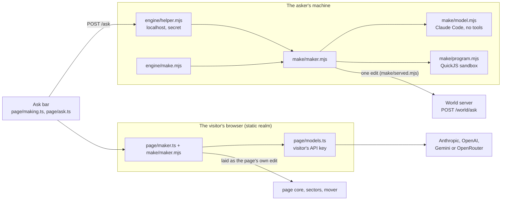

# Making

Making turns a typed wish ("a market stall with a striped awning") into a thing built from the world's own cells. The model belongs to the person who asked, on their subscription or their API key. The engine treats a model's reply as data: it reads it, checks it, turns it into cells and sends it to the world as one ordinary edit. The world's server never runs a model. Rules that models write are covered in [plugins and rules](engine-plugins.md).

## Concepts

- **Ask** (`Ask` in `engine/page/ask.ts`). A wish, a picture or a link, and where the thing is for. It is data for the model, never instructions to the engine.
- **Maker** (`make` in `engine/make/maker.mjs`). The one pipeline every path uses: find a place, ask the model, read the reply, check that it stands, place it, send it. It imports nothing from Node; callers hand in the world, the model and the core.
- **Reply forms.** A model answers in one of three forms: **parts** (`engine/make/form.mjs`, JSON boxes, bars, balls, wedges and letters), **cells** (`engine/make/cells.mjs`, a run-length grid), or a **program** (`engine/make/program.mjs`, JavaScript that fills a grid, run in a sandbox).
- **World** (the `World` contract in the header of `maker.mjs`). What the maker asks of a world: `at`, `look`, `tops`, `things`, `send`. `engine/make/served.mjs` implements it over a world server's HTTP API. `engine/page/maker.ts` implements it over the page's own core.
- **Stands.** Before sending, the maker asks a core whether the thing would hold up (`stands` in `engine/make/place.mjs`). Rows that would fall are dropped. If too little would stand, the model is asked again with the reason.

## What runs where



| Path | Model | Who runs the reply | Where the thing lands |
| --- | --- | --- | --- |
| Helper: `node helper.mjs --world URL` (in `engine/`) | The asker's Claude Code, started by `engine/make/model.mjs` | Node on the asker's machine. Program replies run here. | The world server, as one edit |
| Command line: `node make.mjs "WISH" --world URL --at X,Z` (in `engine/`) | Same as the helper | Same as the helper | The world server |
| Static realm (**Your AI…** in the realm settings) | The visitor's provider, called from the browser by `engine/page/models.ts` with their key | The page. Parts and cells only; a program reply is not run in a page. | The page's own world, laid as its own edit |

The helper refuses a request whose `Host` is not this machine's own name, a browser request whose `Origin` is not an allowed page, and any request without the secret it printed (`X-Village-Secret`). The page receives the secret after `#` in its address, which the browser never sends to a server, and keeps it in `localStorage`.

In a static realm, the realm's record decides whether making is on (`making` in `engine/page/local.ts`): off, on, or `preview`, which is on only with `?making=1` in the address. Making inside a lobby is a fourth path that is changing under #526 and is not described here.

## What a model may and may not do

A model writes text, and nothing more. Each boundary below is enforced by code, not by the prompt.

**The Claude Code run** (`reply` in `engine/make/model.mjs`):

- Started with `--tools ''`, `--strict-mcp-config` and no MCP servers, `--setting-sources ''`, `--disable-slash-commands` and `--no-session-persistence`.
- Runs in a new empty temporary folder, with only `HOME`, `PATH`, `USER`, `LOGNAME`, `TMPDIR`, `LANG` and `SHELL` from the environment.
- Stopped after its time limit. A run that reports having had a tool or a server is refused.

**The browser call** (`engine/page/models.ts`):

- A key is sent only to its own provider's address in `AT`. Nothing a world, a link or a reply says can change that address.
- The request gives the model no tools. The reply is read as text.
- Only words the visitor typed are sent (`Ask.typed`).

**The reply**, in any form:

- It must parse as its form. A cells reply with a key the form does not name is refused. A parts reply is read leniently: what is not part of the form is left out.
- Materials and colours are given by name. The maker builds each kind itself, so a reply cannot set a kind's flags (rubble, charged, finer cells) or ask for water.
- Parts: at most `SIZE_MOST` = 64 × 80 × 64 cells and `PARTS_MOST` = 240 parts, unless the asker gives a larger space to fill.
- Cells: cell sizes from `CMS` (10, 5, 2.5 or 1.25 cm), at most `SIDE_MOST` = 256 cells a side.
- Programs: QuickJS compiled to wasm, with nothing bound in (no host functions, timers, files or network). Memory is capped by the WebAssembly maximum (`PAGES_MOST` pages, 192 MB). The interpreter's interrupt handler stops the program after `RUN_MS` (20 s), and its whole thread is ended after `END_MS` (30 s). The program's output is one string, read as cells data.

**The edit.** The thing reaches a world as one edit of rows through `POST /world/ask`. The world takes it whole or refuses it whole, and it is undone the same way (`undo` in `maker.mjs`).

## The ask

<!-- schema engine/page/ask.ts Ask -->
```ts
export interface Ask {
    wish?: string;
    picture?: {
        type: 'image/png' | 'image/jpeg' | 'image/webp';
        data: string;
    };
    link?: string;
    fresh?: boolean;
    hand?: boolean;
    target?: Target;
    kept?: string;
    typed?: boolean;
}
```

`target` is a point, a box of cells, or a made thing and one of its parts. Without one, the thing is made at what is ahead of the eye. The answer is a `Done` (same file), whose `state` is `there`, `fell`, `not there`, `unknown`, `refused` or `held`. `held` means the thing was made but no nearby place would take it, so the asker can choose where it goes.

## Check a change

```sh
cd engine
node make.mjs "a red phone box" --world http://127.0.0.1:5741 --at 700,3990 --dry   # make and check, send nothing
node test/make.mjs           # the maker with replies kept in files, no model run
node test/models.mjs         # the browser's provider requests
```

`--reply FILE` stands in a saved reply for the model, on `make.mjs` and on the helper. A check that passes with a saved reply proves the pipeline, not a model. Say which one you ran.

<!-- docs-verified 7395eccfb62b043807f729073dfc0b4483063163 {"engine/page/ask.ts":"174d7235c4ea8ad4cb693abfada14a3b","engine/make/form.mjs":"31a88c43de77486a4f2474a75d07fe8a","engine/make/cells.mjs":"b75e3d3d96c23a9f599fa235f6e62250","engine/make/program.mjs":"d239a24bd1eb2458879352756ff3265a","engine/make/model.mjs":"6d09e7ed11a6844251d5a7b5e2ccc07e","engine/page/models.ts":"75f800abbf34adbefb9bf0d19770a060","engine/make/maker.mjs":"330062a3955b5cd6534350a2dbf96122","engine/make.mjs":"b9ca534b6fabc3dd78fa1f7a07c5fc80","engine/helper.mjs":"cf9a75d4e068e840eb8979086ad950b9","engine/page/maker.ts":"e938bf8e37552ed0237386443a50b404","engine/make/served.mjs":"a7cff994b04b8422986595f90869763d","engine/make/place.mjs":"9d2932bdc2d1cab056ac11c8a97c1f0c","engine/page/local.ts":"db878f789a3608c684e66c4f4f0bce2b"} -->
