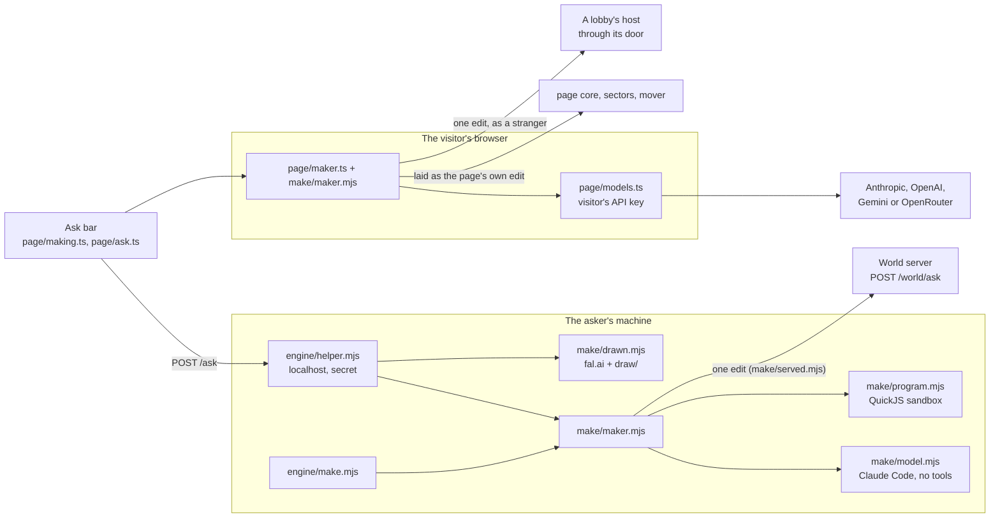

Making turns a typed wish ("a market stall with a striped awning") into a thing built from the world's own cells. The model belongs to the person who asked, on their subscription or their API key. The engine treats a model's reply as data: it reads it, checks it, turns it into cells and sends it to the world as one ordinary edit. The world server never runs a model. Rules that models write are covered in [plugins and rules](/engine-plugins). Things that come alive, such as a made car, are covered in [living things](/living).

## Concepts

- **Ask** (`Ask` in `engine/page/ask.ts`). A wish, a picture or a link, and where the thing is for. It is data for the model, never instructions to the engine.
- **Maker** (`make` in `engine/make/maker.mjs`). The one pipeline every path uses: find a place, ask the model, read the reply, check that it stands, place it, send it. It imports nothing from Node; callers hand in the world, the model and the core.
- **Reply forms.** A model answers in one of three forms: **parts** (`engine/make/form.mjs`, JSON boxes, bars, balls, wedges and letters), **cells** (`engine/make/cells.mjs`, a run-length grid), or a **program** (`engine/make/program.mjs`, JavaScript that fills a grid, run in a sandbox).
- **World** (the `World` contract in the header of `maker.mjs`). What the maker asks of a world: `at`, `look`, `tops`, `things`, `send`. `engine/make/served.mjs` implements it over a world server's HTTP API. `engine/page/maker.ts` implements it over the page's own core.
- **Stands.** Before sending, the maker asks a core whether the thing would hold up (`stands` in `engine/make/place.mjs`). Rows that would fall are dropped. If too little would stand, the model is asked again with the reason, up to three times.
- **Shelf.** What was made before, kept as the reply and the cells it came to, so the same words are made again at once with no model (`engine/make/library.mjs`).

## What runs where



| Path | Model | Who runs the reply | Where the thing lands |
| --- | --- | --- | --- |
| Helper: `node helper.mjs --world URL` (in `engine/`) | The asker's Claude Code, started by `engine/make/model.mjs` | Node on the asker's machine. Program replies run here. | The world server, as one edit |
| Command line: `node make.mjs "WISH" --world URL --at X,Z` (in `engine/`) | Same as the helper | Same as the helper | The world server |
| Static realm (**Your AI…** in the realm settings) | The visitor's provider, called from the browser by `engine/page/models.ts` with their key | The page. Parts and cells only; a program reply is not run in a page. | The page's own world, laid as its own edit |
| A lobby joined from a static realm | Same as the static realm | The page, then the host's dedicated server checks it again | The host's world, through its door |

Which path a page takes depends on two rules in the realm's record, `realm.json` (`Rules` in `engine/page/local.ts`), not the address. `models` says whether anything on the page may ask a model through a helper: making from words, rules and realms written, people who answer. Off, the page never looks for a helper. `making` says whether a visitor may make things in the page itself, from the shelf or with their own AI, with no helper. A rule the record leaves out is off, and a page with no realm record has `models` on and `making` off.

| Page | `models` | `making` | What the bar does |
| --- | --- | --- | --- |
| The engine's own page (`/city`) | on | off | Asks the helper on this machine, if one is running |
| A static realm such as San Francisco ([realm.json](https://github.com/voxelwright/voxelwright/blob/main/engine/sf/realm.json)) | off | on | Makes in the page, from the shelf and the visitor's own AI |
| A realm with `making: "preview"` | | | Makes in the page only with `?making=1` in the address |

### The helper's door

The helper refuses a request whose `Host` is not this machine's own name, a browser request whose `Origin` is not an allowed page, and any request without the secret it printed (`X-Village-Secret`). The page receives the secret after `#` in its address, which the browser never sends to a server, and keeps it in `localStorage`. The helper makes one thing at a time.

### Making in a lobby

A visitor who joins a lobby from a realm that allows making makes things with the page's maker, but the world it asks and sends to is the host's (`Seam.lobby` in `engine/page/maker.ts`). Before any model is asked, the page asks the host whether it may make now. The host counts what each person who is not an admin makes (`LIMITS` in `engine/door.mjs`). By default that is 6 things a minute, 40 standing, 4,000,000 cells in all, within 120 m of where their page says they are; `engine/server.mjs` sets other values with `--things-minute`, `--things`, `--cells` and `--reach`. A host can let only admins build. The world server inside the host's dedicated server checks a stranger's thing again whatever the page checked (`stranger` in `engine/serve.mjs`). See [multiplayer](/multiplayer).

## The shelf

Words that mean something made before are made again from the shelf at once, with no model. There are three shelves:

| Shelf | Where | Written by |
| --- | --- | --- |
| The asker's own | `~/.village/engine/library/` | The helper and `make.mjs`, after each wish of words alone |
| What comes with the engine | [engine/make/kept](https://github.com/voxelwright/voxelwright/tree/main/engine/make/kept): nine things (a car, two swords, a pistol, a chair, a tree, a market stall, a house front, a street lamp) | By hand, each made once by the best model. Read, never written. |
| A static realm's | A `shelf` folder beside the page, built by `engine/sf/build.mjs` from `engine/make/kept` | The build |

One rule, `meant` in `engine/make/meant.mjs`, says what typed words mean of what is kept. The ghost uses it as words are typed (`engine/page/kept.ts`, through the helper's `POST /kept`), and Enter uses it too, so what a ghost shows is what Enter makes. A wish to change a thing ("paint it red", `asksAChange`) is never answered from the shelf. A picture or a link is never a key and never kept. Shift with Enter (or `--fresh`) asks the model anew.

A thing kept as cells is never run again. What was proved of it when it was kept (`proved`: every cell joined to the ground, and it stood whole) is kept with it. Where it goes, the ground there and what is in the way are checked every time.

## At once, then better

For a wish nothing kept answers, the helper makes it twice (`engine/make/best.mjs`). A quick model's program stands first (`--first`, Sonnet by default). Behind it the best model writes its own (`--best`, `claude-fable-5-2` by default, `--best none` for never), which takes minutes. The better one takes the first one's place where it stands, unless someone holds it, has moved it or has driven it. Either way the better one is kept, so the next asker gets it at once.

## A drawn thing

A typed wish that nothing kept answers may be drawn first. An image model draws one sheet of the thing from five sides (left, right, front, rear, top), and a builder carves and paints cells from those views (`engine/make/drawn.mjs`, [engine/draw](https://github.com/voxelwright/voxelwright/tree/main/engine/draw)). At the same time the asker's own model says what a picture cannot: whether it is a thing to draw at all, its name, its size in metres, its one material, and for a car its top speed and 0 to 100 km/h. A drawn car comes alive.

| Fact | Value |
| --- | --- |
| The drawer | fal.ai's `fal-ai/nano-banana-2` through its sync API, words only ([fal-model-api skill](https://github.com/voxelwright/voxelwright/blob/main/.agents/skills/fal-model-api/SKILL.md)) |
| The key | `FAL_KEY`, else the macOS login Keychain's `village-fal`. Read for each call and sent only to fal. No key, nothing is drawn. |
| What fal keeps | Asked to keep nothing (`X-Fal-Store-IO: 0`). The picture comes back in the answer. A picture is fetched only from fal's own store, with no redirect followed. |
| What is drawn | Only words a person typed on the bar (`Ask.typed`). Not a rule's `world.make`, a picture, a link, a change, a thing for a hand or a space to fill. |
| How many | `--draw-most` a day, 40 by default. Words whose paid drawing did not stand are not drawn again while the helper runs. |
| Off | `--no-draw` on the helper |
| Cell size | 1.25 cm up to 1.6 m long, 2.5 cm up to 6.4 m, 5 cm up to 12.8 m, 10 cm up to 25.6 m |
| Checked | Height and both sides along the ground within a factor of 1.8 of the model's size. Otherwise nothing is sent and the wish is made as before. |

A drawing is made only by the helper. A page that makes things itself does not draw.

## Programs and finer cells

A program reply lays the thing cell by cell in a grid of up to 256 cells a side, in cells of 10, 2.5 or 1.25 cm (`GRAINS` in `program.mjs`). A list of parts spends 20 to 35 cells across a thing whatever a cell is; a program's loops give spokes, curved hulls and tiles. `make.mjs --program` asks for one.

The world's cells are 10 cm, and one of them may hold 4 or 8 finer cells along each way, so a fine thing has a grain of 4 or 8 (`grained` in `engine/make/fine.mjs`). Everything that asks where a thing may stand works in the world's cells, on a stand-in: the thing in 10 cm cells, each filled where any of its finer cells is. The stand-in is placed and tried; the fine rows are what is sent.

- A fine thing that reaches more than `FINE_REACH_MOST` = 16,384 of one sector's cells is not sent (the core would refuse it).
- Where a fine thing bigger than a hand's stands within 20 m, the next is made as its stand-in in 10 cm cells, so fine things do not crowd a view.
- A page draws finer cells from the moment its world holds any; a world with none pays nothing.

## What a model may and may not do

A model writes text, and nothing more. Each boundary below is enforced by code, not by the prompt.

**The Claude Code run** (`reply` in `engine/make/model.mjs`):

- Started with `--tools ''`, `--strict-mcp-config` and no MCP servers, `--setting-sources ''`, `--disable-slash-commands` and `--no-session-persistence`.
- Runs in a new empty temporary folder, with only `HOME`, `PATH`, `USER`, `LOGNAME`, `TMPDIR`, `LANG` and `SHELL` from the environment.
- Stopped after its time limit. A run that reports having had a tool or a server is refused.

**The browser call** (`engine/page/models.ts`):

- A key is sent only to its own provider's address in `AT`. Nothing a world, a link or a reply says can change that address.
- The request gives the model no tools. The reply is read as text.
- Only words the visitor typed are sent (`Ask.typed`).
- The key is kept only in this tab's `sessionStorage` by default, or in `localStorage` when **Remember key in this browser** is ticked, under `village.ai`, and in no address or server.

**The reply**, in any form:

- It must parse as its form. A cells reply with a key the form does not name is refused. A parts reply is read leniently: what is not part of the form is left out.
- Materials and colours are given by name. The maker builds each kind itself, so a reply cannot set a kind's flags (rubble, charged, finer cells) or ask for water.
- Parts: at most `SIZE_MOST` = 64 × 80 × 64 cells and `PARTS_MOST` = 240 parts, unless the asker gives a larger space to fill.
- Cells: cell sizes from `CMS` (10, 5, 2.5 or 1.25 cm), at most `SIDE_MOST` = 256 cells a side.
- Programs: QuickJS compiled to wasm, with nothing bound in (no host functions, timers, files or network). Memory is capped by the WebAssembly maximum (`PAGES_MOST` pages, 192 MB). The interpreter's interrupt handler stops the program after `RUN_MS` (20 s), and its whole thread is ended after `END_MS` (30 s). The program's output is one string, read as cells data.
- A link is fetched by the helper itself (`engine/make/link.mjs`), from public hosts only, and the model is told a picture or a page is something to look at, never instructions.

**The edit.** The thing reaches a world as one edit of rows through `POST /world/ask`. The world takes it whole or refuses it whole, and it is undone the same way (`undo` in `maker.mjs`).

## Affordances and the living city

When the maker finalises a static creation (`attachAffordances` in `engine/make/maker.mjs`), it preserves any model-provided `affordances` after strict data validation (`validateAffordances` in `engine/make/affordances.mjs`) and otherwise infers Smart Object slots (`sit`, `shelter`, `browse`, `cover`, `spectacle`, `queue`) from its voxel geometry and name (`inferAffordances`). Validated slots are attached as data under `record.behaviour.affordances` only when specific affordances apply, leaving generic blocks and living vehicles unchanged on the wire.

The unified living-city coordinator (`createLivingCity` in `engine/rules/living-city.mjs`) registers those player-made affordances alongside city slots and geometric overhangs, composes StateTrees, Stimulus Bus, LOD Sight, localized memory/gossip, non-omniscient witness chains, 0 ms contextual barks, and the `engine/mind` Blackboard bridge, and emits a bounded `directorSummary()`. `directorCityBrief` in `engine/make/director.mjs` formats that telemetry into a sanitized plain-text block so realm directors can turn street heat, witness alerts, crowd mood, and player-built objects into organic plot beats.

## Placement QA

`make` and `put` take an optional `qa: {worldSampler, ...}` (#226). `worldSampler(x, y, z)` answers whether the world has something solid in a cell before the thing is added. The result then carries `qa`, a list of findings about the placed rows in 10 cm cells. Findings are advice: they change nothing about what is sent. No caller passes `qa` yet.

`engine/make/qa-probes.mjs` does the probing:

| Finding | What it means |
| --- | --- |
| `floating` | Fewer than two of five points under the thing (the centre and four corners) rest on something, or the centre and at least three corners hang over a drop |
| `cantilevered` | The thing is supported, but a corner is not |
| `wall_embedded` | Sampled cells of the thing are already solid in the world. Its bottom layer is left out. |
| `prop_overlap` | Two oriented boxes intersect, with the penetration depth in cells |

`probePlacedObjects` takes any list of oriented boxes. `probeMadeRows`, which `make` and `put` use, wraps made rows in one tight box and checks overlap only against `neighbors` that the caller passes. `node test/maker-qa.mjs` (in `engine/`) checks the probes and the review cameras.

## Choosing a visitor's model

When a visitor connects a key (`engine/page/connect.ts`), the page lists the models that key can use and offers one first (`models` and `preferred` in `engine/page/models.ts`). The ranking is by the model's id alone, so it needs no list kept by hand:

1. The visitor's last choice, if the key still lists it.
2. A general model before a small tier (`mini`, `nano`, `haiku`, `lite` and the like), a preview or a specialised one (`codex`, `research`, `instruct`).
3. The newest generation first, by the version number in the id.
4. An undated id before a dated snapshot, then a balanced strong tier: Opus, then Sonnet, then Fable for Anthropic.

On OpenRouter, among models of the same class, Anthropic's come first, then OpenAI's, then Google's. The newest Opus, Sonnet and Fable models are asked with the API's `fallbacks`, so one that declines hands the question to the one behind it in the same request (`FALLS_BACK`).

## The ask

{/* schema engine/page/ask.ts Ask */}
```ts
export interface Ask {
    wish?: string;
    picture?: {
        type: 'image/png' | 'image/jpeg' | 'image/webp';
        data: string;
    };
    link?: string;
    fresh?: boolean;
    hand?: boolean;
    target?: Target;
    kept?: string;
    typed?: boolean;
}
```

`target` is a point, a box of cells, or a made thing and one of its parts. Without one, the thing is made at what is ahead of the eye. A box is filled: the thing is made that big, in the box's middle. The answer is a `Done` (same file), whose `state` is `there`, `fell`, `not there`, `unknown`, `refused` or `held`. `held` means the thing was made but no nearby place would take it, so the asker can choose where it goes.

## Check a change

```sh
cd engine
node make.mjs "a red phone box" --world http://127.0.0.1:5741 --at 700,3990 --dry   # make and check, send nothing
node test/make.mjs           # the maker with replies kept in files, no model run
node test/models.mjs         # the browser's provider requests and model ranking
node test/words.mjs          # what typed words mean of the shelf
node test/drawn.mjs          # a drawn thing, with stand-ins for fal and the model
node test/fine.mjs           # programs and finer cells, with kept programs
node test/living-city-hybrid.mjs  # maker affordances, living-city coordinator, mind bridge and director telemetry
```

`--reply FILE` stands in a saved reply for the model, on `make.mjs` and on the helper. A check that passes with a saved reply proves the pipeline, not a model. Say which one you ran.
