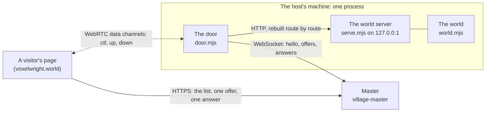
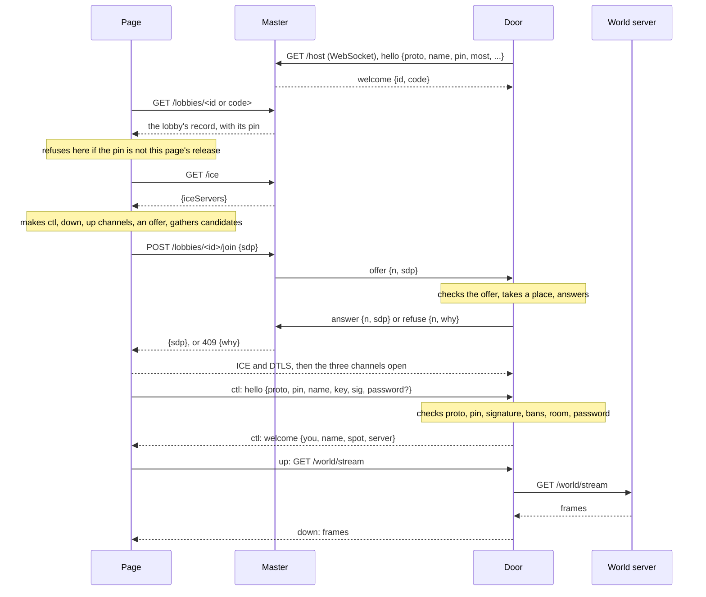

A world that several people share lives on one machine, in a **dedicated server** that someone runs ([engine/server.mjs](https://github.com/voxelwright/voxelwright/blob/main/engine/server.mjs)). Other people's pages find it through a **master server** and then talk to it directly over WebRTC data channels. The site itself runs no game servers, and the master never carries the game.

## The pieces



| Piece | What it does |
| --- | --- |
| [engine/server.mjs](https://github.com/voxelwright/voxelwright/blob/main/engine/server.mjs) | Starts the world server and the door in one process. Stop it and both stop. |
| [engine/door.mjs](https://github.com/voxelwright/voxelwright/blob/main/engine/door.mjs) | Answers each page's offer, checks who it is, and passes a fixed list of requests to the world. Nothing else from outside reaches the world. |
| [engine/serve.mjs](https://github.com/voxelwright/voxelwright/blob/main/engine/serve.mjs) with `--world` | Keeps the world in a file and streams what happens in it. It listens on `127.0.0.1` only. |
| [engine/world.mjs](https://github.com/voxelwright/voxelwright/blob/main/engine/world.mjs) | The one copy of the core that decides what happens. Pages apply only what it says, in its order. |
| [master/](https://github.com/voxelwright/voxelwright/tree/main/master) | Lists lobbies and passes one whole offer and one whole answer for each join. See [the master](/master). |
| [engine/page/door.ts](https://github.com/voxelwright/voxelwright/blob/main/engine/page/door.ts) | The page's end: joins a lobby and gives the rest of the page a `fetch` that goes through the door. |
| [engine/page/lobbies.ts](https://github.com/voxelwright/voxelwright/blob/main/engine/page/lobbies.ts) | The **Servers** panel: the list, joining, who is here, and an admin's controls. |
| [engine/page/wire.ts](https://github.com/voxelwright/voxelwright/blob/main/engine/page/wire.ts) | What both ends share: the protocol number, message sizes, the signed words and the gathering deadline. |

A page can't host a world. The **Host a server** view in the Servers panel shows the command that starts a dedicated server. [Host a server](/hosting) covers running one from an archive.

There is a second, trusted way to share: `serve.mjs --world <file>` alone keeps one shared world that any page it serves joins with `?shared=1`. Those pages come from the same machine (or the owner's tailnet) and talk to the world server directly, with no door. Everything below is about strangers.

## A join



Signalling is whole-offer: each side gathers its candidates before it sends anything, so a join is one request to the master. Gathering stops at `complete`, or once a server-reflexive candidate has come and 300 ms pass with no new one, or at 3 s. With no STUN server it stops 600 ms after the last candidate (`gathered` in `wire.ts`). Why WebRTC and not WebTransport is in [the lobby-transport skill](https://github.com/voxelwright/voxelwright/blob/main/.agents/skills/lobby-transport/SKILL.md).

A page in a lobby draws its own release's tiles and asks the server only for the world: what is kept, what happens, and what people do.

## Who someone is

A page keeps one **ECDSA P-256** key pair in IndexedDB (database `village-door`), made non-extractable, so its private half can't be read out. Where nothing can be kept (some private windows), it makes a new pair each time.

The hello carries the public key (SPKI, base64) and a signature (SHA-256, IEEE P1363, base64) over these words:

```text
village-door-1 <the DTLS fingerprint of this connection, upper case>
```

The fingerprint is the server's own, from its answer. A signature is good on that one connection only, so no server can replay it to another.

The door answers with `you`: `v` and 9 hex characters of an HMAC-SHA256 of the key under a secret only this server holds. The same browser is the same `you` every time it comes back to this server, and different on every other server. From then on, the door writes `by` (and, for `here`, the name) into every request the connection makes, so a page can't act as someone else. The same key from a second page closes the first.

A name is text someone typed. The door removes invisible and direction-changing characters and `/`, keeps 24 characters, and tells two look-alike names apart as `Ada (2)`.

## The door

The door decides everything a stranger's page can do. It is [engine/door.mjs](https://github.com/voxelwright/voxelwright/blob/main/engine/door.mjs), and its header describes the wire.

### Before the hello

| Check | What happens |
| --- | --- |
| The offer is a data-channel offer: `v=0`, an `m=application` line, a SHA-256 fingerprint, an ICE ufrag and password, at most 16,384 bytes | Otherwise refused at once: "that is not an offer". |
| An address in the offer's candidates is banned by address | Refused: "you are banned from this server". |
| A place is free: fewer than 8 joins waiting, and a UDP port free when `--ice-ports` is set | If not, it lets go of a waiting join that has had its chance. With none to let go, it waits up to 3 s in arrival order, then refuses: "the server is busy". |
| The join says hello within 8 s of being placed | Otherwise it is closed. |
| One address has at most `--waiting-per-address` (2) joins waiting | Past that, the join from that address that has been silent longest is let go. |

A waiting join is let go in this order: one already refused, then one not connected 3 s after its answer left, then one from the address with the most joins waiting, then the one silent the longest. A join is never let go before it could have said hello (its channels open for 500 ms, or 2 s after its answer left). Joins that say nothing can't keep a door shut.

The door groups addresses for saved bans and limits: IPv4 as it is, IPv4-mapped IPv6 as its IPv4, and any other IPv6 address by its /56 (`addressKey`). For the per-address limits and the hello's ban check, the address comes from the connection's selected candidate pair, never from what the offer says. A hello or admin login waits for a fresh join attempt if the selected address is unavailable. The lobby shares a budget of 24 password checks per minute across addresses, with successful checks refunded. Only the early ban refusal above reads the offer's candidates, because nothing else is known yet.

### The hello

In order: the protocol is 1; the pin is this server's release (or `town`); the signature verifies; neither `you` nor the address is banned; there is room (`--most`, unless this person is already here); the password matches, if the server has one. Bans and room are checked again just before admission, so two hellos at once can't both take the last place.

Each try at a password (the server's or the admin's) is counted before it is checked, for that connection and that address. The next try waits 2 s, doubling to 30 s. A wrong admin password is answered a second late. Passwords are kept as scrypt hashes, compared in constant time, never logged and never sent to the master.

### What passes

Only the routes in `ROUTES` pass. The door matches the path whole, rebuilds the address from the table, and keeps only the query names the route takes. Any other path is a 404.

| Who | What |
| --- | --- |
| Everyone let in | Read the stream (`GET /world/stream`, rules without their sources). Say where they are (`here`), talk (`say`), play what a rule offers (`act`, `pick`), and drive only what they ride (`drive`). Ask about the world: `at`, `look`, `tops`, `things`, `realm`, `ground`, `rules` without sources, and a living thing's fine look. |
| Builders (everyone, or admins only, as an admin sets) | Change the world by hand: `POST /world/ask` (blasts, fire, balls, bricks, made things, holding and throwing) and `POST /world/fine`. |
| Admins only | Rules put in, changed or taken out, and the realm's record (`POST /world/ask` with `rule`, `unrule` or `realm`). Rules' sources, gaps, realms made and taken out, plugins and the core read again. |
| Nobody | Voicing the world's people (`/world/minds`, `/world/mind`), which would spend the host's model on a stranger's behalf. Seats for agents (`join`, `walk` and the rest), tiles (`/release/`, `/bay/`), pages and plugins' page sides, `/report`, and other realms. |

### Limits

Each connection has its own pools, under the ones the world server keeps for everyone. The first four are flags of `server.mjs`.

| Limit | Default |
| --- | --- |
| Requests a second (`--asks`) | 30 |
| Bytes sent a minute (`--up-mb`) | 24 MB |
| Columns of `/world/tops` a second (`--columns`) | 65,536 |
| Replies asked for and not read (`--backlog-mb`) | 32 MB, then the connection is closed |
| A second, by route | 15 asks, 15 `here`, 10 `act` and `pick`, 3 `say`, 12 `drive`, 20 questions, 20 `ctl` messages |
| Streams | 1 at a time, 2 opens in 10 s |
| Fine looks sent | 4 a minute, 16 MB each |
| Request bodies | 8 MB |
| Requests in flight | 8 |

The door waits for a page that reads the stream slowly. While that page is behind, the world server skips the frames of where things are now on its stream, because a newer frame replaces each one (`serve.mjs`). The door closes a page that takes nothing for 15 s, and one that sends nothing for 15 s (`SILENT` in `engine/door.mjs`). Pages ping every 2 s (`engine/page/door.ts`).

### Making, and whose things are whose

For anyone who is not an admin, the door puts `as` on each ask, and the world server (`stranger` in `serve.mjs`) holds the ask to it. Another person's thing is not theirs to take out, change, remake, bring to life or pick up. The door counts by `you`, so joining again starts nothing afresh.

| What one person may make | Default |
| --- | --- |
| Things made a minute (`--things-minute`) | 6 |
| Changes to things a minute (`--changes-minute`) | 30 |
| Things standing (`--things`) | 40 |
| Cells standing, all told (`--cells`) | 4,000,000 |
| How far from where their page last said they are (`--reach`) | 1,200 cells (120 m) |
| One thing's side | 256 cells, 96 for a living thing |
| One thing's record | 24 KB of JSON |

Before a page asks its model for anything, it asks the door whether it may make (`{n, may: 'make'}`). Strangers place cells as recorded things. Blasts, fire and balls share the maker's change quota and must originate within reach. A blast must clear other makers' recorded cells. Fire, sparks and projectiles can travel, so these asks are refused while another maker has a thing standing. A driver can claim one live vehicle at a time.

Fine uploads share the identity's byte allowance across reconnects. Unplaced parts occupy up to 64 MiB or 256 parts across the server. Once a world records controls referencing a part it is kept with the world. Other staged parts expire after ten minutes and are cleared on restart. The world's file stops at 256 MB: past that, the world takes no more asks.

## The wire

Three reliable data channels, opened by the page:

| Channel | Carries |
| --- | --- |
| `ctl` | JSON. The hello first. Then `{ping}` and `{pong}`, `{unstream: n}`, admin requests `{n, admin}` and `{n, lobby: {op}}` answered `{n, ok}` or `{n, why}`, `{n, may: 'make'}`, `{n, people: true}`, and from the door `{told: {text}}`, `{end: {n, why}}` and `{gone: {why}}`. At most 4 KB a message. |
| `up` | Requests and their replies. A request is a JSON head `{n, m, p, k}` (number, method, path and query, parts) followed by `k` binary parts. A reply is `{n, s, t, k}` (status, type, parts) and its parts, or `{n, s: 200, stream: true}` for a stream. |
| `down` | A stream's bytes. Each message is the request's `n` (4 bytes, little-endian) and a piece of the stream. |

A message is at most 64 KiB (`CHUNK`). A peer whose largest message is under 16 KiB (`CHUNK_LEAST`) is refused. The door sends `down` in pieces and waits when more than 1 MiB is buffered.

The stream is the world's own: frames of a 12-byte header (kind, number, length, each a little-endian uint32) and a body. The kinds are listed in [engine/page/frames.ts](https://github.com/voxelwright/voxelwright/blob/main/engine/page/frames.ts) and described in the header of [engine/serve.mjs](https://github.com/voxelwright/voxelwright/blob/main/engine/serve.mjs). The door reads two of them: `bodies`, to learn what this person rides, and `echo`, to strip a rule's source before it goes to the page.

The page treats everything from the host as data. A reply's type is read as JSON, bytes or plain text, never markup. A reply or a frame over 64 MB closes the door. A page in a lobby takes no plugins' page sides and no new core while it runs ([engine/page/link.ts](https://github.com/voxelwright/voxelwright/blob/main/engine/page/link.ts)).

## Lobbies

A lobby is one dedicated server as the master lists it. The master gives each one two keys:

| Key | Length | Finds |
| --- | --- | --- |
| `id` | 12 characters, public | A listed lobby only |
| `code` | 20 characters, private | Its own lobby, listed or not |

Both are Crockford base32 from the operating system's randomness, read case-insensitively. `--private` keeps a server off the list, so it is joined by its code alone. The server prints both when the master welcomes it.

A visitor finds servers in the realm's settings under **Servers…**, where the realm's rule allows lobbies. `lobbies` in a realm's rules ([engine/page/local.ts](https://github.com/voxelwright/voxelwright/blob/main/engine/page/local.ts)) is off, `"preview"` (only with `?lobbies=1&master=<address>`), or `{master}` (that master and no other). San Francisco's is `"preview"` ([engine/sf/realm.json](https://github.com/voxelwright/voxelwright/blob/main/engine/sf/realm.json)).

The list shows the master's lobbies on this page's release, refreshed by hand and every 30 s while it is open. A private server is joined with **Have a private server's code?** A join reloads the page: the chosen lobby waits in a session-storage ticket for at most a minute, never in the address, and a password is asked for once the page is up again and never kept. A link with `&lobby=<id or code>` also joins, but only after the browser asks the visitor whether to trust a master the link named.

Where a visitor stands on arrival is dealt by `spot`, the lowest number nobody here holds ([engine/page/arrival.ts](https://github.com/voxelwright/voxelwright/blob/main/engine/page/arrival.ts)).

## Admins

`--admin-password-file` gives a server admins. A connection that gives that password (**I am an admin…** in the server's panel, or `engine.lobby.admin('…')` in the console) is an admin until it closes. The panel's controls and `engine.lobby` are the same operations:

| `op` | Does |
| --- | --- |
| `who` | Lists who is here: `you`, name, admin, since, whether the address is known |
| `kick` | Closes someone's connection |
| `ban` | Bans an id, and with `address: true` the address they came from too |
| `unban`, `bans` | Lifts a ban, lists bans |
| `password` | Sets the server's password, or clears it with `null` |
| `most` | Sets the most players, 1 to 64 |
| `build` | Sets who may build: `everyone` or `admins` |
| `say` | Sends text to everyone, as the server |
| `rename` | Sets the name and about |

Anyone let in may ask who is here (`{n, people: true}`): names only, no ids. What an admin changes is kept in `<world>.door.json` (mode 600) with the bans and the HMAC secret. A flag given at start wins over what is kept. A file that is there but can't be read stops the server, so its bans are never written over.

Bans are easy to get around. A new key (cleared storage, a private window) is someone new. Another network gets around an address ban, and an address ban also shuts out everyone behind that address. Banned addresses are kept as HMACs under the secret in the same file, which keeps them from being read at a glance, not from being found.

<Warning>
These hold for every change to the door, the page's door or the master:

- Nothing from the host runs on the page. Replies and frames are data, bounded in size. No code, markup, styles or plugins' page sides come through a door.
- Who someone is comes from their connection: `you` is derived on the server, and the door overwrites `by` on every request.
- The door passes only `ROUTES`, rebuilds each upstream address from the table, and never forwards a path or query as it came.
- Passwords live in files and in the hello, nowhere else: not on the command line, in an address, in storage or in a log, and never at the master.
- A page joins only with the visitor's choice: from the list, or after the browser asks about a master that a link named.
- A page never asks a model for the host, and the host can't spend a visitor's model.
</Warning>

## Checks

Run every check of playing in someone else's server from `engine/`:

```sh
cd engine && npm run lobby
```

It builds the realm once into `dist-sf-lobby`, then runs `test/arrival.mjs`, `test/door-silent.mjs`, `test/door.mjs`, `test/door-make.mjs` and `test/sf-lobbies.mjs` (on a desktop's page and a phone's). It uses `--ports 6500` and the 50 after it, and `--only door,door-make` runs some of them. Run it before a change to the door, the list or a join lands. [engine/test/door-join.mjs](https://github.com/voxelwright/voxelwright/blob/main/engine/test/door-join.mjs) measures what a join sends. The master's own checks are in [master/README.md](https://github.com/voxelwright/voxelwright/blob/main/master/README.md).
