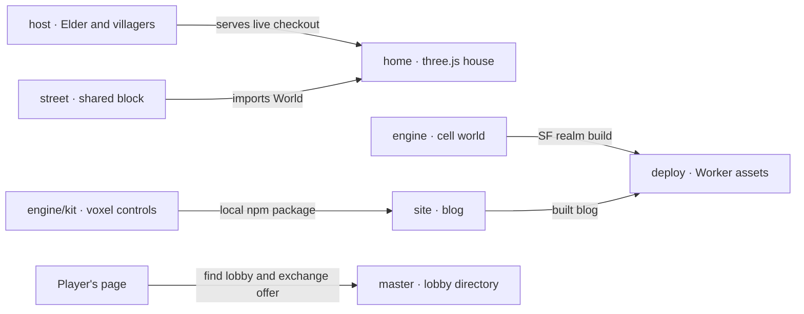

# Project map

Start in the part you want to run. The home and the street share a physics world implementation. The city uses a separate cell engine with a Rust core.

| Part | Where to start |
| --- | --- |
| [Home](../home/README.md) | Walk the house or work on the scene, interactions and physics. |
| [Host](../host/README.md) | Start the live home. Follow a request from the Elder to a candidate change. |
| [Street](../street/README.md) | Run the shared block and join it from two pages. |
| [Engine](../engine/README.md) | Build the Rust core as WebAssembly and draw the city with WebGPU. Page plugins can [draw into a frame](render-passes.md). |
| [Kit](../engine/kit/README.md) | Run the showcase to work on a voxel control in isolation. |
| [Site](../site/README.md) and [deploy](../deploy/README.md) | Build the blog as HTML and Markdown. The deploy assembly combines its output with the SF realm. |
| [Master](../master/README.md) | Find a player-hosted lobby and pass the WebRTC offer and answer. Game traffic goes between peers. |

## How the parts work

- [The engine](engine.md): the parts and how a frame is made. Then [the core](engine-core.md), [the page](engine-page.md), and [plugins and rules](engine-plugins.md).
- [Worlds as cells](cells.md): cells, sectors, edits, San Francisco tiles and releases, with their formats.
- [The city pipeline](city-pipeline.md): from public data to the pinned release a realm loads.
- [Making](making.md): how a typed wish becomes a thing, with the asker's own model, and what a model may do.
- [The kit](kit.md): Voxelmorphism, its parts and tokens, and how the site tailors it.
- [How the project is built](building.md): agents, skills, the gate and the documentation check.

The [check list](checks.md) gives the names accepted by the root check runner. Project-specific instructions for agents live in [.agents/skills](../.agents/skills). Read the [working rules](../AGENTS.md) before changing code.

<!-- docs-verified 00420ce4a7390b907c04f07adcd84a232f5ae4d1 {"site/package.json":"25065cd6f9cdf5bfc5bcd1c193705eab","deploy/assemble.mjs":"0338276fb038a47c9b504192a26606f9","street/src/block.ts":"2e98fa7be8da57128e03b83dd0ff766f","master/src/lib.rs":"e7a60006f48f6ca1730542b56b688e86","host/package.json":"7a50b8c947871907fef6d025d0f5b639","engine/package.json":"fcff01d1444ba359e1d890232761e78f","home/package.json":"2b43e8013bc6abfbe95c89da9f2a128c","host/src/live.ts":"45499f1073f06a5c713a90a389267a56"} -->
