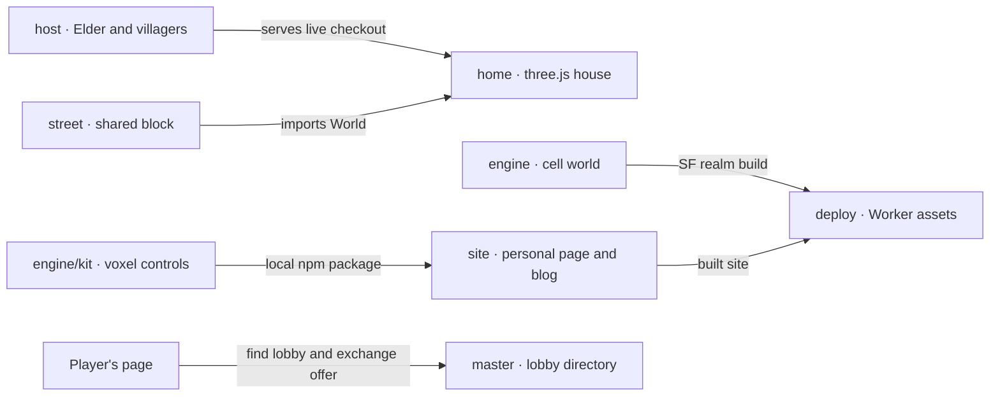

Start in the part you want to run. The home and the street share a physics world implementation. The city uses a separate cell engine with a Rust core.

| Part | Where to start |
| --- | --- |
| [Home](https://github.com/voxelwright/voxelwright/blob/main/home/README.md) | Walk Village's house or work on the scene, interactions and physics. |
| [Host](https://github.com/voxelwright/voxelwright/blob/main/host/README.md) | Start Village's live home. Follow a request from the Elder to a candidate change. |
| [Street](https://github.com/voxelwright/voxelwright/blob/main/street/README.md) | Run the shared block and join it from two pages. |
| [Engine](https://github.com/voxelwright/voxelwright/blob/main/engine/README.md) | Build the Rust core as WebAssembly and draw the city with WebGPU. Page plugins can [draw into a frame](/render-passes). |
| [Kit](https://github.com/voxelwright/voxelwright/blob/main/engine/kit/README.md) | Run the showcase to work on a voxel control in isolation. |
| [Site](https://github.com/voxelwright/voxelwright/blob/main/site/README.md) and [deploy](https://github.com/voxelwright/voxelwright/blob/main/deploy/README.md) | Build the personal front page and blog as HTML and Markdown. The deploy assembly publishes the site alone on zahynailo.dev and the SF realm alone on voxelwright.world. |
| [Master](https://github.com/voxelwright/voxelwright/blob/main/master/README.md) | Find a player-hosted lobby and pass the WebRTC offer and answer. Game traffic goes between peers. |

## Names

- **Voxelwright** is the project, the repository and the whole stack: the engine, the kit, the fonts, the sound engine, the site generator, the servers, the docs, and how agents build it.
- **Voxelmorphism** is the design language and its UI kit (`engine/kit`, the npm package `voxelmorphism`). The owner coined the word.
- **Village** is one product built on the stack: the private family home with its villagers, the Elder and reminders (`home/`, `host/`). The name comes from "it takes a village". It is not the name of the project.
- San Francisco, the street and the site are other things built on the stack. Call each what it is.

The project began as Village, so older issues, branches, paths and identifiers still carry that word (`~/.village`, `VILLAGE_*`, the `village` scripts in `host/`). Quote them exactly; renaming them is separate work.

## How the parts work

- [The engine](/engine): the parts and how a frame is made. Then [the core](/engine-core), [the page](/engine-page), and [plugins and rules](/engine-plugins).
- [Worlds as cells](/cells): cells, sectors, edits, San Francisco tiles and releases, with their formats.
- [The city pipeline](/city-pipeline): from public data to the pinned release a realm loads.
- [Making](/making): how a typed wish becomes a thing, with the asker's own model, and what a model may do.
- [The kit](/kit): Voxelmorphism, its parts and tokens, and how the site tailors it.
- [How the project is built](/building): agents, skills, the gate and the documentation check.

The [check list](/checks) gives the names accepted by the root check runner. Project-specific instructions for agents live in [.agents/skills](https://github.com/voxelwright/voxelwright/tree/main/.agents/skills). Read the [working rules](https://github.com/voxelwright/voxelwright/blob/main/AGENTS.md) before changing code.
