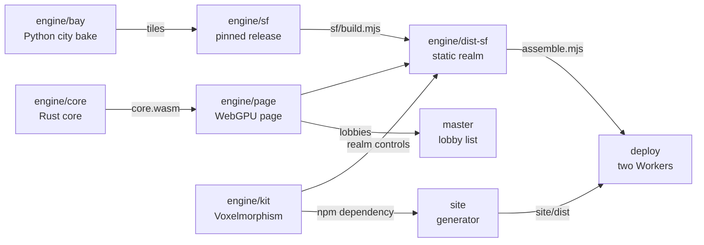

Voxelwright has five active parts: the engine, its UI kit, the master server, the site generator and the deploy. Beside them are the guide and Village, the first prototype, which is paused. Start in the part you want to change, and read its README for commands.

| Part | Folder | What it is | Start with |
| --- | --- | --- | --- |
| Engine | `engine/` | The world as 10 cm cells: a Rust core built to WebAssembly, a TypeScript page on raw WebGPU, a world server for shared worlds and the San Francisco build. | [README](https://github.com/voxelwright/voxelwright/blob/main/engine/README.md), [the engine](/engine) |
| Kit | `engine/kit/` | Voxelmorphism: controls drawn as small voxel solids, with their fonts and sounds. The npm package `voxelmorphism`. | [README](https://github.com/voxelwright/voxelwright/blob/main/engine/kit/README.md), [the kit](/kit) |
| Master | `master/` | A Rust server that lists player-hosted lobbies and passes one WebRTC offer and one answer per join. It never carries game traffic. | [README](https://github.com/voxelwright/voxelwright/blob/main/master/README.md), [the master server](/master) |
| Site | `site/` | A static generator for the owner's front page and blog. Every page is written as HTML and as Markdown. | [README](https://github.com/voxelwright/voxelwright/blob/main/site/README.md), [the site](/site) |
| Deploy | `deploy/` | Two Cloudflare Workers: `voxelwright` serves the realm at voxelwright.world, `zahynailo` serves the site at zahynailo.dev. | [README](https://github.com/voxelwright/voxelwright/blob/main/deploy/README.md), [deploy](/deploy) |
| Guide | `guide/` | These pages, published with Mintlify, and the bindings that keep them true. | [Keeping a page current](/documentation) |
| Village (paused) | `home/`, `host/`, `street/` | The first prototype: a three.js family home with villagers and the Elder, and a shared street. Some of its checks still run in the root gate. | [Village](/village) |

## Names

- **Voxelwright** is the project, the repository and the whole stack: the engine, the kit, the fonts, the sound engine, the site generator, the servers, the docs, and how agents build it.
- **Voxelmorphism** is the design language and its UI kit (`engine/kit`, the npm package `voxelmorphism`). The owner coined the word.
- **Village** is one product built on the stack: the private family home with its villagers, the Elder and reminders (`home/`, `host/`). It is paused. The name comes from "it takes a village". It is not the name of the project.
- San Francisco, the street and the site are other things built on the stack. Call each what it is.

The project began as Village, so older issues, branches, paths and identifiers still carry that word (`~/.village`, `VILLAGE_*`, the `village` scripts in `host/`, the `village-engine` package and the `village-master` crate). Quote them exactly; renaming them is separate work.

## Every guide page

Start here:

- [Voxelwright](/): the whole stack on one page.
- [Quickstart](/quickstart): run the city on your machine.
- [How the project is built](/building): agents, skills, the gate and the documentation check.

Play:

- [Gameplay](/gameplay): walking, driving, cameras, stunts, the HUD, the map and GPS, gamepads, the sky and the EXPLORE board.
- [Sound](/sound): how the engine makes every sound as it plays, and how sound is judged with nobody listening.

World and engine:

- [The engine](/engine): the parts and how a frame is made. Then [the core](/engine-core) and [the page](/engine-page).
- [Worlds as cells](/cells): cells, sectors, edits, tiles and releases, with their formats.
- [The city pipeline](/city-pipeline): from public data to the pinned release a realm loads.
- [The San Francisco release](/sf-release): the contract a realm loads, a pointer, a manifest named by its own hash and the files it lists.
- [Making](/making): how a typed wish becomes a thing, with the asker's own model, and what a model may do.
- [Living things and people](/living): bodies that move, from a car to a person on foot, and people who answer through a model on someone's own machine.
- [Plugins, rules and realms](/engine-plugins): scripts anyone writes, trusted engine code, and the worlds one server keeps. Then [render passes](/render-passes) and [page plugin types](/plugin-types).

Look:

- [The kit](/kit): Voxelmorphism, its parts and tokens, and how the site tailors it.
- [Blocks and the Vox fonts](/blocks-and-fonts): the WebGPU renderer that draws the kit's controls as voxel blocks, and the Vox type family.

Servers and the web:

- [Playing together](/multiplayer): a dedicated server holds a shared world, a master introduces pages to it, and WebRTC data channels carry the game.
- [The master server](/master): the lobby list, its protocol, limits and flags, and how to run it behind TLS.
- [Host a server](/hosting): run a dedicated server, or a master, from one archive each.
- [Deploy](/deploy): how the realm reaches voxelwright.world and the blog reaches zahynailo.dev, from assembly to rollback.
- [The site](/site): the static generator behind zahynailo.dev, which writes every page as HTML and as Markdown.

Contributing:

- [Keeping a page current](/documentation): bindings, stamps and the coverage check.
- [Repository checks](/checks) and [the check runner](/check-cli): what `npm run check` runs and its options.

History:

- [Village](/village): the paused prototypes and the ideas worth keeping.

Project-specific instructions for agents live in [.agents/skills](https://github.com/voxelwright/voxelwright/tree/main/.agents/skills). Read the [working rules](https://github.com/voxelwright/voxelwright/blob/main/AGENTS.md) before changing code.
