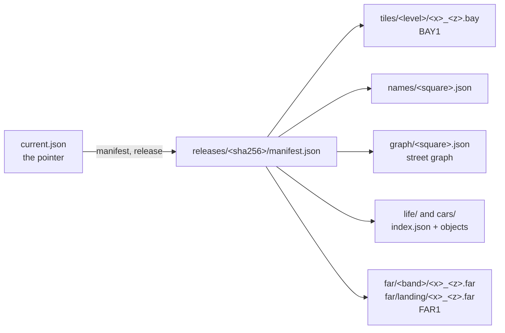

A release is San Francisco as a folder of static files that any HTTPS host can serve. One small pointer names a manifest by its SHA-256, and the manifest lists every other file with its length and hash. A realm pinned to a release always draws the same city, and a new city is a new release, never an edit to an old one.

[The city pipeline](/city-pipeline) says how the files are made. [Worlds as cells](/cells) says how the core turns a tile into cells.

## The shape of a release



```text
current.json                                 the pointer: the only file that changes
releases/<sha256>/manifest.json              the manifest; its SHA-256 is the release's name
releases/<sha256>/tiles/<level>/<x>_<z>.bay  ground, buildings and trees (BAY1)
releases/<sha256>/names/<square>.json        street names and addresses for one square
releases/<sha256>/graph/<square>.json        the street graph for one square
releases/<sha256>/life/, cars/               street life and vehicles, each with its index.json
releases/<sha256>/far/<band>/<x>_<z>.far     the far model's faces (FAR1)
releases/<sha256>/far/landing/<x>_<z>.far    the faces seen from the first view's eye (FAR1)
```

`engine/sf/release.py` is the only writer of this layout. A square is a 1 km square of UTM zone 10N named by the kilometres of its south-west corner, for example `551.7_4183.5`.

## The pointer

```json
{ "version": 1, "release": "<64 lowercase hex>", "manifest": "releases/<64 hex>/manifest.json" }
```

`manifest` is relative to the pointer's URL. `release` is the SHA-256 of the manifest's exact bytes, including its final newline. `release.py` writes the manifest as JSON with sorted keys, no spaces and a final newline, so the same content always has the same name.

There are two pointers:

| Pointer | Who moves it | What reads it |
| --- | --- | --- |
| `<out>/current.json` in a staging folder | `release.py --panel`, after the visual panel passes. It also carries `panelSha256`, the hash of the receipt saved beside the release. | `release.py` (the previous pin for the next promotion), `build.mjs --staged` |
| [engine/sf/pilot/current.json](https://github.com/voxelwright/voxelwright/blob/main/engine/sf/pilot/current.json), committed | A person, by editing it in a commit | `engine/sf/build.mjs`, `deploy/data.mjs` |

The committed pin is what ships. Beside it, `engine/sf/pilot/releases/<sha256>/manifest.json` keeps a copy of each manifest that has been pinned. The tiles are never in git.

`build.mjs` (by default) and `deploy/data.mjs pack` (always) read the pinned release from `~/.village/engine/bay/450-city-paint/sf/releases/<sha256>/`, so a release must be staged or copied there before it can ship.

## The manifest

| Field | Meaning |
| --- | --- |
| `version` | `1`. A reader refuses any other. |
| `frame` | `"10n4250"`: UTM zone 10N, origin 500,000 m east and 4,250,000 m north. x runs east and z south, in 10 cm cells. A reader refuses another frame. |
| `credits` | Lines to show the visitor. The page shows them with the street name. |
| `levels` | Three levels of tiles, finest first. |
| `names` | Square name to a record for `names/<square>.json`. |
| `graph` | Optional. Square name to a record for `graph/<square>.json` ([street graph](https://github.com/voxelwright/voxelwright/blob/main/engine/sf/streets.md)). |
| `life`, `cars` | Optional. Each is `{index, objects}`: a record for the producer's `index.json` and a record per object. |
| `far` | Optional. The far model's listing. |

Every file is named by an **object record**: `{"path", "bytes", "sha256"}`. `path` is relative to the manifest. `bytes` and `sha256` describe the decoded file, so a host may send it Brotli-compressed.

Each level has `level` (its index), `size` (a tile's side in cells), `gstep` (the ground sample step in cells), `tiles` (key to record) and `sea` (keys verified to be open water). A tile's key is `floor(x / size)_floor(z / size)`, negative keys included.

| Level | Tile side | Ground step | Used for cells up to |
| --- | --- | --- | --- |
| 0 | 250 m (`size` 2500) | 1 m (`gstep` 10) | 0.8 m |
| 1 | 1 km (10000) | 2 m (20) | 1.6 m |
| 2 | 4 km (40000) | 16 m (160) | coarser |

The core and the page choose a level by the same rule, `least_step` in [bay.rs](https://github.com/voxelwright/voxelwright/blob/main/engine/core/src/bay.rs). The sizes come from `LEVELS` in [earth.py](https://github.com/voxelwright/voxelwright/blob/main/engine/bay/earth.py).

### Street life and vehicles

`life.index` is `life.py`'s `index.json`: `{version: 1, frame, life: {square: record}, transit}`. `release.py` refuses a life index whose frame differs or whose squares are not exactly the release's `names`. Its objects are one per square plus `transit`, the streetcar, cable car, bus and trolleybus routes. `cars.index` lists the vehicles by id, and each object is `<id>.json`. Every object must match the length and hash its index gives. The formats are in [streets.md](https://github.com/voxelwright/voxelwright/blob/main/engine/sf/streets.md) and the docstring of [life.py](https://github.com/voxelwright/voxelwright/blob/main/engine/sf/life.py).

### The far model

`far` is the listing [pack.mjs](https://github.com/voxelwright/voxelwright/blob/main/engine/sf/far/pack.mjs) writes, read by `far.ts` as `Listing`:

| Field | Meaning |
| --- | --- |
| `version` | `1` |
| `size` | `5000`: a far tile is 500 m on the frame's grid. |
| `bands` | `[4, 1, 0]`: band 0 holds faces 4 m and larger, band 1 faces 1 to 4 m, band 2 the rest. |
| `lods` | `[16, 8, 4, 2, 1, 0.5, 0.25]`: the face sizes, in metres, each run counts down to. |
| `tiles` | Key to an array of three records or `null`, one per band at `far/<band>/<key>.far`. An unlisted key has no far coverage. |
| `credit` | One line, added to the manifest's `credits`. |
| `wedge` | Optional. The finer photographed wedge: apex `at` in cells, bearings `from` and `to`, reach `far` in metres. |
| `light` | Optional. `fill` and `gain`, the light the wedge's colours were fitted under. |
| `landing` | Optional. The faces seen from the first view's eye: `eye` in cells, `tiles` as one record per key at `far/landing/<key>.far`, and the camera it was cut for, such as `fov`, `size`, `yaw`, `pitch` and `heights`. |

`release.py` refuses a far listing unless `version` is 1, `size` is 5000 and `bands` is `[4, 1, 0]`, and it checks each object's path, length and hash. A first-view cut's tiles must be keys the far listing has.

## What a reader checks

`released` in [bay.ts](https://github.com/voxelwright/voxelwright/blob/main/engine/page/bay.ts) reads a release this way:

1. Fetch the pointer once per page load with `cache: 'no-cache'`. Refuse a `version` other than 1 or a `release` that is not 64 hex digits.
2. Fetch the manifest and compare its SHA-256 with `release`. Refuse a mismatch, a manifest `version` other than 1, or another `frame`.
3. From then on, ask only for what that manifest lists. A key in `sea`, or a key no level lists, is water and costs no request.
4. For a listed tile, check the length and the SHA-256 against its record. Retry, then fail. A listed tile that does not arrive is a load error, never water.

The page hashes with `crypto.subtle`, which exists only in a secure context (HTTPS or localhost). Elsewhere it checks tile lengths only, and `Source.checked` is false. Names and far objects are fetched by the paths their records give, and street life and vehicles by the paths their indexes give, all without a length or hash check.

## BAY1: a tile

A tile (or a baked square, called a pack) is little-endian binary. `read` in [bay.rs](https://github.com/voxelwright/voxelwright/blob/main/engine/core/src/bay.rs) is the reader. [bake.py](https://github.com/voxelwright/voxelwright/blob/main/engine/bay/bake.py) and [earth.py](https://github.com/voxelwright/voxelwright/blob/main/engine/bay/earth.py) write it, and [tiles.py](https://github.com/voxelwright/voxelwright/blob/main/engine/bay/tiles.py) cuts squares into tiles. The reader checks every length and refuses a pack whole if anything is out of range, and `bay_load` returns -1.

The header is 16 `int32` words:

| Offset | Word | Meaning |
| --- | --- | --- |
| 0 | 0 | `0x31594142`, the bytes `BAY1` |
| 4 | 1, 2 | The square's corner x and z, in cells |
| 12 | 3 | The square's side, in cells |
| 16 | 4 | `gstep`: ground sample step, cells. Must be above 0. |
| 20 | 5 | `gw`: ground samples a side. Must be above 1. |
| 24 | 6, 7 | First ground sample's x and z |
| 32 | 8 | `tstep`: top sample step. 0 means there are no top arrays. |
| 36 | 9 | `tw`: top samples a side |
| 40 | 10, 11 | First top sample's x and z |
| 48 | 12, 13, 14 | Counts: buildings, outline vertices, trunks |
| 60 | 15 | Flags. Bit 0: a walls array follows the tint. |

The body follows at byte 64, in this order:

| Array | Size | Meaning |
| --- | --- | --- |
| ground | `gw²` × `i16` | Ground height, cells |
| top | `tw²` × `i16` | Height of what stands (a roof, a crown). `-32768` means nothing stands there. |
| class | `tw²` × `u8` | What the ground is. Low three bits: 0 road, 1 pavement, 2 grass, 5 water, 6 yard. 8: leaves overhead. 16: a building stands here (coarse packs). On a road 32 is paint and 64 a rail; on pavement 32 is a flush crossing and 128 a kerb. |
| tint | `tw²` × `u8` | A palette colour for the top |
| walls | `tw²` × `u16` | Only with flag bit 0: the wall kind over each sample, in coarse packs |
| buildings | count × 6 `int32` | First vertex, vertex count, wall kind, trim kind (bits 16 and up carry what photographs showed of the walls, `Evidence` in `bay.rs`), style bits, base height |
| vertices | count × 3 `int32` | x, z, and flags for the side starting here: 1 open air, 2 street, 4 ends a ring, 128 an eave height in bits 8 to 23, facade cues in bits 24 to 29 |
| trunks | count × 4 `int32` | x, z, crown top, thickness |

The building's style word packs cells per storey (bits 0 to 7), cells per bay (8 to 15), a home flag (16), a special form (17 and 18: 1 Coit Tower, 2 the Transamerica Pyramid, 3 a tall lobby or arcade), a triple-storey flag (19), the ground floor's use (20 to 22) and a seed (24 to 31).

Two trailers may follow the trunks, in this order. Any other trailing bytes make the pack invalid.

**`SFST`, street fixtures.** Lamps, poles, signs, wires. When loading a tile, `bay.rs` relocates standing fixtures (lamps, stop signs, hydrants, utility and sensed poles) whose base falls on asphalt onto the nearest street-grade pavement or verge clear of buildings—re-aiming relocated lamp arms back over the carriageway—and drops any with no off-road spot within reach.

| Offset | Type | Meaning |
| --- | --- | --- |
| 0 | 4 bytes | `SFST` |
| 4 | `u32` | Segment count |
| 8 | count × 8 `int32` | Start x, y, z and end x, y, z in cells; radius in centimetres (1 to 100); material kind (1 to 65535) |

**`SFPT`, wall paint.** Only a pack with `gstep` 10 (level 0) may carry it.

| Offset | Type | Meaning |
| --- | --- | --- |
| 0 | 4 bytes | `SFPT` |
| 4 | `u32` | Record count, at most the vertex count |
| then, per record | `u32` | The wall's vertex index (its directed edge). Each edge appears once. |
| | `int32` | The wall's base height, cells |
| | `u16`, `u16` | Width and height in texels |
| | width × height bytes | Palette indices, row-major from the bottom. 0 leaves the procedural wall. |

## FAR1: far faces

A `.far` file holds one band of one far tile, or one tile of the first-view cut. [pack.mjs](https://github.com/voxelwright/voxelwright/blob/main/engine/sf/far/pack.mjs) and [landing.mjs](https://github.com/voxelwright/voxelwright/blob/main/engine/sf/far/landing.mjs) write it, and `load` in [far.ts](https://github.com/voxelwright/voxelwright/blob/main/engine/page/far.ts) reads it.

| Offset | Type | Meaning |
| --- | --- | --- |
| 0 | 4 bytes | `FAR1` |
| 4 | `u32` | Length L of the JSON head, padded with spaces to a multiple of 4 |
| 8 | L bytes | JSON: `version`, `sections`, `styles`, `sun`, `grouped` |
| 8 + L | n × 20 bytes | The faces. With `grouped`, byte j of face i is at `j * n + i`, which Brotli packs better. |

Each section places a run of faces: its frame (`pos`, `cell`, the axes `c0` and `c2`), `start` and `count`, bounds `lo` and `hi` in world cells, and `runs` by which way the faces look (1 up, 2 to 5 the walls), biggest first, each with how many faces reach each of `lods`.

A face is five `u32` words, as the vertex shader in `far.ts` reads them:

| Word | Bits | Meaning |
| --- | --- | --- |
| 0 | 0 to 10, 11 to 21, 22 to 31 | x, z, and length along the section's first axis, in section cells |
| 1 | 0 to 15, 16 to 31 | Low and high y, in 10 cm cells |
| 2 | 0 to 9 | Length along the second axis |
| | 10 and 11 | Axis: 0 a top, 1 and 2 a wall facing either section axis |
| | 12 | Which side of the cell the wall is on |
| | 13 to 28 | Shade |
| 3 | 0 to 23, 24 to 31 | Colour as 8-bit red, green, blue (red highest), and a window style |
| 4 | all | The building's id |

## Beside the release

`engine/sf/build.mjs` writes these into its output folder (`<out>`, `engine/dist-sf` by default) next to the page, outside the release and its hash. The marks come from the city run's street graphs, the map from the release's tiles and the graphs, and the landmarks are a copy of `engine/sf/heroes.json`.

| File | Format | Read by |
| --- | --- | --- |
| `<out>/bay/marks.bin` | `int32` words: `MARK` (`0x4b52414d`), square count, segment count, each square as x0, z0, x1, z1, each segment as x0, z0, x1, z1, style | `bay.rs` `marks` and `page/marks.ts`: lane lines, crossings and rails |
| `<out>/bay/marks-squares.bin` | The same with no segments | Every core, before it makes a sector |
| `<out>/bay/map.bin` | `MAP1` (`0x3150414d`), version 1 or 2 | `parseMap` in `page/nav-data.ts`: the minimap and GPS. Written by `sf/map.mjs`. |
| `<out>/bay/places.json` | JSON (served Brotli-compressed via `worker.mjs`) | `page/neighborhood.ts`: street-snapped storefronts (with configurable parody brands from `sf/brands.json`) and civic plazas (`sf/plazas.json`). Written by `sf/places.mjs`. |
| `<out>/bay/heroes.json` | JSON | Landmarks made by rule in the core |

## How a release stays fixed

<Warning>
Never edit a staged release. Stage a new one, which gets a new name. The code holds this at each step:

- A release's name is the SHA-256 of its manifest, and every object is checked against its record when it is staged.
- `release.py --restock` refuses to write a release whose digest already exists, and never touches the pinned release or `current.json`.
- `release.py --panel` moves a staging pointer only with a receipt naming this candidate, the current predecessor, the tested core's Wasm and the panel spec, with no score below the previous pin or `engine/bay/panel-floors.json`.
- `build.mjs` by default builds only the release `engine/sf/pilot/current.json` pins, and fails when the staging folder does not hold it.
- `deploy/data.mjs pack` refuses a staged manifest whose SHA-256 is not the pin.
- `deploy/data.mjs fetch` refuses a bundle made for another pin or whose index does not hash to the recorded digest, and checks every file's length and SHA-256.
</Warning>

### The data bundle

Machines without `~/.village` (CI and a fresh clone running `./world`) get the pinned release from a GitHub Release asset that `deploy/data.mjs` packs and fetches. [Deploy](/deploy#the-data-bundle) is where its commands and checks are described.

## Cut a new release

<Steps>
<Step title="Stage">
Run `release.py ROOT OUT` on a finished `full_run.py` output, or `release.py --restock` to replace only street life, vehicles, far tiles or the first-view cut (`--landing`) of an existing release. Both print the new digest. The [operator procedure](https://github.com/voxelwright/voxelwright/blob/main/engine/sf/release.md) has the commands.
</Step>
<Step title="Promote">
For new tiles, score the 16 places at street level and at 100 m, then rerun with `--panel RECEIPT`. A restock keeps the tiles, so it skips the panel.
</Step>
<Step title="Pin">
Make sure the release is under `~/.village/engine/bay/450-city-paint/sf/releases/<digest>/`. Copy its manifest to `engine/sf/pilot/releases/<digest>/manifest.json` and name it in `engine/sf/pilot/current.json`.
</Step>
<Step title="Build and bundle">
Run `node engine/sf/build.mjs` (it fills the quality-11 Brotli cache), then `node deploy/data.mjs pack`.
</Step>
<Step title="Commit">
Commit the pin, its manifest copy and `deploy/data.json` together.
</Step>
</Steps>

## What breaks if a format changes

- A manifest field: change `release.py`, `released` in `bay.ts`, and the counts in `build.mjs`. Every existing release keeps its old bytes, so the pin moves.
- A BAY1 field or array: change `read` in `bay.rs`, the writers (`bake.py`, `earth.py`, `tiles.py`) and every other parser (among them `appearance.py`, `body_length` in `full_run.py`, the trailer code in `street_furniture.py`, `paint_tile.py` and `compact_store.py`, and `sf/map.mjs`), then restage every tile. Old tiles are refused, not misread, because the reader checks lengths exactly.
- The FAR1 face words: change the face writers (`landing/ina/matte.py`, `sf/far/bake.py`, `sf/far/heroes.mjs`), the readers (`pack.mjs`, `landing.mjs`, `strike.mjs` and the vertex shader in `far.ts`), and raise `PACKED` in `pack.mjs` so every far tile is packed again.
