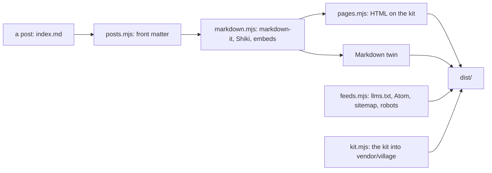
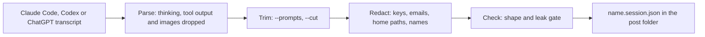

[site/](https://github.com/voxelwright/voxelwright/tree/main/site) builds the owner's personal site: a front page at zahynailo.dev and a blog under `/blog/`. It is a small static generator in plain Node, with no framework. Posts are Markdown folders, every page comes out twice (HTML for people and a Markdown twin for agents), and every page is drawn with the [Voxelmorphism kit](/kit).



[generator/build.mjs](https://github.com/voxelwright/voxelwright/blob/main/site/generator/build.mjs) runs it all. It collects every content problem first and fails the build with the whole list, so a broken embed, a bad front matter field or two pages at one address never ship.

## Commands

Node 24 or later.

```sh
cd site
npm ci
npm run new "Title"     # posts/<slug>/index.md with front matter and draft: true
npm run dev             # drafts included, watched, served on port 4321 with live reload
npm run build           # the production build into dist/, drafts left out
npm test                # the unit tests in test/
npm run check           # builds production and a drafts-included copy, checks both, runs the tests
npm run check-home      # the front page at / in a browser: links, no-script, reduced motion, focus, 390 px
npm run session -- find "words from the first prompt"   # also import, review and cut (below)
npm run flag-proof -- main                               # a flag-off change leaves the built site identical
npm run cards           # paints the share cards in static/og/ (needs Chrome and Playwright)
```

The dev server runs through `cf dev`, the Workers runtime, and falls back to a Node server that mimics it (`npm --prefix site run dev -- --node` forces the fallback).

## What the build writes

[site.config.mjs](https://github.com/voxelwright/voxelwright/blob/main/site/site.config.mjs) sets `base: "/blog/"`. The base is where the site is mounted on its origin, and [lib/paths.mjs](https://github.com/voxelwright/voxelwright/blob/main/site/lib/paths.mjs) owns that rule and the page-to-Markdown mapping. `dist/` mirrors the origin, so [deploy](/deploy) copies it unchanged.

| Address | What it is |
| --- | --- |
| `/` and `/index.md` | The personal front page (`generator/front.mjs`): name, one line, links to Voxelwright World, the blog and the socials. `SITE_PERSONAL_HOME=0` leaves it out. |
| `/blog/` | The list of posts. |
| `/blog/<slug>/` | A post, with every file from its folder beside it. |
| `/blog/tags/`, `/blog/tags/<tag>/` | Tags. |
| `/blog/voxelmorphism/` | The Signal Desk, the kit's showcase. |
| `/blog/llms.txt` | An [llms.txt](https://llmstxt.org) index that links every page's Markdown twin. |
| `/blog/feed.xml` | An Atom feed of the newest 30 posts, full content. |
| `/blog/sitemap.xml` | Every page route. |
| `/robots.txt` | Allows everyone, names the AI crawlers it welcomes, and points at the sitemap. |
| `/404.html` | "Lost in the fog", the host's not-found page. It has no Markdown twin. |
| `/_headers` | `static/_headers` with every path moved under the base, because the host reads it only at the top. |

<Note>
Every page route has a Markdown twin at the same address with `.md` in place of the trailing slash: `/blog/hello/` is `/blog/hello.md`, and the base itself is `/blog/index.md`. Each HTML page links its twin with `<link rel="alternate" type="text/markdown">`. Keep that mapping in `lib/paths.mjs` and nowhere else; the dev server and the Worker read it too.
</Note>

With `base: "/"` the site owns its whole origin instead. Then `/` is the standalone 3D landing (below), and the blog list is `/blog/`. The share cards, some tests and `site/scripts/check-transitions.mjs` build that way.

## Posts and embeds

A post is a folder, `posts/<slug>/index.md`, with its images, clips and models beside it. Front matter takes `title`, `date`, `summary`, `tags` and `draft`, and nothing else. Drafts appear only in the dev build.

Posts may use four custom elements, each as its own block. The build fails if a required attribute or a named file is missing.

| Element | Required | Renders as |
| --- | --- | --- |
| `engine-scene` | `src`, and `alt` or `poster` | The poster or the alt text with a caption. The twin links the scene data. |
| `model-compare` | `before`, `after`, and `alt` or `poster` | The same, linking both models. |
| `model-note` | `model`, `maker`, a body | An aside marked "Not the author's words". The twin makes it a quote headed `**Note from <model> (<maker>):**`. |
| `ai-session` | `src`, a file name in the post folder | A session block (below). |

Code blocks are highlighted by Shiki at build time: one dark theme on pages and the GitHub light and dark pair in the feed.

## AI sessions

An `ai-session` block shows a conversation with a coding agent like a code block: numbered exchanges, the person's prompts, each agent's replies with its model and maker, decisions, and tool calls and subagents folded into one line each. Its file is `ai-session/1`, a small tool-neutral JSON format defined in [lib/session/format.mjs](https://github.com/voxelwright/voxelwright/blob/main/site/lib/session/format.mjs).



A session keeps prompts, replies, decisions, tool calls by name and a one-line label, subagents and markers. It never keeps thinking, tool output, attached images or session ids. Turn ids are given at import and never renumbered, so a link to a turn survives cuts. The build validates every session file and runs the leak gate on it again.

The full format, the redaction rules and the importers for each tool are in [notes/ai-session-format.md](https://github.com/voxelwright/voxelwright/blob/main/site/notes/ai-session-format.md).

## Feature flags

A feature is a folder, `features/<name>/`, that ships only when `site.config.mjs` sets `flags: { "<name>": true }`. With the flag off the build never reads the folder, so the output is identical file for file. [lib/flags.mjs](https://github.com/voxelwright/voxelwright/blob/main/site/lib/flags.mjs) reads the flags. A dev build (`npm --prefix site run dev`) also turns on the names in `SITE_FLAGS`; a production build ignores it.

A feature may add `head` and `bodyEnd` HTML to every page, add pages of its own, and add static files. It may never replace a page or a file. `npm --prefix site run flag-proof` proves a flag-off change leaves the site unchanged, and its `--strict` mode is how a change written by an agent is checked. Turning a flag on is the owner's step. The rules are in [features/README.md](https://github.com/voxelwright/voxelwright/blob/main/site/features/README.md).

## The kit

`voxelmorphism` is installed from `../engine/kit`. Each build copies the parts the pages use, listed in `PARTS` in [generator/kit.mjs](https://github.com/voxelwright/voxelwright/blob/main/site/generator/kit.mjs), with the kit's stylesheet and fonts, into `/blog/vendor/village/`. Every page is fitted as the Signal Desk's walnut instrument (`FITTING` in `generator/pages.mjs`), and at night (the system's setting or the Lights key) the same case has its lights down.

- The kit's stylesheet alone is the plain page, so every page reads without script.
- `static/site.js` starts the kit. It calls `use()` with the renderer, or `use(null)` for a plain page, before the first `adopt()`, so a page never opens a second WebGPU device.
- `?view=2d`, the footer's "Plain page" link, reduced motion or no WebGPU keep a page plain.
- A part the site needs and the kit lacks goes into the kit, not into `static/site.css`.

The design rules are in the [site-craft skill](https://github.com/voxelwright/voxelwright/blob/main/.agents/skills/site-craft/SKILL.md).

## The landing

The landing is a full-screen 3D view of San Francisco from Ina Coolbrith Park, with the site's menu as signs on real roofs. Its files are in `site/static/landing/`. The city model is an export of the [Ina place](https://github.com/voxelwright/voxelwright/tree/main/engine/landing/ina), refreshed by `site/scripts/landing/prepare.mjs`.

It is built only with `base: "/"`. The shipped site is mounted at `/blog/` and puts the front page at `/`, so the landing is not on zahynailo.dev today. Its files are still published: the 404 page reuses its poster (`ina.webp`), and the share cards are painted from the poster and its sign painter.

It carries easter eggs: break the B off BLOG to leave LOG, IDDQD, the moon that changes size, the Konami code on the tow banner, "do a barrel roll", the Matrix ("neo" or a tap on a red tower light), and the Rickroll and Bad Apple!! on the city's windows. The two videos come from private media named by `VOXELWRIGHT_EGG_MEDIA`, and a build without it ships none. Each egg and its check are in [scripts/landing/README.md](https://github.com/voxelwright/voxelwright/blob/main/site/scripts/landing/README.md).

## Markdown by Accept header

`site/src/worker.mjs` answers `Accept: text/markdown` on page routes with the page's twin. It runs only under `npm --prefix site run dev`. The deployed zahynailo.dev is static assets with no Worker code (see [deploy](/deploy)). The `.md` addresses and alternate links work either way.
