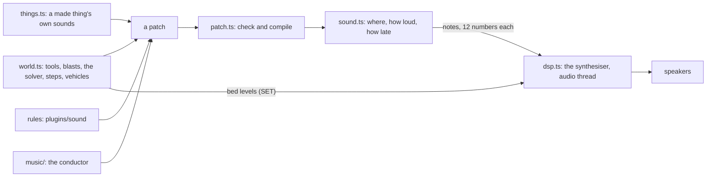
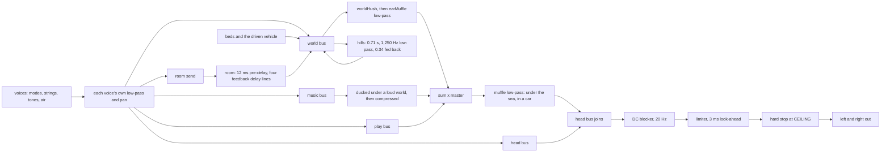
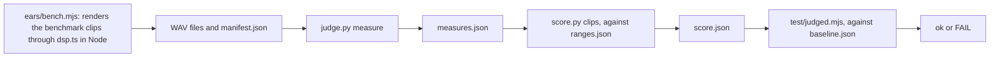

Nothing the engine plays is a recording. Every sound is computed sample by sample while it plays, by one synthesiser that runs in an AudioWorklet. What to play is described by a **patch**: a small JSON object that says what is struck, plucked, blown or rubbed and what the thing is. A model can write one, a rule can send one, and the world's own materials are written the same way.

The code lives in [engine/page/sound/](https://github.com/voxelwright/voxelwright/tree/main/engine/page/sound). The judge that scores how it sounds lives in [engine/ears/](https://github.com/voxelwright/voxelwright/tree/main/engine/ears).

## The picture



The main thread decides **what** and **where**. The audio thread decides **how it sounds**. They talk only through messages: a compiled patch under a number, a batch of notes, and levels to ease towards.

<Note>
These hold everywhere in the sound code:

- **A patch is data, never code.** `patch()` reads it as a stranger's: anything that is not exactly the form is refused with a reason, and every number has a range.
- **The ceiling is in the synthesiser, after everything.** No patch, level or bug can make output louder than `CEILING` (-1 dBFS). A sample that is not a number silences and resets the synthesiser.
- **Nothing is allocated on the audio thread after the constructor.** Voices come from fixed pools; a full pool gives up its quietest voice.
- **The sample rate is the device's.** Nothing may assume 48 kHz.
</Note>

## How it starts

`sound()` in [sound.ts](https://github.com/voxelwright/voxelwright/blob/main/engine/page/sound/sound.ts) makes one `AudioContext` with `latencyHint: 'interactive'`, loads `dsp.ts` as the worklet module and connects one `AudioWorkletNode` named `village-voice` straight to the output.

- Browsers only allow sound after a gesture. The context is resumed by the first `pointerup`, `touchend`, `click` or `keydown` anywhere (or immediately if `navigator.userActivation.hasBeenActive` is already true when deferred audio finishes starting), and again after a call, a lock or an app switch has stopped it. A touch going down is not enough; its coming up is.
- On an iPhone the ringer switch silences page audio unless the page says it is playing media, so `sound()` sets `navigator.audioSession.type = 'playback'` where it exists.
- The page suspends the context while it is hidden.
- The picture never waits for sound. [main.ts](https://github.com/voxelwright/voxelwright/blob/main/engine/page/main.ts) defers starting `sound()` until right after the first picture is drawn so `AudioContext` creation never blocks cold launch; a worklet that fails to load leaves a silent page, not a broken one.

`dsp.ts` has no runtime imports, so the same file runs in Node as `new Synth(rate).render(left, right)`. Sample-rate filter and envelope coefficients are precomputed in the constructor, and undriven modal resonators and unity-cutoff voices take fast paths. The checks and the benchmark render the exact code the page plays.

## A patch

{/* schema engine/page/sound/patch.ts How,Patch,Sounds */}
```ts
export type How = 'struck' | 'plucked' | 'blown' | 'rubbed';

export interface Patch {
    how: How;
    hard: number;
    rough: number;
    shape?: string;
    modes?: [
        number,
        number
    ][];
    pitch: number;
    ring: number;
    damp: number;
    where?: number;
    bend?: number;
    waver?: number;
    pieces?: {
        count: number;
        over: number;
        spread: number;
    };
    air?: {
        from: number;
        to: number;
        for: number;
        gain: number;
        q?: number;
    };
    gain: number;
}

export type Sounds = Partial<Record<(typeof ROLES)[number], Patch>> & {
    surface?: Surface;
};
```

The type is the shape. The rules are in `patch()`, the only reader:

| Key | Required | Range | Meaning |
| --- | --- | --- | --- |
| `how` | yes | `struck`, `plucked`, `blown`, `rubbed` | how it is set sounding |
| `hard` | yes | 0 to 1 | how hard the two things that meet are (felt 0.1, steel 1). Harder is a shorter touch and a brighter sound |
| `rough` | yes | 0 to 1 | grit in the touch, breath in a tone |
| `shape` or `modes` | exactly one | a shape name, or 1 to 12 `[ratio 1 to 40, loudness 0 to 1]` | what rings |
| `pitch` | yes | 20 to 8000 Hz | the lowest mode, for a piece about 30 cm across |
| `ring` | yes | 0.01 to 12 s | time for that mode to die away by 60 dB |
| `damp` | yes | 0 to 1 | how much sooner high modes die (metal low, wood high) |
| `gain` | yes | 0 to 1 | loudness of its own |
| `where` | no | 0 to 0.5 | where along it it is struck or plucked |
| `bend` | no | -2 to 2 octaves | starts off its pitch and settles (a drum skin up, a drop of water down) |
| `waver` | no | 0 to 1 | how much a held tone trembles |
| `pieces` | no | `count` 1 to 40, `over` 0.02 to 4 s, `spread` 0 to 1 | smaller pieces of the same stuff after the blow (breaking, gravel) |
| `air` | no | `from`/`to` 40 to 12000 Hz, `for` 0.01 to 6 s, `gain` 0 to 1, `q` 0.3 to 12 | a rush of noise sweeping between two pitches (a crash, a whoosh) |

The shapes are `bar`, `plate`, `bell`, `skin`, `string`, `tube`, `pipe`, `hollow`, `lump` and `cup`. Each is a list of mode ratios in `SHAPES`. A thing's `sounds` holds at most one patch for each of `hit`, `break`, `step`, `use`, `hum` and `play`, plus a `surface` when it is an instrument (`sounds()` refuses a surface with no `play`).

`compile()` turns a checked patch into numbers only: mode ratios and gains, a contact time from `hard`, and flags that pick the synthesis model. Only a patch that `patch()` passed may be compiled.

## From a patch to a note

`voice.play(patch, how)` is the one call everything uses. `how` can give a place (`at`, in cells), `force`, `size`, a `pitch` in Hz, a held `dur`, a delay, a `reach` and a bus.

1. **The patch gets a number.** The first time a patch object is played it is compiled and sent to the worklet under an id (at most 4,096). `forget(patch)` gives the id back; the page does this for patches strangers send, so they cannot use up the table.
2. **The place becomes numbers.** `hear(at, reach)` works out, from where the ears are:
   - loudness: half as loud at `reach` metres, fading to nothing at sixty times `reach`;
   - side: the pan grows from none at your feet to full at 1.5 m, so a thing beside you is all round you;
   - dullness: a low-pass at `400 + 19600 * exp(-metres / 90)` Hz, a little duller behind;
   - delay: metres / 343 s, so a far blast is heard after it is seen (`travels: false` turns this off);
   - room: more of a far sound goes to the reverb.
3. **The note is twelve numbers** (`NOTE` in `dsp.ts`): when (in frames of the audio clock), patch id, pitch, size, force, hold time, left gain, right gain, low-pass, room send, bus, and a last slot that marks a piece of something breaking or names a held note.
4. **Notes go once a frame.** `listen(eye, yaw)` moves the ears and sends everything asked for since. Notes on the play bus (an instrument under your fingers) and on the head bus (a spell's own sounds) are sent at once.

A held note (`hold()`) has a name, and `release()` lets it go: a tone dies away by its patch, a string or a struck thing is damped. While a held tone sounds, `glide()` bends its pitch and loudness and `place()` moves it. The worklet reports which named notes still sound once a second (`told.named`).

## Inside the synthesiser

A note starts on one of four fixed pools, chosen by its compiled patch. A fifth pool, grains, is used by the beds:

| Pool | Voices | Plays | Model |
| --- | --- | --- | --- |
| modes | 64 (up to 12 modes each) | struck things, plucked things that are not strings, rubbed things that ring | a bank of two-pole resonators excited by a contact pulse, or by noise for as long as it rubs |
| strings | 16 | a plucked `string` | a delay line with a loss filter in the loop (Karplus-Strong) |
| tones | 16 | anything blown, and a rubbed `string`, `tube`, `pipe` or `hollow` | a sine and a softened saw through a low-pass, with breath noise |
| air | 24 | a patch's `air` | noise through a band that sweeps from `from` to `to` |
| grains | 40 | drops of rain, cracks of fire, bubbles | short chirps the beds start by themselves |

When a pool is full the quietest voice gives way. A voice on the play bus is never taken for the world or the music, and neither is one on the head bus.

There are four buses (`BUS`): `world`, `music`, `play` and `head`. The head bus is for what is heard inside the head: the Cleave's and Time's own sounds. Three `SET` values act on the world bus alone and never reach the head bus: `worldHush` (0 none to 1 silent), `earMuffle` (a two-pole low-pass in Hz, 20,000 for none) and `hillGain` (how much of the world bus is sent to the hills). All three default to no effect, and with them at their defaults the synthesiser renders the same samples as before they existed.

**The hills** are one delay line a side, fed from the world bus: what is sent comes back 0.71 s later through a 1,250 Hz low-pass, and 0.34 of that goes round again. Their answer returns into the world bus, so it is hushed and dulled with the rest. The line is not run while nothing is sent and it has been silent for two trips.

**Beds** are not patches. Rain, wind, fire, surf, the sea overhead, rubble grinding, and the driven vehicle's engine (with its turbo and boost whine), tyres and road roll are code in `dsp.ts` that runs all the time at a level the page sets through `SET`. Every level is clamped to its own range where it is set (`LEAST` and `MOST`).



The limiter's look-ahead is why a key on an instrument leaves the synthesiser 3 ms after it is pressed. The head bus joins after the hush and both low-passes but before the limiter, so nothing on it can pass `CEILING` either.

## Where the world's sounds come from

[world.ts](https://github.com/voxelwright/voxelwright/blob/main/engine/page/sound/world.ts) `hearing()` turns what the page already knows into plays and bed levels. The page calls it; it never asks the page for anything.

| What happens | What is heard | Where |
| --- | --- | --- |
| A tool is used | the hammer plays the struck material's `HIT` and `BREAK` patches, a charge its `BREAK` alone; the torch, brick and cannon have their own; `Cleave` (and the older `Cutter`) plays `WORLD.cut` on what it met | `used()` |
| The Cleave, beat by beat | on the head bus: `cleaveAim` as the point is taken out; `cleaveDraw`, one held tone bent up as the stroke lengthens; on release `cleaveStrike` drawn and struck again 127 ms on, with the world bus hushed by 0.92 for 0.42 s; as the cut lands a boom in the head, concrete breaking out in the world, and the hills opened | `cleave(phase, intensity)` |
| Time stopped or wound back | the world bus hushed by 0.7 and dulled to 380 Hz for as long as it lasts; on the head bus the `rewind` patch as a deep stroke when time stops, a clock once a second while it stands and up to twelve times a second while it is wound back | `rewind(state, speed)` |
| A blast landing close | the world bus silent for 50 to 300 ms, the ears dull after (down to 700 Hz) and clearing over a few seconds, and the hills opened | `blastHush(strength)` |
| A blast | a crack for those near and a boom that carries, late by distance; a charge (10 cells and up) also opens the hills, more the nearer and bigger it is, so its boom comes back off them. A blast under 8 cells (the hammer) plays nothing here: the hammer is heard through `used()` | `blast()` |
| The solver's report | a living thing striking something (`told.struck`, with its speed and material): a person bumping a car or wall is silent at walking speed and plays a muted `bodyBump` when running, while vehicle impacts play damped `carBump`, `carCrunch` at speed and `BREAK.glass` on severe crashes (never ringing `HIT.steel`); loose bodies whose speed changed sharply play their five heaviest blows and fold the rest into the rubble's grinding bed | `told()` |
| Glass turning to dust | the glass `BREAK` patch | `told()` |
| Each frame | rain, wind (stronger with height and speed), fire (louder and closer with more flames nearby), surf (the sea looked for in eight directions), the sea overhead | `frame()` |
| Walking | a step every 75 cm with the eye at head height, hard, soft or loose by the ground's paving | `frame()` |
| Driving | engine, tyre and road beds from `drive()`, whose `boost` sets the turbo whine; one-shots from `carEvent()` (door, start, shift, pop, landing); damped collisions from `carCrash()`; a two-note `horn()` | called from `engine/page/living.ts`, through the hooks `main.ts` hands it |
| Driving fast past something | a pass-by whoosh, and the radio | `radio.ts`, below |
| A made thing | its own `hit` and `break` in place of its material's; one with a surface can be played | [things.ts](https://github.com/voxelwright/voxelwright/blob/main/engine/page/sound/things.ts) |
| A rule's sound | a kept word or the rule's own patch, placed where the rule says, or following someone | `sounded()`, `follows()` |
| Someone speaks | a voice, if the page asked for one | `spoke()` |

The world's own patches are in [kinds.ts](https://github.com/voxelwright/voxelwright/blob/main/engine/page/sound/kinds.ts): `HIT` and `BREAK` for each of the core's materials, and `WORLD` for sounds that are no material's (steps, the blast's crack and boom, tools, vehicle foley, and the Cleave's and Time's `cleaveAim`, `cleaveDraw`, `cleaveStrike` and `rewind`). A rule picks from a small kept set of words in [likes.ts](https://github.com/voxelwright/voxelwright/blob/main/engine/page/sound/likes.ts) (`bell`, `drum`, `horn`, `engine` and others), or sends a patch of its own. How a rule makes a sound, and its limits, is on [Engine plugins](/engine-plugins).

## Combat, lightsabers, ballistics and tennis

[combat.ts](https://github.com/voxelwright/voxelwright/blob/main/engine/page/sound/combat.ts) exports `COMBAT_PATCHES` (strict data patches validated by `patch.ts`) and `combatSound(voice)`, a self-contained foley controller that drives `dsp.ts` through the standard `Sound` interface without modifying the worklet:

| System | Patches | Controller methods & behavior |
| --- | --- | --- |
| Melee clash & parry | `parryClash`, `parrySparks` | `parryClash({ impulse, size, at })`: inharmonic steel-blade flexural/torsional modal ring (low metal loss factor) layered with high-impulse spark crackle bursts |
| Blade friction & blunt strikes | `bladeStab`, `bladeScrape`, `bluntHit` | `bladeStab({ force, dur, pullOut, material })` and `bladeScrape({ force, dur, speed })` drive noise-excited modal resonators (`how: 'rubbed'`); `bluntHit({ force, material })` plays a damped low-mid impact thud |
| Lightsaber / plasma blade | `saberIgnite`, `saberRetract`, `saberHum`, `saberHumHarmonic`, `saberSwing`, `saberClash` | `saberIgnite()` plays snap-hiss ignition and holds a continuous dual-oscillator warm plasma hum (`saberHum` + detuned `saberHumHarmonic`); `saberUpdate(speed, angularSpeed, clashing, at)` (aliased `updateSaber`) bends both oscillators with velocity-driven Doppler pitch and filter-brightness sweeps, triggers fast-swing air sweeps, and fires high-voltage plasma clash crackles; `saberRetract()` releases the hum with a descending retraction whine |
| Ranged ballistics & thermal laser | `bulletCrack`, `ricochet`, `shockwaveBoom`, `shockwaveCrack`, `shockwaveOccluded`, `laserSizzle`, `laserHum` | `bulletCrack({ speed })` plays a supersonic N-wave crack/whiz; `ricochet()` plays a fast downward-chirping metallic zing; `shockwaveBoom({ occluded })` layers an open-air shock crack with the boom or crossfades to a low-pass muffled sub-thump when occluded; `laserSizzle({ active, heat, dur })` and `laserStop()` run continuous or timed thermal laser hum and ablation sizzle |
| Tennis mini-game | `tennisPop`, `tennisFrame`, `tennisBounce`, `tennisNet` | `tennisBounce({ surface, velocity })` pitches the hollow-sphere court bounce by surface (`hard` > `clay` > `grass`); `tennisPop({ velocity, sweetSpot })` blends tight stringbed resonance at the sweet spot with a duller off-center frame-hit clank near the rim; `tennisNet()` snaps the net cord |

Every patch stays within `CEILING` (-1 dBFS) even when all systems fire together.

## Music

The place's music is off unless the page has `?music=1` (the car radio below is separate). It follows the place the ears are in, and is composed as it plays. [music/](https://github.com/voxelwright/voxelwright/tree/main/engine/page/sound/music) has four parts:

- `rules.ts`: named rules, each scoring a candidate pattern from 0 to 1 for one thing (a groove's syncopation, a melody's steps, coming back to a figure), each with its source. Cached Euclid/metre tables, per-candidate note-list reuse, and zero-allocation `judgeTotal` scoring keep candidate search fast without changing candidate selection.
- `compose.ts`: the moods (`town`, `coast`, `sea`, `snow`, `night`, `danger`, `making`), and the radio's three in `RADIO_MOODS`, all on the tonic D, so a change of place is a change of mode, never of key. For each voice it makes `TRIES` random patterns, scores them against that voice's rules and keeps the best.
- `worker.ts`: composes off the main thread, because a section takes several frames.
- `conductor.ts` and `perform.ts`: play sections on the audio clock a third of a second ahead, bring a piece in a layer at a time, and at a change of place hand over at the next bar line. No piece is played twice; calm places rest between pieces.

`world.ts` picks the place in this order: danger (blasts, many falling bodies or a large fire nearby), making, under the sea or very high, snow, night, coast, town. A realm's rule can set the mood, mode, pace and drive instead (`plugins/music`, read by `tuned()`).

## In a car

Three things change while you drive.

**The cabin.** In the driver's seat (V), `world.ts` sets the muffle low-pass to 3,400 Hz instead of 20,000 and the cover to 0.45, so rain, wind and surf play at 55%. Wind is cut by a further 40%. The muffle applies to the synthesized mix, including the FM stations.

**The radio.** `radio.ts` plays four stations in turn on N (`STATIONS`): Radio Off, Bay Drive FM (synthwave, 116 BPM, Dorian), Twin Peaks Chill (Rhodes lo-fi, 86 BPM, Lydian, swung) and Fillmore Funk (funk bass and brass stabs, 108 BPM, Mixolydian). Each is a mood in `RADIO_MOODS`, composed by the same rules and search as the place's music. They are kept out of `MOODS`, which realm rules and the benchmark read, and `resolve()` finds both. The radio has a conductor of its own that plays pieces with no rest between them. A change of station plays a dial click and, on a station, a burst of static, then cuts to the new mood (`cut()` in `conductor.ts`). While a station plays, the place's music is paused.

- The horn ducks the radio by 60%. A hard landing or a crash ducks it for a moment. It never drops below 32%, and it comes back slowly.
- Getting out turns it off. Getting back in brings the last station back after 0.42 s.
- It starts on Bay Drive FM for a person and off when `navigator.webdriver` is set, unless `?radio=` says otherwise.

Open the picker with R while driving, the touch Radio button, or Radio in settings. YouTube plays through its embedded player. Spotify and Apple Music are behind `?radio_providers=all` and require provider configuration. The horn and crashes also duck streaming audio. While driving, `pwa.ts` mirrors the active station or streaming track to `navigator.mediaSession` so lock screens, Control Center and hardware media keys control playback and station or track changes.

**Pass-by whooshes.** Above 70 km/h, a `whoosh` patch (a band of noise sweeping from 2,800 Hz down to 260 Hz) and a lower `whooshTail` 55 ms later are played on the side something passes. They are triggered three ways:

- every 55 ms the radio looks 2.6 m and 4.6 m to each side, 1 m ahead, for a solid cell, and plays when one side becomes solid, at most every 0.36 s a side;
- another living vehicle within 1.4 to 7.5 m to the side and 5.5 m along, once a vehicle every 0.9 s;
- the street's `voxelwright:nearmiss` event, panned to where it happened and louder the closer it was.

A faster pass is higher, and a faster or closer one is louder. It is a played sweep, not a pitch shift of the passing thing's own sound: nothing in the engine is Doppler-shifted.

## Instruments and voices

An instrument is a made thing whose `sounds` hold a `play` patch and a `surface`: a flat layout of parts, each a rectangle, oval or polygon that sounds a note, is a string, sets a chord, strums, or slides between two pitches. Parts that do none of these are drawing. [surface.ts](https://github.com/voxelwright/voxelwright/blob/main/engine/page/sound/surface.ts) is its form and only reader:

{/* schema engine/page/sound/surface.ts Part,Surface */}
```ts
export interface Part {
    shape: 'rect' | 'round' | 'poly';
    at?: [
        number,
        number,
        number,
        number
    ];
    points?: [
        number,
        number
    ][];
    colour?: string;
    label?: string;
    key?: string;
    note?: number;
    slide?: {
        to: number;
        along: 'x' | 'y';
    };
    level?: 'x' | 'y';
    string?: number;
    chord?: number[];
    strum?: number;
}

export interface Surface {
    size: [
        number,
        number
    ];
    release?: 'rings' | 'stops';
    parts: Part[];
}
```

`instrument.ts` draws it as SVG from those numbers and names (a colour is a name from `COLOURS`, a label is at most six plain characters), never from markup a model wrote. Walk within 4 m of one and press E or the button to play it by keys or touch; Escape or E puts it away. `instruments.ts` keeps three: a guitar, an ocarina and a piano.

What people say has no voice unless the address asks for one. In a shared world, `?voices=babble` sounds speech as wordless syllables in the synthesiser, placed where the speaker stands, and `?voices=speech` uses the browser's own speech synthesis, which is not placed and bypasses the synthesiser.

## Switches

| Query parameter | Effect |
| --- | --- |
| `?sound=0` | no sound at all |
| `?music=1` | the place's music |
| `?voices=babble` or `?voices=speech` | a voice for what people say (shared world only) |
| `?radio=0`, `?radio=1`, `?radio=baydrive`, `twinpeaks` or `fillmore` | the car radio's first station: off, Bay Drive FM, or the one named |

## Add a sound

<Steps>
<Step title="Write the patch">
A material or world sound goes in `kinds.ts`, a word rules can ask for goes in `likes.ts`, and a made thing's sounds go in its record's `sounds`. To have a model write a thing's sounds, `voice.mjs` asks your own Claude Code with the brief in `brief.ts` and checks the reply with `sounds()`:

```sh
cd engine
node voice.mjs "a kalimba" --out kalimba.json
```
</Step>
<Step title="Play it from where it happens">
Call `voice.play(patch, { at, force, size, reach })` from `world.ts` or the code that knows the event. For a sound that lasts, use `hold()` and `release()`, or a new bed level in `SET`.
</Step>
<Step title="Listen">
Run `npm run serve` in `engine/` and open `http://127.0.0.1:5740/page/sound/lab.html`. The lab plays every sound by hand, takes a patch of your own, and shows what is sounding and what the audio thread costs.
</Step>
<Step title="Check">
Run the checks below. A new word in `likes.ts` must also be written into `plugins/sound/guide.txt`, or the sound plugin's check fails. A new `SET` level needs its slot in `SET`, `SETS`, `LEAST`, `MOST` and the constructor's starting levels. A new benchmark clip changes the baseline: accept it on purpose.
</Step>
</Steps>

## Judged with nobody listening

The agents that build the engine cannot hear it, so a judge scores it instead. It renders fixed clips, measures them, and compares each measure with the range that well-made reference audio of the same kind lies in.



- **The clips** are what the engine plays: steps, blows on each material, breaks, blasts, kept words, held tones, beds, the three instruments, each mood's music from two seeds, a handover between places, and three mixes of music with the world over it. Each mix is also rendered as world alone and music alone. The seeds are fixed, so a different result is the change's own.
- **The measures** ([measures.py](https://github.com/voxelwright/voxelwright/blob/main/engine/ears/measures.py)) are numbers an ear would name: loudness and its range, peak to loudness, stereo width, spectral balance in bands (sub, bass, mud, harsh, air), sharpness, roughness, beating, attack and decay times, how many partials ring, and for music its pulse, key clarity, onsets and whether it comes back to a figure. Timbre is measured with the clip brought to -23 LUFS, so no measure is loudness in disguise.
- **The ranges** ([ranges.json](https://github.com/voxelwright/voxelwright/blob/main/engine/ears/ranges.json)) are the 5th to 95th percentile of each measure over reference recordings, grouped by kind (impact, step, break, blast, one-shot, bed, music, instrument and others). The recordings stay outside the repository; only the ranges are kept, so the check needs no reference audio.
- **The score** of a clip is 100 less the mean cost of its measures (a measure outside its range costs how far out it is, in range widths, up to one), less 25 for each hard fault: clipping, DC offset, or a world event buried under the music. Each fault is printed in words, such as "thin: no low end".
- **The gate** ([test/judged.mjs](https://github.com/voxelwright/voxelwright/blob/main/engine/test/judged.mjs)) fails on any hard fault, on a measure newly outside its range, on a clip more than 1.5 below its accepted score, or on a mean more than half a point down. `--accept` writes the new scores to `baseline.json`; say in the pull request what moved.

Commands, setup and every file are in the [ears README](https://github.com/voxelwright/voxelwright/blob/main/engine/ears/README.md). How the measures were proven, and what they cannot see, is in the [sound-judge skill](https://github.com/voxelwright/voxelwright/blob/main/.agents/skills/sound-judge/SKILL.md).

## Checks

All seven are in `npm run check` in `engine/`. To run one:

```sh
cd engine
node test/sound.mjs     # Node only
node test/music.mjs     # Node only
node test/judged.mjs    # Node and uv
node test/heard.mjs     # the installed Chrome
node test/played.mjs    # the installed Chrome
node test/sounded.mjs   # the real server and Chrome
node test/radio.mjs     # Node, then the installed Chrome (--node-only for Node alone)
node test/sound-combat.mjs # Node only: offline DSP checks for combat, lightsabers, ballistics, and tennis
node test/listen.mjs --out clip.webm   # not a check: records picture and sound together
```

| Check | What it proves |
| --- | --- |
| `sound` | patches do what their words say (steel rings longer than brick, a bigger piece is lower, strings are in tune), the form refuses what is not a patch, nothing passes the ceiling, and what a block costs |
| `sound-combat` | every combat, lightsaber, ballistic, and tennis patch validates as strict data, renders non-silent output under `CEILING` with zero NaN/Inf, and hits its spectral/modulation checks (`parryClash` brighter than `bluntHit`/`shockwaveBoom`, `saberUpdate` Doppler pitch/brightness modulation, open vs occluded shockwave, sweet-spot vs rim tennis pop) |
| `music` | the rules measure what they say, the search beats chance, every note is in the mood's scale, a handover leaves no hole and no click |
| `judged` | the judge, above |
| `heard` | the real page with its sound tapped as it leaves the synthesiser: what the page does makes the sound it should, when it should, as loud as it should |
| `played` | the lab with real keys and touches: a key sounds the right note soon, a held note lasts as long as the key, a piano key let go is damped |
| `sounded` | a rule's sound on the real server and page: placed where the rule put it, late by distance, and what no rule should send is not heard |
| `radio` | each station composes in scale with no gap and stays under the ceiling, the tuning sounds and whooshes are bounded, a whoosh is silent below 70 km/h, pans to its side and sweeps down; in Chrome, N cycles stations, the name shows and fades, the station is remembered, the horn ducks it, and the near-miss event whooshes |

`listen.mjs` records a clip for someone who was not there; it measures nothing. No check can say whether a hammer on brick sounds like one. That is what the lab is for.

The [game-sound skill](https://github.com/voxelwright/voxelwright/blob/main/.agents/skills/game-sound/SKILL.md) holds the sources, measurements and limits behind all of this. The kit's interface cues in `engine/kit/src/core/sound.js` (recorded switch clicks and a few short synthesized cues) are separate from this engine; see [the kit](/kit).
