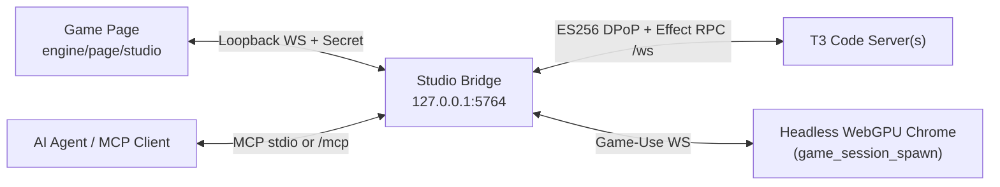

Voxelwright Studio (`engine/studio/` and `engine/page/studio/`) embeds a native T3 Code client, an extensible Game-Dev IDE, and a Game-Use MCP control plane (`voxelwright-game`) directly inside local development sessions. Public `voxelwright.world` static builds carry zero bytes of Studio code.

## Architecture



- **Studio Bridge (`engine/studio/bridge.mjs`)**: loopback-only local daemon (`127.0.0.1:5764`) with per-launch `X-Studio-Secret` auth, foreign-origin rejection, CORP-safe T3 asset proxying (`/studio/api/t3/asset` for COEP pages), voice transcription, binary attachment upload, worktree WebAssembly hot-swap, and Streamable HTTP `/mcp`.
- **T3 Protocol Client (`engine/studio/t3-client.mjs`, `engine/studio/dpop.mjs`, `engine/page/studio/transport.ts`)**: speaks T3 Code's wire protocol natively — local server discovery (`~/.t3/userdata/server-runtime.json`), CLI pairing, RFC 9449 ES256 DPoP token exchange, `/api/auth/websocket-ticket/rpc`, and Effect RPC JSON over `/ws?orchestrationProtocol=2&frameParts=1` (including `\u001e` multi-part frame reassembly). Also supports direct browser-to-T3 mode over WebCrypto when no local bridge is running.
- **Game-Use Control Plane (`engine/studio/game-hub.mjs`, `engine/studio/session-control.mjs`, `engine/studio/mcp.mjs`)**: exposes 19 core `game_*` MCP tools plus dynamic extension tools over both live user browser tabs and spawned headless WebGPU Chrome sessions.

## Start Studio locally

```sh
npm run dev      # runs engine/serve.mjs --studio (:5740) + Studio Bridge & MCP (:5764)
```

Open `http://127.0.0.1:5740/city`. The page loads Studio automatically and discovers the loopback bridge via `GET /studio/bootstrap` (or you can run `npm --prefix engine run serve` and `npm --prefix engine run studio` in separate terminals and open `/city?studio=1`). When opened with `#studio=...&secret=...`, the page stores the session secret in `sessionStorage` and strips it from `location.hash` immediately.

## One-gesture bug capture & fast QA loop

- **`F9` — Bug in View**: freezes the live WebGPU frame into an annotation canvas (Pin + 3D ray-pick, Box, Freehand Pen, optional Raymarch Heatmap), attaches structured T3 `UnknownContextRecord`s (`game-frame`, `game-pick`, `game-timeline`, plus extension collectors) and PNG uploads, and launches an isolated worktree thread in T3 Code.
- **`F10` — What Just Happened?**: captures the last 30 s `engine.recorder` flight-recorder trace, passive anomalies, and optional rolling 15 s WebM clip into a T3 fix thread.
- **Auto-Catch Faults & Playtest Mode**: watches WebGPU faults and high/critical `engine.recorder` anomalies to offer a one-click fix toast; Playtest Mode records voice-dictated bookmarks, toggles 3D spatial thread pins via `hud.cue()`, and dispatches fixes without leaving the game.
- **Verify Fix Here**: in **Review & Verify**, hot-swaps a fix worktree's built core WebAssembly binary live via `engine.recore()` (or opens its preview server), displays an interactive **Before / After** split-wipe and blink comparator, and generates a runnable `engine/test/<slug>.mjs` regression check.

## T3 Code iOS parity inside the game

Press `F2` or `Cmd/Ctrl+Shift+I` to toggle the dockable Studio IDE drawer (Right Drawer, Wide Split, or Bottom Dock) with six views:

1. **Threads**: Active, Inbox, Pinned, Settled, and Archived threads, live search, `+ New Task` (project, worktree, runtime & interaction modes), streaming messages & command output, clickable `game-*` bookmark teleport chips, message queue controls, voice dictation, and interactive Approval / User-Input / Secret request cards.
2. **Review & Verify**: Live worktree verification, Before/After comparator, regression test generator, unified thread diffs, workspace file browser, and Git/VCS controls.
3. **PRs & Issues**: Open PR list, AI Review Guide, approve/merge actions, and issue list with one-click task creation.
4. **Playtest & Tools**: Playtest session controls, shared human/agent control lease, live PTY terminal, preview tabs, mobile simulators, and connected Game-Use sessions.
5. **IDE Lab**: Dynamic host for registered `StudioExtension` panels and quick-launch playbooks (`Voxel Pick`, `Render Lab`, `City & Tiles`, `Sound Lab`, `Workshop`).
6. **Envs & Ops**: Multi-environment auto-connect and pairing, workflows, scheduled cron tasks, and usage summary.

## Game-Use MCP (`voxelwright-game`)

`voxelwright-game` (`node engine/studio/mcp.mjs`) is enabled by default for subsequent agent sessions across Claude Code (`.mcp.json` + `.claude/settings.json`), Antigravity (`.agents/plugins/voxelwright-game/mcp_config.json`), and Codex (`.codex/config.toml`). Any MCP-capable agent (including agents spawned by T3 Code) can drive either a freshly spawned headless WebGPU Chrome session or a live user tab once the player clicks **Let Agent Drive**:

- **Live safety (`SessionControl`)**: read-only tools (`game_status`, `game_snapshot`, `game_frame`, `game_pick`, `game_perf`, `game_flight_recorder`, `game_assert`) never interrupt play. Mutating tools (`game_camera`, `game_act`, `game_world`, `game_debug`, `game_eval`) are blocked whenever a human controls a live tab, and any live key press or `Esc` instantly takes control back and invalidates in-flight agent turns.
- **Extensible tools**: plugins calling `engine.studio?.registerExtension({ id, panels, collectors, gameTools, actions })` automatically expose new panels in **IDE Lab**, extra context records on `F9`/`F10`, and live `game_ext_<ext>_<tool>` MCP tools.

## Check

```sh
cd engine
npm run typecheck
node test/studio.mjs
```
