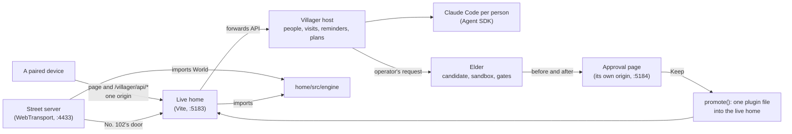

Village was the project's first product: a private 3D home for a family, where each person talks to their own villager, and an agent called the Elder writes changes to the home that a person keeps or turns down. A shared street grew out of it. The home, its host and the street are all paused, and active work is in [the engine](/engine). The code of all three still builds and its checks still run, so they are a working reference for ideas the engine has not taken yet.

## The parts

| Part | What it did | Folder |
| --- | --- | --- |
| **The home** | A painterly kitchen and living room in three.js (WebGPU, WebGL2 fallback). Every scene piece is a Cordis plugin that unloads cleanly. Objects are the menu. A held notepad takes typed lines. Build mode edits the floor plan, everything drawn is a physics body (Jolt), and toys like a pinball table are data. | [home/](https://github.com/voxelwright/voxelwright/tree/main/home) |
| **The villagers** | One Claude Code agent per person on the operator's login, with notes, reminders, a checked persona, and visits to other people's villagers that see only the persona. | [host/](https://github.com/voxelwright/voxelwright/tree/main/host) |
| **The Elder** | Turns a request into a candidate copy of the home with one new plugin file, gates it in a sandbox, and promotes it into the live home only after a person approves it on a separate page. | [host/](https://github.com/voxelwright/voxelwright/tree/main/host) |
| **The street** | One San Francisco block shared over WebTransport, running the home's physics `World` in a Node process. Making by typing, problems judged by the world, and agents as residents through an MCP door. | [street/](https://github.com/voxelwright/voxelwright/tree/main/street) |
| **The physics bench** | The comparison of Rapier, Jolt and a custom solver that chose Jolt. | [home/bench/physics/](https://github.com/voxelwright/voxelwright/tree/main/home/bench/physics) |

## How it connected

- `npm run village` in `host/` runs the daily home: it installs a live copy of `home/` from the current commit, starts the villagers and the Elder, and serves the live home with the villager API on one origin. The approval page is served on the next port, a different origin.
- A device joins by a one-time pairing link that becomes an HttpOnly cookie for one person on one host name.
- A notepad line goes to a router that names its route (talk, furnish, build, theme, physics, elder and others). The page acts only on what the person's own words named.
- When the Elder's change is kept, the live home loads the new plugin into the open page without a reload. Undo rolls it back by recorded hashes.
- The street imports the home's physics `World` directly. House No. 102's door leads into the home, and the home shows a door back out.

## Status

| Part | Builds | Checks |
| --- | --- | --- |
| Home | `npm --prefix home run build` | 35 checks in the root runner, most opening a page. See the [home README](https://github.com/voxelwright/voxelwright/blob/main/home/README.md#checks). |
| Host | `npm --prefix host run typecheck` | 13 checks. Six are local-only, four of them because they use the macOS sandbox, and `host-regressions` is skipped as flaky. |
| Street | `npm --prefix street run typecheck` | 12 checks, all local-only: CI does not install `street/` yet, and the page checks miss their time bounds in software WebGL. |

The names are in the [check list](/checks). Run them with `npm run check -- --only <name>` from the repository root.

<Warning>
Village's privacy boundaries are host code choosing what to read. Every villager runs as the same OS user on the operator's subscription, so they do not isolate family members. Use synthetic people with it.
</Warning>

## Ideas worth keeping

These are the ideas from Village that the engine does not have yet, with where each one lives.

1. **Candidate, gates, separate approval, hashed promotion.** A model's change reaches a running world only after out-of-page gates pass and a person approves it on a page no model code shares. See `host/src/run.ts`, `host/src/plugins/home-checks.ts`, `host/src/approval.ts` and `host/src/promote.ts`.
2. **Devices paired to people.** One-time links, HttpOnly per-host cookies, hashes at rest, same-origin requests only. See `host/src/pairing.ts`.
3. **Reminders with one owner of state.** `transition()` is the only way a reminder changes. Time settles when someone reads, and a missed reminder arrives marked late. See `host/src/reminders.ts`.
4. **Personas as checked data, visits that see only the persona.** A villager's character is bounded fields, and who it talks to comes from profile config no model can write. See `host/src/persona.ts` and `host/src/villager.ts`.
5. **Warm agents.** One long-lived process per person gets the first words out fast. See `warmAgent` in `host/src/villager-agent.ts`.
6. **Toys as data.** Parts, gadgets with knobs and wires make a pinball table without game code. See `home/src/engine/toy.ts` and `home/src/physics/toys/pinball-table.ts`.
7. **One rule makes everything a body.** Material and motion live as data on the drawn object. See `home/src/physics/home.ts`.
8. **The home is the menu.** Objects in the world are the interface, with full keyboard reach. See `home/src/plugins/entries.ts`.
9. **Problems judged by the world, agents as residents.** A goal is a test on real bodies, never a model's verdict, and an agent sits down through an MCP door with intent-level verbs. See `street/src/problems.ts` and `street/src/agents.ts`.
10. **A performance gate against the base.** Base and head are measured side by side with GPU time from timestamp queries. See `home/scripts/perf-gate.mjs`.

The engine already took two of Village's ideas in its own form: model output treated as data and run in a QuickJS sandbox ([making](/making)), and a gap in what a model could do sent to a development session that opens a pull request (the workshop, `engine/workshop/`).
