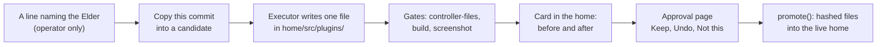

# Village host

> **Paused prototype.** Active work is in the [engine](../engine/README.md). This folder still builds and its checks run.

The host is the Node side of Village, built from Cordis plugins like the home. It serves each person's villager (a Claude Code agent on the operator's login, with notes and reminders), pairs devices to people, keeps the shared house plan, and runs the Elder: a sentence in, a checked candidate change to the home out, kept only when a person approves it on a page of its own. The [Village guide page](../guide/village.md) shows how it connects to [the home](../home/README.md) and [the street](../street/README.md).

## Run

```sh
npm install
npm run typecheck
```

| Command | What it does |
| --- | --- |
| `npm run village` | The daily home: installs the live copy if missing, starts the villagers and the Elder, serves the live home on `127.0.0.1:5183` and the approval page on the next port. |
| `npm run village -- link <person> [--add] [--url <address>]` | Prints a one-time pairing link (valid a day). Without `--add` it ends that person's other devices. |
| `npm run village -- unlink <person>` | Ends every device and unused link of that person. |
| `npm run village -- status` | The live copy, each person's paired sessions and codes, and the launchd service, as JSON. |
| `npm run village -- service install\|uninstall\|status\|plist` | A launchd agent (`dev.village.home`) that keeps `village` running with the options given. `plist` prints it without writing it. |
| `npm run villager` | The villagers alone on `127.0.0.1:5190`, behind the home's dev server (`npm run dev` in `home/`). |
| `npm run elder -- "<request>"` | One Elder run from the terminal into `~/.village/candidates/<id>/`. |
| `npm run elder -- promote <candidate-id> --approve` | Put a passed candidate into the live home. |
| `npm run elder -- rollback [promotion-id\|last]` | Take a promotion back out. |
| `npm run live -- install\|serve\|status` | The live copy of `home/` on its own, without the villagers. |

Common options for `village` and `villager` (all in `src/villager-cli.ts`): `--root` (default `~/.village`), `--agent warm|claude|stub`, `--model` (default `haiku`), `--operators` (default: the first listed person), `--elder-executor`, `--elder-per-hour` (default 6), `--approval-port`, `--approval-url`. `VILLAGER_PEOPLE=alex:Alex:adult:en,leo:Leo:child` lists the household; without it `village` uses the home's cast (Alex, Sam, Mia) and `villager` uses Alex alone.

From a phone over the tailnet, the home and the approval page each need a served port. The owner sets these up; this repository does not change `tailscale serve`:

```sh
tailscale serve --bg --https=8443 http://127.0.0.1:5184
npm run village -- --url https://<this mac>.<tailnet>.ts.net/ --approval-url https://<this mac>.<tailnet>.ts.net:8443/
```

## How an Elder request becomes a change



1. **Copy.** The checkout's current commit goes to `~/.village/candidates/<id>/repo` (uncommitted changes are not copied). `npm ci --ignore-scripts` runs under the sandbox with only the npm registry reachable.
2. **Write.** One executor edits the candidate with fixed instructions: one new file in `home/src/plugins/`, nothing else. `claude-code` runs `claude -p --model sonnet` with `--tools Read,Edit,Write,Glob,Grep` (no Bash, so it cannot run scripts it rewrote) and an empty strict MCP config. `codex` registers only with `ELDER_ALLOW_CODEX=1`. The default timeout is 6 minutes.
3. **Gate** (`src/plugins/home-checks.ts`). `controller-files`: everything outside `home/src/plugins/` is byte-identical, so the kernel, configs and scripts later checks run are the base versions. `build`: `tsc --noEmit` and `vite build` under the sandbox. `screenshot`: no page errors, not blank, and more than 0.05% of pixels changed from the base render. `plugin-lifecycle` runs in the page the plugin shares, so it is a warning only.
4. **Approve.** Keep, Undo and Not this happen only on the approval page (below).
5. **Promote** (`src/promote.ts`). Only paths matching `^home/src/plugins/[\w-]+\.ts$`, only if the working tree, the commit's blobs and the hashes recorded at check time agree, and only into a live copy with no uncommitted changes. It writes the committed blobs, appends to `promotions.jsonl` and commits. Rollback refuses when a promoted file no longer has the hash the promotion gave it. A lock file makes a second promotion at the same time a refusal.

The served live home picks up a new or deleted plugin file without a page reload (`src/live-vite.ts`). `<root>/elder/runs.jsonl` records every run; a run cut off by a stop or crash is recorded as interrupted and never kept or run again.

## Folder map

| Path | What it holds |
| --- | --- |
| `src/village.ts`, `src/villager-cli.ts` | The `village` and `villager` commands and their options. |
| `src/villager.ts` | The villager HTTP API: people, visits, routes, props, plans, reminders, pairing. |
| `src/villager-agent.ts`, `src/villager-voice.ts`, `src/persona.ts` | Agent turns through the Claude Agent SDK, the system prompt, personas and their checks. |
| `src/villager-input.ts` | The router (which route a line takes) and the prop maker. |
| `src/villager-make.ts` | The villager generator: writes `persona.json` and `voice.json`. |
| `src/reminders.ts`, `src/notes.ts`, `src/plans.ts`, `src/sketch.ts` | Reminders, the villager's notes, house plan versions, sketches. |
| `src/pairing.ts` | Device pairing and sessions. |
| `src/elder.ts`, `src/run.ts`, `src/candidate.ts`, `src/sandbox.ts`, `src/plugins/` | The Elder: registries, a run, the candidate copy, the sandbox, executors and gates. |
| `src/elder-home.ts`, `src/approval.ts`, `src/approval-server.ts`, `approval/` | The Elder from inside the home, the approval rule and its page. |
| `src/promote.ts`, `src/live.ts`, `src/live-vite.ts` | Promotion, rollback and the live copy. |
| `test/` | Checks and benches. |

## Checks

```sh
cd .. && npm run check -- --only host-villager host-approval host-reminders
```

Names that run in `host/` (from `scripts/checks.mjs`): `host-typecheck`, `host-regressions`, `host-villager`, `host-plans`, `host-promote`, `host-reminders`, `host-file-lock`, `host-stop`, `host-approval`, `host-physics-prompt`, `host-village`, `host-elder-home`, `host-daily-home`. The Elder's gates use the macOS Seatbelt sandbox, so `host-promote`, `host-elder-home` and `host-daily-home` run only on the Mac. Each check is also a script in `package.json` (for example `npm run check-villager`). With a real model, `npm run check-daily-home -- --real` runs the daily flow with the real villager, router and Elder on the operator's login.

## Boundaries the code enforces

- **Pairing** (`src/pairing.ts`). `link` mints a one-time code that becomes a session in an `HttpOnly; SameSite=Strict; Path=/villager/api` cookie that lasts 400 days. At rest, `<root>/villager/pairing.json` (mode 0600) holds only SHA-256 hashes, compared in constant time. A session belongs to the host name it was paired on, and each home's cookie has its own name.
- **People.** A session opens only its own person's paths (`/people/<id>/…`); any other id is 403. Every API request must be same-origin (`Sec-Fetch-Site`, or a matching `Origin`).
- **Visits.** Talking with someone else's villager is an explicit visit under your own id. It reads only the owner's `persona.json`, writes only under the visitor, and never has reminder tools or routing.
- **Operators.** Only people named by `--operators` may ask the Elder. One run at a time, and at most `--elder-per-hour` runs in a rolling hour, counted from `runs.jsonl` so a restart does not reset it.
- **The Elder's sandbox** (`src/sandbox.ts`). Candidate-influenced tools run under `srt` (Seatbelt): reads denied under the real home and temp directories except the candidate, keychains and `.env` files denied everywhere, writes only to the candidate's `home/` and a temp directory, no network except the npm registry for the install or loopback for the preview. Chrome cannot run under `srt`, so it runs with its own sandbox and a proxy that refuses everything but the preview.
- **Approval** (`src/approval.ts`). The live home runs promoted, model-written plugins, so it can never approve. Keep, Undo and Not this are accepted only on the approval server's own origin, from an operator's session, as JSON, naming the run the page showed. That page is static files from this repository under `default-src 'none'` with no framing. On the terminal the approval is the person's own `--approve`. Nothing a model or candidate writes counts.
- **Model output is data.** Personas are checked on every turn and refused if they contain instruction-like words. The humour ceiling is computed by host code from the operator's profile, and words in a talk can only lower it. Router replies are checked field by field.

These boundaries are host code choosing what to read. Every villager runs as the same OS user on the operator's subscription, and session transcripts land in the operator's `~/.claude/projects/`. That is not isolation between family members.

## Ideas to carry forward into the engine

1. **Candidate, gates, separate approval, hashed promotion and rollback.** Model-written changes reach the running world only through a person on a page no model code can touch: `src/run.ts`, `src/plugins/home-checks.ts`, `src/approval.ts`, `src/promote.ts`.
2. **Gates that read the output, not the author's word.** Out-of-page gates decide; in-page evidence only warns: `src/plugins/home-checks.ts`.
3. **Devices paired to people.** One-time links, HttpOnly per-host cookies, hashes at rest, same-origin only: `src/pairing.ts`.
4. **Reminders with one owner of state.** `transition()` is the only way a reminder changes; time settles on read, and a missed one arrives marked late: `src/reminders.ts`.
5. **Personas as checked, household-visible data.** Character comes from bounded fields; who the villager talks to comes from trusted profile config the model cannot write: `src/persona.ts`, `src/villager-voice.ts`.
6. **Visits that see only what is meant to be shared,** with every write under the visitor: `src/villager.ts`.
7. **Warm agents.** One long-lived Claude Code process per person makes the first words arrive fast; the stored session id stays the truth: `warmAgent` in `src/villager-agent.ts`.
8. **A router whose output is data.** One cheap call names the intent, checked field by field, and the page still acts only on the person's own words: `src/villager-input.ts`.
