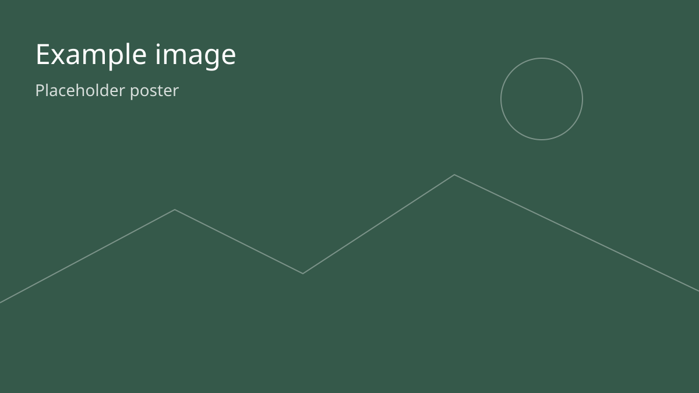

This post is synthetic placeholder text for testing the build. It exercises every element the site supports and says nothing about anyone's views.

## A second-level heading

Lorem ipsum dolor sit amet, consectetur adipiscing elit. Here is [a relative link to the blog index](../) and [an external link](https://example.org/). Some `inline code` sits in this sentence.

### A third-level heading

- A first list item
- A second list item with **bold** and *italic* text
- A third list item
  1. A nested ordered item
  2. Another nested item

> A plain blockquote. Placeholder text only.

## Code

```ts
type Post = {
  title: string;
  date: string;
  tags: string[];
  draft: boolean;
};

export function published(posts: Post[]): Post[] {
  return posts.filter((post) => !post.draft).sort((a, b) => b.date.localeCompare(a.date));
}
```

## An image



## A model note

<model-note model="Example Model 1" maker="Example Lab">
This is placeholder text standing in for a model's words. It renders as an attributed aside, visibly separate from the author's writing.

A second paragraph, with [a link](https://example.org/) and `code`.
</model-note>

## An engine scene

<engine-scene src="scene.json" poster="scene-poster.svg" alt="A blue placeholder still standing in for an interactive engine scene."></engine-scene>

## A model comparison

<model-compare before="before.glb" after="after.glb" poster="compare-poster.svg" alt="A purple placeholder still standing in for a before-and-after model comparison."></model-compare>

## Embeds inside code stay as text

```html
<engine-scene src="scene.json" poster="poster.png" alt="Shown as code, not rendered."></engine-scene>
```
